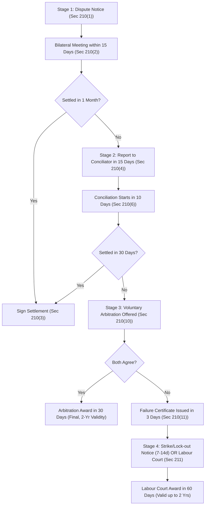

[← Previous: L11.1: Collective Bargaining and CBA (Section 202)](L11.1_Collective_Bargaining_and_CBA_Sec_202.md) | [🏠 Index](00_Index.md) | [📐 Master Sheet](99_Master_Formula_and_Statutory_Sheet.md) | [Next: L12.1: Unfair Labour Practices (Sections 195 and 196) →](L12.1_Unfair_Labour_Practices_Sec_195_and_196.md)

---

# L11.2: Industrial Disputes and Settlement Ladder (Section 210)

> [!info] ⚡ Exam Snapshot
> - **Section & Priority:** Section A · Shoaib Islam Sir · 🔴 Essential (Shoaib Sir Applied Lock)
> - **Estimated Read Time:** ~5 mins
> - **PYQs Covered:** 2024 Final Q.8(a) Part 1 (01m), 2024 Final Q.3(c) (Hypothetical Dispute Scenario & Settlement Steps, 04m)
> - **Scoring Rule:** State the 4-stage settlement ladder with exact timelines (15d-1m-15d-10d-30d-3d-30d-15d-7/14d-60d) and use the 4-step framework for applied scenarios.

---

## 📌 1. Verbatim Definitions (For 2-Mark Questions)

> **Industrial Dispute [BLC 2006, Sec 2(62)]:** "any dispute or difference of opinion between employers and employers, between employers and workers or between workers and workers in respect of appointment or conditions of service or conditions of work or environment of work of any person." *(BLC 2006, Section 2(62))*

*Plain meaning:* A formal disagreement between bosses and workers about jobs, wages, working hours, safety gear, or factory rules.

> **Lock-out [BLC 2006, Sec 2(57)]:** "the closing of a place of work or a part of such place, or the suspension of work therein, wholly or partly, by an employer, or refusal, absolute or conditional, by an employer to continue allow to work by any number of workers employed by him, where such closing, suspension or refusal occurs in connection with any industrial dispute or is intended for the purpose of compelling workers to accept certain terms and conditions of employment." *(BLC 2006, Section 2(57))*

*Plain meaning:* The boss shuts the factory gates or bans workers from entering. The goal is to force workers to accept company terms during a dispute.

> **Strike [BLC 2006, Sec 2(22) & SI Sir Notes · Chapter 4]:** "cessation of work by a body of persons employed in any establishment acting in combination or a concerted refusal, or refusal under a common understanding of any number of persons who are or have been so employed to continue to work or to accept employment." *(BLC 2006, Section 2(22) & SI Sir Class Notes)*

*Plain meaning:* Workers stop working together as an organized team. They walk out to force the boss to agree to their demands.

---

## ⚡ 2. Core Exam Blocks (Write Directly in Exam)

### Legal Standing to Raise an Industrial Dispute [Section 209]

Under **Section 209** of the Bangladesh Labour Act 2006, the law recognizes an industrial dispute only if raised by:

1. The **Employer**, or
2. The certified **Collective Bargaining Agent (CBA)** (or the Participation Committee if no union exists).

**Who Cannot Raise Chapter XIV Disputes?**

- **Individual Workers:** A single worker cannot raise an industrial dispute under Chapter XIV. An individual worker seeking personal legal rights must file a grievance complaint under **Section 33**.
- **Uncertified Minority Trade Unions:** A registered union without certified CBA status has zero standing under Section 209. Any dispute claim or strike notice from a minority union is completely void in law.

---

### Forms of Dispute Action: Employers vs Workers

| Action Form | Initiated By | Statutory Section | Operational Purpose | Legal Status under BLC 2006 |
| :--- | :--- | :--- | :--- | :--- |
| **Lock-out** | Employer | `Sec 2(57)` | Closes the factory or bans worker entry to force agreement on disputed terms | Lawful only after a failure certificate is issued and statutory notice is served (`Sec 211`) |
| **Lay-off** | Employer | `Sec 2(58)` | Suspends work due to shortage of power, raw materials, or machine breakdown | Lawful operational action; employer must pay statutory compensation under `Sec 16` |
| **Retrenchment** | Employer | `Sec 2(11)` | Cuts surplus staff to reduce operating costs or downsize the company | Lawful; requires 30 days written notice and severance compensation (`Sec 20`) |
| **Dismissal** | Employer | `Sec 2(39)` | Fires a worker for proven misconduct after a formal disciplinary inquiry | Lawful disciplinary action following procedures under `Sec 23` and `Sec 24` |
| **Strike** | Workers | `Sec 2(22)` | Organized work stoppage to pressure the boss to accept union demands | Lawful only when called by the CBA after a two-thirds secret ballot vote (`Sec 211(1)`) |
| **Go-slow** | Workers | `Sec 2(18)` | Deliberate, coordinated slowdown of normal factory production | Illegal worker unfair labour practice under `Sec 196(2)(e)` |
| **Gherao** | Workers | `Sec 196(2)(f)` | Physical blockade of factory gates or holding managers hostage | Illegal worker unfair labour practice leading to criminal charges and penalties |

---

### The Statutory Settlement Ladder [Sections 210 and 211]

#### The Four Statutory Stages [Sections 210 and 211]

1. **Stage 1 · Bipartite Direct Talks [Sec 210(1)–(3)]:**
   - **Written Dispute Notice (`Sec 210(1)`):** The employer or the certified CBA sends a written letter stating demands or complaints.
   - **Mandatory Meeting Window (`Sec 210(2)`):** The party receiving the notice must arrange a direct meeting within **15 days** of receiving it.
   - **Negotiation Period (`Sec 210(4)(b)`):** Both sides talk directly across the table. They have up to **1 month** from the first meeting to reach an agreement. They can extend this time only by mutual written consent.
   - **Binding Agreement (`Sec 210(3)`):** If they reach a deal, both sides sign a written **Memorandum of Settlement**. This deal legally binds all workers and the company. Copies are sent to the Government, the Director of Labour, and the Conciliator.

2. **Stage 2 · Conciliation by Government Conciliator [Sec 210(4)–(11)]:**
   - **Reporting Deadlock (`Sec 210(4)`):** Direct talks may fail within 1 month. Also, the other party might refuse to meet within 15 days. In either case, either party may report the dispute in writing to the official Conciliator within **15 days**.
   - **Conciliation Starts (`Sec 210(6)`):** The Conciliator must start formal conciliation meetings within **10 days** of receiving the report. The Conciliator summons both sides to joint meetings.
   - **30-Day Mediation Window (`Sec 210(9)`):** The Conciliator has **30 days** from receiving the report to help both sides reach an agreement.
   - **Successful Settlement (`Sec 210(8)`):** If both sides reach an agreement, they sign a Memorandum of Settlement before the Conciliator. This agreement legally binds everyone.
   - **Failure Procedure (`Sec 210(10)–(11)`):** If no deal is reached within 30 days, the Conciliator suggests voluntary arbitration. If either side says no, the Conciliator must issue a **Failure Certificate within 3 days** of the refusal (`Sec 210(11)`).

3. **Stage 3 · Voluntary Arbitration [Sec 210(12)–(17)]:**
   - **Joint Written Agreement (`Sec 210(12)`):** Voluntary arbitration is optional. Both sides must sign a joint written agreement to submit their dispute to an Arbitrator chosen from the Government panel.
   - **Arbitration Award in 30 Days (`Sec 210(14)`):** The Arbitrator hears both sides. The Arbitrator must give a final written award within **30 days** of receiving the case. Both sides can agree in writing to extend this deadline.
   - **Final and Binding for 2 Years (`Sec 210(16)–(17)`):** The Arbitrator's award is **final and conclusive**. No one can appeal against it in any court. The award remains legally binding on all parties for up to **2 years**.

4. **Stage 4 · Strike, Lock-out, or Labour Court Decision [Sec 211]:**
   - **15-Day Action Window (`Sec 211(1)`):** The party that raised the dispute has **15 days** from getting the Failure Certificate to act. It can serve a strike or lock-out notice, or apply directly to the Labour Court.
   - **Notice Lead Time (`Sec 211(1)`):** Any strike or lock-out notice must give advance notice. The start date cannot be earlier than **7 days** or later than **14 days** from the notice date.
   - **Secret Ballot Requirement (`Sec 211(1)` Proviso):** The CBA cannot serve a strike notice without holding a secret ballot. The ballot must run under Conciliator supervision. At least **two-thirds ($\frac{2}{3}$)** of total union members must vote in favor of the strike.
   - **Labour Court Adjudication (`Sec 211(2), (6)–(7)`):** Either side can apply to the Labour Court at any point. The Labour Court holds hearings and delivers a binding judgment within **60 days**. The judgment remains valid for up to **2 years**.
   - **Government Prohibition Powers (`Sec 211(3)–(5)`):**
     - The Government may ban any strike or lock-out lasting more than **30 days**.
     - It may also ban any strike or lock-out if the dispute harms a public utility or causes national hardship.
     - When the Government bans a strike or lock-out, it sends the dispute immediately to the Labour Court.
   - **3-Year Strike Ban in New Factories (`Sec 211(8)`):** Strikes and lock-outs are banned for **3 years** after commercial production begins in any new or foreign enterprise.

---

### Cessation of Industrial Disputes [Section 212]

Under **Section 212(1)** of the Bangladesh Labour Act 2006, an industrial dispute dies automatically if a party misses statutory deadlines:

1. Failing to apply for conciliation within **15 days** after bipartite direct talks fail.
2. Failing to serve a strike notice, or apply to the Labour Court, within **15 days** of getting the Failure Certificate.
3. Failing to start a declared strike or lock-out on the exact date specified in the notice.

- **One-Year Statutory Bar (`Sec 212(2)`):** If a dispute dies due to missed deadlines, it cannot be reopened. The parties cannot raise an identical dispute for **1 year** from the date of cessation.

> [!tip] Memory Hook: Statutory Dispute Timeline Chain
> **15d** (meet) $\rightarrow$ **1m** (talks) $\rightarrow$ **15d** (report) $\rightarrow$ **10d** (start) $\rightarrow$ **30d** (mediate) $\rightarrow$ **3d** (fail cert) $\rightarrow$ **30d** (arbitrate) $\rightarrow$ **15d** (notice) $\rightarrow$ **7–14d** (strike lead) $\rightarrow$ **$\frac{2}{3}$** (ballot) $\rightarrow$ **60d** (court) $\rightarrow$ **2y** (award).

---

## 🎯 3. PYQ & Target Answer Key

### 2024 Final Q.8(a) (Part 1) · Industrial Dispute Definition (01 Mark)

*Verbatim Question:* Define Industrial dispute and collective bargaining.

**Exam Writing Plan:**

1. **Quote Statutory Definition:**
   - State the definition from **Section 2(62)** of the Bangladesh Labour Act 2006.
   - It covers disagreements between employers and workers about appointments, service conditions, work conditions, or the work environment.
2. **State Practical Scope:**
   - Explain that it covers formal disagreements over wages, working hours, safety appliances, overtime pay, or worker discipline.
3. **State the Section 209 Standing Rule:**
   - An industrial dispute exists legally only when raised by the employer or the certified Collective Bargaining Agent (CBA).
4. **Concluding Takeaway:**
   - Note that individual workers and uncertified minority unions cannot raise disputes under Chapter XIV.

---

### 2024 Final Q.3(c) · Hypothetical Dispute Scenario & Resolution Steps (04 Marks)

*Verbatim Question:* Develop a hypothetical scenario involving an industrial dispute in an industry and outline the steps that should be taken to resolve it under the Bangladesh Labor Code 2006.

#### 1. Facts of the Hypothetical Dispute

- **Establishment:** Apex Microelectronics Ltd., a printed circuit board (PCB) assembly plant in Kaliakoir Hi-Tech Park employing 500 workers.
- **Root Causes of Dispute:**
  - The employer introduced mandatory 12-hour shifts during an export rush but refused double overtime wages under Section 108.
  - Soldering technicians demanded local exhaust ventilation hoods and respirators to prevent toxic fume inhalation.
  - The union demanded a 15% technical skill allowance for handling fine-pitch electronic components.
- **Dispute Inception:** Management rejected all three demands. The certified Collective Bargaining Agent (Apex Workers' Union, representing 380 members) raised a formal industrial dispute.

#### 2. Applicable Law & Sections

- **BLC 2006 Section 2(62):** Definition of industrial dispute regarding terms of employment and working conditions.
- **BLC 2006 Section 209:** Strict rule that only the certified CBA or employer may raise an industrial dispute.
- **BLC 2006 Section 210:** Four-stage statutory dispute settlement procedure (negotiation, conciliation, arbitration).
- **BLC 2006 Section 108:** Mandatory statutory rule requiring double wages for overtime work.

#### 3. Step-by-Step Resolution under Section 210

To resolve the dispute lawfully, the parties must follow the statutory ladder step by step:

- **Step 1 · Written Notice of Dispute (`Sec 210(1)`):**
  - The General Secretary of the CBA sends a written charter of demands to the Managing Director.

- **Step 2 · Bipartite Direct Negotiations (`Sec 210(2)–(3)`):**
  - Management arranges a direct meeting within **15 days** of receiving the notice.
  - Both sides talk for 3 weeks. Management agrees to install ventilation hoods and pay double overtime under Section 108. But it refuses the 15% skill allowance due to cost limits.
  - The statutory **1-month** bilateral negotiation window expires without full agreement.

- **Step 3 · Referral to Government Conciliator (`Sec 210(4)–(6)`):**
  - Within **15 days** after direct talks fail, the CBA files a written report to the regional Conciliator.
  - The Conciliator summons authorized representatives from both sides within **10 days** to start conciliation.

- **Step 4 · Conciliation Dialogue and Compromise (`Sec 210(8)–(9)`):**
  - During the **30-day** conciliation window, the Conciliator proposes a balanced compromise:
    - Management immediately pays overdue overtime wages and installs fume extraction systems.
    - The union accepts a 7% technical allowance tied to daily PCB quality yield targets.
  - Both parties accept this compromise on the 18th day of conciliation.

- **Step 5 · Execution of Memorandum of Settlement (`Sec 210(3), (8)`):**
  - Both parties sign a formal written **Memorandum of Settlement** before the Conciliator.
  - The agreement legally binds the company and all 500 workers for **2 years**, restoring full factory operations.

- **Contingency Procedure If Conciliation Had Failed (`Sec 210(10)–(17)` & `Sec 211`):**
  - If conciliation had broken down, the Conciliator would have issued a Failure Certificate within **3 days** (`Sec 210(11)`).
  - The parties could jointly agree to binding voluntary arbitration within **30 days** (`Sec 210(12)–(14)`).
  - Alternatively, the CBA could hold a secret ballot under Conciliator supervision. At least **two-thirds ($\frac{2}{3}$)** of union members must approve the strike. Then, the CBA could issue a **7 to 14 days** strike notice (`Sec 211(1)`).
  - Either party could also apply directly to the Labour Court for a binding decision within **60 days** (`Sec 211(6)`).

#### 4. Direct Conclusion

The industrial dispute is peacefully and lawfully resolved at Stage 2 under **Section 210(8)** of the Bangladesh Labour Act 2006. The signed Memorandum of Settlement guarantees statutory overtime pay and worker health protections. It prevents disruptive strikes and keeps factory production running smoothly.

---

> [!warning] ⚠️ Examiner Traps
> - **Standing Trap:** Individual workers cannot raise a dispute under Chapter XIV. They must pursue individual legal grievances under **Section 33**.
> - **Strike Ballot Majority:** A strike notice requires secret ballot approval by at least **two-thirds ($\frac{2}{3}$)** of union members under the 2013 amendment (not three-fourths).
> - **Notice Timelines:** A strike notice must be served within **15 days** of receiving the Failure Certificate. It must give **7 to 14 days** of advance warning.
> - **Dispute Extinction:** Under Section 212, missing statutory deadlines kills the dispute automatically. Parties cannot re-file the same dispute for **1 year**.

---

[← Previous: L11.1: Collective Bargaining and CBA (Section 202)](L11.1_Collective_Bargaining_and_CBA_Sec_202.md) | [🏠 Index](00_Index.md) | [📐 Master Sheet](99_Master_Formula_and_Statutory_Sheet.md) | [Next: L12.1: Unfair Labour Practices (Sections 195 and 196) →](L12.1_Unfair_Labour_Practices_Sec_195_and_196.md)
