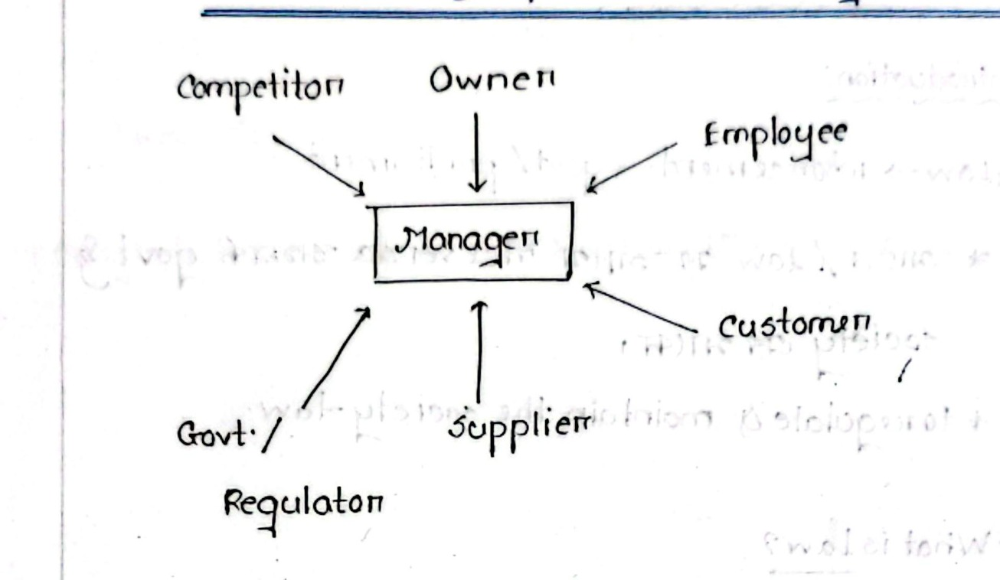
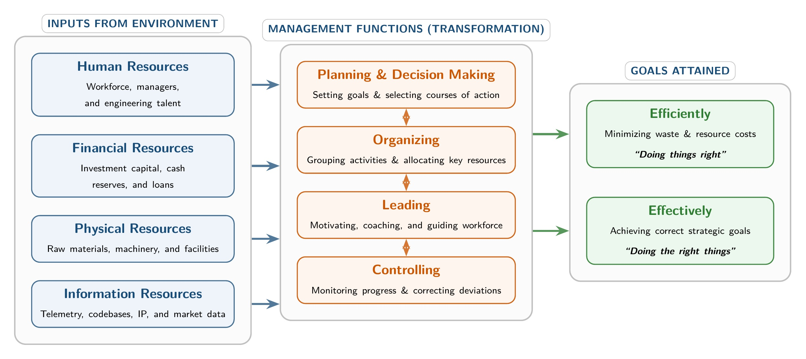

[← Previous: L12.1: Unfair Labour Practices (Sections 195 and 196)](L12.1_Unfair_Labour_Practices_Sec_195_and_196.md) | [🏠 Index](00_Index.md) | [📐 Master Sheet](99_Master_Formula_and_Statutory_Sheet.md) | [Next: M01.2: Efficiency vs. Effectiveness and Decision Matrix →](M01.2_Efficiency_vs_Effectiveness_and_Decision_Matrix.md)

# M01.1: Management Definitions, Resources, and Nature

> [!info] ⚡ Exam Snapshot
> - **Section & Priority:** Section B · Dr. Md. Rabiul Islam Sir · High Priority | **Read Time:** ~3 mins
> - **PYQs Covered:** 2020 Q.1(a) [3m], 2021 Q.1(a) [3m], 2023 Q.5(a) [2m], 2024 Q.1(a) [2m], 2024 Q.5(a) [2m], 2025 IM-CT1 (Q.3, Q.7, Q.8, Q.9)
> - **Scoring Rule:** Cite Taylor (1911) verbatim, Griffin POLC/HFPI, exact Telecom/RUET assets, and map VC to POLC.

---

## 📌 1. Verbatim Definitions (For 2-Mark Questions)

- **Management (F.W. Taylor, 1911):** *"Management is an art of doing things in the best & cheapest way."*
  - *Plain meaning:* Achieving top technical quality at lowest production cost and waste.
- **Management (Ricky W. Griffin):** *"A set of activities (including planning and decision making, organizing, leading, and controlling) directed at an organization's resources (human, financial, physical, and information), with the aim of achieving organizational goals in an efficient and effective manner."*
  - *Plain meaning:* Coordinating 4 resources via POLC functions to reach goals efficiently and effectively.
- **Industrial Management:** *"A specialized branch of engineering management that applies scientific and managerial principles to design, operate, control, and optimize industrial production systems."*
  - *Plain meaning:* Applying engineering and management methods to optimize factory operations and cut waste. (Founded in 1911 by F.W. Taylor; evolved into modern IPE).

---

## ⚡ 2. Core Exam Blocks (Write Directly in Exam)

### The Manager & 6 Organizational Stakeholders

The manager sits at the central hub, actively balancing demands from 6 competing stakeholders:

1. **Owner:** Supplies financial capital; expects return on equity and steady business growth.
2. **Employee:** Operates machinery and software; expects fair pay, safe conditions, and job security.
3. **Customer:** Buys goods and telecom services; expects reliability, fair pricing, and support.
4. **Supplier:** Delivers materials and parts; expects clear specs, steady orders, and prompt payment.
5. **Government / Regulator:** Enforces safety, spectrum rules, and taxes; expects compliance.
6. **Competitor:** Challenges with rival goods and pricing; drives technical innovation.

*Figure 1.1: Manager and organizational stakeholders interaction model.*

---

### The 4 Organizational Resources (H-F-P-I)

Every enterprise takes four resource categories from its environment and transforms them via POLC:

*Figure 1.2: Environmental inputs (H-F-P-I) transformed through POLC to achieve organizational goals.*

> [!tip] Memory Hook: H-F-P-I Resource Ladder
> - **H**uman: People, talent, engineers, and technicians.
> - **F**inancial: Capital, revenues, bank loans, and equity.
> - **P**hysical: Real estate, cell towers, fiber cables, and machines.
> - **I**nformation: Data logs, code, curricula, and circuit designs.

#### Institutional Comparison: Telecom Firm vs. Engineering University

| Resource | Telecommunications Operator (e.g., Grameenphone) | Engineering University (e.g., RUET) |
| :--- | :--- | :--- |
| **Human (HR)** | RF engineers, customer care agents, fiber technicians | Professors, lab technicians, registrar staff |
| **Financial** | Subscriber recharge revenues, equity, spectrum funds | Government revenue grants, student fees, endowments |
| **Physical** | BTS cellular towers, fiber network, server centers | Academic buildings, engineering labs, student halls |
| **Information** | Call records (CDR), traffic logs, churn models | Curricula, syllabi, semester grades, exam records |

---

### 8 Core Features of the Nature of Management

1. **Goal-Oriented:** Directs all collective efforts toward pre-determined targets.
2. **Universal Application:** Operates across all enterprise types (firms, hospitals, universities) and nations.
3. **Social Process:** Gets work done through people, relying on interpersonal communication and team dynamics.
4. **Dynamic and Adaptive:** Continuously adjusts to external technology and market shifts.
5. **Integrative Group Activity:** Synchronizes specialized units to create operational synergy.
6. **Decision-Driven:** Constantly evaluates alternatives to solve problems under risk.
7. **Resource Optimization:** Balances efficiency (cutting waste) and effectiveness (hitting goals).
8. **Continuous Learning:** Demands ongoing skill upgrading and modern automation adoption.

> [!tip] Memory Hook: G-U-S-D-I-D-O-L (8 Features of Management)
> - **G**oals | **U**niversal | **S**ocial | **D**ynamic
> - **I**ntegrative | **D**ecisions | **O**ptimization | **L**earning

---

## 🎯 3. PYQ & Target Answer Key

### Final Exam Theory Blueprints

#### 2020 Q.1(a) [3m], 2023 Q.5(a) [2m] & 2024 Q.1(a) [2m] · Management & Industrial Management
- **Question:** Define management / industrial management.
- **Answer Blueprint:** Quote Taylor (1911) and Griffin verbatim from §1. For Industrial Management, cite engineering roots and production system optimization from §1.

#### 2021 Q.1(a) [3m] & 2024 Q.5(a) [2m] · Management, Efficiency, Effectiveness
- **Question:** Define management, efficiency and effectiveness.
- **Answer Blueprint:** Quote Griffin from §1. Define efficiency as "doing things right" ($\text{Efficiency} = \frac{\text{Useful Output}}{\text{Total Input}}$) and effectiveness as "doing right things". *(See M01.2 for matrix).*

---

### 2025 Class Test 1 Solutions (IM-CT1)

#### 2025 IM-CT1 Q.3 [2m] · Management Is Universal
- **Question:** Management is Universal. How?
- **Solution:** POLC functions apply everywhere:
  1. **Enterprises:** Businesses, hospitals, and universities all require management.
  2. **Geographies:** Core principles remain identical across nations.
  3. **Hierarchies:** Executives, middle managers, and first-line supervisors all coordinate resources.

#### 2025 IM-CT1 Q.7 [2m] · Management Is a Social Process
- **Question:** Management is a social process. How?
- **Solution:** Management centers on human relationships:
  1. **People focus:** Achieves organizational goals through human beings.
  2. **Interpersonal interaction:** Managers spend time communicating and resolving friction.
  3. **Social impact:** Decisions shape worker wages, safety, and community welfare.

#### 2025 IM-CT1 Q.8 [2m] · Is a University Vice-Chancellor a Manager?
- **Question:** Is a university Vice-Chancellor a manager? Why or why not?
- **Solution:** **Yes, a Vice-Chancellor is a top-level manager.** The VC coordinates 4 resources and executes 4 POLC functions:
  - *Resources:* Guides staff (Human), allocates grants/tuition (Financial), manages campus labs (Physical), oversees curricula/grades (Information).
  - *Functions:* Sets vision (Planning), structures departments (Organizing), inspires faculty (Leading), tracks budgets (Controlling).

#### 2025 IM-CT1 Q.9 [2m] · Resources of a Telecom Firm
- **Question:** Mention at least two names of human, physical, and financial resources of a Telecom firm,
- **Solution:** For a telecom operator (e.g., Grameenphone):
  - *Human Resources:* (1) RF Network Engineers, (2) Customer Care Agents.
  - *Physical Resources:* (1) Cellular BTS Towers, (2) Optical Fiber Backbone.
  - *Financial Resources:* (1) Prepaid Recharge Revenues, (2) Shareholder Equity.

---

> [!warning] ⚠️ Examiner Traps
> - **Missing 1911 in Taylor:** Always cite F.W. Taylor with year **1911** and verbatim words: *"best & cheapest way"*.
> - **Incomplete Griffin Quote:** State both the 4 functions (`P-O-L-C`) and 4 resources (`H-F-P-I`).
> - **Generic Resources Trap:** In CT questions, avoid vague terms like "money"; name specific telecom assets like "BTS towers" and "recharge revenue".
> - **VC Question:** Always answer "Yes" and map both 4 resources and 4 POLC functions.

---

[← Previous: L12.1: Unfair Labour Practices (Sections 195 and 196)](L12.1_Unfair_Labour_Practices_Sec_195_and_196.md) | [🏠 Index](00_Index.md) | [📐 Master Sheet](99_Master_Formula_and_Statutory_Sheet.md) | [Next: M01.2: Efficiency vs. Effectiveness and Decision Matrix →](M01.2_Efficiency_vs_Effectiveness_and_Decision_Matrix.md)
