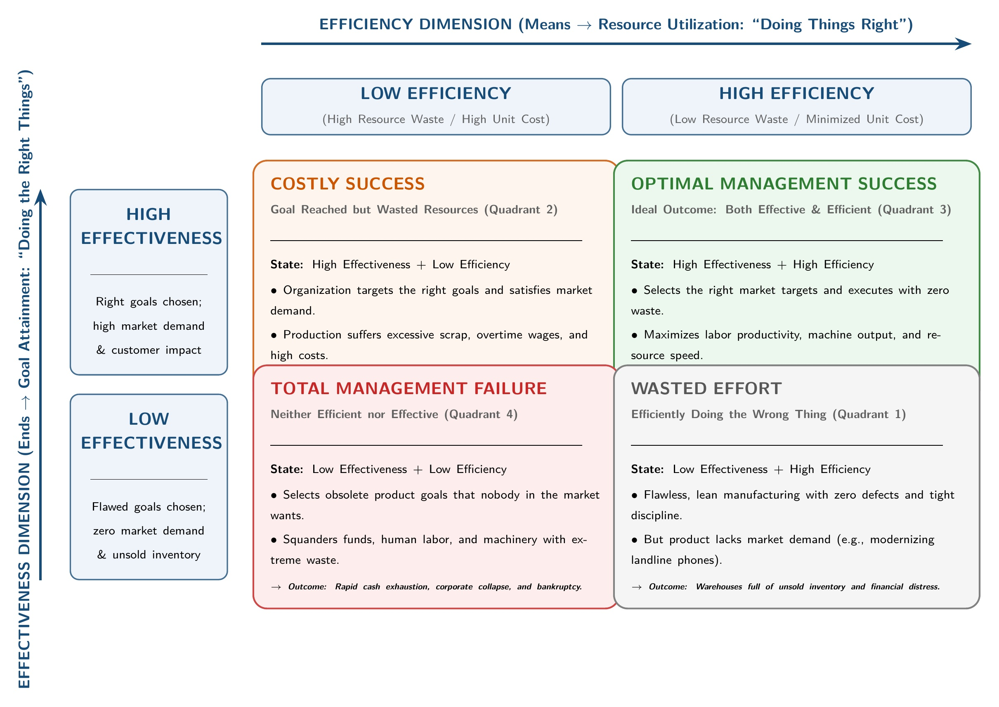

[← Previous: M01.1: Management Definitions, Resources, and Nature](M01.1_Management_Definitions_Resources_and_Nature.md) | [🏠 Index](00_Index.md) | [📐 Master Sheet](99_Master_Formula_and_Statutory_Sheet.md) | [Next: M01.3: Management Functions (P-O-L-C) and Leadership →](M01.3_Management_Functions_POLC_and_Leadership.md)

***

# M01.2: Efficiency vs. Effectiveness and Decision Matrix

> [!info] ⚡ Exam Snapshot
> - **Section & Priority:** Section B · Dr. Md. Rabiul Islam (MRI Sir) · 🔴 Essential | **Read Time:** ~3 mins
> - **PYQs Covered:** 2021 Q.1(a) (03m), 2021 Q.2(a) (03m), 2023 Q.5(b) (04m), 2024 Q.5(a) (02m), 2025 IM-CT1 Q.2 (02m)
> - **Scoring Rule:** State both mottos ("doing things right" vs "doing the right things"), the input-output formula, and the $2 \times 2$ matrix with concrete telecom scenarios.

***

## 📌 1. Verbatim Definitions (For 2-Mark Questions)

- **Efficiency:**
  > "Using resources wisely and in a cost-effective way." (Ricky W. Griffin)
  - *Plain meaning:* Producing output with minimal waste of time, money, and labor ("doing things right").
  - *Mathematical relationship:*

$$
\text{Efficiency} = \frac{\text{Useful Output}}{\text{Total Resource Input}} \quad (\text{Expenses} \downarrow, \, \text{Output} \uparrow)
$$

- **Effectiveness:**
  > "Making the right decisions and successfully implementing them." (Ricky W. Griffin)
  - *Plain meaning:* Choosing and achieving the right goals that satisfy customer demand ("doing the right things").

- **Decision Making (Supporting Concept for 2021 Q.2a):**
  > "The process of selecting the best course of action among competing alternatives to achieve organizational goals." (Ricky W. Griffin)
  - *Plain meaning:* Choosing the best option from available choices to reach a target.

***

## ⚡ 2. Core Exam Blocks (Write Directly in Exam)

### Block A: Comparison Table (Efficiency vs. Effectiveness)

| Parameter | Efficiency ("Doing Things Right") | Effectiveness ("Doing the Right Things") |
| :--- | :--- | :--- |
| **Focus & Scope** | Means and internal resource usage | Ends and external market demand |
| **Core Question** | "How well are resources used?" | "Are we pursuing the right goals?" |
| **Primary Metric** | Input-output ratio, unit cost, scrap rate | Goal attainment, market share, buyer satisfaction |
| **Time Horizon** | Short-term operational daily focus | Long-term strategic market focus |
| **Risk if Ignored** | High production costs destroy profit margins | Perfect production of unwanted goods causes bankruptcy |
| **Industry Case** | Assembling circuit boards with zero scrap | Designing 5G products demanded by telecom buyers |

> [!tip] Memory Hook: **The DO-RIGHT Rule**
> - **Efficiency:** Doing things **R**ight (Focus: **R**esource waste and process).
> - **Effectiveness:** Doing the **R**ight things (Focus: **R**esults and correct goals).

### Block B: The $2 \times 2$ Management Decision Matrix

Organizations combine efficiency and effectiveness across four distinct operational situations:

*Figure 1.1: Two-by-Two Efficiency versus Effectiveness Strategic Decision Matrix (Source: Griffin & Lecture 1).*

1. **Quadrant 1: Efficient but Not Effective (Wasted Effort):** High efficiency, low effectiveness. Operations run with zero scrap, but product demand is zero. *Scenario:* Automating PCB assembly for rotary phones cuts unit cost by $40\%$ and defects to zero. But consumers demand smartphones, causing unsold inventory and heavy cash loss.
2. **Quadrant 2: Effective but Not Efficient (Costly Success):** Low efficiency, high effectiveness. Critical goals are achieved, but at excessive resource cost. *Scenario:* A storm snaps a fiber optic line before a live World Cup broadcast. Management charters a private helicopter to fly splicing crews, restoring uptime in 45 minutes. Effective (saved contract penalties), but inefficient (cost 5x monthly maintenance budget).
3. **Quadrant 3: Both Efficient and Effective (Ideal Success):** High efficiency, high effectiveness. Goals are attained with minimal resource waste. *Scenario:* A telecom operator suffers peak-hour call drops. Instead of building a $\$500,000$ base station, engineers deploy AI dynamic load-balancing software on existing servers. Effective (call drops down $95\%$) and efficient (saves $\$500,000$ capital expenditure).
4. **Quadrant 4: Neither Efficient nor Effective (Total Failure):** Low efficiency, low effectiveness. Wrong goals are pursued with excessive waste. *Scenario:* A firm produces 3.5-inch floppy disks in 2026 using worn machinery, suffering $35\%$ scrap. Inefficient (high scrap costs) and ineffective (zero market demand), leading to business closure.

> [!tip] Memory Hook: **W-C-I-T Quadrants**
> - **W** $\rightarrow$ **W**asted Effort (Efficient, but Not Effective)
> - **C** $\rightarrow$ **C**ostly Success (Effective, but Not Efficient)
> - **I** $\rightarrow$ **I**deal Success (Both Efficient and Effective)
> - **T** $\rightarrow$ **T**otal Failure (Neither Efficient nor Effective)

***

## 🎯 3. PYQ & Target Answer Key

### RUET 2023 Final Exam Q.5(b) (04 Marks)
**Question:** Clarify efficiency and effectiveness from the management perspective. Give example of a decision situation that is efficient but not effective, again effective but not efficient.
- **Answer Blueprint:** Write definitions and mottos from §1. Present comparison table from §2 Block A. For efficient but not effective, cite landline assembly (§2 Block B, Quadrant 1). For effective but not efficient, cite helicopter fiber repair (Quadrant 2).

### RUET 2021 Final Exam Q.2(a) Part 2 (03 Marks)
**Question:** What is decision making? Give an example for decision making which is effective but not efficient.
- **Answer Blueprint:** Define decision making verbatim from §1. Present helicopter fiber repair from §2 Block B (Quadrant 2). Note link restoration (effective) alongside 5x budget overrun (inefficient).

### RUET 2025 IM-CT1 Q.2 (02 Marks)
**Question:** Give an example of a decision situation that is both efficient and effective.
- **Answer Blueprint:** Write 1-line definitions from §1. Present AI cellular load balancing from §2 Block B (Quadrant 3). Note the $95\%$ drop reduction (effective) and $\$500,000$ capital savings (efficient).

### RUET 2021 Final Q.1(a) (03 Marks) & 2024 Final Q.5(a) (02 Marks)
**Question:** Define management, efficiency and effectiveness.
- **Answer Blueprint:** Write management definition (Griffin: P-O-L-C of H-F-P-I resources). Quote efficiency and effectiveness definitions and mottos from §1. Include the input-output efficiency formula.

> [!note] Cross-Topic Question Routing
> - **2024 Q.2(a)** (*Define contract and agreement*): Legal CO1 topic, fully answered in [L02.1](L02.1_Contract_Agreement_Void_and_Voidable.md). (Note: 2024 Q.5(a) on efficiency and effectiveness is answered above).
> - **2025 IM-CT1 Q.6** (*Roles and titles of top and middle management*): Management levels topic, fully answered in [M02.1](M02.1_Management_Levels_and_Functional_Areas.md).

***

> [!warning] ⚠️ Examiner Traps
> - **Inverting Mottos:** Never swap the mottos. Efficiency is "doing things right"; effectiveness is "doing the right things".
> - **Omitting Formulas:** Always write $\text{Efficiency} = \frac{\text{Output}}{\text{Input}}$ and $\text{Expenses} \downarrow, \text{Output} \uparrow$ alongside the definition.
> - **Trivial Examples:** Avoid domestic chores. Use ECE/telecom scenarios (fiber splicing, cellular load balancing, PCB assembly) for full credit.

***

[← Previous: M01.1: Management Definitions, Resources, and Nature](M01.1_Management_Definitions_Resources_and_Nature.md) | [🏠 Index](00_Index.md) | [📐 Master Sheet](99_Master_Formula_and_Statutory_Sheet.md) | [Next: M01.3: Management Functions (P-O-L-C) and Leadership →](M01.3_Management_Functions_POLC_and_Leadership.md)
