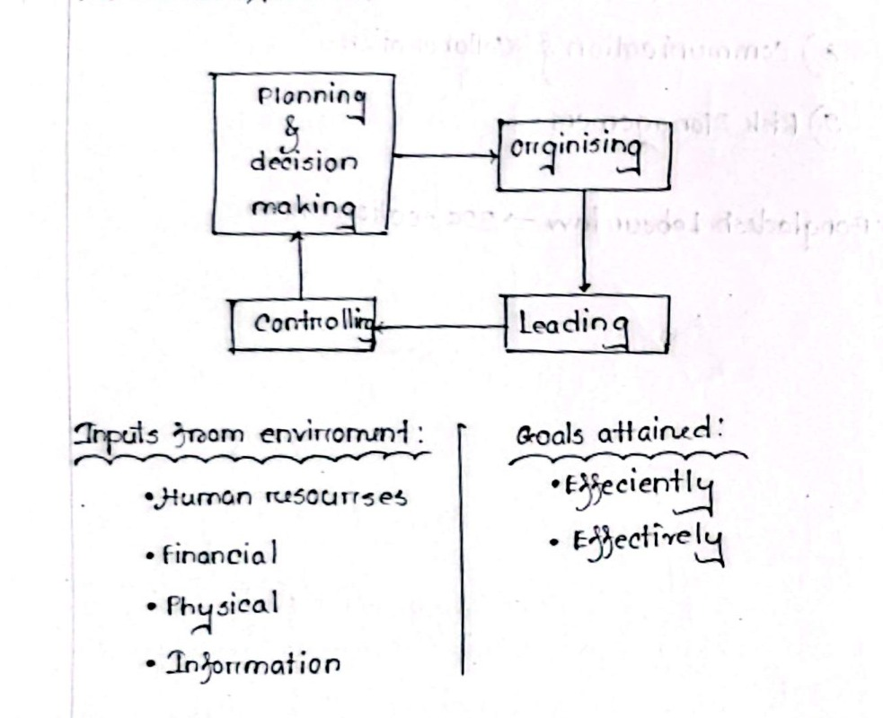

[← Previous: M01.2: Efficiency vs. Effectiveness and Decision Matrix](M01.2_Efficiency_vs_Effectiveness_and_Decision_Matrix.md) | [🏠 Index](00_Index.md) | [📐 Master Sheet](99_Master_Formula_and_Statutory_Sheet.md) | [Next: M02.1: Management Levels and Functional Areas →](M02.1_Management_Levels_and_Functional_Areas.md)

---

# M01.3: Management Functions (P-O-L-C) and Leadership

> [!info] ⚡ Exam Snapshot
> - **Section & Priority:** Section B · Dr. Md. Rabiul Islam (MRI Sir) · 🔴 Essential
> - **Read Time:** ~3 mins
> - **PYQs Covered:** 2020 Q.1(b) (04m), 2024 Q.1(b) (04m), 2024 Q.5(b) (03m), 2025 IM-CT1 Q.4 (02m), 2025 IM-CT1 Q.10 (02m)
> - **Scoring Rule:** Draw the interactive transformation cycle (`H-F-P-I` to `POLC` to Goals). Detail each function with sub-tasks and engineering examples. Contrast official authority with personal influence.

---

## 📌 1. Verbatim Definitions (For 2-Mark Questions)

> **Management Process:** "An ongoing, interactive cycle of four basic activities (planning and decision making, organizing, leading, and controlling) applied to organizational resources to achieve desired goals efficiently and effectively." *(Griffin & Lecture 1)*

*Plain meaning:* Management is not a one-time event. It is a continuous loop where four activities turn raw resources into finished goals.

> **Planning and Decision Making:** "Setting an organization's goals and deciding how best to achieve them." *(Ricky W. Griffin, Fundamentals of Management)*

*Plain meaning:* Planning means deciding your goal early. Then, you choose the smartest path to reach it.

> **Organizing:** "Determining how best to group activities and resources." *(Ricky W. Griffin, Fundamentals of Management)*

*Plain meaning:* Organizing means putting people and tools into the right groups. You assign clear jobs so work flows smoothly.

> **Leading:** "Motivating and directing members of the organization toward goal attainment." *(Ricky W. Griffin, Fundamentals of Management)*

*Plain meaning:* Leading means getting your team excited and focused. You guide them so everyone works together toward the goal.

> **Controlling:** "Monitoring and correcting ongoing activities to facilitate goal attainment." *(Ricky W. Griffin, Fundamentals of Management)*

*Plain meaning:* Controlling means tracking progress against your plan. If things go off track, you fix them quickly.

---

## ⚡ 2. Core Exam Blocks (Write Directly in Exam)

### Block A: The Management Process & Open Transformation Model

Management works like a transformation engine. It takes four raw resources from the environment and turns them into finished goals:

*Figure 2.1: Management process transforming organizational inputs into goals (Source: Classnotes Hum 2217).*

1. **Inputs from the Environment (Four Basic Resources · H-F-P-I)**
   - **Human Resources:** Engineers, technicians, software developers, and managers.
   - **Financial Resources:** Investor funding, bank credit, project budgets, and revenue cash.
   - **Physical Resources:** Offices, telecom towers, servers, test gear, and raw materials.
   - **Information Resources:** Sensor data, circuit schematics, legal standards, and market research.

2. **The Transformation Process (Interactive P-O-L-C Functions)**
   - The four core functions (Planning, Organizing, Leading, and Controlling) coordinate and direct these resources.
   - Ricky W. Griffin emphasizes that these functions do not follow a stiff 1-2-3-4 order.
   - Instead, they run at the same time and continuously exchange feedback.

3. **Outputs Attained (Organizational Goals)**
   - **Efficiently:** Reaching targets with minimal cost, zero wasted materials, and low labor hours.
   - **Effectively:** Reaching the right goals to satisfy customers and market demand.

> [!tip] Memory Hook: **The P-O-L-C Circle**
> - **P**lan: Decide the destination.
> - **O**rganize: Build the vehicle and assign seats.
> - **L**ead: Drive and inspire the team.
> - **C**ontrol: Monitor the dashboard and correct deviations.

### Block B: Detailed Breakdown of the Four P-O-L-C Functions

1. **Planning & Decision Making**
   - **What it means:** Setting organizational goals and deciding in advance how best to achieve them.
   - **Key Sub-Tasks:**
     - Defining a clear long-term vision.
     - Forecasting technology trends and market needs.
     - Preparing operating budgets.
     - Evaluating different options to choose the best path.
   - **Core Purpose:** Gives clear direction. It cuts down uncertainty and focuses resources on key priorities.
   - **Engineering Example:** Setting a 12-month engineering milestone to deploy 5G coverage across ten major cities.

2. **Organizing (Tasks & Purposes · 2025 IM-CT1 Q.10)**
   - **What it means:** Arranging people, tools, and tasks into a clear operating structure.
   - **Four Core Tasks of Organizing:**
     1. *Division of Work:* Breaking down a large project into smaller, specialized jobs.
     2. *Departmentalization:* Grouping similar jobs into logical teams (such as RF Engineering, Software, and Quality Testing).
     3. *Assignment of Duties:* Giving specific job responsibilities to employees based on their skills.
     4. *Delegation of Authority:* Giving managers the official decision-making power and resources to do their work.
   - **Four Core Purposes of Organizing:**
     1. *Defines Reporting Lines:* Shows everyone who reports to whom and who is accountable.
     2. *Coordinates Workflow:* Connects different teams so work flows smoothly without friction.
     3. *Eliminates Duplication:* Stops two people from doing the same job twice, preventing waste.
     4. *Ensures Best Resource Use:* Keeps machines, office space, and engineering talent working productively without sitting idle.
   - **Engineering Example:** Structuring a telecom engineering department into specialized Transmission, RF Optimization, and Core Network teams under project leads.

3. **Leading**
   - **What it means:** Guiding, directing, and motivating employees to work collaboratively toward shared goals.
   - **Key Sub-Tasks:**
     - Communicating the project vision clearly.
     - Inspiring high performance through praise and bonuses.
     - Mentoring junior engineers and building strong team spirit.
     - Resolving workplace conflicts and misunderstandings quickly.
   - **Core Purpose:** Channels human energy, creativity, and enthusiasm toward corporate goals.
   - **Engineering Example:** Running a short daily standup meeting to celebrate bug fixes and keep team spirit high during a launch.

4. **Controlling (The Four-Step S-M-C-C Sequence)**
   - **What it means:** Tracking actual performance against target standards and correcting mistakes when things go off track.
   - **Four-Step Control Sequence (S-M-C-C):**
     1. *Set Standards (S):* Set clear, measurable targets (for example, peak call drop rate under $0.5\%$).
     2. *Measure Performance (M):* Collect live operational logs, telemetry, and test results.
     3. *Compare (C):* Compare actual results against targets to spot any performance gap.
     4. *Take Corrective Action (C):* Adjust antennas, patch software bugs, or replace worn parts to fix the gap.
   - **Core Purpose:** Keeps work on schedule. It feeds real performance numbers back into the next planning round.
   - **Engineering Example:** An automated network monitoring dashboard detects falling signal power on a fiber route. It reroutes traffic to a backup line and alerts technicians immediately.

> [!tip] Memory Hook: **The S-M-C-C Control Sequence**
> - **S** $\rightarrow$ **S**tandards: Set measurable benchmarks.
> - **M** $\rightarrow$ **M**easure: Collect actual performance data.
> - **C** $\rightarrow$ **C**ompare: Identify performance gaps against benchmarks.
> - **C** $\rightarrow$ **C**orrect: Fix deviations to return to plan.

### Block C: Leadership vs. Management (2025 IM-CT1 Q.4)

#### Why All Leaders in Organizations Function as Managers

Leading a team requires more than charisma and inspirational speeches. An organizational leader must turn ideas into reality. To do that, the leader must coordinate real people and resources.

Think of a cricket captain or a software project lead.

- The captain cannot just inspire the players.
- They must plan match strategy before the game (Planning).
- They must set the batting lineup and place fielders (Organizing).
- They must motivate bowlers during tough overs (Leading).
- They must track the required run rate and review bowling overs (Controlling).

Because achieving any real team goal requires managing people, time, and tools, every organizational leader inevitably functions as a manager.

#### Why All Managers Are Not Leaders

A manager gets authority from an official job title given by the company. Many managers simply follow rulebooks, approve expense sheets, and enforce attendance.

Think of a strict office boss who sits behind a desk.

- They command workers through official company rank and employment contracts.
- But they lack an inspiring vision, empathy, and genuine personal trust.
- Team members obey them only to protect their monthly salary and avoid trouble.
- Subordinates do not follow them with excitement or voluntary loyalty.

Such individuals manage systems, paperwork, and schedules. But they do not inspire or lead people.

| Attribute | Management | Leadership |
| :--- | :--- | :--- |
| **Source of Power** | Official job title and rank appointed from above | Personal trust and respect earned from below |
| **Main Focus** | Systems, rules, budgets, and daily procedures | People, shared vision, and team culture |
| **Core Goal** | Order, stability, and predictable results | Positive change, innovation, and future growth |
| **Reaching Goals** | Plans steps, allocates resources, tracks schedules | Inspires a shared vision and aligns people to it |
| **Team Relationship** | Employees obey due to formal job contracts | Employees follow willingly out of genuine commitment |
| **Kotter's Maxim** | Produces order and consistency | Produces constructive change and vision |

> [!tip] Memory Hook: **Title vs. Trust**
> - **Management = Title + Authority:** Keeps daily operations orderly and stable.
> - **Leadership = Trust + Vision:** Inspires people and drives constructive change.

---

## 🎯 3. PYQ & Target Answer Key

### RUET 2020 Final Exam Q.1(b) (04 Marks)

**Question:** Discuss the functions of management.

**Exam Writing Plan:**

1. **Opening Statement:**
   - Define management as a continuous loop that coordinates resources to achieve goals.
   - Mention the four resources (`H-F-P-I`: Human, Financial, Physical, Information).

2. **The Interactive Loop (Draw Figure 2.1):**
   - State that management functions do not follow a stiff 1-2-3-4 sequence.
   - Explain that they run at the same time and continuously exchange feedback.
   - Sketch Figure 2.1 showing inputs, the POLC loop, and outputs.

3. **Detail the Four P-O-L-C Functions:**
   - *Planning & Decision Making:* Set clear targets, forecast tech trends, and budget resources.
   - *Organizing:* Divide project tasks, create teams, and assign clear authority.
   - *Leading:* Motivate engineers, communicate the vision, and build team spirit.
   - *Controlling:* Use the four-step S-M-C-C process to spot and fix performance gaps.

4. **Concluding Takeaway:**
   - State that controlling closes the circle by feeding test data back into new planning cycles.

---

### RUET 2024 Final Exam Q.1(b) (04 Marks)

**Question:** State the functions of management.

**Exam Writing Plan:**

1. **Core Concept:**
   - Introduce the four core functions of management: Planning, Organizing, Leading, and Controlling.
   - State that they transform raw resources into finished organizational goals.

2. **Core Summary of Each Function:**
   - *Planning:* Formulating clear goals and choosing the smartest path to reach them.
   - *Organizing:* Assigning tasks, building teams, and allocating equipment and funds.
   - *Leading:* Guiding, inspiring, and motivating team members toward milestones.
   - *Controlling:* Tracking real output against benchmarks and fixing any errors.

3. **Concluding Takeaway:**
   - Note that effective managers run these functions at the same time with continuous feedback.

---

### RUET 2024 Final Exam Q.5(b) (03 Marks)

**Question:** State the process of Management.

**Model Answer:**

Management works as a continuous transformation engine. It takes four resources from the environment and turns them into finished goals through four core functions:

1. **Environmental Inputs (Four Resources · H-F-P-I):**
   - *Human Resources:* Engineers, managers, and technical staff.
   - *Financial Resources:* Startup capital, project budgets, and revenue cash.
   - *Physical Resources:* Manufacturing plants, cell towers, and lab gear.
   - *Information Resources:* Sensor data, circuit schematics, and market reports.

2. **The Core Managerial Transformation (P-O-L-C):**
   - *Planning & Decision Making:* Setting targets and deciding how best to achieve them.
   - *Organizing:* Grouping activities and setting up clear lines of authority.
   - *Leading:* Motivating team members and guiding collective efforts.
   - *Controlling:* Tracking output against benchmarks and correcting any deviations.

3. **Goals Attained (Outputs):**
   - *Efficiently:* Accomplishing targets with minimal resource waste and low cost.
   - *Effectively:* Choosing the right products to satisfy customer demand.

*(Note: In your exam script, sketch Figure 2.1 showing inputs on the left side, the interactive POLC cycle in the center, and goals attained on the right side.)*

---

### RUET 2025 IM-CT1 Q.4 (02 Marks)

**Question:** All leaders are managers, but all managers are not leaders. Why?

**Model Answer:**

This statement highlights the fundamental difference between **official job title** and **personal leadership influence**:

1. **Why All Leaders in Organizations Function as Managers:**
   - Guiding a team toward an organizational mission requires practical resource coordination.
   - A leader, such as a sports captain or tech lead, cannot succeed through charm alone.
   - They must set team targets (Planning) and assign roles to members (Organizing).
   - They must motivate the team (Leading) and track performance against milestones (Controlling).
   - Because coordinating resources to produce results requires these core tasks, all organizational leaders inevitably act as managers.

2. **Why All Managers Are Not Leaders:**
   - A manager receives authority from their official job title and company rank.
   - Many managers run systems mechanically by strictly enforcing company rules, budgets, and attendance.
   - They command obedience through formal rank and employment contracts.
   - But they lack an inspiring vision, empathy, and personal trust.
   - Subordinates obey them only out of job obligation rather than voluntary commitment.
   - Such individuals manage systems and schedules, but do not lead people.

3. **Core Conclusion (Kotter's Distinction):**
   - As John Kotter summarized, **management** produces order and consistency through formal systems.
   - In contrast, **leadership** produces constructive change and vision through personal trust and inspiration.

---

### RUET 2025 IM-CT1 Q.10 (02 Marks)

**Question:** Write the tasks and purposes of organizing.

**Model Answer:**

#### 1. Tasks of Organizing

1. **Division of Work:** Breaking down complex projects into smaller, specialized jobs.
2. **Departmentalization:** Grouping similar jobs into logical functional teams (such as Software, RF Hardware, and Quality Testing).
3. **Assignment of Duties:** Allocating specific roles and responsibilities to individuals based on their skills.
4. **Delegation of Authority:** Giving managers the decision-making power and resources needed to execute their duties.

#### 2. Purposes of Organizing

1. **Defines Reporting Lines:** Creates a clear chain of command showing who reports to whom.
2. **Coordinates Workflow:** Synchronizes team efforts so work flows smoothly without bottlenecks.
3. **Eliminates Duplication:** Prevents overlapping duties and wasteful double-handling of tasks.
4. **Ensures Best Resource Use:** Keeps physical equipment, workspace, and engineering talent working productively without sitting idle.

---

> [!note] Cross-Topic Question Routing
> - **2020 Q.1(a)** (*Define management*): Management foundation definition, fully answered in [M01.1](M01.1_Management_Definitions_Resources_and_Nature.md).
> - **2025 IM-CT1 Q.8** (*Is a university Vice-Chancellor a manager?*): Applied manager role question, fully answered in [M01.1](M01.1_Management_Definitions_Resources_and_Nature.md).

---

> [!warning] ⚠️ Examiner Traps
> - **The Linear POLC Mistake:** Never describe management as a rigid, one-way 1-2-3-4 step. State clearly that POLC functions operate as a continuous cycle with ongoing feedback.
> - **Mixing Tasks and Purposes:** In 2025 IM-CT1 Q.10, present tasks and purposes as two separate, numbered lists. Do not merge them into a single prose paragraph.
> - **Missing Kotter's Core Contrast:** In leadership vs. management, always cite John Kotter's terms: management produces order and consistency, whereas leadership produces constructive change and vision.

---

[← Previous: M01.2: Efficiency vs. Effectiveness and Decision Matrix](M01.2_Efficiency_vs_Effectiveness_and_Decision_Matrix.md) | [🏠 Index](00_Index.md) | [📐 Master Sheet](99_Master_Formula_and_Statutory_Sheet.md) | [Next: M02.1: Management Levels and Functional Areas →](M02.1_Management_Levels_and_Functional_Areas.md)
