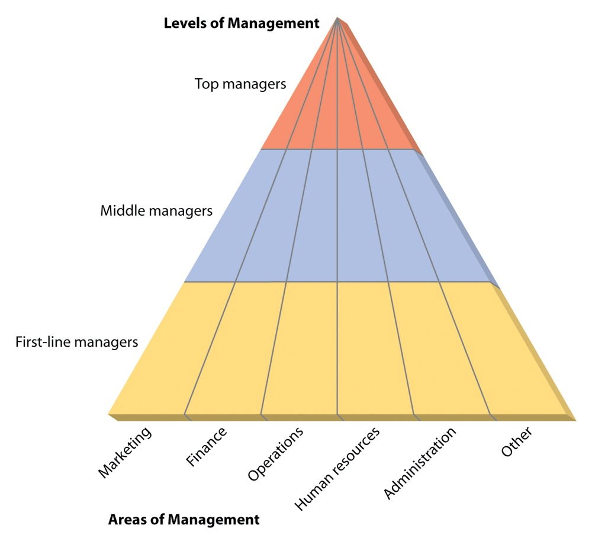

[← Previous: M01.3: Management Functions (P-O-L-C) and Leadership](M01.3_Management_Functions_POLC_and_Leadership.md) | [🏠 Index](00_Index.md) | [📐 Master Sheet](99_Master_Formula_and_Statutory_Sheet.md) | [Next: M02.2: Managerial Skills, Evaluation, and Development →](M02.2_Managerial_Skills_Evaluation_and_Development.md)

---

# M02.1: Management Levels and Functional Areas

> [!info] ⚡ Exam Snapshot
> - **Section & Priority:** Section B · Dr. Md. Rabiul Islam Sir · High Priority
> - **Read Time:** ~4 mins
> - **PYQs Covered:** 2025 IM-CT1 Q.6 (02 Marks), Model Final Questions (04 Marks)
> - **Scoring Rule:** State exact time horizons, titles, and all 10 functional areas with zero duplicate prose.

---

## 📌 1. Verbatim Definitions (For 2-Mark Questions)

> **Top Managers:** "Top managers make up the relatively small group of executives who manage the overall organization." *(Ricky W. Griffin, Fundamentals of Management, Chapter 1)*

*Plain meaning:* Top managers are senior corporate executives responsible for setting long-term enterprise strategy, establishing broad organizational policies, and representing the company to external stakeholders like investors and government regulators.

> **Middle Managers:** "Middle managers are primarily responsible for implementing the policies and plans developed by top managers and for supervising and coordinating the activities of lower-level managers." *(Ricky W. Griffin, Fundamentals of Management, Chapter 1)*

*Plain meaning:* Middle managers are departmental leaders who bridge executive strategy with shop-floor operations, translating strategic plans into tactical departmental programs and coordinating cross-unit workflows.

> **First-Line Managers:** "First-line managers supervise and coordinate the activities of operating employees." *(Ricky W. Griffin, Fundamentals of Management, Chapter 1)*

*Plain meaning:* First-line managers are frontline supervisors who directly oversee operative personnel, assign daily shift tasks, and resolve immediate technical problems on the shop floor.

> **Functional Area of Management:** "A specialized department within an enterprise that oversees a distinct set of operational tasks and business activities." *(Lecture 3 & Griffin Chapter 1)*

*Plain meaning:* A functional area is an organizational division dedicated to a specific business discipline, such as operations, marketing, finance, or human resources.

---

## ⚡ 2. Core Exam Blocks (Write Directly in Exam)

### A. Management Hierarchy and Functional Matrix

Management levels divide authority horizontally across an organization, while functional departments divide operational activities vertically. Every functional department contains managers operating across all three hierarchical tiers.

*Figure 1: Management Levels and Functional Areas Matrix (Source: Lecture 3 & Griffin Ch. 1).*

---

### B. Master Comparison of the Three Management Levels

| Comparison Dimension | Top-Level Management | Middle-Level Management | First-Line (Lower) Management |
| :--- | :--- | :--- | :--- |
| **Primary Scope** | Entire organization and external business environment | Departmental units and cross-unit workflows | Daily shop-floor operations and operative workers |
| **Planning Horizon** | Long-term (3 to 5+ years, Strategic planning) | Medium-term (6 to 12 months, Tactical planning) | Short-term (daily, weekly, Operational planning) |
| **Core Responsibilities** | Set corporate vision, allocate capital, guide major investments | Translate strategies into unit plans, coordinate budgets | Assign daily work schedules, train staff, solve line snags |
| **Typical Job Titles** | CEO, President, Managing Director (MD), CTO, VP | Plant Manager, Division Head, Regional Director | Production Supervisor, Foreperson, Team Leader |
| **Dominant Skill Focus** | Conceptual, Decision-Making, Time-Management | Interpersonal, Diagnostic, Communication | Technical, Interpersonal, Communication |
| **Engineering Example** | CTO approves a nationwide 5G infrastructure rollout | Regional Director schedules cell tower maintenance cycles | Site Supervisor directs fiber-optic cable splicing crews |

---

### C. Authority and Feedback Flow Across Levels

Managerial coordination requires smooth information flow across both vertical and horizontal organizational axes:

1. **Downward Flow (Strategic Translation):** Executive five-year strategic goals cascade downward into quarterly departmental programs, which first-line supervisors convert into daily shift assignments and work orders.

2. **Upward Flow (Operational Feedback):** Operating technicians report equipment failures or defect spikes to first-line supervisors. Supervisors escalate chronic bottlenecks to department heads, who alert executive leadership to emerging operational risks.

3. **Horizontal Flow (Cross-Functional Alignment):** Managers coordinate laterally across departments to align complementary resources. For example, operations managers synchronize factory production schedules with financial cash flows and marketing demand forecasts.

---

### D. The 10 Primary Functional Areas of Management

> [!tip] Memory Hook: 10 Functional Areas
> **"Managers Often Find Helpful Information And Resolve Public International Projects"**
>
> - **Core Business Engine:** Marketing, Operations, Finance, Human Resources
> - **Support & Administration:** Information Technology, Administrative
> - **Growth & Boundary-Spanning:** Research & Development, Public Relations, International, Project & Risk

1. **Operations Management:**
   - **Primary Focus:** Directs the physical creation and delivery of goods and technical services.
   - **Key Duties:** Production scheduling, workflow design, inventory control, and quality assurance.
   - **Engineering Example:** Managing automated printed circuit board (PCB) assembly lines and optimizing component supply chains.

2. **Financial Management:**
   - **Primary Focus:** Manages corporate capital structure, cash flows, and investment decisions.
   - **Key Duties:** Capital budgeting, financial reporting, risk assessment, and operational cost controls.
   - **Engineering Example:** Allocating capital budgets for acquiring 5G spectrum auction licenses and testing hardware.

3. **Marketing Management:**
   - **Primary Focus:** Drives customer adoption, sales revenue, and brand market positioning.
   - **Key Duties:** Market research, competitive pricing models, product launch campaigns, and distribution channels.
   - **Engineering Example:** Designing enterprise subscription tiers for cloud data storage and software services.

4. **Human Resource Management (HRM):**
   - **Primary Focus:** Recruits, develops, compensates, and retains engineering and operational talent.
   - **Key Duties:** Talent acquisition, technical skill training, performance evaluations, and labor compliance.
   - **Engineering Example:** Staffing radio-frequency (RF) engineering teams and conducting workplace safety drills.

5. **Information Technology (IT) Management:**
   - **Primary Focus:** Maintains computing infrastructure, enterprise software, and business data security.
   - **Key Duties:** Enterprise Resource Planning (ERP) administration, database management, and network defense.
   - **Engineering Example:** Securing an industrial Supervisory Control and Data Acquisition (SCADA) network from cyber threats.

6. **Administrative (General) Management:**
   - **Primary Focus:** Provides general oversight and coordinates shared administrative services across departments.
   - **Key Duties:** Facility management, office logistics, legal documentation, and cross-unit policy alignment.
   - **Engineering Example:** Managing regional corporate office leases, utility agreements, and facility maintenance.

7. **Research & Development (R&D) Management:**
   - **Primary Focus:** Leads scientific inquiry, technical innovation, and experimental product design.
   - **Key Duties:** Laboratory research, patent filings, rapid prototyping, and technical feasibility studies.
   - **Engineering Example:** Directing an engineering squad developing low-power 6G wireless communication transceivers.

8. **Public Relations (PR) Management:**
   - **Primary Focus:** Protects corporate reputation and coordinates media and community communications.
   - **Key Duties:** Press releases, media briefings, investor relations events, and crisis management.
   - **Engineering Example:** Issuing clear technical briefings to journalists following an unexpected cellular network outage.

9. **International Management:**
   - **Primary Focus:** Coordinates business operations, supply chains, and compliance across national borders.
   - **Key Duties:** Export-import regulations, foreign currency risk management, and global shipping logistics.
   - **Engineering Example:** Sourcing microcontrollers from overseas fabricators while managing customs compliance and currency fluctuations.

10. **Project and Risk Management:**
    - **Primary Focus:** Directs time-bound engineering initiatives and establishes hazard mitigation protocols.
    - **Key Duties:** Critical path scheduling, milestone tracking, safety hazard mitigation, and disaster recovery.
    - **Engineering Example:** Leading a cross-functional engineering team to deploy a municipal fiber broadband network within eight months.

---

## 🎯 3. PYQ & Target Answer Key

### 2025 IM-CT1 Q.6 · Roles and Titles of Top and Middle Management (02 Marks)

**Question:** Mention the usual roles or titles of the top as well as middle-level management positions.

**Direct Exam Solution:**

1. **Top-Level Management:**
   - **Usual Roles:** Formulate corporate mission, set long-term strategy (3 to 5+ years), establish enterprise-wide policies, allocate major capital, and represent the organization to external stakeholders.
   - **Typical Titles:** Chief Executive Officer (CEO), Managing Director (MD), President, Chief Technology Officer (CTO), and Vice President (VP).

2. **Middle-Level Management:**
   - **Usual Roles:** Translate corporate strategies into tactical departmental plans (6 to 12 months), coordinate workflows across units, allocate department budgets, and supervise first-line managers.
   - **Typical Titles:** Plant Manager, Operations Manager, Regional Director, Division Head, and Chief Engineer.

---

### Model Final Q1 · Comprehensive Comparison of Management Levels (04 Marks)

**Question:** Compare the three hierarchical levels of management in terms of primary focus, time horizon, key responsibilities, and typical job titles. Support your answer with a structured comparison table.

**Exam Writing Plan:**

1. **Opening Definitions:** Quote verbatim definitions of Top, Middle, and First-Line Management from §1 to establish formal theoretical grounding.

2. **Comparison Matrix:** Reproduce the 6-dimension comparison table from §2 Block B detailing Primary Scope, Planning Horizon (Top: 3 to 5+ years; Middle: 6 to 12 months; First-Line: daily or weekly), Core Responsibilities, Typical Job Titles, Dominant Skills, and Telecommunications Engineering Examples.

3. **Operational Interdependence:** Briefly explain the three-step interaction cycle from §2 Block C, highlighting downward strategic translation, upward operational feedback, and horizontal cross-functional coordination.

4. **Concluding Takeaway:** Note that while technical skill demands drop from first-line to top management, interpersonal skills remain vital across all three tiers because managers always achieve results through people.

---

### Model Final Q2 · Industrial Functional Areas and Cross-Tier Flow (04 Marks)

**Question:** Describe the primary functional areas of management in an industrial enterprise. How do these functional areas interact across hierarchical management levels?

**Exam Writing Plan:**

1. **Opening Framework:** State the 10-area memory hook (*"Managers Often Find Helpful Information And Resolve Public International Projects"*) and classify the departments into the three functional clusters: Core Business Engine (Operations, Finance, Marketing, HR), Support and Administration (IT, Administrative), and Growth and Boundary-Spanning (R&D, PR, International, Project and Risk).

2. **Functional Descriptions:** Briefly summarize the primary focus, key responsibilities, and engineering applications for each of the 10 functional areas using §2 Block D.

3. **Cross-Tier Interaction:** Draw the Levels $\times$ Functional Areas matrix from §2 Block A (*Figure 1*) and trace vertical operational execution using an engineering example: Top CTO approves 5G network expansion $\to$ Middle Regional Manager plans deployment schedules $\to$ First-Line Supervisor directs technicians splicing fiber cables.

4. **Concluding Takeaway:** Conclude by highlighting that functional departments cut vertically across an enterprise, necessitating active horizontal coordination at every hierarchical level to prevent departmental silos.

---

> [!warning] ⚠️ Examiner Traps
> - **Missing Time Horizons:** Always specify exact planning horizons: Top (3 to 5+ years), Middle (6 to 12 months), and First-Line (daily or weekly). Omitting these horizons loses significant marks.
> - **Confusing First-Line Managers with Operating Employees:** Operating employees build products or write software without supervising others. First-line managers hold formal managerial authority and supervise those operating employees.
> - **Using Generic Job Titles:** Never write vague terms like "manager". Always provide concrete professional titles such as *Chief Technology Officer*, *Plant Operations Manager*, or *Assembly Shift Supervisor*.

---

[← Previous: M01.3: Management Functions (P-O-L-C) and Leadership](M01.3_Management_Functions_POLC_and_Leadership.md) | [🏠 Index](00_Index.md) | [📐 Master Sheet](99_Master_Formula_and_Statutory_Sheet.md) | [Next: M02.2: Managerial Skills, Evaluation, and Development →](M02.2_Managerial_Skills_Evaluation_and_Development.md)
