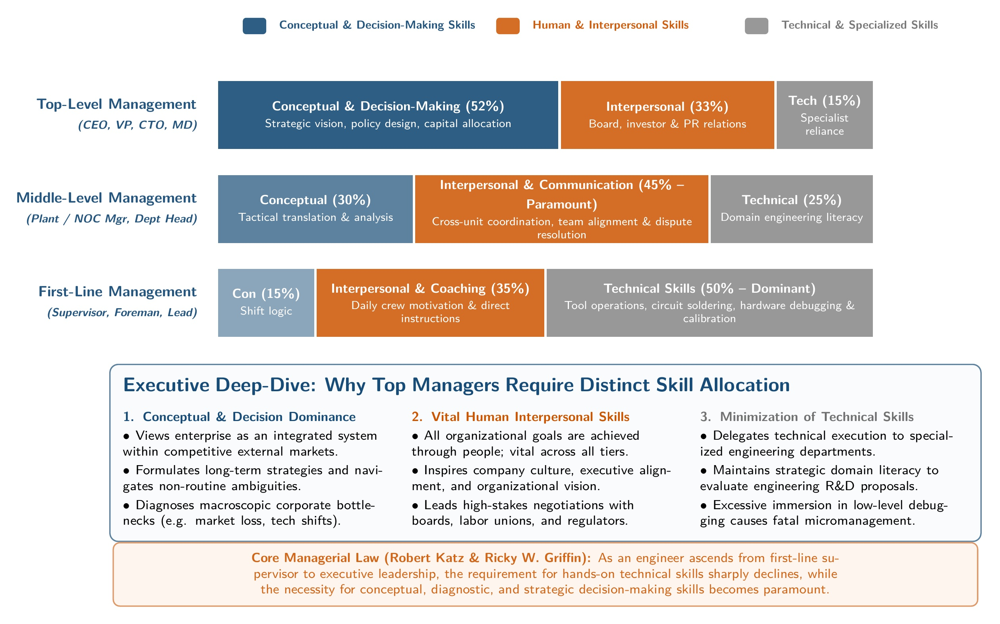

[← Previous: M02.1: Management Levels and Functional Areas](M02.1_Management_Levels_and_Functional_Areas.md) | [🏠 Index](00_Index.md) | [📐 Master Sheet](99_Master_Formula_and_Statutory_Sheet.md) | [Next: M03.1: Fayol's 14 Principles and Scalar Chain →](M03.1_Fayols_14_Principles_and_Scalar_Chain.md)

---

# M02.2: Managerial Skills, Evaluation, and Development

> [!info] ⚡ Exam Snapshot
> - **Section & Priority:** Section B · Dr. Md. Rabiul Islam Sir · Very High Priority
> - **Read Time:** ~5 mins
> - **PYQs Covered:** 2021 Q.1(c) (04 Marks), 2024 Q.1(c) (04 Marks), 2023 Q.5(c) (04 Marks), 2025 IM-CT1 Q.1 (02 Marks), 2025 IM-CT1 Q.5 (02 Marks)
> - **Scoring Rule:** State all 7 skills (T-I-C-D-C-D-T) with balanced strengths and limitations, and map skills to hierarchical tiers.

---

## 📌 1. Verbatim Definitions (For 2-Mark Questions)

> **Technical Skills:** "The skills necessary to accomplish or understand the specific kind of work being done in an organization." *(Ricky W. Griffin, Fundamentals of Management, Chapter 1)*

*Plain meaning:* Technical skills represent the hands-on proficiency, specialized engineering methods, and tool competencies required to perform practical operational tasks.

> **Interpersonal Skills:** "The ability to communicate with, understand, and motivate both individuals and groups." *(Ricky W. Griffin, Fundamentals of Management, Chapter 1)*

*Plain meaning:* Interpersonal skills are people-oriented capabilities that allow managers to mentor colleagues, resolve workplace friction, and build collaborative teamwork.

> **Conceptual Skills:** "The manager's ability to think in the abstract." *(Ricky W. Griffin, Fundamentals of Management, Chapter 1)*

*Plain meaning:* Conceptual skills involve the cognitive capacity to view the organization as an integrated whole and understand how external industry changes affect internal departments.

> **Diagnostic Skills:** "The manager's ability to visualize the most appropriate response to a situation." *(Ricky W. Griffin, Fundamentals of Management, Chapter 1)*

*Plain meaning:* Diagnostic skills allow a manager to investigate trouble symptoms systematically, uncover underlying root causes, and prescribe effective corrective solutions.

> **Communication Skills:** "The manager's abilities both to effectively convey ideas and information to others and to effectively receive ideas and information from others." *(Ricky W. Griffin, Fundamentals of Management, Chapter 1)*

*Plain meaning:* Communication skills encompass the two-way transmission and reception of instructions, technical data, and organizational feedback without distortion.

> **Decision-Making Skills:** "The manager's ability to correctly recognize and define problems and opportunities and to then select an appropriate course of action to solve problems and capitalize on opportunities." *(Ricky W. Griffin, Fundamentals of Management, Chapter 1)*

*Plain meaning:* Decision-making skills involve recognizing operational challenges, evaluating trade-offs under conditions of risk, and committing resources to the most beneficial course of action.

> **Time-Management Skills:** "The manager's ability to prioritize work, to work efficiently, and to delegate appropriately." *(Ricky W. Griffin, Fundamentals of Management, Chapter 1)*

*Plain meaning:* Time-management skills enable managers to rank high-impact strategic priorities, maintain productive workflows, and delegate routine operational chores.

---

## ⚡ 2. Core Exam Blocks (Write Directly in Exam)

### A. Griffin's Seven Fundamental Managerial Skills (T-I-C-D-C-D-T)

> [!tip] Memory Hook: The 7 Managerial Skills
> **"The Inspiring Chief Diagnoses Clearly, Decides Timely"**
>
> - **Katz's Classical Triad:** Technical (Hands), Interpersonal (Heart), Conceptual (Head).
> - **Griffin's Process Skills:** Diagnostic (Find), Communication (Share), Decision-Making (Choose), Time-Management (Execute).

1. **Technical Skills:**
   - **Meaning & Example:** The specialized knowledge and hands-on operational techniques needed to perform specific jobs. For example, a telecommunications field supervisor troubleshooting optical fiber lines using an Optical Time-Domain Reflectometer (OTDR) or testing printed circuit boards.
   - **Critical Evaluation:** Technical mastery builds instant credibility and trust with operating employees. However, excessive reliance on technical knowledge causes managers to micromanage subordinates instead of delegating routine tasks and focusing on strategic guidance.

2. **Interpersonal (Human) Skills:**
   - **Meaning & Example:** The ability to communicate with, understand, and motivate both individuals and groups. For example, an engineering lead mentoring junior programmers, fostering collaborative teamwork, and mediating disputes between hardware and software development teams.
   - **Critical Evaluation:** Strong interpersonal skills build high employee morale, trust, and organizational loyalty. However, an overemphasis on pleasing people can prevent a manager from enforcing necessary workplace discipline, giving negative performance feedback, or terminating chronic underperformers.

3. **Conceptual Skills:**
   - **Meaning & Example:** The mental ability to think in the abstract, see the organization as an integrated system, and understand how external industry changes affect internal operations. For example, a chief technology officer transitioning enterprise infrastructure toward next-generation 5G IoT architecture.
   - **Critical Evaluation:** Conceptual skill enables visionary leadership and innovative business models. However, abstract plans remain ineffective paper exercises if executives fail to consider shop-floor operational realities and resource limits.

4. **Diagnostic Skills:**
   - **Meaning & Example:** The ability to visualize the most appropriate response to a situation by investigating symptoms and identifying underlying root causes. For example, a plant quality manager tracing automated surface-mount circuit defects back to solder paste viscosity rather than blaming line operators.
   - **Critical Evaluation:** Sound diagnostic thinking prevents organizations from wasting capital on temporary surface patches. However, collecting endless data on minor routine problems leads to analysis paralysis and stalls urgent operational action.

5. **Communication Skills:**
   - **Meaning & Example:** The manager's ability to convey ideas and information clearly to others, as well as to actively receive and understand feedback. For example, delivering structured morning shift briefings and writing concise, accurate technical fault incident logs.
   - **Critical Evaluation:** Clear communication aligns cross-functional engineering teams, eliminates ambiguities, and accelerates project velocity. However, excessive meetings and redundant email broadcasts cause information fatigue and cut into productive engineering time.

6. **Decision-Making Skills:**
   - **Meaning & Example:** The ability to recognize problems and emerging opportunities, evaluate alternatives under conditions of risk, and select an optimal course of action. For example, deciding whether to invest in robotic pick-and-place machines or outsource assembly to an external manufacturing partner.
   - **Critical Evaluation:** Decisive judgment allows an enterprise to exploit market openings and stay ahead of competitors. Effective managers make sound calls consistently and reverse incorrect choices swiftly before financial losses compound.

7. **Time-Management Skills:**
   - **Meaning & Example:** The ability to prioritize high-impact initiatives, work efficiently, and delegate routine operational responsibilities. For example, reserving uninterrupted morning hours for system architecture design while delegating spare parts replenishment to team leads.
   - **Critical Evaluation:** Disciplined time management protects deep-thinking hours and prevents critical project delays. However, overly rigid scheduling reduces managerial flexibility when unexpected emergencies or sudden system failures demand immediate attention.

---

### B. Skill Distribution Across Management Levels

Management tiers require different balances of skills. Technical skill requirements decrease as a manager rises through the hierarchy, while conceptual and decision-making demands rise sharply.

*Figure 1: Relative Importance of Managerial Skills across Hierarchy (Source: Griffin Ch. 1 & Robert Katz Model).*

| Management Level | Dominant Skills | Lowest Priority | Rationale for Skill Balance |
| :--- | :--- | :--- | :--- |
| **Top-Level Management** | Conceptual, Decision-Making, Time-Management | Technical Skills | Sets multi-year strategy; relies on specialists for technical tasks. |
| **Middle-Level Management** | Interpersonal, Diagnostic, Communication | Technical (Moderate) | Bridges executive strategy with factory reality; coordinates cross-unit workflows. |
| **First-Line Management** | Technical, Interpersonal, Communication | Conceptual Skills | Supervises operators directly; solves daily shift snags and enforces standards. |

*Core Principle:* Interpersonal skills remain equally vital across all three tiers because every manager accomplishes goals through people.

---

### C. Five Strategies to Develop and Improve Executive Skills

Top executives sharpen their strategic capabilities through five structured development pathways:

1. **Executive Coaching and Mentorship:**
   - **Mechanism:** Engaging in structured, one-on-one advising sessions with seasoned board directors or certified executive mentors.
   - **Impact:** Uncovers personal communication blind spots, enhances high-stakes decision-making judgment, and provides an objective sounding board.

2. **Advanced Executive Education and Crisis Simulations:**
   - **Mechanism:** Participating in university executive leadership programs and computer-based business war games.
   - **Impact:** Safely tests strategic reflexes, diagnostic problem-solving, and crisis management skills under simulated market disruptions without risking real corporate capital.

3. **360-Degree Feedback Systems:**
   - **Mechanism:** Gathering systematic, anonymous evaluations from board members, peer executives, direct subordinates, and key clients.
   - **Impact:** Identifies perception gaps between self-assessment and team feedback, strengthens interpersonal relationships, and builds mutual accountability.

4. **Structured Delegation and Time-Blocking:**
   - **Mechanism:** Establishing clear delegation guidelines that empower middle managers to approve routine operational matters while reserving two to three uninterrupted morning hours for deep strategic work.
   - **Impact:** Shields executives from daily operational distractions and ensures focused attention on long-term corporate goals.

5. **Continuous Environmental Scanning and Advisory Councils:**
   - **Mechanism:** Participating actively in professional engineering councils, industry trade groups, and technology policy think-tanks.
   - **Impact:** Expands conceptual awareness, monitors emerging patents and regulatory shifts, and enables early detection of disruptive technological threats.

---

## 🎯 3. PYQ & Target Answer Key

### 2021 Q.1(c) & 2024 Q.1(c) · Critical Evaluation of Managerial Skills (04 Marks)

**Question:** Critically evaluate the skills necessary to accomplish managerial tasks.

*(Note: 2021 Q.1(c) asked to "Critically discuss the skills necessary to accomplish managerial tasks".)*

**Exam Writing Plan:**

1. **Opening Framework:** Introduce Robert L. Katz's classical skill triad (Technical, Human, Conceptual) and Ricky W. Griffin's expanded framework of seven fundamental skills (`T-I-C-D-C-D-T`), quoting the core definition of management skills from §1.

2. **Critical Evaluation of the 7 Skills:** Systematically present each skill using the structure from §2 Block A (Technical, Interpersonal, Conceptual, Diagnostic, Communication, Decision-Making, Time-Management). For every skill, state its core operational purpose, provide an engineering example (e.g. OTDR, PCB testing, SCADA networks), and critically evaluate both its primary advantage and the risk of over-reliance (e.g., technical over-reliance causing micromanagement; excessive interpersonal focus weakening discipline).

3. **Skill Distribution Across Hierarchy:** Reproduce the Skill Distribution Table from §2 Block B, demonstrating how technical skill requirements decrease from first-line to top management while conceptual and decision-making demands rise steeply.

4. **Concluding Takeaway:** Emphasize that while technical skills help engineers enter management, conceptual and interpersonal skills dictate long-term managerial effectiveness, with interpersonal capability remaining equally indispensable across all three hierarchical tiers.

---

### 2023 Q.5(c) · Top-Level Managerial Skills and Improvement Strategies (04 Marks)

**Question:** Identify skills necessary for a top level manager and suggest strategies to improve those skills.

**Exam Writing Plan:**

1. **Opening Executive Context:** Define top-level managers from §1 and explain that executive leaders make non-routine, unstructured decisions under high uncertainty with multi-year time horizons (3 to 5+ years).

2. **Dominant Executive Skills:** Present the 4 primary skills required at the executive tier from §2 Block B (Conceptual, Decision-Making, Diagnostic, and Time-Management), noting that technical skills are lowest in priority because executives rely on departmental specialists.

3. **Actionable Improvement Strategies:** Detail the five proven executive development pathways from §2 Block C (Executive Coaching and Mentorship, Advanced Executive Education and Crisis Simulations, 360-Degree Feedback Systems, Structured Delegation with Time-Blocking, and Continuous Environmental Scanning).

4. **Visual Aid & Concluding Takeaway:** Sketch the relative skill importance diagram (*Figure 1*) and conclude that continuous self-evaluation and protected strategic thinking time are vital for transitioning from technical engineering to executive governance.

---

### 2025 IM-CT1 Q.1 · Top Three Skills for First-Line Managers (02 Marks)

**Question:** Which three skills are most important for a first-line manager? Justify your answer with examples.

**Direct Exam Solution:**

The three most critical skills for a first-line manager are:

1. **Technical Skills:**
   - **Justification:** First-line managers directly oversee daily shop-floor production and guide operating personnel. They must understand machinery operation, assembly protocols, and troubleshooting workflows to instruct technicians and resolve equipment faults.
   - **Engineering Example:** A telecommunications field supervisor uses an Optical Time-Domain Reflectometer (OTDR) to identify fault locations and splice damaged fiber-optic cables during an urgent network outage.

2. **Interpersonal (Human) Skills:**
   - **Justification:** First-line managers maintain continuous daily contact with operating technicians. They must motivate workers, build team morale, resolve personal friction on the shift, and encourage collaborative problem-solving.
   - **Engineering Example:** An electronics assembly supervisor resolves disputes between surface-mount machine operators and quality control inspectors, preventing assembly line slowdowns while maintaining defect standards.

3. **Communication Skills:**
   - **Justification:** First-line managers serve as the essential communication bridge between operating employees and middle management. They translate high-level weekly schedules into clear daily shift assignments and report machine breakdowns or material shortages upward.
   - **Engineering Example:** An IT operations supervisor conducts structured morning shift briefings for support technicians and writes concise incident logs documenting server crashes for engineering directors.

---

### 2025 IM-CT1 Q.5 · How to Claim Conceptual Skills (02 Marks)

**Question:** How would you claim that you have conceptual skills?

**Direct Exam Solution:**

Conceptual skill is the cognitive ability to think in the abstract, visualize the entire organization as an integrated system, and understand how individual operational tasks relate to overall business goals.

To substantiate a claim of having strong conceptual skills, an engineer or manager can demonstrate:

1. **Understanding the Big Picture:**
   - Demonstrating how individual technical tasks contribute to broader corporate objectives, rather than viewing a piece of code, circuit schematic, or fiber installation in isolation.

2. **Anticipating Systemic Ripple Effects:**
   - Recognizing how delays or decisions in one department create cascading consequences across the enterprise, such as anticipating how delayed hardware component shipments stall firmware testing and push back customer delivery schedules.

3. **Synthesizing Multi-Disciplinary Solutions:**
   - Integrating customer requirements, financial constraints, and emerging technological trends to design viable, long-term engineering and business solutions.

---

> [!warning] ⚠️ Examiner Traps
> - **Skills vs. Functions Confusion:** Never confuse Managerial Skills (`T-I-C-D-C-D-T`) with Management Functions (`P-O-L-C`). Functions are what managers *do* (planning, organizing, leading, controlling); skills are the competencies managers *use* to perform those functions.
> - **Omitting Critical Trade-Offs:** A critical evaluation question demands both advantages and limitations. For instance, strong technical skills build worker credibility, but over-reliance breeds micromanagement. High empathy fosters morale, but excessive people-pleasing undermines discipline.
> - **Generic Engineering Examples:** In Class Tests and Final Exams, avoid vague answers. Always supply concrete engineering tools and concepts, such as OTDR testers, SCADA systems, PCB soldering, or 5G cell site deployment.

---

[← Previous: M02.1: Management Levels and Functional Areas](M02.1_Management_Levels_and_Functional_Areas.md) | [🏠 Index](00_Index.md) | [📐 Master Sheet](99_Master_Formula_and_Statutory_Sheet.md) | [Next: M03.1: Fayol's 14 Principles and Scalar Chain →](M03.1_Fayols_14_Principles_and_Scalar_Chain.md)
