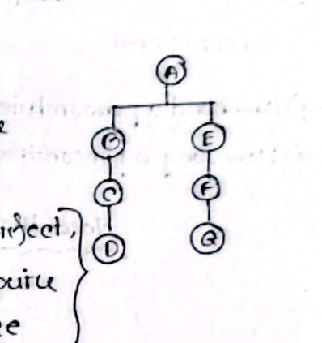

[← Previous: M02.2: Managerial Skills, Evaluation, and Development](M02.2_Managerial_Skills_Evaluation_and_Development.md) | [🏠 Index](00_Index.md) | [📐 Master Sheet](99_Master_Formula_and_Statutory_Sheet.md) | [Next: M03.2: Taylor's Scientific Management →](M03.2_Taylors_Scientific_Management.md)

***

# M03.1: Fayol's 14 Principles and Scalar Chain

> [!info] ⚡ Exam Snapshot
> - **Section & Priority:** Section B (CO2) · Dr. Md. Rabiul Islam Sir · 🔴 High Priority | **Read Time:** ~4 mins
> - **PYQs Covered:** 2021 Final Q.1(b) (05m), 2024 Final Q.5(c) (05m), Class 7 Model Question (05m)
> - **Scoring Rule:** State all 14 principles, contrast Command vs Direction via table, and cite the 2 Gangplank rules.

***

## 📌 1. Verbatim Definitions (For 2-Mark Questions)

> **Administrative Management:** "Focuses on managing the total organization." (Ricky W. Griffin)
- *Plain meaning:* Top-down corporate governance coordinating structure, authority, and policies across the firm.

> **Scalar Chain:** "The formal chain of command from the highest to the lowest level in the organization." (MRI Sir, Lecture 4)
- *Plain meaning:* Vertical hierarchy through which routine instructions and operational messages travel.

> **Gangplank (Fayol's Bridge):** Direct horizontal cross-channel connecting employees of equal rank across departments during emergencies.
- *Plain meaning:* Lateral bridge bypassing vertical tiers to prevent communication delays during crises.

***

## ⚡ 2. Core Exam Blocks (Write Directly in Exam)

### 2.1 The 14 Principles of Henri Fayol

> [!tip] Memory Hook: **DAD U C USSR? O I SEE!**
> Division, Authority, Discipline, Unity of command, Centralization, Unity of direction, Subordination, Scalar chain, Remuneration, Order, Initiative, Stability, Equity, *Esprit de corps*.

1. **Division of Work:** Specialization boosts dexterity; raises factory output up to $350\%$ (Class 7 Notes). *Ex:* Soldering vs testing.
2. **Authority & Responsibility:** Authority is the right to give orders. Responsibility is the duty to deliver. Accountability means answering for outcomes. Authority must equal responsibility (parity rule). *Ex:* Site leads purchasing replacement cables.
3. **Discipline:** Obeying organizational rules through fair supervision and clear penalties. *Ex:* Cleanroom anti-static wristbands.
4. **Unity of Command:** Each worker receives orders from only one direct superior. *Ex:* Developer reporting solely to Scrum Master.
5. **Centralization:** Balancing executive decision concentration with subordinate delegation. *Ex:* HQ sets budgets; field staff plan repairs.
6. **Unity of Direction:** Activities sharing one goal follow one plan under one leader. *Ex:* Squads following one product roadmap.
7. **Subordination of Individual Interest:** Firm goals override personal or team ambitions. *Ex:* Patching security bugs before custom features.
8. **Scalar Chain:** Unbroken authority line from chief executive to front-line staff. *Ex:* Routine updates moving through supervisors.
9. **Remuneration:** Fair pay rewarding effort and satisfying workers and employers. *Ex:* Overtime pay for post-storm network repairs.
10. **Order (Material & Social):** A place for everything, and right person in right job. *Ex:* Labeled tool racks; certified fiber techs.
11. **Initiative:** Encouraging staff to propose and execute new ideas. *Ex:* Automating daily server health checks with Python.
12. **Stability of Tenure:** Job security minimizes turnover and preserves skills. *Ex:* Multi-year contracts retaining firmware engineers.
13. **Equity:** Treating staff with kindness, justice, and impartiality. *Ex:* Identical promotion criteria for all junior engineers.
14. ***Esprit de Corps*:** Building harmony, mutual trust, and team cohesion. *Ex:* Blameless post-mortems after service disruptions.

***

### 2.2 Unity of Command vs. Unity of Direction

| Parameter | Unity of Command | Unity of Direction |
| :--- | :--- | :--- |
| **Rule** | 1 worker reports to 1 direct supervisor. | 1 objective follows 1 plan under 1 leader. |
| **Focus** | Individual worker and reporting lines. | Entire department and project roadmap. |
| **Purpose** | Prevents conflicting orders and dual loyalties. | Prevents duplicate work and wasted resources. |
| **Scope** | Micro level (worker to supervisor). | Macro level (entire department or project). |
| **Violation** | Discipline breaks down; worker confusion. | Fragmented effort; wasted corporate resources. |
| **Example** | QA tester answers solely to QC Lead. | All squads follow one product launch roadmap. |

***

### 2.3 Scalar Chain and the Gangplank Bridge

The scalar chain is the vertical line of authority from chief executive to front-line staff. Routine messages climb and descend this hierarchy step by step.

*Figure 1: Scalar Chain and Gangplank Bridge (Source: Raidah Class Notes, Class 7).*

#### Normal Vertical Delay
Executive $A$ oversees branches $A \rightarrow B \rightarrow C \rightarrow D$ and $A \rightarrow E \rightarrow F \rightarrow G$. Worker $D$ must climb to $A$ and descend to $G$ ($D \rightarrow A \rightarrow G$). This path requires six intermediate handoffs, causing fatal delays during emergencies.

#### Gangplank Bridge and Its 2 Strict Rules
Fayol created the **Gangplank** (horizontal bridge) to connect workers $D$ and $G$ of equal rank directly. Two mandatory rules govern this shortcut:
1. **Prior Permission:** Both workers must obtain approval from their immediate supervisors ($C$ and $F$) before communicating.
2. **Immediate Reporting:** Both workers must promptly inform their supervisors about all agreements and decisions made.

*Engineering Example:* A cut fiber cable halts internet traffic. Field engineer $D$ gets approval from manager $C$ and contacts router engineer $G$ directly. They reroute traffic onto microwave links within two minutes, then email joint reports to managers $C$ and $F$.

***

### 2.4 Critical Evaluation of Administrative Management

#### Contributions and Strengths
1. **Universal Framework:** Principles apply across manufacturing, telecommunications, public utilities, and software firms.
2. **Clear Administrative Structure:** Defines formal authority lines, eliminates dual reporting confusion, and fixes accountability.
3. **Managerial Flexibility:** Principles are adaptable guidelines rather than rigid mathematical rules.
4. **Comprehensive Top-Down View:** Offers a total blueprint for corporate governance across all departments.

#### Limitations and Criticisms
1. **Internal Inconsistencies:** Strict Unity of Command clashes with modern cross-functional teams and matrix structures.
2. **Mechanistic View:** Treats workers like machine parts, overlooking informal social networks and personal motives.
3. **Bureaucratic Delay:** Rigid vertical scalar chains slow decisions in fast-moving technology markets.
4. **Lack of Empirical Evidence:** Principles reflect personal executive experience rather than controlled scientific experiments.

*Verdict:* While modern tech firms use agile squads, clear authority, discipline, and fair treatment remain foundational for corporate administration.

***

## 🎯 3. PYQ & Target Answer Key

### 2021 Final Q.1(b) (05 Marks)
- **Question:** Discuss administrative principles: Unity of Command, Unity of Direction, Centralization, Authority and Accountability.
- **Answer Blueprint:** Define Authority, Accountability, and parity rule from §2.1 (Principle 2). Define Centralization from §2.1 (Principle 5). Reproduce the 6-row comparison table between Command and Direction from §2.2.

### 2024 Final Q.5(c) (05 Marks)
- **Question:** Critically evaluate the principles of administrative management.
- **Answer Blueprint:** Define Administrative Management from §1 and write the `DAD U C USSR? O I SEE!` memory hook. Summarize the 14 principles from §2.1. Provide the 4 Contributions vs. 4 Limitations from §2.4 with the 1-line verdict.

### Class 7 Model Exam Question (05 Marks)
- **Question:** Explain Henri Fayol's Scalar Chain principle. How does the "Gangplank" overcome delays in communication? Illustrate with a diagram and an engineering example.
- **Answer Blueprint:** Define Scalar Chain and Gangplank from §1. Sketch branches $A \rightarrow D$ and $A \rightarrow G$ with Figure 1. Explain the 6-step delay ($D \rightarrow A \rightarrow G$). State both Gangplank rules and cite the telecom fiber-cut scenario from §2.3.

***

> [!warning] ⚠️ Examiner Traps
> - **Mixing up Command and Direction:** Unity of Command is *one worker, one boss*. Unity of Direction is *one objective, one plan*.
> - **Omitting Gangplank Conditions:** Claiming direct contact without *prior approval* and *immediate reporting* loses marks.
> - **Missing the Specialization Stat:** Division of Work raises shop output by up to **$350\%$** (Class 7 Notes).

***

[← Previous: M02.2: Managerial Skills, Evaluation, and Development](M02.2_Managerial_Skills_Evaluation_and_Development.md) | [🏠 Index](00_Index.md) | [📐 Master Sheet](99_Master_Formula_and_Statutory_Sheet.md) | [Next: M03.2: Taylor's Scientific Management →](M03.2_Taylors_Scientific_Management.md)
