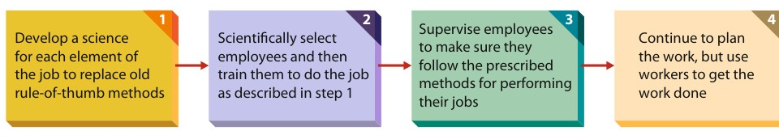

[← Previous: M03.1: Fayol's 14 Principles and Scalar Chain](M03.1_Fayols_14_Principles_and_Scalar_Chain.md) | [🏠 Index](00_Index.md) | [📐 Master Sheet](99_Master_Formula_and_Statutory_Sheet.md) | [Next: M04.1: Planning and Rational Decision Making →](M04.1_Planning_and_Rational_Decision_Making.md)

***

# M03.2: Taylor's Scientific Management

> [!info] ⚡ Exam Snapshot
> - **Section & Priority:** Section B (CO2) · Dr. Md. Rabiul Islam Sir · 🔴 High Priority | **Read Time:** ~3 mins
> - **PYQs Covered:** 2020 Final Q.1(c) (05m), Model Comparison Question (05m)
> - **Scoring Rule:** State the 4 steps in order, define soldiering, and contrast Taylor with Fayol via table.

***

## 📌 1. Verbatim Definitions (For 2-Mark Questions)

> **Scientific Management:** "Focuses on improving the performance of individual workers." (Ricky W. Griffin)
- *Plain meaning:* Studying shop-floor tasks through systematic observation to replace guesswork with verified scientific rules.

> **Management (Taylor, 1911):** "The art of knowing what you want men to do, and seeing that they do it in the best and cheapest way."
- *Plain meaning:* Finding the single most efficient, economical method for every physical operation.

> **Soldiering:** "Employees deliberately working at a pace slower than their capabilities." (Ricky W. Griffin)
- *Plain meaning:* Deliberate worker restriction of daily factory output to protect jobs or wage rates.

> **Mental Revolution:** Labor and management shift to mutual cooperation to expand total surplus rather than fighting over profits.
- *Plain meaning:* Replacing industrial conflict with shared prosperity through maximized productivity.

***

## ⚡ 2. Core Exam Blocks (Write Directly in Exam)

### 2.1 The Problem of Soldiering
Taylor identified deliberate slow working (soldiering) as the main barrier to output:
1. **Natural Soldiering:** The human instinct to take things easy and avoid exertion.
2. **Systematic Soldiering:** Deliberate group output restriction organized by workers.
- *Three Root Causes:* Fear of layoffs, flawed non-incentive wages and rate cuts, and clumsy rule-of-thumb habits.

***

### 2.2 Taylor's 4 Sequential Steps of Scientific Management

> [!tip] Memory Hook: **D-S-S-P (Develop, Select, Supervise, Plan)**
> - **D** · Develop science | **S** · Select & train | **S** · Supervise methods | **P** · Plan work

*Figure 1: Steps in Scientific Management (Source: Griffin, p. 42).*

1. **Develop a Science for Each Task Element:** Study tasks systematically to replace guesswork and find "the one best way."
2. **Scientifically Select, Train, and Develop Workers:** Match applicant traits to jobs. Systematically train workers in standard motions.
3. **Supervise and Cooperate Heartily:** Provide instruction cards and daily support to ensure compliance with scientific methods.
4. **Equal Division of Work and Responsibility:** Managers plan and design tools; workers execute physical operations.

***

### 2.3 Core Shop-Floor Tools (S-T-I-F-M)
1. **Standardization (S):** Uniform tools and conditions. *Ex:* Bethlehem custom shovels (small for heavy ore, large for ash).
2. **Time and Motion Study (T):** Stopwatch analysis eliminating wasted movements and adding rest pauses (Gilbreths: 17 *therbligs*).
3. **Incentive Piece-Rate System (I):** High pay rates for meeting standard output; low rates for falling short.
4. **Functional Foremanship (F):** 8 specialized supervisors (violates Unity of Command):
   - *Planning Room:* Route, Instruction, Time/Cost, and Disciplinarian clerks.
   - *Shop Floor:* Gang, Speed, and Repair bosses, plus Inspector.
5. **Mental Revolution (M):** Mutual labor-management cooperation expanding total surplus rather than disputing profits.

***

### 2.4 Critical Evaluation of Scientific Management
- **Strengths:** Surged output (Bethlehem pig-iron: $12.5 \rightarrow 47.5\text{ tons/man/day}$); founded ergonomics and merit pay.
- **Limitations:** Treated workers like cogs; caused burnout; unions fought speed-ups; 8-boss foremanship created friction.

***

### 2.5 Henri Fayol vs. F.W. Taylor

| Parameter | Henri Fayol (Administrative) | F.W. Taylor (Scientific) |
| :--- | :--- | :--- |
| **Level** | Top executive and corporate hierarchy. | Shop floor, workbench, and machine line. |
| **Focus** | Organizational structure and policy. | Task efficiency, tools, and worker motions. |
| **Approach** | **Top-Down:** Executive to staff. | **Bottom-Up:** Workbench to management. |
| **Workers** | Recognizes morale, team spirit, initiative. | Views workers as money-motivated actors. |
| **Command** | Strict rule: each worker has 1 boss. | Rejected: workers take orders from 8 bosses. |
| **Tools** | 14 principles and 5 functions. | Time-motion study and piece rates. |
| **Legacy** | Administrative theory and org charts. | Industrial engineering and ergonomics. |

***

## 🎯 3. PYQ & Target Answer Key

### 2020 Final Q.1(c) (05 Marks)
- **Question:** What are the principles of "scientific management"? Briefly describe them.
- **Answer Blueprint:** Define Scientific Management from §1. State soldiering and 3 causes from §2.1. Present the 4 sequential steps with Figure 1 from §2.2. List the 5 shop-floor tools (S-T-I-F-M) from §2.3.

### Model Exam Question: Fayol vs. Taylor (05 Marks)
- **Question:** Compare Henri Fayol and F.W. Taylor across level, focus, approach, and primary contribution.
- **Answer Blueprint:** Reproduce the 7-row comparison table from §2.5. Conclude: Fayol engineered executive coordination, while Taylor engineered shop-floor productivity.

***

> [!warning] ⚠️ Examiner Traps
> - **Scrambling the 4 Steps:** Steps must follow sequential order: Develop $\rightarrow$ Select $\rightarrow$ Supervise $\rightarrow$ Plan (D-S-S-P).
> - **Unity of Command Violation:** Functional foremanship assigns 8 bosses per worker, deliberately violating Fayol's Unity of Command.
> - **Incomplete Soldiering Definition:** Distinguish natural vs systematic soldiering and cite rate-cutting as a root cause.

***

[← Previous: M03.1: Fayol's 14 Principles and Scalar Chain](M03.1_Fayols_14_Principles_and_Scalar_Chain.md) | [🏠 Index](00_Index.md) | [📐 Master Sheet](99_Master_Formula_and_Statutory_Sheet.md) | [Next: M04.1: Planning and Rational Decision Making →](M04.1_Planning_and_Rational_Decision_Making.md)
