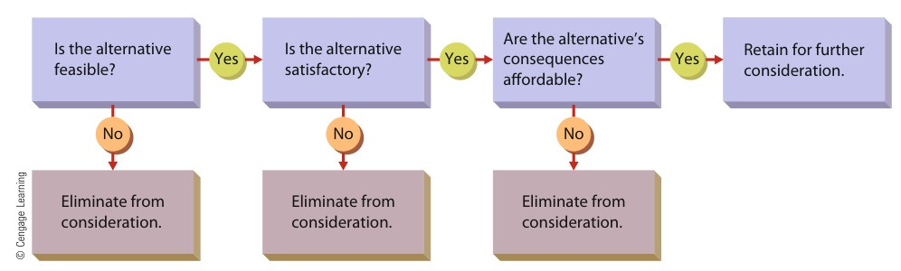

[← Previous: M03.2: Taylor's Scientific Management](M03.2_Taylors_Scientific_Management.md) | [🏠 Index](00_Index.md) | [📐 Master Sheet](99_Master_Formula_and_Statutory_Sheet.md) | [Next: M04.2: Organizing, Departmentalization, Delegation, and Span →](M04.2_Organizing_Departmentalization_Delegation_and_Span.md)

---

# M04.1: Planning and Rational Decision Making

> [!info] ⚡ Exam Snapshot
> - **Section & Priority:** Section B (Dr. Md. Rabiul Islam / MRI Sir) · High Priority
> - **Read Time:** ~4 mins
> - **PYQs Covered:** 2023 Q.6(a) (02m), 2023 Q.6(b) (03m), 2021 Q.2(a) (03m applied scenario)
> - **Scoring Rule:** State decision making as the catalyst of planning. List all 6 rational steps (`R-I-E-S-I-F`) in chronological order, name the 3 evaluation tests (`F-S-C`), and cite a concrete ECE telecom scenario.

---

## 📌 1. Verbatim Definitions (For 2-Mark Questions)

> **Planning:** "Setting an organization's goals and deciding in advance how best to achieve them." *(Ricky W. Griffin, Fundamentals of Management, Chapter 1)*

*Plain meaning:* Planning establishes where the organization wants to go and details the operational roadmap, schedules, and resource allocations needed to reach those targets before work begins.

> **Decision Making:** "The act of choosing one alternative from among a set of alternatives." *(Ricky W. Griffin, Fundamentals of Management, Chapter 4)*

*Plain meaning:* Decision making is the managerial act of identifying an operational problem or opportunity, generating viable options, and selecting the most effective course of action.

> **Bounded Rationality:** "A concept suggesting that decision makers are limited by their values and unconscious reflexes, skills, and habits." *(Herbert A. Simon / Griffin Ch. 4)*

*Plain meaning:* Real-world managers face cognitive and time constraints. Because they cannot process infinite information, their logical rationality operates within realistic human boundaries.

> **Satisficing:** "The tendency to search for alternatives only until one is found that meets some minimum standard of sufficiency." *(Herbert A. Simon / Griffin Ch. 4)*

*Plain meaning:* Rather than conducting an exhaustive search for the single mathematically optimal choice, managers select the first workable alternative that meets their minimum acceptable performance threshold.

---

## ⚡ 2. Core Exam Blocks (Write Directly in Exam)

### A. Three Types of Plans (`S-T-O`) & Standing vs. Single-Use Plans

Decision making serves as the primary catalyst of planning. At every stage of the planning process, managers must choose between alternative goals, operational pathways, and capital budgets.

| Dimension | Strategic Plan | Tactical Plan | Operational Plan |
| :--- | :--- | :--- | :--- |
| **Manager Level** | Top management (Board of Directors, CEO) | Middle management (Divisional Heads, Plant Managers) | First-line management (Unit Supervisors, Foremen) |
| **Time Horizon** | Long term ($3\text{ to }5+\text{ years}$) | Intermediate term ($1\text{ to }3\text{ years}$) | Short term (Days, weeks, or months) |
| **Scope & Breadth** | Entire organization across all business units | Specific department or functional division | Specific task, machine, shift, or work crew |
| **Detail Level** | Broad, general, and policy-focused | Moderate and departmental | Highly specific, quantitative, and standardized |
| **Risk Exposure** | High external market and technology volatility | Moderate operational and execution risk | Low internal operational risk |
| **ECE / Tech Case** | Build nationwide 5G optical fiber grid | Procure DWDM gear and train field crews | Run daily fiber inspection with OTDR meters |

> [!tip] Memory Hook: 3 Plan Types (`S-T-O`)
> - **S** -> **S**trategic Plans: Top management, long term (3 to 5+ years), entire enterprise scope.
> - **T** -> **T**actical Plans: Middle management, intermediate term (1 to 3 years), departmental scope.
> - **O** -> **O**perational Plans: First-line supervisors, short term (days to months), daily operational scope.

- **Standing Plans (For Recurring Activities):**
  - *Policy:* A general guide for managerial decision making within the organization (for example, an employee internet and security access policy).
  - *Standard Operating Procedure (SOP):* A sequence of detailed, step-by-step instructions for completing recurring tasks (such as a server rack backup checklist).
  - *Rule:* An explicit operational mandate specifying what must or must not be done (such as requiring electrostatic discharge wrist straps inside a semiconductor assembly room).

- **Single-Use Plans (For Non-Recurring Activities):**
  - *Program:* A comprehensive plan covering a large set of interrelated organizational activities (such as nationwide telecom infrastructure modernization).
  - *Project:* A single-use plan with a narrower scope, tighter budget, and defined deadline (such as installing a new cellular BTS antenna tower on a university campus).

---

### B. Decision Types & Three Decision Conditions

| Feature | Programmed Decision | Non-Programmed Decision |
| :--- | :--- | :--- |
| **Problem Nature** | Structured, routine, and repetitive | Unstructured, novel, and complex |
| **Frequency** | High frequency; recurs on a regular basis | Rare, unique, or single-occurrence event |
| **Solution Procedure** | Follows established rules, SOPs, and algorithms | Relies on managerial judgment, intuition, and creative analysis |
| **Management Level** | Lower-level and middle-level managers | Top-level executives and senior leadership |
| **ECE / Tech Example** | Reordering optical patch cords automatically at ROP | Deciding whether to acquire a regional broadband ISP |

#### Three Decision Conditions

1. **State of Certainty:**
   - *Condition:* The decision maker possesses complete, accurate, and reliable information. Every alternative and its exact outcome are known with 100% confidence.
   - *Error Risk:* Minimal ambiguity and virtually zero risk of decision error.
   - *ECE Example:* Purchasing standard CAT-6 patch cables from an approved vendor under an existing fixed-price supply contract.

2. **State of Risk:**
   - *Condition:* Information is incomplete, but the decision maker can estimate the mathematical probability of each outcome using historical data and statistical models.
   - *Error Risk:* Moderate ambiguity; decisions carry a calculated and quantifiable risk.
   - *ECE Example:* Submitting a \$500,000 bid on a smart grid deployment contract where historical bidding logs indicate a 70% probability of winning.

3. **State of Uncertainty:**
   - *Condition:* Information is highly ambiguous or unavailable. The decision maker cannot assign mathematical probabilities to potential outcomes.
   - *Error Risk:* High ambiguity and the highest probability of making costly errors; managers must rely on intuition and scenario analysis.
   - *ECE Example:* Committing heavy capital investment to unproven quantum optical communication hardware amid rapidly shifting international trade sanctions.

---

### C. Decision Models: Classical vs. Administrative

| Dimension | Classical Decision Model | Administrative Model (Herbert A. Simon) |
| :--- | :--- | :--- |
| **Nature of Model** | Prescriptive (explains how managers *should* decide) | Descriptive (explains how managers *actually* decide) |
| **Information Available** | Complete, perfect, accurate, and cost-free | Incomplete, imperfect, and subject to search costs |
| **Manager Rationality** | Perfectly logical, objective, and unbiased | Constrained by bounded rationality, habits, and reflexes |
| **Alternative Search** | Exhaustive search across every possible alternative | Limited sequential search stopping at a workable option |
| **Decision Criterion** | Optimizing (identifying the single best economic choice) | Satisficing (selecting the first option meeting minimum criteria) |
| **Real-World Reality** | Theoretical ideal; virtually impossible in practice | Realistic reflection of everyday managerial behavior |

---

### D. The 6 Steps of Rational Decision Making (`R-I-E-S-I-F`)

> [!tip] Memory Hook: 6 Rational Steps (`R-I-E-S-I-F`)
> - **R** -> **R**ecognize and define the decision situation
> - **I** -> **I**dentify alternatives
> - **E** -> **E**valuate alternatives (`F-S-C`: Feasibility, Satisfactoriness, Consequences)
> - **S** -> **S**elect the best alternative
> - **I** -> **I**mplement the chosen alternative
> - **F** -> **F**ollow up and evaluate results

When facing critical non-programmed decisions, managers follow six structured rational steps. The process is illustrated below using a running case study of cellular base station (BTS) congestion in Rajshahi:

1. **Recognize and Define the Decision Situation:**
   - *Principle:* A stimulus signals that a decision is required. This stimulus can be an operational problem (such as rising call drop rates) or a business opportunity (such as newly opened 5G spectrum). The manager must identify the underlying root cause rather than merely treating surface symptoms.
   - *Rajshahi BTS Case:* Automated network monitoring logs reveal that peak-hour call drops at a Rajshahi BTS jumped from $0.5\%$ to $6.8\%$. Diagnostic analysis confirms that evening video streaming has congested the RF sector.

2. **Identify Alternatives:**
   - *Principle:* Managers brainstorm realistic courses of action, exploring both standard and creative solutions within physical, legal, and organizational limits.
   - *Rajshahi BTS Case:* Telecom engineers identify three distinct options:
     - *Option A:* Install an additional 4G RF transceiver card in the existing tower rack (\$4,000 cost).
     - *Option B:* Construct a brand-new cell tower on an adjacent plot (\$50,000 cost).
     - *Option C:* Throttle subscriber data throughput during peak evening hours.

3. **Evaluate Alternatives (The Three Essential Tests):**
   - *Principle:* Every candidate alternative must successfully pass three sequential tests (`F-S-C`). If an alternative fails any single test, it is eliminated immediately.

*Figure 4.1: Evaluating Alternatives in the Decision-Making Process (Source: Griffin Ch. 4, p. 136).*

   - *Test 1 · Feasibility:* Is the option practical given existing financial, technical, and time constraints? Option B costs \$50,000 and requires six months of construction, so it fails the Feasibility test and is eliminated.
   - *Test 2 · Satisfactoriness:* Does the option genuinely resolve the root problem and achieve the operational objective? All three options would relieve sector congestion.
   - *Test 3 · Affordable Consequences:* Are the financial, operational, and customer consequences acceptable? Option C degrades user experience, violates SLA commitments, and increases customer churn, so it fails the Consequences test and is eliminated.
   - *Evaluation Result:* Option A (adding the RF transceiver card) is feasible, satisfactory, and produces affordable consequences.

4. **Select the Best Alternative:**
   - *Principle:* The decision maker chooses the alternative that provides the best balance of feasibility, effectiveness, and acceptable trade-offs.
   - *Rajshahi BTS Case:* The Chief Technical Officer formally approves Option A (procuring and mounting the RF transceiver card).

5. **Implement the Chosen Alternative:**
   - *Principle:* Management allocates operational funding, assigns technical personnel, establishes project schedules, and manages organizational resistance to change.
   - *Rajshahi BTS Case:* Field technicians mount the RF card into the rack, flash updated firmware, and re-orient antenna tilt during an off-peak maintenance window over the weekend.

6. **Follow Up and Evaluate Results:**
   - *Principle:* Managers compare post-implementation performance against pre-established target benchmarks. If the decision achieves the desired goal, operations proceed; if performance falls short, corrective action is taken.
   - *Rajshahi BTS Case:* Traffic logs recorded over the following week demonstrate that call drop rates dropped to $0.4\%$, well below the acceptable $1.0\%$ threshold, confirming complete resolution.

---

## 🎯 3. PYQ & Target Answer Key

### 2023 Final Q.6(a) (02 Marks)

**Question:** What do you mean by planning and decision making?

**Exam Writing Plan:**

1. Quote Ricky W. Griffin's verbatim definitions of Planning (*"Setting an organization's goals and deciding in advance how best to achieve them"*) and Decision Making (*"The act of choosing one alternative from among a set of alternatives"*) from §1.
2. Provide their plain meanings in 1 to 2 clear sentences: planning creates the operational roadmap before work starts, while decision making evaluates choices to resolve problems or capture opportunities.
3. Explicitly explain the core connection: Decision making serves as the fundamental catalyst of planning. At every stage of planning, managers must choose between alternative goals, paths, and budgets.
4. Concluding Takeaway: A manager cannot formulate any meaningful plan without making continuous decisions at every phase.

---

### 2023 Final Q.6(b) (03 Marks)

**Question:** State the process of decision making with example.

**Exam Writing Plan:**

1. Introduction: State that rational decision making follows a logical, step-by-step process consisting of six sequential phases (`R-I-E-S-I-F`).
2. List the 6 Steps in chronological sequence: (1) Recognize and define situation, (2) Identify alternatives, (3) Evaluate alternatives, (4) Select best alternative, (5) Implement chosen alternative, and (6) Follow up and evaluate results (from §2 Block D).
3. Detail the 3 Evaluation Tests in Step 3 (`F-S-C`): Feasibility, Satisfactoriness, and Affordable Consequences, referencing Figure 4.1.
4. Provide the ECE Telecom Case: Walk through the Rajshahi 4G BTS congestion scenario across all 6 steps, showing why Option B (too expensive and slow) and Option C (customer churn) failed while Option A (RF card) succeeded.
5. Concluding Takeaway: Emphasize that Step 6 (follow-up) must never be omitted, as it verifies post-implementation call drop rates against performance benchmarks.

---

### 2021 Final Q.2(a) (03 Marks Applied Scenario)

**Question:** What is decision making? Give an example of decision making which is effective but not efficient.

**Full Answer:**

#### 1. Definition of Decision Making

Decision making is the act of choosing one alternative from among a set of alternatives (Ricky W. Griffin, *Fundamentals of Management*, Chapter 4). It is the managerial process of recognizing an operational problem, evaluating viable paths, and selecting an optimal solution.

#### 2. Distinction Between Effectiveness and Efficiency

- **Effectiveness ("Doing the right things"):** Achieving targeted organizational goals and successfully resolving the problem.
- **Efficiency ("Doing things right"):** Minimizing resource waste (funds, time, materials, and labor) while achieving the targeted outcome.

#### 3. Real-World ECE / Telecom Engineering Case

- **The Operational Situation:** A primary optical fiber backbone snaps in Rajshahi during peak evening hours, abruptly disconnecting broadband service for 50,000 corporate and retail subscribers.
- **The Managerial Decision:** The network operations director charters an emergency helicopter crew for \$25,000 to fly specialist technicians and replacement fusion splicers from Dhaka to Rajshahi, restoring connectivity in 20 minutes.
- **Why It Was Effective:** The decision was **effective**. Network connectivity was restored immediately, major SLA breach penalties were avoided, and subscriber churn was halted.
- **Why It Was Not Efficient:** The decision was **not efficient**. The emergency helicopter operation cost \$25,000. In contrast, rerouting data traffic over an available standby microwave backup link would have cost only \$100 and taken just 10 minutes longer to synchronize. The manager achieved the goal, but wasted massive financial resources.

---

### Model Exam Question (04 Marks)

**Question:** Distinguish between strategic, tactical, and operational plans. Illustrate each plan type with an example from an engineering enterprise.

**Exam Writing Plan:**

1. Opening Statement: State that organizations configure plans across three hierarchical tiers according to management level, time horizon, and scope (Ricky W. Griffin, Chapter 3).
2. Define each plan type:
   - *Strategic Plans:* Top management (Board, CEO), long-term horizon ($3\text{ to }5+\text{ years}$), enterprise-wide scope (e.g., countrywide 5G optical fiber grid rollout).
   - *Tactical Plans:* Middle management (Division Heads), intermediate horizon ($1\text{ to }3\text{ years}$), departmental focus (e.g., procuring DWDM equipment and training technicians).
   - *Operational Plans:* First-line supervisors, short-term horizon (days to months), specific daily tasks (e.g., daily cable testing with OTDR meters).
3. Reproduce the 6-Dimension Comparison Table: Compare manager level, time horizon, scope, detail, environmental risk, and engineering examples from §2 Block A.
4. Concluding Takeaway: Strategic goals guide tactical programs, which in turn drive daily operational plans in an unbroken downward hierarchy.

---

> [!warning] ⚠️ Examiner Traps
> - **The Step 6 Omission Trap:** Never stop the rational decision-making process at Step 5 (Implementation). Omitting Step 6 (Follow up and evaluate results) loses 1 full mark.
> - **The 3 Evaluation Tests:** In Step 3, you must explicitly name **Feasibility**, **Satisfactoriness**, and **Affordable Consequences**. Generic phrases like "checking pros and cons" lose marks.
> - **Planning Catalyst Rule:** In definition questions, always explicitly state that decision making serves as the essential catalyst of planning.

---

[← Previous: M03.2: Taylor's Scientific Management](M03.2_Taylors_Scientific_Management.md) | [🏠 Index](00_Index.md) | [📐 Master Sheet](99_Master_Formula_and_Statutory_Sheet.md) | [Next: M04.2: Organizing, Departmentalization, Delegation, and Span →](M04.2_Organizing_Departmentalization_Delegation_and_Span.md)
