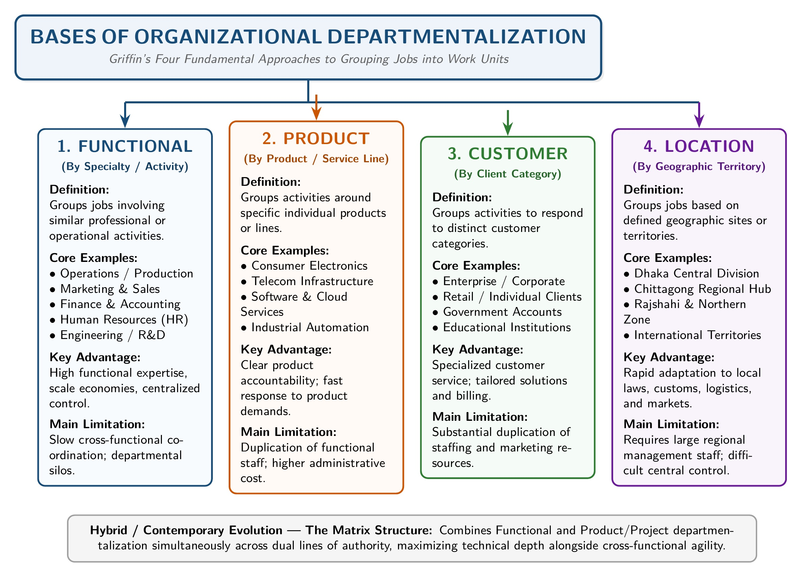
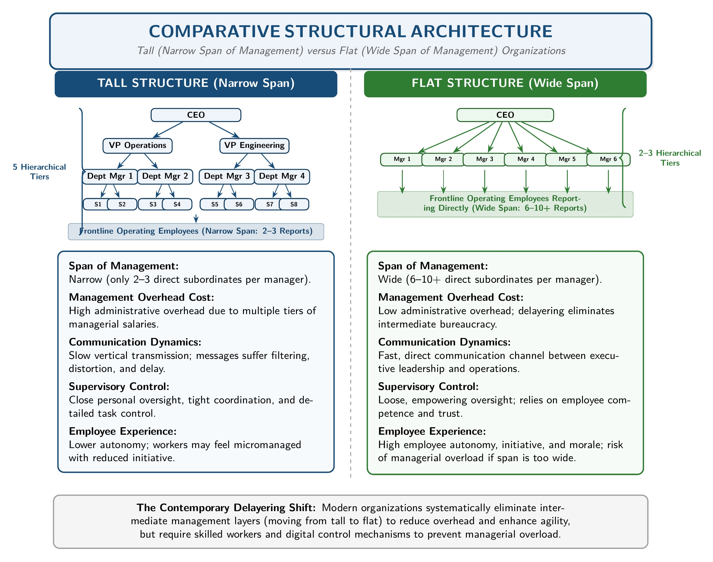

[← Previous: M04.1: Planning and Rational Decision Making](M04.1_Planning_and_Rational_Decision_Making.md) | [🏠 Index](00_Index.md) | [📐 Master Sheet](99_Master_Formula_and_Statutory_Sheet.md) | [Next: M04.3: Controlling Process and Steps →](M04.3_Controlling_Process_and_Steps.md)

---

# M04.2: Organizing, Departmentalization, Delegation, and Span of Control

> [!info] ⚡ Exam Snapshot
> - **Section & Priority:** Section B (Dr. Md. Rabiul Islam / MRI Sir) · High Priority
> - **Read Time:** ~5 mins
> - **PYQs Covered:** 2023 Final Q.6(c) (05m), 2025 IM-CT1 Q.10 (02m)
> - **Scoring Rule:** State the 6 building blocks of organizing. Compare 4 departmentalization bases (`F-P-C-L`), explain the 3 delegation steps with the ultimate accountability rule, and contrast tall vs. flat spans of control.

---

## 📌 1. Verbatim Definitions (For 2-Mark Questions)

> **Organizing:** "Determining how best to group organizational activities and resources." *(Ricky W. Griffin, Fundamentals of Management, Chapter 1)*

*Plain meaning:* Organizing groups employees, physical equipment, and operational tasks into a logical, coordinated structure so the enterprise can execute its plans smoothly.

> **Job Specialization:** "The degree to which the overall task of the organization is broken down and divided into smaller, component parts." *(Ricky W. Griffin, Chapter 6)*

*Plain meaning:* Job specialization divides a complex total workflow into small, simplified, and repeatable individual tasks.

> **Departmentalization:** "The process of grouping jobs according to some logical arrangement." *(Ricky W. Griffin, Chapter 6)*

*Plain meaning:* Departmentalization combines individual specialized positions into functional, product-based, client-focused, or geographic operating units as an organization expands.

> **Delegation:** "The process by which managers assign a portion of their total workload to others." *(Ricky W. Griffin, Chapter 6)*

*Plain meaning:* Delegation transfers operational tasks and legitimate decision-making power from a superior to subordinates while establishing reporting accountability.

> **Span of Management (Span of Control):** "The number of people who report to a particular manager." *(Ricky W. Griffin, Chapter 6)*

*Plain meaning:* Span of control defines how many direct subordinates report to a single supervisor, directly determining whether an organizational hierarchy is tall or flat.

---

## ⚡ 2. Core Exam Blocks (Write Directly in Exam)

### A. Tasks, Purposes, and the 6 Building Blocks of Organizing

#### Purposes vs. Tasks of Organizing

- **Purposes of Organizing (Why Organizations Structure Themselves):**
  1. *Role Clarity:* Defines exact roles, duties, authority limits, and reporting relationships for every employee.
  2. *Resource Coordination:* Integrates human, financial, physical, and information assets into a unified working system.
  3. *Waste Elimination:* Prevents work duplication, task friction, and redundant operational effort across teams.
  4. *Chain of Command:* Establishes an unbroken line of formal authority from executive leadership down to shop-floor workers.

- **Tasks of Organizing (What Actions Managers Carry Out · `I-D-A-D`):**
  1. **I**dentify and divide the total operational workload into specialized, manageable tasks.
  2. **D**epartmentalize related jobs into logical working units.
  3. **A**ssign specific duties, responsibilities, and workstations to qualified employees.
  4. **D**elegate legitimate authority, equipment, and financial resources to execute the work.

#### The 6 Basic Building Blocks of Organizing (Griffin Ch. 6)

1. **Designing Jobs (Job Specialization):** Breaking the total organizational workload into component parts. To prevent worker boredom and fatigue from over-specialization, managers use job rotation, job enlargement, and job enrichment.
2. **Grouping Jobs (Departmentalization):** Combining specialized positions into logical units using established criteria (`F-P-C-L`: Functional, Product, Customer, Location).
3. **Establishing Reporting Relationships:** Clarifying the chain of command and selecting an appropriate span of control, creating either a tall or flat organizational hierarchy.
4. **Distributing Authority:** Delegating legitimate decision-making power down to subordinates and deciding the appropriate degree of centralization versus decentralization.
5. **Coordinating Activities:** Integrating individual departments through structural mechanisms such as managerial hierarchy, standard rules, liaison roles, and task forces.
6. **Differentiating Positions (Line vs. Staff):** Distinguishing line positions (direct responsibility for organizational goals and formal command authority) from staff positions (advisory and technical support expertise).

---

### B. 4 Common Bases of Departmentalization (`F-P-C-L`) & Matrix Design

> [!tip] Memory Hook: 4 Departmentalization Bases (`F-P-C-L`)
> - **F** -> **F**unctional (by technical specialty: R&D, Operations, Sales, Finance)
> - **P** -> **P**roduct (by product line: Refrigerators, Air Conditioners, Televisions, Mobile)
> - **C** -> **C**ustomer (by client segment: Corporate Enterprise, Retail Consumers, Government)
> - **L** -> **L**ocation (by geographic territory: Dhaka, Rajshahi, Chittagong, Khulna)

*Figure 6.1: Four Primary Bases of Organizational Departmentalization (Source: Griffin Ch. 6).*

| Base | Grouping Criterion | Key Advantage | Key Disadvantage | Tech / ECE Example |
| :--- | :--- | :--- | :--- | :--- |
| **Functional** | Similar technical or business activities | Deep technical expertise and straightforward supervision | Slow cross-unit decisions; narrow departmental silos | Electronics startup (Hardware Design, Firmware, QA, Finance) |
| **Product** | Specific product line or family | Direct product coordination and clear profit accountability | Duplicated staff and higher administrative costs | Walton consumer divisions (Refrigerators, AC, TV, Mobile) |
| **Customer** | Distinct customer segment or tier | Tailored customer handling and high client satisfaction | High administrative cost to maintain duplicate divisions | Telecom accounts (Corporate Enterprise vs. Mass Retail Consumers) |
| **Location** | Geographic territory or site | Rapid regional responsiveness and local supply handling | Hard to enforce uniform standards; duplicate regional heads | Power utility maintenance circles (Dhaka, Rajshahi, Khulna) |
| **Matrix Design** | Function + Project overlay (Dual reporting) | High flexibility and efficient specialist deployment | Dual-boss conflict (violates unity of command); role ambiguity | Aerospace satellite project (RF engineers report to VP and Project Lead) |

---

### C. Delegation of Authority: 3 Steps, Barriers, and Centralization

#### The 3 Steps in the Delegation Process

1. **Assigning Responsibility:** The manager assigns a specific duty or operational task to a subordinate (for example, directing a junior engineer to design a microinverter circuit).
2. **Granting Authority:** The manager provides the legitimate power, budget access, and equipment needed to complete the work without constant micro-approvals.
3. **Creating Accountability:** The subordinate accepts the obligation to perform the duty on time and report results back to the manager.

> [!important] The Ultimate Accountability Rule
> While a manager delegates authority and responsibility, **the manager can never delegate ultimate accountability**. Top executives hold the delegating manager responsible if the subordinate fails.

#### Barriers to Effective Delegation

- **Managerial Barriers:**
  - *Reluctance to Relinquish Control:* Some managers believe they can complete the work faster and better themselves.
  - *Lack of Trust in Subordinates:* Managers doubt the technical competence or reliability of their team members.
  - *Insecurity and Fear of Competition:* Insecure supervisors worry that an outstanding subordinate will outshine or replace them.
  - *Poor Communication:* Managers fail to define task goals, guidelines, and authority boundaries clearly.

- **Subordinate Barriers:**
  - *Fear of Failure and Criticism:* Employees worry about making mistakes and receiving public blame.
  - *Lack of Self-Confidence:* Subordinates doubt their technical skills to execute tasks independently.
  - *Lack of Incentives:* Employees resist taking on additional workload without commensurate recognition, pay, or promotion prospects.
  - *Information Deficits:* Workers lack the technical training or operational data needed to handle the assignment.

#### Centralization vs. Decentralization

- **Centralization:** Power and decision-making authority are systematically retained at top executive levels (e.g., Walmart, McDonald's).
- **Decentralization:** Power and decision-making authority are systematically delegated down to middle and frontline managers (e.g., General Electric, Johnson & Johnson).
- **Key Determinants:**
  - *Environmental Uncertainty:* Dynamic, unpredictable markets favor decentralization so frontline staff can react rapidly.
  - *Decision Cost and Risk:* Expensive capital investments and critical liabilities favor centralization.
  - *Subordinate Competence:* Highly trained, competent frontline staff encourage management to decentralize authority.

---

### D. Span of Control: Tall vs. Flat Structures & 8 Determining Factors

*Figure 6.2: Tall Structure (Narrow Span) versus Flat Structure (Wide Span) (Source: Griffin Ch. 6).*

| Parameter | Tall Structure (Narrow Span) | Flat Structure (Wide Span) |
| :--- | :--- | :--- |
| **Span Size** | Narrow (few subordinates per manager) | Wide (many subordinates per manager) |
| **Hierarchical Layers** | Many vertical tiers | Few vertical tiers |
| **Administrative Overhead** | High (many managerial salaries) | Low (fewer managers needed) |
| **Communication Speed** | Slower; messages get delayed and distorted across levels | Faster; direct link from top leadership to frontline staff |
| **Manager Supervision** | Close, tight control and personal oversight | Looser supervision; high manager coordination workload |
| **Employee Morale** | Lower; micromanagement restricts initiative and autonomy | Higher; workers enjoy autonomy, trust, and empowerment |

#### 8 Factors Determining Span Size (`C-D-N-I-S-T-P-T`)

1. **Competence of Staff:** Highly skilled and experienced workers require minimal supervision, enabling a **wide span**; untrained personnel require a **narrow span**.
2. **Physical Dispersion:** When workers are co-located in a single facility, supervision is easy, supporting a **wide span**; geographically scattered field sites require a **narrow span**.
3. **Nonsupervisory Workload:** Managers burdened with heavy administrative, planning, or committee duties have less time for oversight, requiring a **narrow span**.
4. **Required Interaction:** Tasks demanding constant personal communication, coaching, or troubleshooting necessitate a **narrow span**.
5. **Standardized Procedures (SOPs):** Comprehensive written manuals, rules, and checklists allow subordinates to operate independently, enabling a **wide span**.
6. **Task Similarity:** When supervised subordinates perform identical, routine operations, a manager can effectively handle a **wide span**.
7. **Frequency of New Problems:** Stable, predictable environments support a **wide span**; dynamic operations facing frequent unexpected problems require a **narrow span**.
8. **Communication Technology:** Modern management software, ERP dashboards, and instant messaging allow a supervisor to oversee a **wide span** with ease.

---

## 🎯 3. PYQ & Target Answer Key

### 2023 Final Q.6(c) (05 Marks)

**Question:** Discuss the following elements of organizing:

1. Departmentalization
2. Delegation of authority
3. Span of control

**Exam Writing Plan:**

1. Opening Definition: Define Organizing verbatim from §1 (*"Determining how best to group organizational activities and resources"*).
2. Element 1 · Departmentalization: Define departmentalization from §1. Present the 4 primary bases (`F-P-C-L`: Functional, Product, Customer, Location) using the comparison table and Figure 6.1 from §2 Block B, noting strengths and tech examples for each.
3. Element 2 · Delegation of Authority: Define delegation from §1. Walk through the 3 sequential steps (Assigning responsibility, Granting authority, Creating accountability) from §2 Block C. Emphasize the ultimate accountability rule and cite manager/subordinate barriers.
4. Element 3 · Span of Control: Define span of management from §1. Contrast Tall (narrow span) vs. Flat (wide span) structures using the comparison table and Figure 6.2 from §2 Block D. List 4 key determining factors (competence, SOPs, task similarity, communication technology).
5. Concluding Takeaway: Effective organizing balances these three structural elements to establish clear reporting relationships while maintaining organizational agility.

---

### 2025 IM-CT1 Q.10 (02 Marks)

**Question:** Write the tasks and purposes of organizing.

**Exam Writing Plan:**

1. Opening Statement: State that organizing serves distinct purposes (explaining *why* an enterprise structures itself) and comprises concrete tasks (explaining *what actions* managers perform).
2. List the 4 Purposes of Organizing: Role clarity, Resource coordination, Waste elimination, and Unbroken chain of command (from §2 Block A).
3. List the 4 Tasks of Organizing (`I-D-A-D`): Identification and division of work, Departmentalization of related jobs, Assignment of duties, and Delegation of legitimate authority (from §2 Block A).
4. Concluding Takeaway: A structured two-part presentation with bold headings ensures maximum marks on 2-mark definitions.

---

### Model Exam Question 1 · Departmentalization Bases and Matrix Design (05 Marks)

**Question:** Explain the four common bases of departmentalization. How does a matrix organization structure differ from classic departmentalization? Support your answer with organizational diagrams.

**Exam Writing Plan:**

1. Opening Definition: Define Departmentalization from §1 and introduce the four traditional bases (`F-P-C-L`).
2. Four Traditional Departmentalization Bases: Explain Functional, Product, Customer, and Location bases using Figure 6.1 and the comparison table from §2 Block B (highlighting criteria, advantages, and tech examples).
3. Matrix Organization Concept: Explain that a matrix design overlays a horizontal project management structure onto a vertical functional hierarchy.
4. Detail 3 Core Differences: (a) Dual command (violates unity of command with two bosses vs. single boss), (b) Resource sharing (temporary project assignment without permanent rehire), and (c) Flexibility vs. conflict trade-off.
5. Concluding Takeaway: While traditional bases optimize stability and specialization, matrix structures provide agility for complex, multi-disciplinary engineering projects.

---

### Model Exam Question 2 · Delegation Process, Barriers, and Centralization (04 Marks)

**Question:** Outline the three steps of the delegation process. Why do managers often fail to delegate? Distinguish between centralization and decentralization.

**Exam Writing Plan:**

1. Three Steps of Delegation: Walk through Assigning responsibility, Granting authority, and Creating accountability from §2 Block C.
2. The Ultimate Accountability Principle: Explicitly state that a manager delegates authority and operational responsibility, but never ultimate accountability.
3. Barriers to Delegation: Summarize managerial barriers (reluctance to let go, lack of trust, fear of being outshined) and subordinate barriers (fear of failure, lack of incentives).
4. Centralization vs. Decentralization: Compare power retained at top management vs. power systematically pushed down to frontline units, citing market uncertainty and decision risk as deciding factors.
5. Concluding Takeaway: Delegation is an interpersonal act, whereas centralization/decentralization reflects organization-wide structural policy.

---

### Model Exam Question 3 · Tall vs. Flat Structures and Span Factors (05 Marks)

**Question:** Compare tall and flat organizational structures. Describe the factors that determine whether an organization should adopt a wide or narrow span of control.

**Exam Writing Plan:**

1. Definition of Span of Control: Define span of management from §1 and explain how it determines organizational height.
2. Tall vs. Flat Comparison: Contrast narrow span (tall) vs. wide span (flat) across hierarchical layers, administrative cost, communication speed, manager workload, and employee morale using Figure 6.2 and the comparison table from §2 Block D.
3. Eight Determining Factors (`C-D-N-I-S-T-P-T`): List and briefly explain worker competence, physical dispersion, nonsupervisory duties, required interaction, SOPs, task similarity, problem novelty, and communication technology.
4. Concluding Takeaway: Modern enterprises increasingly favor flat organizations through delayering, enabled by automated digital dashboards and empowered professional staff.

---

> [!warning] ⚠️ Examiner Traps
> - **Tasks vs. Purposes Confusion:** Purposes answer *why* we organize (role clarity, resource coordination, waste elimination). Tasks answer *what actions* managers perform (work division, departmentalization, assigning duties, delegating authority). Never mix these up on 2-mark questions!
> - **The Ultimate Accountability Rule:** Always state that managers can delegate authority and operational responsibility, but **never ultimate accountability**. Top leadership still holds the delegating supervisor accountable.
> - **Matrix Dual Command:** Explicitly mention that a matrix design violates Henri Fayol's classical unity of command principle because subordinates report simultaneously to two bosses.
> - **Three Delegation Steps Sequence:** Always state the 3 delegation steps in exact order (Assigning responsibility -> Granting authority -> Creating accountability); never merge authority and responsibility into a single vague bullet.

---

[← Previous: M04.1: Planning and Rational Decision Making](M04.1_Planning_and_Rational_Decision_Making.md) | [🏠 Index](00_Index.md) | [📐 Master Sheet](99_Master_Formula_and_Statutory_Sheet.md) | [Next: M04.3: Controlling Process and Steps →](M04.3_Controlling_Process_and_Steps.md)
