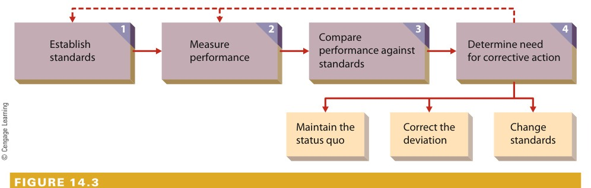

[← Previous: M04.2: Organizing, Departmentalization, Delegation, and Span](M04.2_Organizing_Departmentalization_Delegation_and_Span.md) | [🏠 Index](00_Index.md) | [📐 Master Sheet](99_Master_Formula_and_Statutory_Sheet.md) | [Next: M05.1: Motivation Basics and Financial vs. Non-Financial →](M05.1_Motivation_Basics_and_Financial_vs_NonFinancial.md)

---

# M04.3: Controlling Process and Steps

> [!info] ⚡ Exam Snapshot
> - **Section & Priority:** Section B · Dr. Md. Rabiul Islam Sir · High Priority | **Read Time:** ~4 mins
> - **PYQs Covered:** 2021 Final Q.2(b) (06m: Definition & 4 Control Steps)
> - **Scoring Rule:** State Griffin's definition verbatim, draw the 4-step feedback diagram, and list all 3 corrective choices in Step 4 for full 6/6 marks.

---

## 📌 1. Verbatim Definitions (For 2-Mark Questions)

1. **Control (Organizational Control):**
   > "The regulation of organizational activities so that some targeted element of performance remains within acceptable limits [or: in such a way as to facilitate goal attainment]." (Ricky W. Griffin, *Fundamentals of Management*, Chapter 14)
   - *Plain meaning:* Keeping work on track so actual results match planned goals.

2. **Control Standard:**
   > "A target against which subsequent performance will be compared." (Ricky W. Griffin, Chapter 14)
   - *Plain meaning:* An objective, measurable benchmark used to evaluate actual performance.

---

## ⚡ 2. Core Exam Blocks (Write Directly in Exam)

### A. Four Fundamental Purposes of Control (A-L-C-M)

1. **Adapt to Environmental Change:** Tracks shifts in markets, technology, and costs to adjust work before losses occur.
2. **Limit Accumulation of Error:** Prevents minor daily errors from compounding into severe operational or financial failures.
3. **Cope with Organizational Complexity:** Provides standardized metrics for managers to oversee diverse product lines and branch units.
4. **Minimize Operating Costs:** Cuts scrap, idle labor, and downtime to keep expenses within budget limits.

> [!tip] Memory Hook: A-L-C-M
> - **A** -> **A**dapt to environmental change
> - **L** -> **L**imit error accumulation
> - **C** -> **C**ope with complexity
> - **M** -> **M**inimize costs and waste

### B. Operations Control by Timing and Resource Control Areas

Operations control monitors the transformation of inputs into finished outputs:

| Control Type | Timing | Focus | Primary Objective | Industrial Example |
| :--- | :--- | :--- | :--- | :--- |
| **Preliminary (Feedforward)** | Before work begins | Inputs (materials, labor, funds) | Prevent defects from entering the plant | Inspecting raw silicon wafers before fabrication |
| **Screening (Concurrent)** | During transformation | In-process operations | Catch and fix errors immediately during work | Checking PCB solder joints right after wave soldering |
| **Postaction (Feedback)** | After work ends | Final outputs (finished goods) | Verify final quality and guide future planning | Running 24-hour burn-in stress tests on assembled units |

> [!tip] Memory Hook: P-S-P (Timing of Control)
> - **P** -> **P**reliminary (Inputs: Before work starts)
> - **S** -> **S**creening (Process: During transformation)
> - **P** -> **P**ostaction (Outputs: After work completes)

Resource control areas:
1. **Physical:** Inventories, machine maintenance, scrap rates.
2. **Human:** Selection tests, training, performance appraisals.
3. **Information:** Forecasting, network uptime, cybersecurity audits.
4. **Financial:** Cash flow, budgets, debt schedules.

### C. The Four Steps in the Control Process (S-M-C-C)

*Figure 1: Steps in the Organizational Control Process (Source: Griffin Ch. 14, p. 461).*

1. **Set Standards:** Establish measurable targets aligned with goals (e.g., solder defect rate $< 0.1\%$, uptime $\ge 99.9\%$).
2. **Measure Performance:** Continuously collect valid and timely operational data (e.g., AOI logs, daily output counts).
3. **Compare Performance Against Standards:** Compare actual output against targets using an acceptable tolerance band. Variations within tolerance require no action.
4. **Consider Corrective Action:** Choose one of three distinct paths:
   - **Maintain Status Quo:** Performance meets standard within tolerance; continue work as planned.
   - **Correct Deviation:** Performance falls below standard; fix root causes (recalibrate machines, retrain staff).
   - **Change Standard:** Standard is unrealistic or outdated due to technology shifts; adjust the benchmark.
5. **Feedback Loop:** Feeds Step 4 data back to Step 1 and Step 2 to refine future standards and measurement methods.

> [!tip] Memory Hook: S-M-C-C
> - **S** -> **S**et standards (measurable targets)
> - **M** -> **M**easure performance (continuous data collection)
> - **C** -> **C**ompare against standards (check tolerance band)
> - **C** -> **C**onsider corrective action (**M-C-C**: Maintain, Correct, or Change)

---

## 🎯 3. PYQ & Target Answer Key

### 2021 Final Q.2(b) (06 Marks)
**Question:** What do you mean by "controlling"? Briefly describe the steps in the control process.

**Answer Blueprint:**
- State Griffin's verbatim definition of control from §1.
- Draw the 4-step closed-loop diagram from §2 Block C (Figure 1).
- Explain each step (`S-M-C-C`) and detail all 3 corrective choices in Step 4 (**Maintain**, **Correct**, **Change**) plus the feedback loop.

---

### Target Question 1: Operations Control Types (04 Marks)
**Question:** Distinguish among preliminary, screening, and postaction control with industrial examples.

**Answer Blueprint:**
- Present the 5-column comparison table directly from §2 Block B.
- State in 1 sentence that combining all three eliminates quality blind spots.

---

### Target Question 2: Four Purposes of Control (04 Marks)
**Question:** Discuss the four fundamental purposes of organizational control as outlined by Ricky W. Griffin.

**Answer Blueprint:**
- State the four purposes (`A-L-C-M`) from §2 Block A with their 1-line industrial cases.

---

> [!warning] ⚠️ Examiner Traps
> - **Incomplete Step 4 Trap:** Never write simply "take corrective action." Explicitly list all three options: maintain status quo, correct deviation, or change the standard.
> - **Missing Feedback Loop:** Forgetting the feedback arrow connecting Step 4 to Steps 1 and 2 in your flowchart loses marks.
> - **Screening vs. Postaction Timing:** Screening occurs *during* transformation. Postaction occurs *after* the product is fully completed.

---

[← Previous: M04.2: Organizing, Departmentalization, Delegation, and Span](M04.2_Organizing_Departmentalization_Delegation_and_Span.md) | [🏠 Index](00_Index.md) | [📐 Master Sheet](99_Master_Formula_and_Statutory_Sheet.md) | [Next: M05.1: Motivation Basics and Financial vs. Non-Financial →](M05.1_Motivation_Basics_and_Financial_vs_NonFinancial.md)
