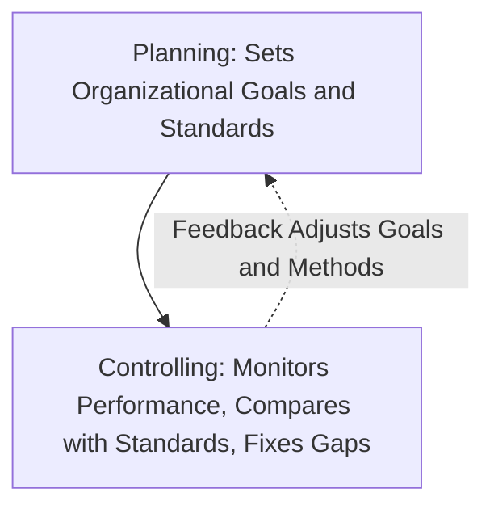

[← Previous: M04.2: Organizing, Departmentalization, Delegation, and Span](M04.2_Organizing_Departmentalization_Delegation_and_Span.md) | [🏠 Index](00_Index.md) | [📐 Master Sheet](99_Master_Formula_and_Statutory_Sheet.md) | [Next: M05.1: Motivation Basics and Financial vs. Non-Financial →](M05.1_Motivation_Basics_and_Financial_vs_NonFinancial.md)

---

# M04.3: Controlling Process and Steps

> [!info] ⚡ Exam Snapshot
> - **Section & Priority:** Section B (CO2 · Industrial Management · Dr. Md. Rabiul Islam Sir) · High Priority
> - **Read Time:** ~4 minutes
> - **PYQs Covered:** 2021 Final Q.2(b) (06 Marks: Definition and 4 Control Steps)
> - **Scoring Strategy:** State Griffin's definition verbatim. Draw the four-step closed-loop diagram with its feedback loop. Finally, explain all three corrective choices in Step 4.

---

## 📌 1. Verbatim Definitions (For 2-Mark Questions)

> **Control (Organizational Control):** "The regulation of organizational activities in such a way as to facilitate goal attainment." *(Ricky W. Griffin, Fundamentals of Management, Chapter 14)*

*Plain meaning:* Control keeps the company on track. It works like a ship's rudder. Managers track daily work to make sure it hits planned targets.

> **Control Standard:** "A target against which subsequent performance will be compared." *(Ricky W. Griffin, Fundamentals of Management, Chapter 14)*

*Plain meaning:* A clear target number you want to hit. For example, your target might be 100 good chips per hour. Managers compare real output against this number.

---

## ⚡ 2. Core Exam Blocks (Write Directly in Exam)

### A. Four Fundamental Purposes of Control (A-L-C-M)

Planning sets the goals. Controlling monitors work to ensure the firm actually reaches those goals:

Griffin outlines four key reasons why managers need control:

1. **Adapting to Environmental Change:**
   - Markets change fast.
   - Customers want new features, rivals cut prices, and technology evolves.
   - Good control spots these shifts early.
   - This helps managers adjust operations before the firm loses money.

2. **Limiting the Accumulation of Error:**
   - Small daily mistakes add up fast.
   - A tiny solder flaw can ruin an entire production run.
   - Good control catches errors early before they turn into huge financial disasters.

3. **Coping with Organizational Complexity:**
   - Big companies make many products across multiple factory sites.
   - One manager cannot watch every worker in person.
   - Clear control metrics let managers track complex operations easily from one place.

4. **Minimizing Operating Costs:**
   - Control cuts scrap and cuts machine downtime.
   - It stops workers from sitting idle without parts.
   - This keeps production costs low and protects profit margins.

> [!tip] Memory Hook: A-L-C-M (Purposes of Control)
> - **A** -> **A**dapt to environmental change
> - **L** -> **L**imit the accumulation of error
> - **C** -> **C**ope with organizational complexity
> - **M** -> **M**inimize operating costs and waste

### B. Operations Control by Timing and Resource Control Areas

Operations control tracks materials as they move through the factory:

| Control Type | Timing | Operational Focus | Primary Objective | Industrial Example |
| :--- | :--- | :--- | :--- | :--- |
| **Preliminary (Feedforward)** | Before work begins | Inputs (materials, labor, funds) | Stop defective materials before they enter the plant | Testing raw silicon wafers before making microchips |
| **Screening (Concurrent)** | During transformation | In-process transformation activities | Catch and fix errors right as parts are made | Checking PCB solder joints right after wave soldering |
| **Postaction (Feedback)** | After work ends | Final outputs (finished goods) | Verify final quality and use results to improve future runs | Running 24-hour stress tests on assembled units |

> [!tip] Memory Hook: P-S-P (Timing of Control)
> - **P** -> **P**reliminary (Inputs: Before work starts)
> - **S** -> **S**creening (Process: During transformation)
> - **P** -> **P**ostaction (Outputs: After work completes)

Resource control tracks the four main types of company resources:

1. **Physical Resources:** Managing warehouse inventory, scheduling machine repairs, and cutting factory scrap.
2. **Human Resources:** Testing job applicants, running skill training, and evaluating employee performance reviews.
3. **Information Resources:** Checking sales forecasts, keeping computer servers online, and guarding company data.
4. **Financial Resources:** Tracking cash flow, managing department budgets, and paying bills on time.

### C. The Four Steps in the Control Process (S-M-C-C)

*Figure 1: Steps in the Organizational Control Process (Source: Griffin Ch. 14, p. 461).*

The control process follows four clear steps linked by an active feedback loop:

1. **Set Standards:**
   - Set clear, measurable targets based directly on company goals.
   - For example, target a solder defect rate $\le 0.1\%$ or server uptime $\ge 99.9\%$.
   - A good standard must be specific, realistic, and easy to measure.

2. **Measure Performance:**
   - Track actual work output on a regular basis.
   - Collect data using automated sensors, inspection sheets, or production logs.
   - The data must be accurate, reliable, and collected on time.

3. **Compare Performance Against Standards:**
   - Check actual output against the target benchmark.
   - Managers set an acceptable tolerance band around the target.
   - If output falls within this band, no action is needed.
   - But if a big gap appears, managers must step in to find the root cause.

4. **Determine Need for Corrective Action:**
   - Evaluate the gap and pick one of three clear paths (**M-C-C**):
     - **Maintain Status Quo (Do Nothing):**
       - Performance hits or beats the target within the allowed range.
       - Work runs smoothly. Managers let it continue as planned.
     - **Correct the Deviation (Fix the Gap):**
       - Performance falls below acceptable limits.
       - Managers must step in right away.
       - They recalibrate machines, patch software bugs, or retrain operators.
     - **Change the Standard (Reset the Target):**
       - Sometimes the original target is flawed or unrealistic.
       - Tech tools or market rules may also have changed.
       - Managers revise the standard to make it realistic.

**The Continuous Feedback Loop:**

- Data from Step 4 continuously flows back into Step 1 and Step 2.
- If standards are too harsh, feedback tells managers to adjust Step 1.
- If measurements were faulty, feedback helps managers improve tools in Step 2.
- Without this loop, control goes blind and cannot fix recurring problems.

> [!tip] Memory Hook: S-M-C-C (The 4 Control Steps)
> - **S** -> **S**et standards (measurable targets)
> - **M** -> **M**easure performance (continuous data collection)
> - **C** -> **C**ompare against standards (check tolerance band)
> - **C** -> **C**onsider corrective action (**M-C-C**: Maintain, Correct, or Change)

---

## 🎯 3. PYQ & Target Answer Key

### 2021 Final Q.2(b) (06 Marks)

**Question:** What is controlling? Discuss the steps of controlling method.

**Exam Writing Plan:**

1. **Verbatim Definition:**
   - Quote Ricky W. Griffin: *"The regulation of organizational activities in such a way as to facilitate goal attainment."*
   - Add a 1-sentence plain explanation. Control acts like a ship's rudder to keep work on target.
2. **Process Diagram:**
   - Draw the 4-step closed-loop diagram (Figure 1).
   - Show: Set Standards $\to$ Measure $\to$ Compare $\to$ Corrective Action.
   - Draw the dashed feedback loop connecting back to Step 1 and Step 2.
3. **Explain the Four Steps (`S-M-C-C`):**
   - Step 1: Set measurable standards (e.g., defect rate $\le 0.1\%$).
   - Step 2: Measure real performance using sensors or logs.
   - Step 3: Compare results against the target tolerance band.
   - Step 4: Pick a corrective action.
4. **Detail Three Corrective Action Paths:**
   - *Maintain Status Quo:* Keep going if results hit the target.
   - *Correct Deviation:* Fix root causes if results fall short.
   - *Change Standards:* Reset targets if they are unrealistic.
5. **Concluding Takeaway:**
   - Control fails without the feedback loop.
   - Real-time feedback lets managers adapt to changes and fix errors early.

---

### Target Question 1: Operations Control by Timing (04 Marks)

**Question:** Distinguish among preliminary, screening, and postaction control with appropriate industrial examples.

**Exam Writing Plan:**

1. **Core Distinction:**
   - Define operations control in one simple sentence.
   - It monitors resources as they move through inputs, transformation, and final outputs.
2. **Comparison Table:**
   - Draw the 5-column table from §2 Block B.
   - Compare Preliminary, Screening, and Postaction control across timing, focus, objective, and examples.
3. **Engineering Examples:**
   - *Preliminary:* Test raw silicon wafers before making chips.
   - *Screening:* Inspect solder joints right after soldering a PCB.
   - *Postaction:* Run 24-hour stress tests on assembled units.
4. **Concluding Takeaway:**
   - Top manufacturing plants use all three controls together.
   - This eliminates blind spots at every production stage.

---

### Target Question 2: Fundamental Purposes of Control (04 Marks)

**Question:** Discuss the four fundamental purposes of organizational control as outlined by Ricky W. Griffin.

**Exam Writing Plan:**

1. **Opening Statement:**
   - Explain why control is vital.
   - Modern businesses face constant change, human errors, and growing complexity.
2. **Four Purposes (A-L-C-M):**
   - *Adapting to Environmental Change:* Spot shifts in customer tastes, rival pricing, and technology early.
   - *Limiting the Accumulation of Error:* Catch small daily mistakes before they balloon into disasters.
   - *Coping with Organizational Complexity:* Use clear metrics to run multiple product lines and factory sites.
   - *Minimizing Operating Costs:* Cut scrap, eliminate idle labor, and reduce machine downtime.
3. **Concluding Takeaway:**
   - Control keeps factories efficient.
   - It also gives managers the agility to respond quickly to problems.

---

> [!warning] ⚠️ Examiner Traps
> - **Incomplete Step 4 Trap:** Never just say "take corrective action." You must explain all three choices: maintain status quo, fix the deviation, or change the standard.
> - **Missing Feedback Loop Trap:** Always draw the dashed feedback loop in your diagram. It must connect Step 4 back to Step 1 and Step 2. Skipping it loses easy marks.
> - **Timing Confusion (Screening vs. Postaction):** Screening happens *during* production to catch live errors. Postaction happens strictly *after* the final product is finished to verify quality.

---

[← Previous: M04.2: Organizing, Departmentalization, Delegation, and Span](M04.2_Organizing_Departmentalization_Delegation_and_Span.md) | [🏠 Index](00_Index.md) | [📐 Master Sheet](99_Master_Formula_and_Statutory_Sheet.md) | [Next: M05.1: Motivation Basics and Financial vs. Non-Financial →](M05.1_Motivation_Basics_and_Financial_vs_NonFinancial.md)
