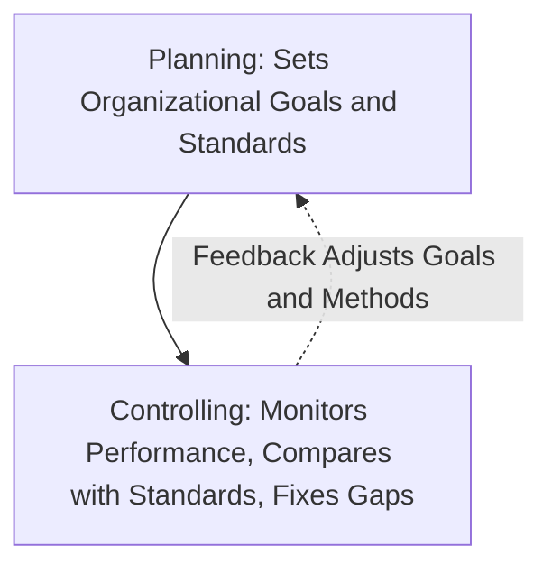

[← Previous: M04.2: Organizing, Departmentalization, Delegation, and Span](M04.2_Organizing_Departmentalization_Delegation_and_Span.md) | [🏠 Index](00_Index.md) | [📐 Master Sheet](99_Master_Formula_and_Statutory_Sheet.md) | [Next: M05.1: Motivation Basics and Financial vs. Non-Financial →](M05.1_Motivation_Basics_and_Financial_vs_NonFinancial.md)

---

# M04.3: Controlling Process and Steps

> [!info] ⚡ Exam Snapshot
> - **Section & Priority:** Section B (CO2 · Industrial Management · Dr. Md. Rabiul Islam Sir) · High Priority
> - **Read Time:** ~4 minutes
> - **PYQs Covered:** 2021 Final Q.2(b) (06 Marks: Definition and 4 Control Steps)
> - **Scoring Strategy:** State Griffin's definition verbatim, draw the four-step closed-loop feedback diagram, and detail all three corrective choices in Step 4 for full marks.

---

## 📌 1. Verbatim Definitions (For 2-Mark Questions)

> **Control (Organizational Control):** "The regulation of organizational activities in such a way as to facilitate goal attainment." *(Ricky W. Griffin, Fundamentals of Management, Chapter 14)*

*Plain meaning:* Control acts like a ship's rudder by monitoring ongoing activities to ensure actual operational performance matches planned organizational goals.

> **Control Standard:** "A target against which subsequent performance will be compared." *(Ricky W. Griffin, Fundamentals of Management, Chapter 14)*

*Plain meaning:* An objective, measurable benchmark used by managers to evaluate actual work output and detect operational deviations.

---

## ⚡ 2. Core Exam Blocks (Write Directly in Exam)

### A. Four Fundamental Purposes of Control (A-L-C-M)

Planning sets the goals, while controlling ensures the organization stays on track to reach them:

Griffin outlines four essential purposes of organizational control:

1. **Adapting to Environmental Change:** A structured control system tracks shifts in customer tastes, competitor actions, and technology, allowing managers to adjust operations before losses occur.
2. **Limiting the Accumulation of Error:** Effective control catches small daily mistakes early, preventing them from compounding over time into catastrophic operational or financial failures.
3. **Coping with Organizational Complexity:** As an enterprise grows to produce diverse product lines across multiple sites, centralized control metrics enable managers to oversee complex operations efficiently.
4. **Minimizing Operating Costs:** Continuous control minimizes raw material scrap, eliminates idle labor, and reduces downtime, keeping expenses strictly within budgeted limits.

> [!tip] Memory Hook: A-L-C-M (Purposes of Control)
> - **A** -> **A**dapt to environmental change
> - **L** -> **L**imit the accumulation of error
> - **C** -> **C**ope with organizational complexity
> - **M** -> **M**inimize operating costs and waste

### B. Operations Control by Timing and Resource Control Areas

Operations control monitors how an organization transforms inputs into finished goods and services:

| Control Type | Timing | Operational Focus | Primary Objective | Industrial Example |
| :--- | :--- | :--- | :--- | :--- |
| **Preliminary (Feedforward)** | Before work begins | Inputs (materials, labor, funds) | Prevent defects and substandard inputs from entering the plant | Inspecting raw silicon wafers before semiconductor fabrication |
| **Screening (Concurrent)** | During transformation | In-process transformation activities | Catch and fix errors immediately during production | Checking PCB solder joints right after wave soldering |
| **Postaction (Feedback)** | After work ends | Final outputs (finished goods) | Verify final quality and provide data for future planning | Running 24-hour burn-in stress tests on assembled units |

> [!tip] Memory Hook: P-S-P (Timing of Control)
> - **P** -> **P**reliminary (Inputs: Before work starts)
> - **S** -> **S**creening (Process: During transformation)
> - **P** -> **P**ostaction (Outputs: After work completes)

Resource control areas track the four fundamental organizational resources:

1. **Physical Resources:** Managing inventory levels, equipment maintenance schedules, and factory scrap rates.
2. **Human Resources:** Administering selection tests, conducting technical training, and evaluating performance appraisals.
3. **Information Resources:** Ensuring accurate sales forecasting, computer network uptime, and cybersecurity compliance.
4. **Financial Resources:** Managing operational cash flow, controlling departmental budgets, and tracking debt obligations.

### C. The Four Steps in the Control Process (S-M-C-C)

*Figure 1: Steps in the Organizational Control Process (Source: Griffin Ch. 14, p. 461).*

The organizational control process follows four interconnected steps linked by an active feedback loop:

1. **Establish Standards:** Establish measurable, objective targets derived directly from organizational goals (e.g., solder defect rate $\le 0.1\%$ or network uptime $\ge 99.9\%$).

2. **Measure Performance:** Continuously collect valid, reliable, and timely operational data through automated sensors, inspection logs, or production tallies.

3. **Compare Performance Against Standards:** Compare measured output against the benchmark within an established tolerance band. Small deviations within tolerance require no action, while larger gaps trigger corrective analysis.

4. **Determine Need for Corrective Action:** Evaluate the comparison and choose one of three distinct managerial paths:
   - **Maintain Status Quo:** When performance meets or exceeds the standard within tolerance, management takes no action and allows work to continue as planned.
   - **Correct the Deviation:** When performance falls below the acceptable tolerance limit, managers intervene immediately to address the root cause (such as recalibrating machines, updating code, or retraining workers).
   - **Change the Standard:** If the original benchmark was set unrealistically high or low, or if market and technological conditions have changed, management revises the standard.

**The Continuous Feedback Loop:** Information from Step 4 continuously flows back into Step 1 and Step 2. This dynamic feedback ensures future standards remain realistic and measurement methods remain accurate.

> [!tip] Memory Hook: S-M-C-C (The 4 Control Steps)
> - **S** -> **S**et standards (measurable targets)
> - **M** -> **M**easure performance (continuous data collection)
> - **C** -> **C**ompare against standards (check tolerance band)
> - **C** -> **C**onsider corrective action (**M-C-C**: Maintain, Correct, or Change)

---

## 🎯 3. PYQ & Target Answer Key

### 2021 Final Q.2(b) (06 Marks)

**Question:** What is controlling? Discuss the steps of controlling method.

**Exam Writing Plan:**

1. **Verbatim Definition:** Quote Ricky W. Griffin: *"The regulation of organizational activities in such a way as to facilitate goal attainment."* Add a 1-sentence plain meaning explaining that control acts like a rudder to keep operations on target.
2. **Process Diagram:** Draw the four-step closed-loop diagram (Figure 1: Set Standards -> Measure Performance -> Compare Against Standards -> Consider Corrective Action) showing the dashed feedback loop connecting back to standards and measurement.
3. **Four Steps Explanation:** Explain each step (`S-M-C-C`) using engineering metrics (such as defect rate $\le 0.1\%$ or machine uptime $\ge 99.9\%$).
4. **Three Corrective Action Paths:** Detail all three decisions in Step 4: (a) Maintain the status quo, (b) Correct the deviation, and (c) Change the standards.
5. **Concluding Takeaway:** Note that without the continuous feedback loop, control remains static and cannot adapt to operational disruptions.

---

### Target Question 1: Operations Control by Timing (04 Marks)

**Question:** Distinguish among preliminary, screening, and postaction control with appropriate industrial examples.

**Exam Writing Plan:**

1. **Core Distinction:** Define operations control as the systematic regulation of inputs, transformation processes, and finished outputs.
2. **Comparison Table:** Replicate the 5-column table from §2 Block B contrasting Preliminary, Screening, and Postaction control across Timing, Focus, Primary Objective, and Industrial Example.
3. **Industrial Application:** Highlight concrete engineering examples (testing raw silicon wafers, inspecting PCB solder joints during wave soldering, and 24-hour burn-in stress testing of finished units).
4. **Concluding Takeaway:** Emphasize that world-class manufacturing systems integrate all three controls concurrently to eliminate quality blind spots.

---

### Target Question 2: Fundamental Purposes of Control (04 Marks)

**Question:** Discuss the four fundamental purposes of organizational control as outlined by Ricky W. Griffin.

**Exam Writing Plan:**

1. **Opening Statement:** State that organizational control is essential because modern business environments face constant uncertainty and operational complexity.
2. **Four Purposes (A-L-C-M):** Enumerate the four purposes from §2 Block A with bold lead-ins:
   - *Adapting to Environmental Change:* Tracking shifts in markets, technologies, and costs.
   - *Limiting the Accumulation of Error:* Preventing small daily mistakes from compounding into massive failures.
   - *Coping with Organizational Complexity:* Providing standardized metrics to oversee multi-unit and multi-product operations.
   - *Minimizing Operating Costs:* Cutting scrap, idle labor, and downtime to protect margins.
3. **Concluding Takeaway:** Conclude that effective control balances organizational efficiency with strategic agility.

---

> [!warning] ⚠️ Examiner Traps
> - **Incomplete Step 4 Trap:** Never write simply "take corrective action." Explicitly list and explain all three managerial options: maintain status quo, correct deviation, or change the standard.
> - **Missing Feedback Loop Trap:** Forgetting to draw the feedback loop connecting Step 4 back to Step 1 and Step 2 in the flowchart will cost easy marks.
> - **Timing Confusion (Screening vs. Postaction):** Screening control happens *during* the transformation process (real-time error detection), whereas postaction control happens strictly *after* the product is fully completed (historical verification).

---

[← Previous: M04.2: Organizing, Departmentalization, Delegation, and Span](M04.2_Organizing_Departmentalization_Delegation_and_Span.md) | [🏠 Index](00_Index.md) | [📐 Master Sheet](99_Master_Formula_and_Statutory_Sheet.md) | [Next: M05.1: Motivation Basics and Financial vs. Non-Financial →](M05.1_Motivation_Basics_and_Financial_vs_NonFinancial.md)
