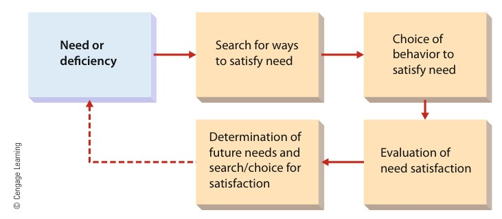

[← Previous: M04.3: Controlling Process and Steps](M04.3_Controlling_Process_and_Steps.md) | [🏠 Index](00_Index.md) | [📐 Master Sheet](99_Master_Formula_and_Statutory_Sheet.md) | [Next: M05.2: Maslow's Hierarchy and Herzberg's Two-Factor Theory →](M05.2_Maslow_Hierarchy_and_Herzberg_Two_Factor_Theory.md)

---

# M05.1: Motivation Basics and Financial vs. Non-Financial

> [!info] ⚡ Exam Snapshot
> - **Section & Priority:** Section B (CO2 · Industrial Management · Dr. Md. Rabiul Islam Sir) · High Priority
> - **Read Time:** ~4 minutes
> - **PYQs Covered:** 2020 Final Q.2(a) (02m), 2021 Final Q.3(a) (03m), 2021 Final Q.3(c) (03m), 2023 Final Q.8(a) (03m), 2024 Final Q.2(b) (03m)
> - **Scoring Strategy:** State Griffin's definition verbatim. Write the performance formula $P = M \times A \times E$ and explain why it multiplies. Sketch the 6-stage motivation framework. Finally, contrast financial and non-financial rewards in a clean table.

---

## 📌 1. Verbatim Definitions (For 2-Mark Questions)

> **Employee Motivation:** "The set of forces that cause people to behave in certain ways." *(Ricky W. Griffin, Fundamentals of Management, Chapter 10)*

*Plain meaning:* Motivation is the inner drive that makes you want to work. It decides how hard you try, where you focus, and how long you keep going.

> **Individual Job Performance:** "Individual performance is generally determined by three things: motivation (the desire to do the job), ability (the capability to do the job), and the work environment (the resources needed to do the job)." *(Ricky W. Griffin, Fundamentals of Management, Chapter 10)*

*Plain meaning:* Your real work output depends on three things working together: your desire to work, your skills, and the tools you are given.

---

## ⚡ 2. Core Exam Blocks (Write Directly in Exam)

### A. The Performance Equation ($P = M \times A \times E$)

Individual job output depends on three factors working together:

$$
P = M \times A \times E
$$

where:

1. **Motivation ($M$):** The worker's desire, drive, and willingness to put in effort.
2. **Ability ($A$):** The technical knowledge, training, and practical skills needed for the job.
3. **Work Environment ($E$):** The physical tools, computers, software, parts, and clear instructions needed to do the work.

> [!important] Why Performance Multiplies ($P = M \times A \times E$)
> These three factors multiply together. They do not just add up.
> Suppose an engineer has top skills ($A$) and modern lab equipment ($E$). If motivation is zero ($M = 0$), total performance drops to zero ($P = 0$).
> A company can fix poor skills with training. It can fix poor equipment by buying new tools.
> But motivation is the hardest factor to manage. It lives inside the worker's mind, so managers cannot simply buy it.

> [!tip] Memory Hook: M-A-E (Three Pillars of Performance)
> - **M** -> **M**otivation (Heart: Desire to do the work)
> - **A** -> **A**bility (Head: Skills and technical capability)
> - **E** -> **E**nvironment (Hands: Tools, equipment, and resources)

### B. The 6-Stage Motivation Framework

Motivation works as a continuous cycle. An unmet need pushes a person to act, as shown below:

*Figure 1: The Motivation Framework (Source: Griffin Ch. 10, p. 324 / Fig. 10.1).*

The framework follows six clear steps connected by an active feedback loop:

1. **Need Deficiency:**
   - The cycle starts when a worker feels something is missing.
   - For example, they may want more pay, better job safety, or respect from peers.

2. **Search for Ways to Satisfy the Need:**
   - The worker looks for ways to satisfy this unmet need.
   - They might think about asking for a promotion, working extra overtime, or learning a new skill.

3. **Choice of Goal-Directed Behavior:**
   - The worker picks one clear action plan.
   - Then, they put real effort into doing their daily job to reach that goal.

4. **Evaluation of Performance:**
   - The boss and the worker look at the actual work results.
   - They see whether the worker hit their targets and deadlines.

5. **Rewards or Punishments:**
   - The worker gets an outcome based on their output.
   - Good work earns cash bonuses, praise, or promotions. Poor work brings warnings or pay cuts.

6. **Reassessment of Need Deficiency:**
   - The worker checks if their original need was satisfied.
   - If the need is met, they feel satisfied and new needs pop up.
   - If the need is not met, the feedback loop starts over. The worker must try a different action.

> [!tip] Memory Hook: N-S-C-E-R-R (The Motivation Framework)
> - **N** -> **N**eed deficiency occurs
> - **S** -> **S**earch for ways to satisfy the need
> - **C** -> **C**hoice of goal-directed behavior
> - **E** -> **E**valuation of performance
> - **R** -> **R**ewards or punishments received
> - **R** -> **R**eassessment of need deficiency (feedback loop)

### C. Six Dimensions of Organizational Significance

High employee motivation gives companies six clear benefits:

1. **Higher Productivity and Quality:**
   - Motivated workers produce more units each day.
   - They pay closer attention to detail, keeping defect rates very low.

2. **Reduced Turnover and Absenteeism:**
   - Satisfied employees show up on time and stay with the firm.
   - This saves the company huge costs in hiring and training replacements.

3. **Efficient Use of Resources:**
   - Dedicated technicians handle tools and machines with care.
   - This cuts raw material waste, stops breakdowns, and avoids machine downtime.

4. **Creative Problem-Solving and Innovation:**
   - Engaged engineers take initiative on their own.
   - They fix software bugs and improve factory workflows without waiting for orders.

5. **Readiness for Organizational Change:**
   - Motivated staff do not fear change.
   - They quickly learn new software, tools, and processes without resisting management.

6. **Alignment of Goals:**
   - Workers connect their personal career growth with company success.
   - This removes internal friction and helps the whole team pull in the same direction.

### D. Financial vs. Non-Financial Motivators

Companies motivate employees through cash and non-cash rewards:

| Comparison Parameter | Financial Motivators (Monetary) | Non-Financial Motivators (Non-Monetary) |
| :--- | :--- | :--- |
| **Core Instruments** | Base salary, merit pay, bonuses, profit sharing, and company stock (ESOPs) | Praise, job freedom, promotion, flexible hours, and pleasant workspaces |
| **Target Need Level** | Satisfies basic survival needs (Food, shelter, and job security) | Satisfies higher growth needs (Friendship, respect, and personal achievement) |
| **Duration of Impact** | Short-term boost (workers soon get used to the extra pay) | Long-term drive (builds deep personal pride, commitment, and loyalty) |
| **Organizational Cost** | High direct cash expense (adds recurring costs to company payroll) | Low direct cash expense (needs manager time and a supportive culture) |
| **Retention Strength** | Weak retention barrier (rivals can easily steal workers by offering higher pay) | Strong retention barrier (rivals cannot easily copy your culture or trust) |
| **Industrial Example** | A \$1,500 cash bonus for shipping firmware on time | Promoting an engineer to lead the hardware research team |

> [!tip] Memory Hook: CASH vs. CARE
> - **Financial = CASH:** Compensation, Awards, Shares, Hard cash (Short-term satisfaction)
> - **Non-Financial = CARE:** Culture, Autonomy, Recognition, Empowerment (Long-term loyalty)

---

## 🎯 3. PYQ & Target Answer Key

### 2021 Final Q.3(a) & 2023 Final Q.8(a): Nature and Importance of Motivation (03 Marks)

**Question:** What is employee motivation? Why is it important?  
*(Asked verbatim in 2021 Final Q.3(a) and 2023 Final Q.8(a))*

**Exam Writing Plan:**

1. **Verbatim Definition:**
   - Quote Ricky W. Griffin: *"The set of forces that cause people to behave in certain ways."*
   - Add a 1-sentence plain meaning. Motivation decides how hard a person works and how long they keep trying.
2. **The Performance Equation:**
   - State the formula: $P = M \times A \times E$.
   - Define all four variables: Performance ($P$), Motivation ($M$), Ability ($A$), and Environment ($E$).
   - Emphasize that if motivation is zero ($M = 0$), total performance drops to zero ($P = 0$).
3. **Core Importance Points:**
   - Give 4 key points from §2 Block C with bold lead-ins.
   - Include: Higher Productivity, Lower Turnover, Less Waste, and Better Innovation.
4. **Concluding Takeaway:**
   - Managers can buy new tools and train skills.
   - But motivation cannot be bought directly. It requires smart leadership and fair rewards.

---

### 2024 Final Q.2(b): Significance of Motivation in Organizations (03 Marks)

**Question:** State the significance of employee motivation in organization.

**Exam Writing Plan:**

1. **Opening Statement:**
   - Define motivation in one sentence.
   - It is the spark that turns company resources into real productive output.
2. **Six Dimensions of Significance:**
   - Write the 6 dimensions from §2 Block C with bold lead-ins:
     - *Higher Productivity and Quality:* Making more units with fewer defects.
     - *Reduced Turnover and Absenteeism:* Keeping skilled talent and saving hiring costs.
     - *Efficient Use of Resources:* Running machines carefully to cut scrap and downtime.
     - *Creative Problem-Solving:* Fixing bugs and improving factory flow without being told.
     - *Readiness for Change:* Adopting new tools and software without fear or pushback.
     - *Alignment of Goals:* Uniting employee career goals with company targets.
3. **Engineering Example:**
   - Add a 1-sentence example.
   - For instance, motivated technicians run test checks carefully to prevent sudden line shutdowns.
4. **Concluding Takeaway:**
   - Motivation protects company profits by cutting waste and keeping the business competitive.

---

### 2020 Final Q.2(a) [Part 1]: Definition and Performance Determinants (02 Marks)

**Question:** What is employee motivation?

**Exam Writing Plan:**

1. **Verbatim Definition:**
   - Quote Ricky W. Griffin: *"The set of forces that cause people to behave in certain ways."*
2. **The Performance Equation:**
   - State the formula: $P = M \times A \times E$.
   - Define the variables: Performance ($P$), Motivation ($M$), Ability ($A$), and Environment ($E$).
3. **Managerial Takeaway:**
   - Explain why motivation is special.
   - It is the inner willingness to work, making it the most critical factor for success.

---

### 2021 Final Q.3(c): Financial and Non-Financial Sources of Motivation (03 Marks)

**Question:** Explain the financial and non-financial sources of motivation.

**Exam Writing Plan:**

1. **Core Distinction:**
   - Define financial rewards as cash tools that meet basic survival needs.
   - Define non-financial rewards as psychological tools that meet higher growth needs.
2. **List Key Instruments:**
   - *Financial:* Base salary, merit pay, bonuses, profit sharing, and stock options.
   - *Non-Financial:* Public praise, job freedom, promotion, flexible hours, and good culture.
3. **Summary Comparison Table:**
   - Draw the 6-row table from §2 Block D.
   - Compare them across tools, needs met, duration, cost, retention, and examples.
4. **Concluding Takeaway:**
   - Use the CASH vs. CARE rule.
   - Cash rewards prevent worker anger, but non-cash recognition builds true long-term loyalty.

---

> [!warning] ⚠️ Examiner Traps
> - **The Additive Fallacy:** Never write $P = M + A + E$. Performance multiplies: $P = M \times A \times E$. If motivation is zero ($M = 0$), total performance drops to zero ($P = 0$) even with great tools and top skills.
> - **Reward Balance Trap:** Do not assume cash is the only motivator. In RUET exams, you must contrast short-term cash satisfaction with long-term loyalty to get full marks.
> - **Vague Significance Bullets:** Never write weak phrases like "it makes workers happy." Always use professional management terms: lower scrap rates, reduced turnover, and faster adaptation to change.

---

[← Previous: M04.3: Controlling Process and Steps](M04.3_Controlling_Process_and_Steps.md) | [🏠 Index](00_Index.md) | [📐 Master Sheet](99_Master_Formula_and_Statutory_Sheet.md) | [Next: M05.2: Maslow's Hierarchy and Herzberg's Two-Factor Theory →](M05.2_Maslow_Hierarchy_and_Herzberg_Two_Factor_Theory.md)
