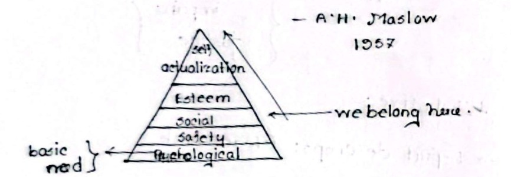
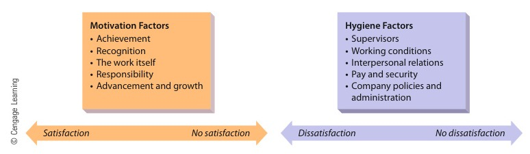

[← Previous: M05.1: Motivation Basics and Financial vs. Non-Financial](M05.1_Motivation_Basics_and_Financial_vs_NonFinancial.md) | [🏠 Index](00_Index.md) | [📐 Master Sheet](99_Master_Formula_and_Statutory_Sheet.md) | [Next: M05.3: Vroom's Expectancy, McGregor X/Y, and ERG Theories →](M05.3_Vroom_Expectancy_McGregor_XY_and_ERG_Theories.md)

---

# M05.2: Maslow's Hierarchy of Needs and Herzberg's Two-Factor Theory

> [!info] ⚡ Exam Snapshot
> - **Section & Priority:** Section B (CO2 · Industrial Management · Dr. Md. Rabiul Islam Sir) | Priority: 🔴 Very High | **Read Time:** ~4 mins
> - **PYQs Covered:** 2021 Q.3(b) (06m), 2020 Q.2(a) Part 2 (04m), 2024 Q.2(c) (05m)
> - **Scoring Rule:** Draw the 5-tier pyramid and dual-continuum scales with exact endpoint labels. Opposite of satisfaction is *No Satisfaction*, not dissatisfaction.

---

## 📌 1. Verbatim Definitions (For 2-Mark Questions)

1. **Maslow's Hierarchy of Needs:**
   > "Suggests that people must satisfy five groups of needs in order: physiological, security, belongingness, esteem, and self-actualization." (Ricky W. Griffin, *Fundamentals of Management*)
   - *Plain meaning:* People satisfy basic survival needs first before social and personal growth needs motivate them.

2. **Herzberg's Two-Factor Theory:**
   > "Suggests that people's satisfaction and dissatisfaction are influenced by two independent sets of factors: motivation factors and hygiene factors." (Ricky W. Griffin, *Fundamentals of Management*)
   - *Plain meaning:* Job context avoids dissatisfaction, but only job content builds real motivation and satisfaction.

---

## ⚡ 2. Core Exam Blocks (Write Directly in Exam)

### 1. Abraham Maslow's Hierarchy of Needs (1943)

#### Satisfaction-Progression Principle
1. **Sequential Ascent:** People satisfy needs in strict upward order. Higher needs stay dormant until lower needs are met.
2. **Deficiency Drives Action:** An unmet need creates internal tension that directs human behavior.
3. **Satisfied Needs Stop Motivating:** Once satisfied, a need loses motivating power. The person moves to the next higher level.

*Figure 1: Maslow's Hierarchy of Needs Pyramid (Source: Classnotes_Hum2217_Raidah.md, Class 8).*

> [!tip] Memory Hook: Maslow's Five Levels (P-S-S-E-S)
> Ascend from base to apex:
> - **P** $\to$ **Physiological:** Basic biological survival.
> - **S** $\to$ **Security:** Physical and economic safety.
> - **S** $\to$ **Social:** Team belonging and companionship.
> - **E** $\to$ **Esteem:** Status, respect, and recognition.
> - **S** $\to$ **Self-Actualization:** Peak personal growth and creative realization.

#### Table: Maslow's Five Need Levels: Life Needs vs. Workplace Support

| Tier | Need Category | General Life Meaning | Workplace Support Examples |
| :---: | :--- | :--- | :--- |
| **1 (Base)** | **Physiological** | Food, water, air, sleep, rest | Base salary, clean water, rest intervals |
| **2** | **Security / Safety** | Protection from danger, disease, poverty | Safe machinery, PPE, job security, insurance |
| **3** | **Social / Belongingness** | Love, friendship, companionship | Project teams, open communication, social outings |
| **4** | **Esteem** | Self-respect, status, recognition | Senior titles, performance bonuses, awards |
| **5 (Apex)** | **Self-Actualization** | Personal growth, creative fulfillment | Challenging R&D assignments, design autonomy |

#### Four Major Criticisms of Maslow's Theory
1. **Rigid Progression is Unrealistic:** People bypass levels. A hungry startup engineer may skip meals to complete a prototype.
2. **Arbitrary Five Tiers:** Empirical research shows needs blend into two or three overlapping categories instead of five distinct steps.
3. **Western Cultural Bias:** Collectivist societies like Bangladesh often prioritize family safety and group cohesion over individual self-actualization.
4. **Multiple Needs Operate Together:** Workers seek salary, job security, and peer recognition simultaneously.

#### Four Workplace Applications of Maslow's Theory
1. **Tailor Rewards to Individuals:** Offer financial security to junior engineers and creative autonomy to project leads.
2. **Secure Baseline Needs First:** Guarantee fair base salaries and physical safety before offering recognition awards.
3. **Support Growth for Engineers:** Keep technical staff motivated with complex design problems and decision-making freedom.
4. **Offer Balanced Benefits:** Combine health coverage (safety), team hackathons (social), awards (esteem), and training grants (actualization).

---

### 2. Frederick Herzberg's Two-Factor Theory (1959)

Herzberg interviewed 200 accountants and engineers in Pittsburgh. He discovered that factors causing job satisfaction are completely separate from factors causing job dissatisfaction.

#### Dual-Continuum Principle
Herzberg replaced the traditional single-scale view with two independent continuums:
1. **Motivation Scale (Job Content):** $\text{Satisfaction} \longleftrightarrow \text{No Satisfaction}$
2. **Hygiene Scale (Job Context):** $\text{No Dissatisfaction} \longleftrightarrow \text{Dissatisfaction}$

*Figure 2: Frederick Herzberg's Dual-Continuum Model (Source: Griffin Ch. 10, Fig 10.3).*

> [!tip] Memory Hook: Herzberg's Two-Factor Split
> - **Hygiene Factors (Job Context):** Like washing hands. They prevent sickness (dissatisfaction), but washing hands never builds muscle.
> - **Motivator Factors (Job Content):** Like exercise and nutrition. They build muscle, driving active pride and superior performance.

#### Table: Hygiene Factors vs. Motivation Factors

| Comparison Dimension | Hygiene Factors (Maintenance / Extrinsic) | Motivation Factors (Satisfiers / Intrinsic) |
| :--- | :--- | :--- |
| **Focus** | Job Context: work environment and conditions | Job Content: the actual work performed |
| **Core Elements** | Salary, company policy, supervisor style, safety, peer relations | Achievement, recognition, responsibility, growth, advancement |
| **Operating Scale** | Dissatisfaction $\longleftrightarrow$ No Dissatisfaction | Satisfaction $\longleftrightarrow$ No Satisfaction |
| **When Deficient** | Triggers sharp grievances, low morale, and high turnover | Workers lack enthusiasm, but harbor no active grievances |
| **When Adequate** | Reaches neutral baseline ("No Dissatisfaction"); no extra effort | Inspires high motivation, pride, commitment, and superior performance |

#### The Two-Stage Process for Motivating Employees
1. **Stage 1: Fix Hygiene Deficiencies (Reach Neutral):** Provide fair wages, safe labs, and fair supervision. Eliminates grievances and achieves "No Dissatisfaction".
2. **Stage 2: Introduce Motivators (Unlock High Effort):** Delegate full project ownership, praise milestones, and offer career paths. Moves workers to "Satisfaction".

#### Four Major Criticisms of Herzberg's Theory
1. **Attribution Bias:** Employees credit themselves for success (motivators) and blame external factors for failure (hygiene).
2. **Narrow Sample:** Surveying only accountants and engineers limits generalization to low-wage factory workers.
3. **Dual Role of Pay:** Herzberg treated pay as hygiene. However, merit bonuses signal prestige and recognition, acting as motivators.
4. **Ignores Personality Differences:** Not all workers desire enrichment. Some prefer routine, structured tasks with low responsibility.

#### Four Workplace Applications of Herzberg's Theory
1. **Job Enrichment (Vertical Loading):** Redesign engineering roles to give developers end-to-end module ownership from design to deployment.
2. **Formal Recognition Systems:** Create spot awards, patent bonuses, and technical presentations to celebrate engineering milestones.
3. **Dual Career Ladders:** Let senior engineers advance in status and pay without moving into administrative management.
4. **Protect Baseline Hygiene:** Keep salaries adjusted for inflation and maintain modern hardware test facilities.

---

### 3. Maslow vs. Herzberg Mapping

1. **Lower 3 Levels = Hygiene:** Physiological, Safety, and Social needs match Herzberg's extrinsic hygiene factors (job context).
2. **Upper 2 Levels = Motivators:** Self-Actualization and upper Esteem match intrinsic motivator factors (job content).
3. **Esteem Acts as the Bridge:** External esteem (status, titles) behaves as hygiene. Internal esteem (achievement, autonomy) behaves as a motivator.

---

## 🎯 3. PYQ & Target Answer Key

### 2021 Final Q.3(b) · Maslow's Need-Hierarchy Theory with Criticisms and Applications (06 Marks)
- **Question:** Briefly state the "Need-hierarchy" theory of motivation showing its criticism and potential application.
- **Answer Blueprint:**
  1. Define Maslow's theory using Ricky W. Griffin's definition in §1.
  2. State the 3 rules of the Satisfaction-Progression Principle in §2.1.
  3. Draw the five-tier pyramid (*Figure 1*) with `P-S-S-E-S` levels.
  4. Sketch the 5-Tier Table in §2.1 linking life needs to workplace support.
  5. List the 4 Criticisms and 4 Applications of Maslow's theory in §2.1.

### 2020 Final Q.2(a) Part 2 · Employee Motivation and Maslow's Hierarchy (04 Marks)
- **Question:** What is employee motivation? State the Need-Hierarchy theory of motivation with potential application.
- **Answer Blueprint:**
  1. **Define Motivation:** The internal forces that initiate, direct, and sustain goal-directed action. State the performance equation $P = M \times A \times E$, where $P$ is performance, $M$ is motivation, $A$ is ability, and $E$ is environment.
  2. **Maslow Theory:** Quote §1 definition, sketch the 5-tier pyramid (*Figure 1*), and list the 5 levels using `P-S-S-E-S`.
  3. **Applications:** List the 4 Applications of Maslow's theory in §2.1.

### 2024 Final Q.2(c) · Herzberg's Two-Factor Theory with Criticisms and Applications (05 Marks)
- **Question:** Analyze the two-factor theory of motivation with criticism and potential application.
- **Answer Blueprint:**
  1. State Herzberg's 1959 study and quote Ricky W. Griffin's definition in §1.
  2. Contrast traditional single-scale view with Herzberg's Dual Continuums (*Figure 2*). Emphasize exact endpoint labels.
  3. Draw the Hygiene vs. Motivator comparison table in §2.2.
  4. Explain the Two-Stage Process (Stage 1: hygiene to neutral; Stage 2: motivators to peak performance).
  5. Write the 4 Criticisms and 4 Applications of Herzberg's theory in §2.2.

---

> [!warning] ⚠️ Examiner Traps
> - **Endpoint Error:** The opposite of satisfaction is **No Satisfaction**, not dissatisfaction. The opposite of dissatisfaction is **No Dissatisfaction**.
> - **Treating Base Pay as Motivator:** Base pay is a hygiene factor. It prevents complaints, but it cannot inspire peak effort alone.
> - **Omitting Progression Rule:** Do not just draw the pyramid. Always explain the Satisfaction-Progression Principle.
> - **Context vs. Content:** Hygiene factors belong to job context (work environment). Motivators belong to job content (the actual work).

---

[← Previous: M05.1: Motivation Basics and Financial vs. Non-Financial](M05.1_Motivation_Basics_and_Financial_vs_NonFinancial.md) | [🏠 Index](00_Index.md) | [📐 Master Sheet](99_Master_Formula_and_Statutory_Sheet.md) | [Next: M05.3: Vroom's Expectancy, McGregor X/Y, and ERG Theories →](M05.3_Vroom_Expectancy_McGregor_XY_and_ERG_Theories.md)
