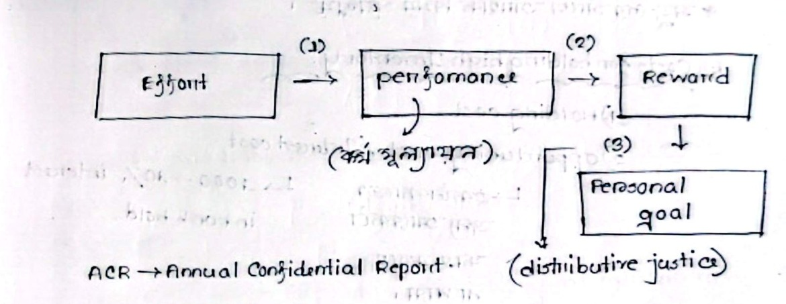

[← Previous: M05.2: Maslow's Hierarchy and Herzberg's Two-Factor Theory](M05.2_Maslow_Hierarchy_and_Herzberg_Two_Factor_Theory.md) | [🏠 Index](00_Index.md) | [📐 Master Sheet](99_Master_Formula_and_Statutory_Sheet.md) | [Next: M06.1: HRM, Recruitment, Selection, and Training →](M06.1_HRM_Recruitment_Selection_and_Training.md)

---

# M05.3: Vroom's Expectancy, McGregor's Theory X/Y, and ERG Theories

> [!info] ⚡ Exam Snapshot
> - **Course Section:** Section B (CO2 · Industrial Management · Dr. Md. Rabiul Islam Sir)
> - **Exam Priority:** 🔴 Very High
> - **Estimated Read Time:** ~4 minutes
> - **PYQs Covered:** 2023 Final Q.8(b) (4 marks), Model Theory X/Y & ERG Comparison (4 marks), Applied Case Diagnostic (5 marks)
> - **Crucial Scoring Rule:** Always write the multiplication formula $M = E \times I \times V$. State the Zero-Product Rule clearly. Always connect the $P \to O$ link to the Annual Confidential Report (ACR) and distributive justice.

---

## 📌 1. Verbatim Definitions (For 2-Mark Questions)

> **Expectancy Theory:** "Suggests that motivation depends on two things: how much we want something and how likely we think we are to get it." *(Ricky W. Griffin, Fundamentals of Management)*

*Plain meaning:* Before working hard, workers ask two simple questions: "Can I hit the goal?" and "Do I care about the reward?" If either answer is no, they will not put in the effort.

---

> **Theory X and Theory Y:** "Two extreme belief sets that different managers hold about their workers: Theory X is a pessimistic view, while Theory Y is an optimistic view." *(Douglas McGregor, The Human Side of Enterprise)*

*Plain meaning:* Theory X sees workers as lazy people who hate work and need strict watching. Theory Y sees workers as capable people who enjoy work, seek responsibility, and solve problems creatively when trusted.

---

> **ERG Theory:** "A needs theory that collapses Maslow's categories into Existence, Relatedness, and Growth, and introduces the frustration-regression principle." *(Clayton Alderfer, Existence, Relatedness, and Growth)*

*Plain meaning:* Alderfer groups human needs into three flexible buckets: Existence, Relatedness, and Growth. If you cannot reach a higher growth goal, you get frustrated. You then fall back to demanding more basic things like higher pay or better perks.

---

## ⚡ 2. Core Exam Blocks (Write Directly in Exam)

### 1. Victor Vroom's Expectancy Theory (1964)

Victor Vroom published his expectancy theory in 1964. He viewed motivation as a conscious choice. Employees rationally weigh their choices before acting. They decide how much effort to put in based on the rewards they expect to receive.

#### The Multiplicative Motivation Formula

$$
\text{Motivation } (M) = \text{Expectancy } (E) \times \text{Instrumentality } (I) \times \text{Valence } (V)
$$

*Figure 1: Victor Vroom's Expectancy Model and Reward Pathway (Source: Classnotes_Hum2217_Raidah.md, Class 8).*

#### The Three Sequential Linkages

Vroom's model links human effort to personal goals through three clear steps:

1. **Effort-to-Performance Expectancy ($E \to P$):**
   - **Definition:** The employee's belief that hard effort will lead to successful task performance.
   - **Probability Scale:** Ranges from $0.0$ (no chance effort leads to success) to $1.0$ (complete certainty).
   - **Core Question:** *"Can I achieve the required target if I work hard?"*
   - **Key Influences:** Personal self-confidence, technical skills, realistic targets, proper tools, and good training.

2. **Performance-to-Outcome Instrumentality ($P \to O$):**
   - **Definition:** The employee's belief that hitting the performance target will directly produce promised rewards.
   - **Probability Scale:** Ranges from $0.0$ (performance brings no reward) to $1.0$ (reward is guaranteed upon success).
   - **Core Question:** *"Will management actually deliver the promised reward if I succeed?"*
   - **Key Influences:** Trust in leadership, objective performance appraisals, clear bonus policies, and past managerial honesty.

3. **Valence of Outcomes ($V$):**
   - **Definition:** The personal value, attractiveness, or desirability an employee places on a specific reward.
   - **Value Scale:** Ranges from $-1.0$ to $+1.0$.
     - **Positive ($+1.0$):** A reward the worker loves and truly wants (like a promotion or cash bonus).
     - **Zero ($0.0$):** Complete indifference toward the reward.
     - **Negative ($-1.0$):** An outcome the worker hates or fears (such as burnout or forced overtime away from family).
   - **Core Question:** *"Do I truly want and value the reward being offered?"*
   - **Overall Condition:** An employee often receives several rewards from good performance. Motivation requires the sum of all valences to stay positive:

$$
\sum V > 0
$$

> [!important] The Zero-Product Rule
> Motivation works by simple multiplication: $M = E \times I \times V$.
> If any single term equals zero ($0$), total employee motivation collapses completely to zero ($0$):
> - **If $E = 0$:** The worker feels the target is technically impossible. Working hard is pointless.
> - **If $I = 0$:** The worker does not trust management to deliver. The reward feels like a fake promise.
> - **If $V \le 0$:** The worker places no value on the prize, or the negative burden of achieving it exceeds its worth.
> 
> Even with a huge cash bonus, motivation stays at zero if the deadline is impossible ($E = 0$). The same happens if workers expect management to cheat them ($I = 0$).

#### ACR and Distributive Justice in the Workplace (MRI Sir Lecture Focus)

During Class 8, Dr. Md. Rabiul Islam Sir linked Vroom's instrumentality ($P \to O$) to formal workplace governance:

1. **Annual Confidential Report (ACR):**
   - Public corporations, government agencies, and engineering firms rate employees through an ACR.
   - The ACR records technical output, discipline, initiative, and leadership.
   - If ACR evaluations feel secretive, biased, or political, employees lose all faith.
   - This collapses the $P \to O$ link straight to zero.

2. **Distributive Justice Moderation:**
   - Employees continually compare their rewards against their invested effort and peer outcomes.
   - Perceived fairness determines whether an outcome feels inspiring or insulting.
   - In Class 8, MRI Sir divided justice into three distinct states:
     - **Pure Justice:** Completely impartial reward allocation based strictly on demonstrated technical merit.
     - **Perfect Justice:** Flawless balance where every contributor receives exactly what they earned.
     - **Impure Justice:** Biased allocation corrupted by favoritism, nepotism, or arbitrary judgment.
   - When impure justice dominates a firm, workers realize that rewards depend on office politics rather than hard work. This completely destroys instrumentality ($P \to O = 0$).

#### Four Managerial Applications of Expectancy Theory

1. **Make the Target Achievable ($E \to P$):**
   - Equip technical teams with modern test benches, computers, and simulation tools.
   - Provide training and set clear sprint milestones so engineers feel confident of success.

2. **Deliver Promised Rewards Honestly ($P \to O$):**
   - Tie bonuses to transparent, objective performance metrics.
   - Deliver promised incentives immediately upon project delivery without changing criteria mid-way.

3. **Individualize the Reward Menu ($V$):**
   - Recognize that different employees value different outcomes.
   - Offer flexible rewards. Give funded training certifications to junior engineers, flexible hours to working parents, and stock options to senior leads.

4. **Maintain Organizational Justice:**
   - Ensure performance reviews and ACR grading remain transparent, objective, and unbiased to protect distributive justice.

#### Three Major Criticisms of Expectancy Theory

1. **Assumes Unrealistic Calculation:**
   - The model assumes workers make complex mathematical calculations before deciding how hard to work. In fast-paced offices, people rarely think this way.

2. **Ignores Emotions and Gut Feelings:**
   - It overemphasizes conscious logic while ignoring subconscious feelings, company loyalty, peer pressure, and impulsive actions.

3. **Hard to Measure Empirically:**
   - Subjective probabilities ($E$ and $I$) and personal valence scales ($V$) are exceptionally difficult to measure accurately in real organizations.

---

### 2. Douglas McGregor's Theory X and Theory Y (1960)

In his 1960 classic *The Human Side of Enterprise*, Douglas McGregor studied managerial behavior. He argued that managers act on core assumptions about human nature. These beliefs act as self-fulfilling prophecies. Treating workers like untrustworthy laborers makes them passive and resistant. In contrast, treating them as trusted partners builds dedication and initiative.

#### Table: Theory X vs. Theory Y Comparison

| Comparison Dimension | Theory X (Pessimistic / Autocratic) | Theory Y (Optimistic / Participative) |
| :--- | :--- | :--- |
| **View of Human Nature** | Inherently dislikes work and avoids it whenever possible | Work is a natural source of satisfaction, play, and fulfillment |
| **Attitude to Responsibility** | Shuns responsibility, lacks ambition, and prefers strict orders | Welcomes, seeks, and accepts personal responsibility |
| **Creative Potential** | Limited to senior managers; workers lack ingenuity | Widely spread across all employees in the organization |
| **Primary Motivators** | Fear of punishment, strict coercion, and basic financial security | Internal pride, personal achievement, and shared team goals |
| **Management Style** | Autocratic command, close micromanagement, and centralization | Democratic, participative, delegative, and empowering |
| **Control Mechanism** | External policing, rigid rules, surveillance, and disciplinary action | Self-direction, self-control, and intrinsic alignment with goals |
| **Modern Application** | Routine manual assembly lines with standardized compliance | Agile software engineering teams, hardware R&D, and tech startups |

> [!tip] Memory Hook: Theory X vs. Theory Y Posture
> Visualize the physical posture of a manager:
> - **Theory X = Crossed Arms (X):** Closed, defensive, suspicious, and micromanaging. Assumes workers are lazy and need strict policing.
> - **Theory Y = Open Arms (Y):** Welcoming, eager, and empowering. Assumes workers are self-motivated, creative, and ready to grow.

---

### 3. Clayton Alderfer's ERG Theory (1972)

Clayton Alderfer developed ERG Theory in 1972 to overcome the weaknesses of Maslow's rigid five-tier hierarchy. He condensed human needs into three broad categories and introduced a flexible behavioral model.

#### The Three Need Categories

1. **Existence ($E$):**
   - Covers basic physical survival and bodily safety needs.
   - Includes fair wages, clean air, safe workstations, and health benefits.
   - Matches Maslow's Physiological and Safety tiers.

2. **Relatedness ($R$):**
   - Covers interpersonal relationships, social acceptance, and mutual respect.
   - Includes team collaboration, open communication, supervisor respect, and peer praise.
   - Matches Maslow's Social needs and external Esteem needs.

3. **Growth ($G$):**
   - Covers personal psychological development, creative fulfillment, and competence.
   - Includes solving complex technical challenges, leading R&D projects, and mastering new skills.
   - Matches Maslow's internal Esteem and Self-Actualization tiers.

#### Core Modifications to Maslow's Model

1. **Multiple Needs at Once:**
   - Maslow claimed only one need level operates at any time.
   - In contrast, Alderfer showed that multiple need levels motivate employees at the same time.
   - For example, an engineer can actively pursue higher pay (Existence) and creative design autonomy (Growth) at the exact same moment.

2. **The Frustration-Regression Principle:**
   - Maslow allowed only upward progression (satisfaction-progression).
   - Alderfer discovered that blocking a higher-level need triggers downward movement.
   - If an employee is frustrated in fulfilling a higher-order need (such as Growth), their frustration causes them to fall back.
   - They regress to demanding greater fulfillment of lower-level needs (such as Relatedness or Existence).
   - *Workplace Example:* An embedded systems engineer wants to lead a new R&D project, but management blocks the opportunity (Growth frustrated). Instead of quitting, the engineer stops contributing creative ideas. Instead, they start aggressively demanding overtime pay, higher bonuses, and better cafeteria food (regressing to Existence needs).

---

### 4. Cross-Comparison of Major Motivation Models

#### Table: Comparison of Content and Process Theories

| Dimension | Maslow's Hierarchy | Herzberg's Two-Factor | Alderfer's ERG Theory | Vroom's Expectancy |
| :--- | :--- | :--- | :--- | :--- |
| **Model Type** | Content (Needs-based) | Content (Needs-based) | Content (Needs-based) | Process (Cognitive choice) |
| **Structural Units** | 5 rigid ascending levels | 2 independent continuums | 3 flexible core categories | 3 multiplied variables ($E, I, V$) |
| **Key Categories** | Physiological, Safety, Social, Esteem, Actualization | Hygiene factors vs. Motivators | Existence, Relatedness, Growth | Expectancy, Instrumentality, Valence |
| **Dynamic Principle** | Strict satisfaction-progression | Two-stage: hygiene first, then motivators | Multiple needs at once + frustration-regression | Cognitive pathway: $E \to P \to O \to V$ |
| **Failure Reaction** | Dormant higher needs; no downward movement | Dissatisfaction if hygiene is absent | Downward regression to lower-level needs | Motivation drops to zero if any term is $0$ |
| **Managerial Focus** | Identify unmet need level | Enrich job content; maintain hygiene baseline | Provide diverse avenues for personal growth | Build realistic paths from effort to valued reward |

---

## 🎯 3. PYQ & Target Answer Key

### 2023 Final Q.8(b) · Vroom's Expectancy Theory and Applications (04 Marks)

**Exam Question Prompt:**

> Briefly state the Expectancy Theory of motivation with potential application.

**Exam Writing Plan:**

1. **Definition & Premise:**
   - Define Expectancy Theory using the Ricky W. Griffin quote from [§1](#📌-1-verbatim-definitions-for-2-mark-questions).
   - State that motivation is a conscious cognitive choice process where employees evaluate expected payoffs before exerting effort.

2. **The Multiplicative Formula & Pathway:**
   - Write the core formula: $\text{Motivation } (M) = E \times I \times V$.
   - Draw the sequential pathway (*Figure 1*): $\text{Effort} \xrightarrow{E \to P} \text{Performance} \xrightarrow{P \to O} \text{Rewards} \xrightarrow{V} \text{Personal Goals}$.
   - State the Zero-Product Rule: if any single component equals zero, total motivation drops to zero.

3. **The Three Linkages:**
   - Define Expectancy ($E \to P$, probability $0.0$ to $1.0$).
   - Define Instrumentality ($P \to O$, probability $0.0$ to $1.0$), explicitly citing the Annual Confidential Report (ACR) and distributive justice.
   - Define Valence ($V$, value scale $-1.0$ to $+1.0$), stating the condition $\sum V > 0$.

4. **Potential Workplace Applications:**
   - Clarify $E \to P$ by providing engineers with simulation tools and achievable sprint targets.
   - Honor $P \to O$ by delivering promised project bonuses transparently and without delay.
   - Individualize $V$ by offering flexible reward menus (certifications vs. stock options).
   - Ensure distributive justice by maintaining objective, unbiased ACR appraisals.

5. **Exam Takeaway:**
   - Conclude with a one-sentence summary:
   - *"Vroom proves that large bonuses fail unless leaders both make targets achievable and guarantee fair, honest reward delivery."*

---

### Model Exam Q1 · Theory X vs Theory Y and ERG Modifications (04 Marks)

**Exam Question Prompt:**

> Compare Douglas McGregor's Theory X and Theory Y assumptions. How does Clayton Alderfer's ERG Theory modify Maslow's hierarchy of needs?

**Complete Exam Solution:**

1. **Douglas McGregor's Theory X vs. Theory Y Assumptions:**
   - Douglas McGregor (1960) identified two contrasting sets of managerial beliefs regarding employee behavior:
     - **Theory X (Pessimistic / Autocratic):** Assumes employees inherently dislike work, avoid responsibility, and lack ambition. They seek financial security above all, and must be coerced, controlled, and threatened with punishment to perform.
     - **Theory Y (Optimistic / Participative):** Assumes that work is as natural as play or rest. Employees exercise self-direction, seek responsibility, and possess widespread creative problem-solving capability when committed to organizational goals.

2. **Core Comparison Summary:**
   - Theory X relies on centralized authority, strict surveillance, and external discipline (suited for routine manual assembly lines).
   - Theory Y relies on decentralized delegation, employee empowerment, and project autonomy (suited for agile software development and R&D engineering).

3. **Clayton Alderfer's ERG Modifications to Maslow:**
   - Clayton Alderfer (1972) revised Maslow's five-tier model in three key ways:
     - **Consolidation into Three Needs:** Collapsed five tiers into Existence ($E$: physiological and safety), Relatedness ($R$: social and external esteem), and Growth ($G$: internal esteem and self-actualization).
     - **Multiple Needs at Once:** Alderfer showed that multiple need levels motivate employees at the same time, unlike Maslow's rigid one-tier-at-a-time rule.
     - **Frustration-Regression Principle:** Maslow allowed only upward climbing. In contrast, Alderfer showed that blocking a higher need (such as Growth) triggers downward movement. The employee falls back to demanding more satisfaction from lower-level needs (such as higher pay or more socializing).

---

### Model Exam Q2 · Diagnosing Motivation Breakdown in Engineering Teams (05 Marks)

**Exam Question Prompt:**

> A telecommunications company offers a large cash bonus to software engineers who complete a critical network migration project within two weeks. Despite the attractive bonus, none of the engineers work overtime, and the project stalls. Using Vroom's Expectancy Theory, diagnose the possible causes of this motivational failure and suggest corrective managerial actions.

**Complete Exam Solution:**

1. **Theoretical Diagnostic Framework:**
   - According to Victor Vroom's Expectancy Theory, employee motivation is governed by a multiplication formula:

$$
\text{Motivation } (M) = \text{Expectancy } (E) \times \text{Instrumentality } (I) \times \text{Valence } (V)
$$

   - Under the **Zero-Product Rule**, if any single term equals zero ($0$), total motivation collapses to zero ($0$).
   - Even though the cash bonus is large, motivation broke down because one or more terms in the chain dropped to zero.

2. **Three Possible Diagnostic Causes of Motivation Failure:**
   - **Expectancy Breakdown ($E \to P = 0$):**
     - The engineers may believe that completing a complex network migration within two weeks is technically impossible.
     - They may lack automated testing scripts, documentation, or adequate server infrastructure.
     - They perceive zero chance of hitting the target ($E = 0$). Working overtime feels completely pointless.
   - **Instrumentality Breakdown ($P \to O = 0$):**
     - Management may have a history of breaking bonus promises on past projects or altering qualifying criteria mid-way.
     - Engineers may believe that bonuses will be awarded through favoritism or biased ACR grading rather than technical delivery.
     - If office justice feels impure, engineers expect no reward even after hitting the target ($I = 0$).
   - **Valence Breakdown ($V \le 0$):**
     - Although the cash bonus is attractive, two weeks of continuous overtime causes severe sleep deprivation, acute burnout, and family conflict.
     - If the negative psychological and physical burden outweighs the cash incentive, net valence becomes zero or negative ($V \le 0$).

3. **Corrective Managerial Actions:**
   - **Restore Expectancy ($E \to P$):**
     - Break down the migration into realistic, staged milestones.
     - Provide senior architect support and automated testing infrastructure.
     - Extend the deadline to a technically feasible schedule.
   - **Restore Instrumentality ($P \to O$):**
     - Issue a formal, written management guarantee with explicit, objective milestone deliverables.
     - Set up an escrow or verified bonus fund to prove immediate payout upon completion.
   - **Improve Valence ($V$):**
     - Offset overtime burnout by offering guaranteed compensatory paid time off (comp-off days).
     - Provide catered nutritious meals during sprints and public technical commendations alongside the cash bonus.

---

> [!warning] ⚠️ Examiner Traps
> - **Valence Range Misconception:** Valence is not a probability between $0.0$ and $1.0$. It is a personal preference value ranging from $-1.0$ (strongly negative/undesirable) to $+1.0$ (strongly positive/desirable).
> - **Omitting the Zero-Product Rule:** Always emphasize the multiplicative formula ($M = E \times I \times V$). If any single link fails, total motivation drops to zero.
> - **Confusing ERG with Herzberg:** Clayton Alderfer developed ERG Theory (Existence, Relatedness, Growth with frustration-regression). Frederick Herzberg developed the Two-Factor Theory (Hygiene vs. Motivators). Do not mix up their terminology.
> - **Ignoring MRI Sir's Lecture Links:** When explaining the $P \to O$ link, always cite the Annual Confidential Report (ACR). Include distributive justice (pure, perfect, and impure justice) for full marks.

---

[← Previous: M05.2: Maslow's Hierarchy and Herzberg's Two-Factor Theory](M05.2_Maslow_Hierarchy_and_Herzberg_Two_Factor_Theory.md) | [🏠 Index](00_Index.md) | [📐 Master Sheet](99_Master_Formula_and_Statutory_Sheet.md) | [Next: M06.1: HRM, Recruitment, Selection, and Training →](M06.1_HRM_Recruitment_Selection_and_Training.md)
