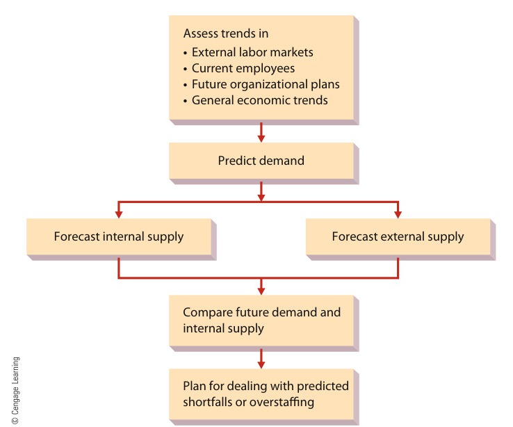

[← Previous: M05.3: Vroom's Expectancy, McGregor X/Y, and ERG Theories](M05.3_Vroom_Expectancy_McGregor_XY_and_ERG_Theories.md) | [🏠 Index](00_Index.md) | [📐 Master Sheet](99_Master_Formula_and_Statutory_Sheet.md) | [Next: M06.2: Performance Appraisal Methods and Rating Errors →](M06.2_Performance_Appraisal_Methods_and_Rating_Errors.md)

# M06.1: HRM, Recruitment, Selection, and Training

> [!info] ⚡ Exam Snapshot
> - **Section & Priority:** Section B · Dr. Md. Rabiul Islam · 🟡 Medium Priority | **Read Time:** ~4 mins
> - **PYQs Covered:** 2020 Q.3(a) (03m), 2020 Q.3(b) (04m), 2020 Q.3(c) (05m)
> - **Scoring Rule:** State Griffin's exact definitions, contrast Recruitment vs. Selection in a table, and list 6 concrete reasons for training.

---

## 📌 1. Verbatim Definitions (For 2-Mark Questions)

> **Human Resource Management (HRM):**
> "The set of organizational activities directed at attracting, developing, and maintaining an effective workforce." *(Ricky W. Griffin)*
- *Plain meaning:* Hiring, training, and retaining workers to achieve company goals.

> **Recruiting:**
> "The process of attracting individuals to apply for jobs that are open." *(Ricky W. Griffin)*
- *Plain meaning:* Generating a qualified applicant pool for open company positions.

> **Selection:**
> "Gathering from applicants information that will predict their job success and then hiring the candidates likely to be most successful." *(Ricky W. Griffin)*
- *Plain meaning:* Screening and interviewing applicants to select the best hire.

> **Training vs. Development:**
> "Training: Teaching operational or technical employees how to do the job for which they were hired. Development: Teaching managers and professionals the skills needed for both present and future jobs." *(Ricky W. Griffin)*
- *Plain meaning:* Training teaches immediate operational skills; development prepares managers for future leadership.

---

## ⚡ 2. Core Exam Blocks (Write Directly in Exam)

### Block 1: Strategic Scope of HRM (`A-D-M`)

HRM treats staff as **human capital**: an organizational asset yielding competitive advantage. Line managers and HR specialists manage three core activities (`A-D-M`):

1. **A - Attracting Human Resources:** HR planning, job analysis, external recruitment channels, and candidate selection screening.
2. **D - Developing Human Resources:** Employee onboarding, technical skills training, executive development programs, and performance appraisal.
3. **M - Maintaining Human Resources:** Setting fair wage structures, managing benefits packages, labor relations, and statutory safety compliance.

### Block 2: Job Analysis (Job Description vs. Job Specification)

Job analysis systematically analyzes workplace tasks, creating two separate documents:

| Comparison Basis | Job Description | Job Specification |
| :--- | :--- | :--- |
| **Primary Focus** | The job tasks and workplace conditions | Human qualifications and credentials |
| **Core Question** | "What does the worker do?" | "Who is qualified to do this job?" |
| **Typical Contents** | Title, duties, machinery, physical hazards | Degrees, certifications, experience, skills |
| **Primary Use** | Writing job postings and performance standards | Screening candidate resumes and interview hurdles |
| **Engineering Example** | "Solder surface-mount chips on line 3" | "B.Sc. in EEE/ECE with 2 years QA experience" |

### Block 3: The Human Resource Planning Process

HR planning ensures adequate staffing levels across five steps:

1. **Assess Strategic Trends:** Review organizational goals and past staffing patterns.
2. **Predict Labor Demand:** Forecast required personnel from sales and production targets.
3. **Forecast Internal Supply:** Track current staff readiness via **Replacement Charts** (manager succession) and **Skills Inventories** (employee database).
4. **Forecast External Supply:** Monitor labor market availability and engineering graduate numbers.
5. **Plan for Imbalances:** Hire or retrain for shortfalls; transfer or freeze hiring for surpluses.

*Figure 8.1: The Human Resource Planning Process (Source: Griffin, Fundamentals of Management, 8th ed., p. 260).*

### Block 4: Recruitment and Selection

#### A. Recruitment Channels and Selection Tools
- **Internal Recruiting:** Promotes current staff via intranet postings and skills inventories. Boosts morale and saves time, but causes ripple effect vacancies.
- **External Recruiting:** Attracts outside applicants via campus drives and job boards. Brings fresh ideas, but costs more and requires longer onboarding.
- **Realistic Job Preview (RJP):** Shares both attractive and difficult job realities to reduce early turnover.
- **Selection Tools:** Uses application blanks, validated tests, structured interviews, assessment centers, and reference checks.

#### B. Comparison: Recruitment vs. Selection
| Basis of Comparison | Recruitment | Selection |
| :--- | :--- | :--- |
| **1. Meaning** | Attracting candidates to apply for vacancies | Evaluating applicants to hire the best person |
| **2. Objective** | Creates a large pool of applicants | Filters the pool to choose one candidate |
| **3. Nature of Process** | **Positive process** (encourages applications) | **Negative process** (rejects unsuitable candidates) |
| **4. Sequence** | First phase (precedes selection) | Second phase (starts after pool is created) |
| **5. Core Methods** | Job boards, campus drives, advertisements | Tests, structured interviews, work samples |
| **6. Cost and Time** | Lower cost and time spent per candidate | High cost and time for rigorous testing |
| **7. Final Outcome** | Applicant pool ready for evaluation | Formal appointment letter and contract |

### Block 5: Employee Training and 6 Reasons for Training

#### A. Training Methods
- **On-the-Job Training (OJT):** Hands-on coaching on live production machinery.
- **Off-the-Job Training:** Vestibule training (mock facility), computer simulations, and classroom lectures on safety and operating codes.

#### B. 6 Reasons Why Training is Necessary (`T-E-C-H-S-M`)
1. **T - Technological Adaptation:** Equips staff to operate automated lines, robotics, and CAD tools.
2. **E - Error Reduction & Quality:** Sharpens precision, cuts scrap rates, and ensures uniform quality.
3. **C - Cost & Downtime Drop:** Proper equipment handling prevents premature wear and costly machine downtime.
4. **H - Health and Industrial Safety:** Teaches hazard handling and emergency drills, preventing fatal workplace accidents.
5. **S - Supervision Drop:** Trained operators resolve technical glitches independently, freeing manager time.
6. **M - Morale and Retention:** Upskilling shows organizational commitment, raising loyalty and building leadership pipelines.

---

## 🎯 3. PYQ & Target Answer Key

### 2020 Q.3(a) · Human Resources Management: Definition and Scope (03 Marks)
- **Question:** What is human resources management?
- **Answer Blueprint:** State Ricky W. Griffin's definition and define human capital (§1). List the 3 core functional activities (`A-D-M`: Attracting, Developing, Maintaining) with two examples each (§2 Block 1).

### 2020 Q.3(b) · Distinction Between Recruitment and Selection (04 Marks)
- **Question:** Distinguish between recruitment and selection.
- **Answer Blueprint:** Define recruitment and selection verbatim (§1). Draw the 7-parameter comparison table (§2 Block 4) emphasizing positive pool creation vs. negative screening. Briefly state internal vs. external recruiting trade-offs.

### 2020 Q.3(c) · Employee Training: Meaning and Necessity (05 Marks)
- **Question:** What is meant by employee training? Why is it necessary?
- **Answer Blueprint:** Define employee training and distinguish it from employee development (§1). Outline on-the-job and off-the-job training methods (§2 Block 5). Detail all 6 reasons for employee training using `T-E-C-H-S-M` (§2 Block 5).

---

> [!warning] ⚠️ Examiner Traps
> - **HRM Definition:** Must include all three verbs: *attracting*, *developing*, and *maintaining*. Writing only "hiring people" loses marks.
> - **Positive vs. Negative:** State explicitly that recruitment is a *positive* process, while selection is a *negative* screening process.
> - **Description vs. Specification:** Job *description* covers duties and tools. Job *specification* covers human skills and credentials.
> - **Training vs. Development:** Training teaches operational staff current skills. Development prepares managers for future roles.

---

[← Previous: M05.3: Vroom's Expectancy, McGregor X/Y, and ERG Theories](M05.3_Vroom_Expectancy_McGregor_XY_and_ERG_Theories.md) | [🏠 Index](00_Index.md) | [📐 Master Sheet](99_Master_Formula_and_Statutory_Sheet.md) | [Next: M06.2: Performance Appraisal Methods and Rating Errors →](M06.2_Performance_Appraisal_Methods_and_Rating_Errors.md)
