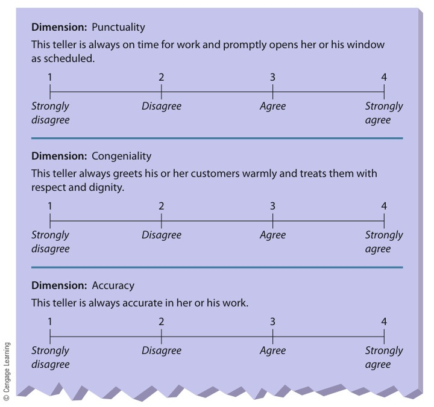
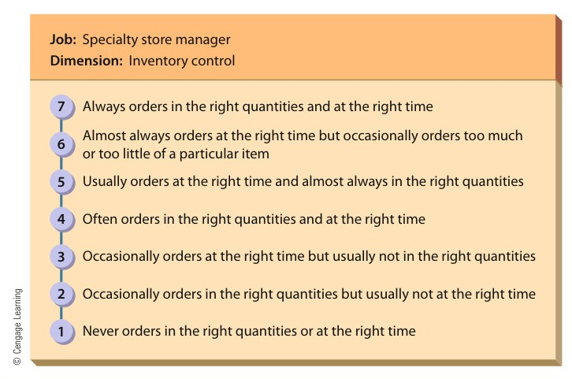

[← Previous: M06.1: HRM, Recruitment, Selection, and Training](M06.1_HRM_Recruitment_Selection_and_Training.md) | [🏠 Index](00_Index.md) | [📐 Master Sheet](99_Master_Formula_and_Statutory_Sheet.md) | [Next: O01.1: Inventory Control and Holding Costs →](O01.1_Inventory_Control_and_Holding_Costs.md)

---

# M06.2: Performance Appraisal Methods and Rating Errors

> [!info] ⚡ Exam Snapshot
> - **Section & Priority:** Section B (CO2 · Industrial Management · Dr. Md. Rabiul Islam) · 🔴 Essential (Tested in all 4 Finals: 2020, 2021, 2023, 2024)
> - **Read Time:** ~5 mins
> - **PYQs Covered:** 2023 Q.8(c) (3 marks), 2024 Q.8(b) (4 marks), 2020 Q.2(b) (6 marks), 2021 Q.4(c) (4 marks)
> - **Scoring Strategy:** State Griffin's exact definitions. Contrast Graphic Scale vs. BARS across 6 parameters in a table. Explain all 6 rating errors (`H-L-S-C-R-C`) with engineering examples and everyday intuition. Detail all 5 practical remedies (`B-R-D-M-M`).

---

## 📌 1. Verbatim Definitions (For 2-Mark Questions)

> **Performance Appraisal:**  
> "A formal assessment of how well an employee is doing his or her job." *(Ricky W. Griffin)*

*Plain meaning:* A formal review where a manager grades a worker's past performance. It helps decide on pay raises, promotions, or training.

> **Performance Management:**  
> "The continuous process of identifying, measuring, and developing employee performance to match organizational goals." *(Ricky W. Griffin)*

*Plain meaning:* An ongoing, year-round system of daily coaching, goal setting, and feedback to help workers reach company goals.

> **Graphic Rating Scale:**  
> A performance appraisal method where a supervisor rates an employee on a series of evaluative dimensions using a fixed numerical or descriptive scale.

*Plain meaning:* A simple evaluation sheet where a boss grades traits (like punctuality or accuracy) using numbers from 1 to 5.

> **Behaviorally Anchored Rating Scale (BARS):**  
> "A sophisticated rating method in which supervisors construct a rating scale associated with behavioral anchors." *(Ricky W. Griffin)*

*Plain meaning:* An advanced rating scale where each score ties to real, observable job actions. It replaces vague words like "good" or "poor".

> **360-Degree Feedback:**  
> "A performance appraisal system in which managers are evaluated by everyone around them: their boss, their peers, and their subordinates." *(Ricky W. Griffin)*

*Plain meaning:* Getting performance feedback from all directions, including your boss, teammates, subordinates, and outside clients.

---

## ⚡ 2. Core Exam Blocks (Write Directly in Exam)

### Block 1: Performance Appraisal vs. Management & Core Objectives

Performance appraisal and performance management serve different purposes within human resource management:

| Basis of Comparison | Performance Appraisal | Performance Management |
| :--- | :--- | :--- |
| **1. Nature** | A formal, periodic evaluation event | An ongoing, continuous organizational system |
| **2. Time Focus** | Backward-looking (evaluates past work) | Forward-looking (develops future capability) |
| **3. Frequency** | Conducted annually or semi-annually | Carried out continuously through daily coaching |
| **4. Primary Goal** | Assess past performance for administrative decisions | Align daily individual output with strategic organizational goals |
| **5. Scope** | Individual evaluation tool and scoring instrument | Broad system including goals, feedback, training, and rewards |
| **6. Manager's Role** | Acts as an evaluator and judge | Acts as a coach, guide, and mentor |

#### Three Core Objectives of Performance Appraisal (`A-D-V`)

Organizations conduct formal performance appraisals for three strategic reasons:

1. **A - Administrative Decisions:** Appraisals provide written justification for salary raises, bonuses, promotions, transfers, and terminations.
2. **D - Developmental Feedback:** Appraisals pinpoint employee technical weaknesses. This guides the design of targeted training programs and career coaching.
3. **V - Selection Device Validation:** Appraisals generate historical performance data. This proves whether hiring tests and interviews actually predicted real job success.

### Block 2: Who Should Evaluate? (Evaluator Sources: `S-P-S-S-C-3`)

Gathering feedback from diverse sources balances personal views and provides well-rounded evaluations:

1. **Immediate Supervisor:** Direct supervisors assign daily tasks and monitor workflow. They know technical expectations best. But their ratings can suffer from personal bias.
2. **Peers and Coworkers:** Teammates work alongside the employee every day. They observe communication, reliability, and technical teamwork firsthand. But peers may hesitate to criticize friends or may compete for the same promotion.
3. **Subordinates (Upward Appraisal):** Direct reports rate managerial communication, fairness, and leadership style. Subordinate ratings must remain strictly anonymous to prevent fear of workplace retaliation.
4. **Self-Appraisal:** Employees evaluate their own work and document key achievements. This promotes personal accountability. But individuals tend to rate themselves too generously.
5. **Customers and External Clients:** Outside clients assess service speed, courtesy, and technical support in client-facing roles.
6. **360-Degree Feedback:** A complete rating system gathering feedback from all directions: supervisors, peers, subordinates, and clients. Blending multiple viewpoints cancels out single-rater bias.

### Block 3: Performance Appraisal Methods (Objective vs. Judgmental)

Organizations use both objective performance data and judgmental supervisory ratings to evaluate employees:

#### A. Objective Methods

Objective methods rely on verifiable facts and measurable data rather than subjective impressions:

- **Measurable Output:**
  - Tracks hard numbers like units assembled, software modules completed, or sales dollars generated.
  - *Opportunity Bias:* Raw output numbers can mislead managers if operating conditions differ unfairly. For example, a salesperson in a wealthy city has an easier job than one in a poor rural district. Managers must adjust raw output for territory differences.
- **Special Performance Tests:**
  - Employees carry out standardized technical tasks under identical, controlled workstation conditions.
  - Standardized testing removes opportunity bias and measures pure skill. But it cannot measure daily motivation or attitude on the factory floor.

#### B. Judgmental Methods

Judgmental methods evaluate employee qualities and work behaviors through human evaluation:

- **Ranking Techniques:** Orders employees from highest to lowest performer, or places workers into fixed percentage brackets (such as top 10%, middle 80%, bottom 10%).
- **Management by Objectives (MBO):** Managers and subordinates agree on measurable targets at the start of the period. Later, they evaluate actual results against those exact targets.
- **Graphic Rating Scales vs. BARS:** Graphic Rating Scales evaluate employee traits using simple numbers. Behaviorally Anchored Rating Scales (BARS) tie each rating number to concrete, observable job actions.

*Figure 8.2: Graphic Rating Scales for a Bank Teller (Source: Griffin, Fundamentals of Management, 8th ed., p. 267).*

*Figure 8.3: Behaviorally Anchored Rating Scale (BARS) for Inventory Control (Source: Griffin, Fundamentals of Management, 8th ed., p. 268).*

| Comparison Parameter | Graphic Rating Scale | Behaviorally Anchored Rating Scale (BARS) |
| :--- | :--- | :--- |
| **1. Scale Anchors** | Vague numbers (1 to 5) or trait labels (poor, average, good) | Concrete descriptions of observable, verifiable job behaviors |
| **2. Development Cost** | Very low; generic templates fit many different jobs | Very high; requires rigorous job analysis for each position |
| **3. Objectivity** | Low; vulnerable to personal interpretation and rating bias | High; anchors keep evaluators focused on verifiable job actions |
| **4. Feedback Quality** | Weak; informs employees of scores without behavior guidance | Excellent; explicitly demonstrates which behaviors elevate scores |
| **5. Rater Consistency** | Low; different supervisors define scale points differently | High; distinct anchors produce uniform ratings across evaluators |
| **6. Scale Example** | Point 4: "Above average accuracy" | Point 4: "Verifies component polarity before soldering" |

### Block 4: The 6 Potential Rating-Scale Appraisal Problems (`H-L-S-C-R-C`)

Even carefully designed rating scales remain vulnerable to six common errors in human judgment:

1. **H - Halo and Horns Error:**
   - *Everyday intuition:* Letting one bright spot or one dark spot blind you to everything else.
   - *Halo Error:* An employee does one visible thing very well, so the boss rates them high on everything. For example, an engineer who arrives early gets top marks for circuit design despite making wiring errors.
   - *Horns Error:* An employee has one minor flaw, so the boss rates them low on everything. For example, having a messy desk hurts a worker's technical design score.

2. **L - Leniency Error:**
   - *Everyday intuition:* Giving everyone an easy 'A' to avoid conflict and keep the peace.
   - The evaluator rates all workers near the top of the scale.
   - Managers do this to avoid arguments, look supportive, or help staff win team bonuses. But this practice robs true top performers of recognition.

3. **S - Strictness (Severity) Error:**
   - *Everyday intuition:* Grading so harshly that nobody can ever get an 'A'.
   - The evaluator rates all employees near the bottom of the scale.
   - Even outstanding workers receive mediocre marks. This damages worker morale and breeds frustration.

4. **C - Central Tendency Error:**
   - *Everyday intuition:* Playing it safe by grading everybody as a plain 'C'.
   - The evaluator rates all workers at the midpoint (such as giving everyone a 3 on a 5-point scale).
   - Managers do this to avoid having to defend high or low scores. This hides real performance differences between workers.

5. **R - Recency Error:**
   - *Everyday intuition:* Judging a whole year of work based only on what the worker did last week.
   - The evaluator bases ratings only on the last two or three weeks. They forget the rest of the year.
   - A poor worker who works hard right before reviews gets high marks. Meanwhile, a steady contributor who makes one recent mistake gets penalized.

6. **C - Contrast Error and Personal Bias:**
   - *Everyday intuition:* Judging someone against the person who walked in right before them instead of the job standard.
   - *Contrast Error:* Rating a worker against the coworker evaluated right before them instead of real job standards. An average worker looks weak right after an exceptional superstar.
   - *Personal Bias:* Letting personal prejudices about age, gender, or background distort appraisal scores.

### Block 5: Five Practical Remedies to Avoid Appraisal Problems (`B-R-D-M-M`)

Organizations use five proven managerial practices to eliminate rating scale errors:

1. **B - Adopt BARS:** Replace vague trait words with Behaviorally Anchored Rating Scales. Anchor scale numbers to concrete, observable job behaviors.
2. **R - Run Structured Rater Training:** Train managers through workshops and simulations. Teach them to recognize and avoid rating errors like halo, leniency, and central tendency.
3. **D - Maintain Performance Diaries (Critical Incidents):** Require supervisors to record key successes and mistakes all year long. This stops recency error.
4. **M - Use Multiple Evaluators (360-Degree Feedback):** Collect ratings from supervisors, peers, subordinates, and clients. Blending multiple viewpoints cancels out single-rater bias.
5. **M - Set Objective Benchmarks with MBO:** Use Management by Objectives. Agree on measurable goals at the start of the year to eliminate subjective guesswork.

---

## 🎯 3. PYQ & Target Answer Key

### 2023 Q.8(c) · Performance Management, Evaluators, and Appraisal Methods (03 Marks)

**Question:**  
What is performance management? Who should do the appraisal and in what ways?

**Exam Writing Plan:**

1. **Definition & System Overview:**
   - Quote Griffin's definition of *performance management* (*"The continuous process of identifying, measuring, and developing employee performance to match organizational goals"*).
   - Contrast it with *performance appraisal*. Performance management is an ongoing, year-round system. Performance appraisal is a periodic scoring event.

2. **Evaluator Sources (Who Should Appraise):**
   - *Immediate Supervisor:* Primary rater who assigns tasks and observes daily performance.
   - *Peers and Coworkers:* Provide firsthand observations of teamwork, reliability, and cooperation.
   - *Subordinates (Upward Appraisal):* Evaluate managerial communication, fairness, and leadership style.
   - *Self-Appraisal & Clients:* Promote personal accountability and assess external service satisfaction.
   - *360-Degree Feedback:* Combines evaluations across all surrounding sources to eliminate single-rater bias.

3. **Appraisal Methods (In What Ways):**
   - *Objective Methods:* Measurable output (adjusted for opportunity bias) and standardized performance tests.
   - *Judgmental Methods:* Graphic rating scales, Behaviorally Anchored Rating Scales (BARS), ranking techniques, and Management by Objectives (MBO).

4. **Takeaway:**
   - Conclude that modern organizations combine multiple evaluators with objective benchmarks.
   - This ensures fair and developmentally constructive appraisals.

---

### 2024 Q.8(b) · Potential Rating-Scale Appraisal Problems and Remedies (04 Marks)

**Question:**  
State potential rating-scale appraisal problems and suggest ways to avoid the problems.

**Exam Writing Plan:**

1. **Introduction:**
   - State that rating scales evaluate employee traits along fixed dimensions.
   - Note that rating scales remain vulnerable to subjective cognitive errors by human raters.

2. **Six Potential Rating-Scale Problems (`H-L-S-C-R-C`):**
   - *H - Halo / Horns Error:* Letting one positive or negative trait distort the entire evaluation.
   - *L - Leniency Error:* Rating all workers near the top of the scale to avoid confrontation.
   - *S - Strictness Error:* Rating all employees excessively low due to unrealistically severe standards.
   - *C - Central Tendency Error:* Placing all ratings in the middle to avoid defending extreme scores.
   - *R - Recency Error:* Over-weighting events from the last two or three weeks while ignoring earlier months.
   - *C - Contrast Error & Personal Bias:* Scoring an employee relative to the preceding coworker rather than against objective job standards.

3. **Five Practical Managerial Remedies (`B-R-D-M-M`):**
   - *B - Adopt BARS:* Anchor scale points to concrete, observable job behaviors.
   - *R - Conduct Rater Training:* Train managers to recognize and avoid perceptual errors.
   - *D - Critical Incident Diaries:* Maintain year-round written logs of notable accomplishments and errors.
   - *M - Multiple Evaluators (360-Degree Feedback):* Combine ratings from supervisors, peers, and subordinates to cancel out individual bias.
   - *M - Measurable MBO Benchmarks:* Set objective, quantifiable targets in advance.

4. **Takeaway:**
   - Conclude that behavioral anchors (BARS) and continuous performance logs provide the strongest defense against rating scale errors.

---

### 2020 Q.2(b) · Performance Appraisal and Rating Scale Appraisal Problems (06 Marks)

**Question:**  
What is performance appraisal? Explain the potential rating scale appraisal problems.

**Exam Writing Plan:**

1. **Verbatim Definition & Core Purposes:**
   - Quote Ricky W. Griffin's definition of *performance appraisal* (*"A formal assessment of how well an employee is doing his or her job"*).
   - State its three core organizational objectives (`A-D-V`): administrative decisions (raises and promotions), employee development (training needs and coaching), and selection validation.

2. **In-Depth Explanation of 6 Rating-Scale Errors (`H-L-S-C-R-C`):**
   - *Halo & Horns Error:* Explain how a single good trait (like punctuality) inflates technical scores. Show how an untidy desk (horns effect) inappropriately drags down design scores.
   - *Leniency Error:* Explain why supervisors rate everyone near the top (avoiding conflict, protecting team bonuses). Emphasize that it fails to recognize true high performers.
   - *Strictness (Severity) Error:* Explain how excessively harsh standards demoralize dedicated workers.
   - *Central Tendency Error:* Explain the urge to play it safe by scoring everyone as "average" (point 3 on a 5-point scale). Point out that this hides true performance variations.
   - *Recency Error:* Explain how short human memory distorts reviews. Late surges or recent mistakes overshadow months of steady work.
   - *Contrast Error & Personal Prejudice:* Explain how reviewing an average worker immediately after a star skews judgment. Warn against demographic bias.

3. **Takeaway:**
   - Conclude that subjective perceptual traps corrupt trait-based rating scales.
   - Organizations must anchor appraisals to documented behavioral standards (BARS).

---

### 2021 Q.4(c) · Performance Management and Potential Rating Scale Errors (04 Marks)

**Question:**  
What is performance management? State the potential rating scale appraisal problems.

**Exam Writing Plan:**

1. **Definition & System Overview:**
   - Quote Griffin's definition of *performance management* verbatim from §1 (*"The continuous process of identifying, measuring, and developing employee performance to match organizational goals"*).
   - Note that it includes continuous coaching, regular feedback, and formal appraisals.

2. **Core Differences Table (Brief):**
   - Contrast performance management with performance appraisal using 3 key points from §2 Block 1:
   - *System:* Ongoing system vs. periodic scoring event.
   - *Focus:* Forward-looking development vs. backward-looking evaluation.
   - *Manager's role:* Coach and mentor vs. judge and evaluator.

3. **Six Potential Rating Scale Errors (`H-L-S-C-R-C`):**
   - *Halo / Horns Error:* A single trait coloring the entire evaluation.
   - *Leniency Error:* Assigning uniformly high ratings across the department.
   - *Strictness Error:* Applying unreasonably harsh standards to all employees.
   - *Central Tendency Error:* Placing every worker safely at the midpoint of the scale.
   - *Recency Error:* Scoring work based only on the most recent weeks.
   - *Contrast Error:* Evaluating a worker against the preceding candidate rather than standard job criteria.

4. **Takeaway:**
   - Conclude that effective performance management minimizes rating scale errors.
   - It replaces annual subjective impressions with continuous communication and objective benchmarks.

---

> [!warning] ⚠️ Examiner Traps
> - **Appraisal vs. Management Distinction:** Performance appraisal is a periodic scoring event evaluating past results. Performance management is an ongoing, year-round system integrating goal setting, daily coaching, and feedback.
> - **Incomplete Errors List:** Always state all six rating errors (`H-L-S-C-R-C`). Writing only Halo and Recency forfeits up to half the allocated marks.
> - **Opportunity Bias in Output Measurement:** When discussing objective performance metrics, always highlight opportunity bias (such as uneven sales territories). Explain how managers adjust for it.
> - **BARS Definition Accuracy:** Behaviorally Anchored Rating Scales anchor scale points to concrete, observable job behaviors. They avoid subjective personal traits or vague numbers.

---

[← Previous: M06.1: HRM, Recruitment, Selection, and Training](M06.1_HRM_Recruitment_Selection_and_Training.md) | [🏠 Index](00_Index.md) | [📐 Master Sheet](99_Master_Formula_and_Statutory_Sheet.md) | [Next: O01.1: Inventory Control and Holding Costs →](O01.1_Inventory_Control_and_Holding_Costs.md)
