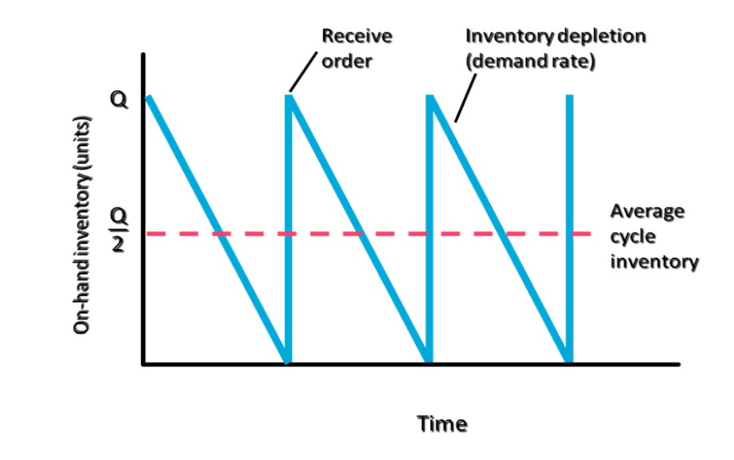
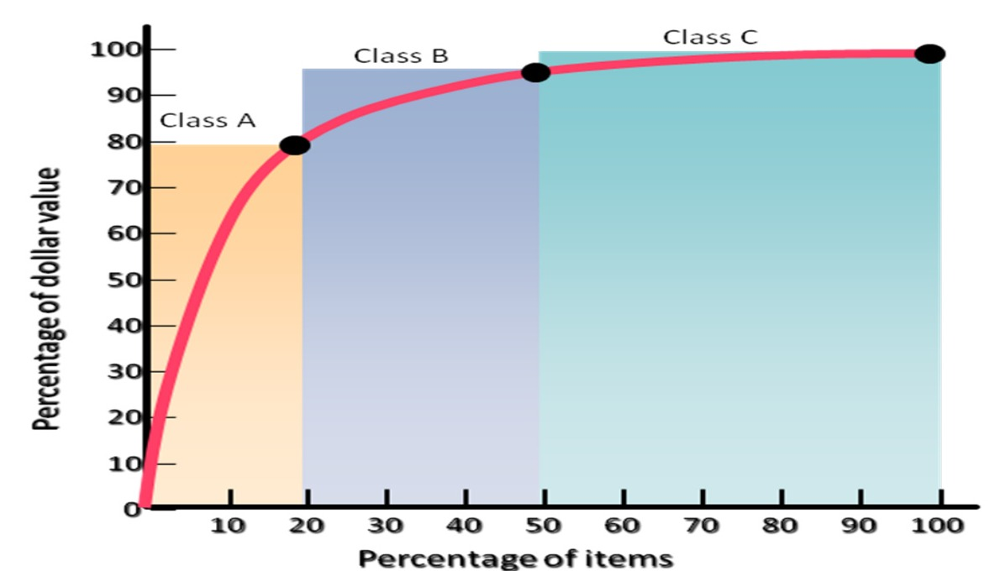

[← Previous: O01.1: Inventory Control and Holding Costs](O01.1_Inventory_Control_and_Holding_Costs.md) | [🏠 Index](00_Index.md) | [📐 Master Sheet](99_Master_Formula_and_Statutory_Sheet.md) | [Next: O02.1: EOQ Model, ROP, Safety Stock, and Cost Curves →](O02.1_EOQ_Model_ROP_Safety_Stock_and_Cost_Curves.md)

---

# O01.2: Types of Inventory and ABC Analysis

> [!info] ⚡ Exam Snapshot
> - **Section & Priority:** Section B · Dr. Md. Rabiul Islam (MRI Sir) · High Priority | **Read Time:** ~5 mins
> - **PYQs Covered:** 2020 Q.4(c) (03m), 2023 Q.7(a) Part 2 (01m), ABC Analysis (Core 4m model question)
> - **Scoring Rule:** State four functional types (`C-S-A-P`) with exact formulas, embed cycle sawtooth graph, and provide complete ABC table + Pareto curve.

---

## 📌 1. Verbatim Definitions (For 2-Mark Questions)

1. **Cycle Inventory:**
   > "The portion of total inventory that varies directly with lot size is called cycle inventory. Determining how frequently to order, and in what quantity, is called lot sizing." (MRI Sir, Inventory Control Notes, Page 1)
   - *Plain meaning:* Working stock consumed between regular deliveries, averaging half the order lot ($Q/2$).

2. **Safety Stock Inventory:**
   > "Safety stock inventory is surplus inventory that protects against uncertainties in demand, lead time, and supply." (MRI Sir, Inventory Control Notes, Page 1)
   - *Plain meaning:* Buffer stock held to prevent stockouts when deliveries are delayed or demand surges.

3. **Anticipation Inventory:**
   > "Inventory used to absorb uneven rates of demand or supply, which business often face, is referred to as anticipation inventory." (MRI Sir, Inventory Control Notes, Page 1)
   - *Plain meaning:* Pre-built stock stored ahead of predictable seasonal sales surges, strikes, or plant shutdowns.

4. **Pipeline Inventory:**
   > "Inventory moving from point to point in the materials flow system is called pipeline inventory... Pipeline inventory consists of orders that have been placed but not yet received." (MRI Sir, Inventory Control Notes, Page 1)
   - *Plain meaning:* Goods in transit across the supply network, calculated as $I_p = \bar{d} L$.

5. **ABC Analysis:**
   > "The process of dividing inventory items into three classes according to their dollar usage so that managers can focus on items that have the highest dollar value." (MRI Sir, Inventory Control Notes, Page 1)
   - *Plain meaning:* Categorizing parts into three tiers by annual spending to apply strict control on costly items.

---

## ⚡ 2. Core Exam Blocks (Write Directly in Exam)

### A. Four Functional Types of Inventory (`C-S-A-P`)

> [!tip] Memory Hook: 4 Functional Inventory Types (`C-S-A-P`)
> - **C**: Cycle Inventory (satisfies normal demand between orders; average level is $Q/2$).
> - **S**: Safety Stock (cushions against unexpected demand surges or supplier delays).
> - **A**: Anticipation Inventory (buffers predictable seasonal rushes or factory shutdowns).
> - **P**: Pipeline Inventory (materials in transit across the supply network; $I_p = \bar{d} L$).

1. **Cycle Inventory:**
   - Portion of total inventory that varies directly with lot size ($Q$).
   - *Lot-sizing rule:* Ordering every $N$ weeks means order quantity $Q$ equals $N$ weeks of demand.
   - *Average level:* Exactly half the order batch size:
   $$
   \text{Average Cycle Inventory} = \frac{Q}{2}
   $$
   - *ECE Example:* Batch order of 1200 Wi-Fi chips yields average cycle stock of $1200 / 2 = 600\text{ units}$.

*Figure 1: Cycle inventory replenishment and depletion sawtooth pattern (Source: Inventory Control Notes, Page 3).*

2. **Safety Stock Inventory ($SS$):**
   - Surplus buffer protecting against delivery delays, demand spikes, and production scrap:
   $$
   SS = z \, \sigma_d \sqrt{L}
   $$
   - *ECE Example:* Keeping 250 buffer amplifier modules prevents assembly line halts during air cargo customs delays.

3. **Anticipation Inventory:**
   - Stock accumulated ahead of planned, predictable events (seasonal rushes, strikes, or scheduled maintenance).
   - *ECE Example:* Stockpiling 10,000 smart energy meters before a scheduled two-week factory overhaul in May.

4. **Pipeline (In-Transit) Inventory ($I_p$):**
   - Materials moving between supply chain nodes (orders placed and dispatched, but not yet delivered):
   $$
   I_p = \bar{d} L
   $$
   - *Worked Example:* Demand $\bar{d} = 60\text{ microcontrollers/day}$ with transit lead time $L = 5\text{ days}$:
   $$
   I_p = 60 \times 5 = 300\text{ units}
   $$
   - Exactly 300 microcontrollers remain in transit across shipping conduits at any moment.

### B. ABC Inventory Analysis (Pareto 80/20 Principle)

ABC Analysis applies the **Pareto Principle** ($80/20$ rule). A small share of critical items accounts for most dollar usage, while most items account for very little value.

- **Annual Dollar Usage Formula:**
$$
\text{Annual Dollar Usage} = \text{Annual Demand } (D) \times \text{Unit Cost } (C)
$$

*Figure 2: ABC inventory Pareto curve (Source: Inventory Control Notes, Page 2).*

> [!tip] Memory Hook: 20-30-50 / 80-15-5 Split
> - **Item Counts Climb:** $20\% \rightarrow 30\% \rightarrow 50\%$ (Total = $100\%$).
> - **Dollar Values Drop:** $80\% \rightarrow 15\% \rightarrow 5\%$ (Total = $100\%$).
> - **Class A:** ~20% items, ~80% value (tightest continuous control).
> - **Class B:** ~30% items, ~15% value (moderate standard control).
> - **Class C:** ~50% items, ~5% value (simple, relaxed control).

### C. Four-Step ABC Classification Procedure

1. **Calculate Annual Dollar Usage:** Multiply annual demand ($D_i$) by unit purchase price ($C_i$) for every item: $\text{Dollar Usage} = D_i \times C_i$.
2. **Sort in Descending Order:** Rank all inventory parts from highest annual dollar usage to lowest.
3. **Compute Cumulative Percentages:** Calculate cumulative percentages for item count and annual dollar usage.
4. **Assign ABC Classes:** Group items into Class A (top ~80% value, ~20% items), Class B (next ~15% value, ~30% items), and Class C (final ~5% value, ~50% items).

### D. Master ABC Managerial Control Policy Table

| Parameter | Class A Items | Class B Items | Class C Items |
| :--- | :--- | :--- | :--- |
| **Item & Dollar Share** | ~20% items, ~80% dollar value | ~30% items, ~15% dollar value | ~50% items, ~5% dollar value |
| **Control Level** | Strict, tight continuous control | Moderate standard control | Simple, relaxed control |
| **Review System** | Continuous review ($Q$-system); real-time logs | Periodic review (bi-weekly / monthly) | Visual check or two-bin system |
| **Safety Stock Size** | Kept very low (minimizes high holding costs) | Moderate buffer stock | High buffer stock (prevents line halts) |
| **Order Policy** | Frequent orders in small batch sizes ($Q$) | Moderate order batch sizes | Infrequent bulk purchases |
| **Record Keeping** | Exact perpetual inventory records | Standard periodic counts | Simplified bulk records or no itemized logs |
| **Purchasing Authority** | Senior operations managers / procurement heads | Middle purchasing staff | Clerical buyers or automated reorder |
| **ECE Plant Examples** | High-end FPGAs, microprocessors, RF modules | Custom multilayer PCBs, transformers, LCDs | Surface-mount resistors, capacitors, screws |

---

## 🎯 3. PYQ & Target Answer Key

### Final 2020 Q.4(c) (03 Marks)
**Question:** Discuss the types of inventory.

**Answer Blueprint:**
- State that inventory differs by operational role, not physical appearance.
- Detail the four functional types (`C-S-A-P`) from §2 Block A with standard formulas and operating drivers.
- Provide the sawtooth diagram (Figure 1) and lot-sizing operating rule.

---

### Final 2023 Q.7(a) Part 2 (01 Mark)
**Question:** State its types [types of inventory].

**Answer Blueprint:**
- Name the four functional types (`C-S-A-P`) from §2 Block A: Cycle ($Q/2$), Safety Stock ($SS$), Anticipation, and Pipeline ($I_p$).

---

### Model Exam Question 1 (04 Marks)
**Question:** Differentiate between the four functional types of inventory (Cycle, Safety Stock, Anticipation, and Pipeline inventory). Explain how pipeline inventory is calculated with a practical example.

**Answer Blueprint & Worked Solution:**
- Differentiate the four functional types (`C-S-A-P`) using §2 Block A (Cycle, Safety Stock, Anticipation, Pipeline).
- **Pipeline Formula:** $I_p = \bar{d} L$, where $\bar{d}$ = average demand rate, and $L$ = transit lead time in identical units.
- **Worked Example:** A plant uses $\bar{d} = 60\text{ microcontrollers/day}$ with lead time $L = 5\text{ days}$:
  $$
  I_p = 60 \times 5 = 300\text{ units in transit}
  $$

---

### Model Exam Question 2 (04 Marks)
**Question:** What is ABC Analysis in inventory management? Explain its classification criteria, management control policies for each category, and illustrate the concept with a Pareto curve.

**Answer Blueprint:**
- State the ABC definition and Pareto principle ($80/20$ rule) from §1 and §2 Block B.
- Write the Annual Dollar Usage formula: $\text{Annual Dollar Usage} = D \times C$.
- Sketch the Pareto curve from Figure 2 (steep rise for A, moderate slope for B, flat curve for C).
- State the 4-step classification procedure from §2 Block C.
- Present the Master ABC Managerial Control Policy Table from §2 Block D.

---

> [!warning] ⚠️ Examiner Traps
> - **Functional Types vs. Physical Forms:** When asked for "types of inventory", never write raw materials, WIP, and finished goods. Always write the four functional types: Cycle, Safety Stock, Anticipation, and Pipeline (`C-S-A-P`).
> - **Pipeline Time Unit Mismatch:** In $I_p = \bar{d} L$, $\bar{d}$ and $L$ must use identical time units (e.g., days with days).
> - **ABC Safety Stock Inversion:** Never say Class A needs the highest safety stock. Class A items carry massive holding costs, so their safety stock is kept very low. Class C items carry trivial holding costs, so their safety stock is high.
> - **Pareto Percentage Confusion:** On the curve, Class B spans $20\%$ to $50\%$ cumulative items ($30\%$ of total items). Do not write that Class B is $50\%$ of items.

---

[← Previous: O01.1: Inventory Control and Holding Costs](O01.1_Inventory_Control_and_Holding_Costs.md) | [🏠 Index](00_Index.md) | [📐 Master Sheet](99_Master_Formula_and_Statutory_Sheet.md) | [Next: O02.1: EOQ Model, ROP, Safety Stock, and Cost Curves →](O02.1_EOQ_Model_ROP_Safety_Stock_and_Cost_Curves.md)
