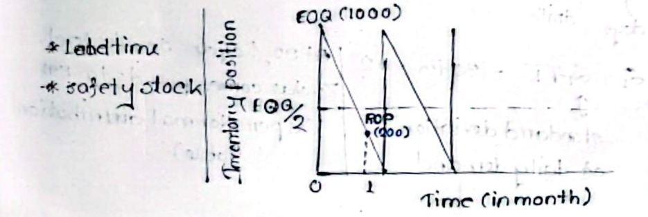
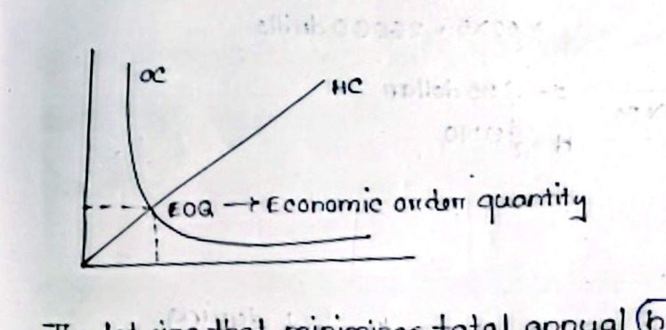

[← Previous: O01.2: Types of Inventory and ABC Analysis](O01.2_Types_of_Inventory_and_ABC_Analysis.md) | [🏠 Index](00_Index.md) | [📐 Master Sheet](99_Master_Formula_and_Statutory_Sheet.md) | [Next: O02.2a: Q-System Method and Weekly Demand Problems →](O02.2a_Q_System_Method_and_Weekly_Demand_Problems.md)

---

# O02.1: EOQ Model, ROP, Safety Stock, and Cost Curves

> [!info] ⚡ Exam Snapshot
> - **Section & Priority:** Section B (CO3 · Operational Management · Dr. Md. Rabiul Islam / MRI Sir) · Essential Final Exam Anchor
> - **Read Time:** ~4 minutes
> - **PYQs Covered:** 2020 Q.4(b) (04 marks), 2021 Q.4(b) (04 marks), 2023 Q.7(b) (02 marks), 2024 Q.4(b) (03 marks), 2024 Q.7(a) (04 marks)
> - **Scoring Rule:** State definitions verbatim with mathematical formulas, define every parameter ($D, S, H, z, \sigma, L$), and explicitly highlight annual cost equality ($HC = OC$) at the EOQ.

---

## 📌 1. Verbatim Definitions (For 2-Mark Questions)

> **Economic Order Quantity ($EOQ$):** "EOQ is the lot size that minimizes total annual inventory holding and ordering costs." *(MRI Sir, Inventory Control Notes, Page 2)*

*Plain meaning:* Economic Order Quantity is the optimal replenishment order batch size that strikes an exact balance between annual warehouse holding fees and purchase order placement fees.

$$
EOQ = \sqrt{\frac{2DS}{H}}
$$

Where:

- $D$ = Annual demand (units/year).
- $S$ = Cost per order or setup (\$/order or Tk/order).
- $H$ = Annual holding cost per unit per year (\$/unit/year or Tk/unit/year).

> **Lead Time ($L$):** "The total elapsed time between the placement of an order and its receipt into usable stock." *(Operations Management Lecture Series / Inventory Control Notes)*

*Plain meaning:* Lead time represents the entire waiting period that elapses from the instant a purchase requisition is approved until items are inspected, verified, and placed on warehouse shelves for immediate use.

- **Process Stages:** Requisition approval, vendor processing, freight transit, receiving inspection, and put-away storage.
- **Time Unit Rule:** Expressed in working days or weeks; must match the time period used for demand rate $\bar{d}$ and standard deviation $\sigma_d$.

> **Safety Stock ($SS$):** "Safety stock inventory is surplus inventory that protects against uncertainties in demand, lead time, and supply." *(MRI Sir, Inventory Control Notes, Page 1)*

*Plain meaning:* Safety stock is an emergency cushion kept in reserve to prevent factory shutdowns or lost sales if customer demand spikes unexpectedly or if supplier shipments face transit delays.

$$
SS = z \, \sigma_L = z \, \sigma_d \sqrt{L}
$$

Where:

- $z$ = Standard normal factor corresponding to cycle service level ($95\% \to 1.645\text{ or }1.43; 92\% \to 1.41; 88\% \to 1.175$).
- $\sigma_d$ = Standard deviation of demand per period (days or weeks).
- $L$ = Replenishment lead time in matching periods.
- $\sigma_L = \sigma_d \sqrt{L} = \text{Standard deviation of demand during lead time}$.

> **Reorder Point ($ROP$ or $R$):** "A predetermined inventory level such that an order for a fixed quantity $Q$ is placed whenever the inventory position drops to or below this level." *(Inventory Control Notes & Class 9 Notes)*

*Plain meaning:* The Reorder Point is a preset inventory threshold that alerts the warehouse manager to issue a new purchase order of size $EOQ$ immediately, ensuring goods arrive before current stock runs out.

$$
ROP = \bar{d} L + SS = \bar{d} L + z \sigma_d \sqrt{L}
$$

Where:

- $\bar{d}$ = Average daily or weekly demand rate.
- $L$ = Supplier lead time in matching days or weeks.
- $SS$ = Safety stock buffer units.
- **Deterministic Case:** When customer demand and vendor lead time are completely constant, demand variance is zero ($\sigma_d = 0$), reducing the formula to $ROP = \bar{d} L$.

---

## ⚡ 2. Core Exam Blocks (Write Directly in Exam)

### A. Inventory Sawtooth Cycle and ROP Dynamics

The continuous interaction between $EOQ$, lead time $L$, safety stock $SS$, and $ROP$ creates the classic inventory replenishment sawtooth cycle:

*Figure 1: Inventory Depletion Sawtooth Cycle and Reorder Point.*

1. **Peak Inventory ($Q = EOQ$):** A fresh replenishment order batch of size $EOQ$ arrives instantaneously at the beginning of each cycle, bringing warehouse stock to its maximum height.
2. **Depletion Rate ($d$):** Cycle inventory depletes downward at a steady, uniform daily or weekly customer demand rate $d$.
3. **Average Cycle Inventory ($\frac{EOQ}{2}$):** Because inventory drains linearly from $Q$ down to zero, the mean cycle inventory held across the cycle equals exactly half the batch size ($\frac{EOQ}{2}$).
4. **Order Trigger Point ($ROP$):** When on-hand stock drains down to the predetermined reorder point threshold, the manager immediately places a replenishment order of size $EOQ$.
5. **Lead Time Window ($L$):** Stock continues to deplete during the supplier delivery window $L$, reaching the safety stock buffer line just as the new replenishment shipment arrives.

### B. Six Key Assumptions of the Basic EOQ Model (`C-C-I-N-N-O`)

The foundational Economic Order Quantity formulation rests upon six core operational assumptions:

1. **Constant and Known Demand Rate ($D$):** Customer demand occurs at a uniform, predictable rate continuously over time.
2. **Constant and Known Lead Time ($L$):** The procurement delay between order placement and delivery arrival is completely fixed and known with certainty.
3. **Instantaneous Batch Receipt:** Each replenishment order of size $Q$ arrives in a single delivery all at once, with no partial shipments.
4. **No Stockouts or Shortages Allowed:** Customer demand must be met on schedule, meaning no backorders, lost sales, or stockout penalties occur.
5. **Constant Cost Structure (No Quantity Discounts):** The unit purchase price is constant regardless of order volume, with fixed setup cost $S$ and holding cost $H$.
6. **Only Two Variable Costs and Independence:** Only annual ordering costs and inventory holding costs vary with order quantity, and items are managed independently.

> [!tip] Memory Hook: 6 EOQ Assumptions (`C-C-I-N-N-O`)
> - **C:** **C**onstant and known customer demand rate ($D$).
> - **C:** **C**onstant and known supplier lead time ($L$).
> - **I:** **I**nstantaneous replenishment with entire batch $Q$ arriving all at once.
> - **N:** **N**o stockouts, shortages, or backorders allowed.
> - **N:** **N**o quantity discounts (purchase price per unit is fixed).
> - **O:** **O**nly holding and ordering costs vary with lot size.

### C. Annual Cost Curves and Behavior

Total annual cycle inventory cost balances two opposing cost forces:

*Figure 2: Economic Order Quantity Cost Trade-Off Curves.*

1. **Annual Ordering Cost ($OC$):** The annual expense incurred to place and receive purchase orders equals $\left(\frac{D}{Q}\right) S$. Because fewer orders are placed as batch size $Q$ expands, ordering cost decreases non-linearly, forming a downward hyperbolic curve.
2. **Annual Holding Cost ($HC$):** The annual expense of storing cycle inventory equals $\left(\frac{Q}{2}\right) H$. As batch size $Q$ increases, average cycle inventory rises in direct proportion, making holding cost increase linearly from the origin with slope $\frac{H}{2}$.
3. **Total Annual Cost ($TC$):** The sum of annual ordering and holding costs equals $TC(Q) = \left(\frac{D}{Q}\right) S + \left(\frac{Q}{2}\right) H$. This curve is convex and U-shaped, reaching its global minimum point precisely where the downward ordering cost curve intersects the upward holding cost line ($HC = OC$).

### D. Mathematical Derivation of the EOQ Formula

#### Method 1: Algebraic Equating Method (Cost Curve Intersection)

At the minimum point of the total cost curve, annual holding cost exactly equals annual ordering cost:

$$
HC = OC \implies \left(\frac{Q}{2}\right) H = \left(\frac{D}{Q}\right) S
$$

Multiply both sides of the equation by $Q$:

$$
\left(\frac{Q^2}{2}\right) H = D S
$$

Multiply both sides by $2$ and divide by unit holding cost $H$:

$$
Q^2 = \frac{2DS}{H}
$$

Take the square root of both sides to isolate the optimal Economic Order Quantity ($Q^*$):

$$
EOQ = Q^* = \sqrt{\frac{2DS}{H}}
$$

#### Method 2: Calculus Optimization Method (First Derivative Test)

Express the total annual cost equation as a continuous function of batch size $Q$:

$$
TC(Q) = D S Q^{-1} + \frac{H}{2} Q
$$

Differentiate total cost with respect to order quantity $Q$:

$$
\frac{d(TC)}{dQ} = - D S Q^{-2} + \frac{H}{2} = -\frac{DS}{Q^2} + \frac{H}{2}
$$

Set the first derivative to zero to identify the critical point:

$$
-\frac{DS}{Q^2} + \frac{H}{2} = 0 \implies \frac{H}{2} = \frac{DS}{Q^2}
$$

Rearrange to solve for $Q^2$:

$$
Q^2 = \frac{2DS}{H} \implies EOQ = Q^* = \sqrt{\frac{2DS}{H}}
$$

Verify the second derivative to confirm a global cost minimum:

$$
\frac{d^2(TC)}{dQ^2} = \frac{2DS}{Q^3}
$$

Because annual demand $D$, ordering cost $S$, and order quantity $Q$ are strictly positive real numbers, $\frac{d^2(TC)}{dQ^2} > 0$. This positive second derivative confirms that $EOQ$ achieves the absolute lowest total annual inventory cost.

---

## 🎯 3. PYQ & Target Answer Key

### Final 2020 Q.4(b), 2021 Q.4(b) & 2024 Q.7(a): Core Four Inventory Definitions (04 Marks)

**Verbatim Exam Prompt:**

> "Define EOQ, Re-order point, lead time and safety stock Inventory." *(Appeared in 2020 Final Q.4(b), 2021 Final Q.4(b), and 2024 Final Q.7(a) for 4 marks)*

**Exam Writing Plan:**

1. **Economic Order Quantity ($EOQ$):** Quote the verbatim definition from §1: *"EOQ is the lot size that minimizes total annual inventory holding and ordering costs."* Write the formula $EOQ = \sqrt{\frac{2DS}{H}}$, define parameters ($D, S, H$), and explicitly state: *"At EOQ, annual holding cost equals annual ordering cost ($HC = OC$)."*
2. **Lead Time ($L$):** Quote the verbatim definition from §1: *"The total elapsed time between the placement of an order and its receipt into usable stock."* List the procurement sequence (requisition, supplier processing, transit, inspection, shelving) and highlight that time units must match demand rate $\bar{d}$.
3. **Safety Stock ($SS$):** Quote the verbatim definition: *"Surplus inventory that protects against uncertainties in demand, lead time, and supply."* State $SS = z \sigma_d \sqrt{L}$ and define $z$, $\sigma_d$, and $L$.
4. **Reorder Point ($ROP$):** Quote the verbatim definition: *"A predetermined inventory level such that an order for a fixed quantity $Q$ is placed whenever the inventory position drops to or below this level."* State $ROP = \bar{d}L + SS = \bar{d}L + z \sigma_d \sqrt{L}$.
5. **Concluding Takeaway:** State in one sentence that these four pillars ensure stock availability while minimizing overall annual inventory holding and ordering costs.

---

### Final 2023 Q.7(b): Rapid Four-Term Trimming (02 Marks)

**Verbatim Exam Prompt:**

> "Define EOQ, Lead Time, Reorder point, and Safety Stock." *(Appeared in 2023 Final Exam Q.7(b), Section B for 2 marks)*

**Exam Writing Plan:**

1. **Scope and Strategy:** For a 2-mark question asking for four terms, allocate strictly 30 seconds per term and write concise 1-sentence definitions alongside their core formulas.
2. **Economic Order Quantity ($EOQ$):** The optimal batch size minimizing total annual holding and ordering costs: $EOQ = \sqrt{\frac{2DS}{H}}$.
3. **Lead Time ($L$):** The total elapsed waiting time between placing an order and receiving usable stock into the warehouse.
4. **Safety Stock ($SS$):** Surplus buffer inventory held to protect against unexpected demand surges or delivery delays during lead time: $SS = z\sigma_d\sqrt{L}$.
5. **Reorder Point ($ROP$):** The preset inventory threshold triggering a replenishment order of size $EOQ$: $ROP = \bar{d}L + SS$.

---

### Final 2024 Q.4(b): Three-Term Scope-Trimmed Variant (03 Marks)

**Verbatim Exam Prompt:**

> "Define EOQ, Re-order point and lead time." *(Appeared in 2024 Final Exam Q.4(b), Section A for 3 marks)*

**Exam Writing Plan:**

1. **Critical Scope Trap:** Notice that safety stock was **not** requested in this prompt. Do not write safety stock; save your exam writing time for the subsequent numerical problem.
2. **Economic Order Quantity ($EOQ$):** Provide the full verbatim definition from §1, the formula $EOQ = \sqrt{\frac{2DS}{H}}$, and define $D, S, H$. Emphasize that annual holding cost equals annual ordering cost at this lot size.
3. **Reorder Point ($ROP$):** State the verbatim definition from §1 and write $ROP = \bar{d}L + SS$. Explain that reaching this stock level alerts the manager to order a batch of size $EOQ$.
4. **Lead Time ($L$):** State the verbatim definition from §1, noting the delay from purchase requisition to physical stocking, and highlight time-unit alignment with demand rate $\bar{d}$.
5. **Concluding Takeaway:** Conclude in one sentence that coordinating $EOQ$, $ROP$, and $L$ creates a predictable continuous replenishment cycle.

---

### Model Theory Question: EOQ Assumptions, Cost Curves, and Derivation (04 Marks)

**Verbatim Exam Prompt:**

> "State the key assumptions of the basic Economic Order Quantity (EOQ) model. Explain the annual holding cost, ordering cost, and total cost curves, and derive the mathematical expression for EOQ." *(Operations Management Syllabus Module 6 Model Question for 4 marks)*

**Exam Writing Plan:**

1. **Six Assumptions (`C-C-I-N-N-O`):** State the 6 assumptions from §2 Block B (constant demand, constant lead time, instantaneous receipt, no stockouts permitted, constant unit price without discounts, and only holding and ordering costs vary).
2. **Annual Cost Curves:** Briefly write the formulas for $OC = \left(\frac{D}{Q}\right)S$ (downward hyperbola), $HC = \left(\frac{Q}{2}\right)H$ (linear upward from origin), and $TC(Q) = \left(\frac{D}{Q}\right)S + \left(\frac{Q}{2}\right)H$ (U-shaped curve). Sketch Figure 2 showing their intersection.
3. **Mathematical Derivation:** Provide the algebraic equating method ($HC = OC \implies \left(\frac{Q}{2}\right)H = \left(\frac{D}{Q}\right)S \implies Q^2 = \frac{2DS}{H} \implies EOQ = \sqrt{\frac{2DS}{H}}$) or the calculus optimization method ($\frac{d(TC)}{dQ} = -\frac{DS}{Q^2} + \frac{H}{2} = 0$).
4. **Concluding Takeaway:** State that the minimum point of the total cost curve occurs precisely where holding cost equals ordering cost, confirming the mathematical optimality of $EOQ$.

---

> [!warning] ⚠️ Examiner Traps
> - **Cost Equality Rule:** Always state explicitly: *"At EOQ, annual holding cost equals annual ordering cost ($HC = OC$)."* Examiners specifically check for this statement.
> - **Peak vs. Average Stock:** Peak inventory level is $Q = EOQ$; average cycle inventory is $\frac{EOQ}{2}$. Never label the peak of the sawtooth diagram as $\frac{Q}{2}$.
> - **Time Unit Alignment:** Annual demand $D$ and holding cost $H$ must share the exact same annual time frame. If weekly demand $d$ is given, multiply by 52 weeks before calculating $EOQ$.
> - **Question Scope Trimming:** In 2024 Q.4(b), safety stock was not requested. Only define the three terms asked to avoid wasting critical exam time.

---

[← Previous: O01.2: Types of Inventory and ABC Analysis](O01.2_Types_of_Inventory_and_ABC_Analysis.md) | [🏠 Index](00_Index.md) | [📐 Master Sheet](99_Master_Formula_and_Statutory_Sheet.md) | [Next: O02.2a: Q-System Method and Weekly Demand Problems →](O02.2a_Q_System_Method_and_Weekly_Demand_Problems.md)
