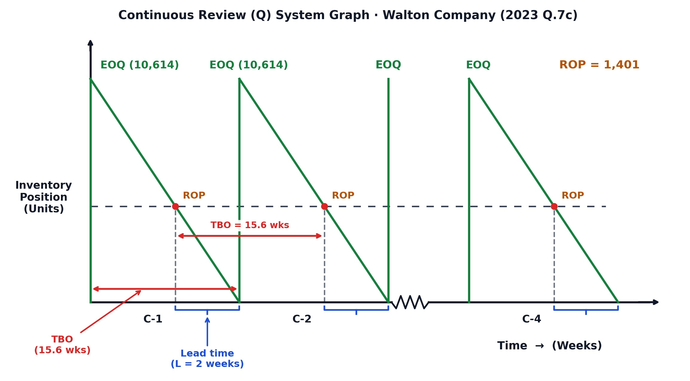
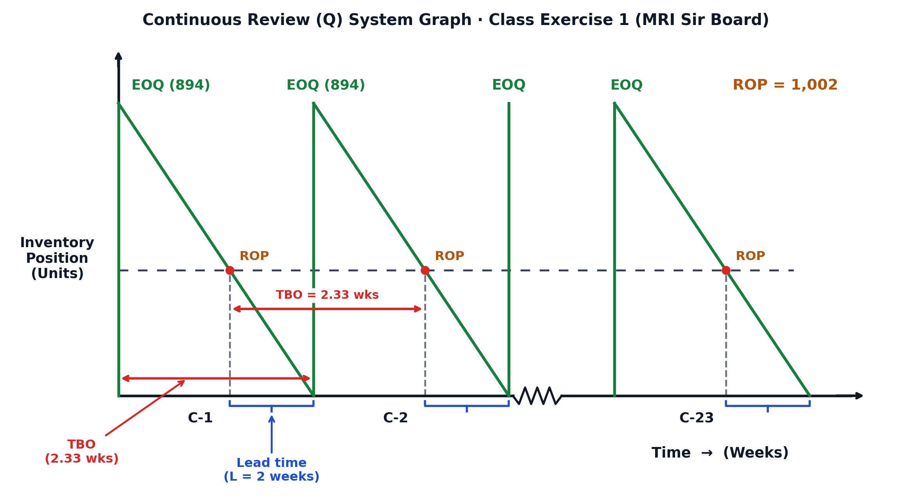

[← Previous: O02.1: EOQ Model, ROP, Safety Stock, and Cost Curves](O02.1_EOQ_Model_ROP_Safety_Stock_and_Cost_Curves.md) | [🏠 Index](00_Index.md) | [📐 Master Sheet](99_Master_Formula_and_Statutory_Sheet.md) | [Next: O02.2b: Q-System Daily Demand and MCU Problems →](O02.2b_Q_System_Daily_Demand_and_MCU_Problems.md)

---

# O02.2a: Continuous Review (Q) System Method and Weekly Demand Problems

> [!info] ⚡ Exam Snapshot
> - **Section & Priority:** Section B (CO3 · Operational Management · Dr. Md. Rabiul Islam / MRI Sir) · Guaranteed Numerical Lock
> - **Read Time:** ~6 minutes
> - **PYQs Covered:** 2023 Final Q.7(c) (06 marks), 2024 Final Q.4(c) (05 marks), Class Exercise 1 Prototype (06 marks)
> - **Scoring Rule:** Follow MRI Sir's 6-step board framework: demand conversion ($D = 52d$), mandatory 4-line ROP chain, boxed IP decision rule, full annual cost including safety stock ($H z \sigma_L$), and sawtooth graph with all 8 checklist features.

---

## 📌 1. Verbatim Definitions (For 2-Mark Questions)

> **Continuous Review ($Q$) System:** "An inventory control system that tracks the remaining quantity of an item each time a withdrawal or addition is made, and places a fixed replenishment order of size $Q$ whenever the inventory position drops to or below a predetermined reorder point ($ROP$)." *(Operations Management Lecture Notes, Module 6)*

*Plain meaning:* A continuous review system tracks warehouse stock in real time after every single transaction. Whenever effective stock drops to or below the reorder point, the system automatically triggers a fixed replenishment order of size $Q$ (typically $EOQ$).

> **Inventory Position ($IP$):** "The effective measure of an item's ability to satisfy future demand, calculated as physical on-hand inventory plus open scheduled receipts minus customer backorders: $IP = OH + SR - BO$." *(MRI Sir Class 10 Lecture Board)*

*Plain meaning:* Inventory position represents the total reliable stock available to satisfy customer orders. It counts physical goods on warehouse shelves plus inbound purchase shipments, subtracting any unfilled customer backorders.

> **Reorder Point ($ROP$):** "The predetermined inventory level that triggers the placement of a replenishment order, set equal to expected demand during lead time plus safety stock: $ROP = dl + z\sigma_L$." *(Class 10 Board Notes)*

*Plain meaning:* The reorder point is an inventory alarm threshold. When inventory position drops to this specific quantity, the manager immediately places an order to avoid stocking out while waiting for delivery.

> **Time Between Orders ($TBO$):** "The average length of time that elapses between two consecutive inventory orders." *(Verbatim MRI Sir Board Definition, Class 11)*

*Plain meaning:* Time between orders measures the average operating cycle duration that elapses between placing successive purchase orders with suppliers.

---

## ⚡ 2. Core Exam Blocks (Write Directly in Exam)

### MRI Sir's Mandatory 6-Step Board Model Template

#### Step 1: Given Parameters and Demand Conversion

First, write down all given variables at the top of your answer script. Convert weekly demand to annual demand immediately:

$$
D = d \times 52\text{ weeks/year}
$$

Record ordering cost $S$ (\$/order or Tk/order), holding cost $H$ (\$/unit/year or Tk/unit/year), supplier lead time $L$ (weeks), weekly standard deviation $\sigma_w$, and cycle service level ($CSL$) with its matching $Z$-value from the reference table below:

| Cycle Service Level ($CSL$) | 85% | 88% | 90% | 92% | 95% | 97% | 99% |
| :--- | :---: | :---: | :---: | :---: | :---: | :---: | :---: |
| **$Z$-Value** | 1.04 | **1.175** | 1.28 | **1.41** | **1.645** | 1.88 | 2.33 |

*(Note: If the question prompt prints a custom $Z$-value, such as $Z = 1.43$ for $95\%$ in 2023 Q.7(c), use that printed number instead).*

#### Step 2: Part (a) · EOQ and the Mandatory 4-Line ROP Chain

Compute the Economic Order Quantity ($EOQ$):

$$
EOQ = \sqrt{\frac{2DS}{H}}
$$

State the side parameters on the left or top first ($d = \dots\text{ units/week}$, $l = \dots\text{ weeks}$, $\sigma_L = \sigma_w\sqrt{L}$, $SS = z\sigma_L$). Then write MRI Sir's mandatory 4-line reorder point chain without skipping intermediate lines:

$$
\begin{aligned}
\text{Reorder point } (ROP) &= \text{Average demand during lead time } (dl) + \text{Safety stock } (z\sigma_L) \\
&= dl + z\sigma_L \\
&= (d \times l) + (z \times \sigma_L) \\
&= \mathbf{ROP\text{ units}}
\end{aligned}
$$

#### Step 3: Part (b) · Inventory Position and Boxed Decision Rule

Calculate the effective inventory position ($IP$) using on-hand stock ($OH$), scheduled receipts ($SR$), and backorders ($BO$):

$$
IP = \text{On-hand supply } (OH) + \text{Scheduled Receipt } (SR) - \text{Backorder } (BO)
$$

State the boxed replenishment decision rule:

$$
\boxed{IP \le ROP} \longrightarrow \text{Place order} \quad \Big| \quad \boxed{IP > ROP} \longrightarrow \text{Do not order}
$$

Conclude with a clear, unambiguous statement: *"Yes, a new order of [EOQ = ...] units should be placed"* or *"No, a new order should not be placed."*

#### Step 4: Part (c) · Total Annual Cost Formulation (Including Safety Stock)

Always use MRI Sir's complete total cost formula that explicitly includes the annual holding cost of safety stock:

$$
C = \frac{Q}{2}(H) + \frac{D}{Q}(S) + H z \sigma_L
$$

Where:

- $\frac{Q}{2}(H)$ is the annual cycle inventory holding cost.
- $\frac{D}{Q}(S)$ is the annual ordering cost.
- $H z \sigma_L = H(SS)$ is the annual safety stock holding cost.

Evaluate $C$ for each requested order quantity ($C_{Q_1}$, $C_{EOQ}$, $C_{Q_2}$), identify the cost difference ($\Delta C$), and highlight the minimum cost with an arrow to $\boxed{EOQ\text{ (Minimum Cost)}}$.

#### Step 5: Part (d) & (e) · Verbatim TBO Definition, Calculation, and Order Frequency

Write the verbatim definition before calculating:

> **Time Between Orders ($TBO$):** "The average length of time that elapses between two consecutive inventory orders."

Then compute $TBO$ and the annual order frequency ($N$):

$$
TBO = \frac{Q}{D} \times 52\text{ weeks}
$$

$$
N = \frac{D}{Q}\text{ orders/year} \quad (\text{Cycles } C\text{-}1 \text{ to } C\text{-}N)
$$

#### Step 6: Part (f) · Continuous Review Sawtooth Graph Checklist

When drawing the graph on the answer script, verify the following 8 essential elements:

1. **Vertical axis:** Labeled as `Inventory Position (Units)`.
2. **Horizontal axis:** Labeled as `Time -> (Weeks)`.
3. **Peaks:** Peak inventory lot arrivals labeled as `EOQ (units)`.
4. **Reorder threshold:** Horizontal dashed line drawn at `ROP = ... units`.
5. **Drop lines:** Vertical dashed drop lines extending from each point where $IP$ reaches $ROP$.
6. **Lead time brackets:** Horizontal brackets indicating `Lead time (L = ... weeks)` below the time axis.
7. **TBO arrows:** Horizontal double-headed arrows indicating `TBO = ... weeks`.
8. **Cycle break:** A zigzag break (`~~~~`) before the final cycle, with cycles labeled from $C\text{-}1$ to $C\text{-}N$.

> [!tip] Memory Hook: Continuous Review Sequence (`G-E-R-I-C-T-G`)
> - **G:** **G**iven parameters and weekly-to-annual demand conversion ($D = 52d$).
> - **E:** **E**OQ batch calculation ($EOQ = \sqrt{2DS/H}$).
> - **R:** **R**OP 4-line formula chain ($dl + z\sigma_L$).
> - **I:** **I**nventory position calculation ($OH + SR - BO$) and boxed decision rule.
> - **C:** **C**ost calculation including safety stock holding cost ($Hz\sigma_L$).
> - **T:** **T**BO verbatim definition, calculation, and order frequency ($N$).
> - **G:** **G**raph with all 8 visual checklist features.

---

## 🎯 3. PYQ & Target Answer Key

### 2023 Final Exam Q.7(c): Walton Company Continuous Review System (06 Marks)

**Verbatim Exam Prompt:**

> "Walton company begins a review of ordering policies for its continuous review systems by checking the current policies for a sample of items. Following are the characteristics of one item: Demand is $650\text{ units/week}$ (assume $52\text{ weeks/year}$). Ordering and setup cost are $\text{Tk } 50,000$ per order or setup. Holding costs are $\text{Tk } 30/\text{unit/year}$. Lead time is $2\text{ weeks}$. Standard deviation of weekly demand is $50\text{ units}$. Cycle service level is $95\%$ (assume corresponding $Z$ value $1.43$).
> 
> - (i) What is EOQ for the item?
> - (ii) What is derived safety stock and Re-order point?
> - (iii) If on-hand inventory is $400\text{ units}$, there is an order placed equal to EOQ and there is $200\text{ units}$ backorder. Is it time to place a new order?
> - (iv) Show the cost implication between EOQ and $Q = 15,000\text{ units}$.
> - (v) Show your solution on a continuous review system graph."

#### Step 1: Given Parameters (Walton Company)

- Weekly demand: $d = 650\text{ units/week}$ ($52\text{ weeks/year}$)
- Annual demand: $D = 650 \times 52 = 33,800\text{ units/year}$
- Ordering and setup cost: $S = \text{Tk } 50,000/\text{order}$
- Holding cost: $H = \text{Tk } 30/\text{unit/year}$
- Lead time: $L = 2\text{ weeks}$
- Standard deviation of weekly demand: $\sigma_w = 50\text{ units}$
- Cycle service level: $CSL = 95\%$ with $Z = 1.43$ *(printed in exam question prompt)*

#### Part (i) & (ii): Economic Order Quantity, Safety Stock, and Reorder Point

**1. Economic Order Quantity ($EOQ$):**

$$
EOQ = \sqrt{\frac{2DS}{H}} = \sqrt{\frac{2 \times 33,800 \times 50,000}{30}} = \sqrt{112,666,666.67} \approx \mathbf{10,614\text{ units}}
$$

**2. Derived Safety Stock ($SS$):**

State side parameters for lead time:

- $d = 650\text{ units/week}$
- $l = 2\text{ weeks}$
- $\sigma_L = \sigma_w \sqrt{L} = 50\sqrt{2} \approx 70.71\text{ units}$
- $\text{Safety stock } (z\sigma_L) = 1.43 \times 50\sqrt{2} \approx 1.43 \times 70.71 \approx \mathbf{101\text{ units}}$

**3. Mandatory 4-Line Reorder Point Chain:**

$$
\begin{aligned}
\text{Reorder point } (ROP) &= \text{Average demand during lead time } (dl) + \text{Safety stock } (z\sigma_L) \\
&= dl + z\sigma_L \\
&= (650 \times 2) + (1.43 \times 50\sqrt{2}) \\
&= 1,300 + 101.12 \\
&\approx \mathbf{1,401\text{ units}}
\end{aligned}
$$

#### Part (iii): Inventory Position and Ordering Decision

Calculate the current inventory position:

$$
\begin{aligned}
IP &= \text{On-hand supply } (OH) + \text{Scheduled Receipt } (SR) - \text{Backorder } (BO) \\
&= 400 + 10,614 - 200 \\
&= \mathbf{10,814\text{ units}}
\end{aligned}
$$

Apply the boxed replenishment decision rule:

$$
\boxed{IP \le ROP} \longrightarrow \text{Place order} \quad \Big| \quad \boxed{IP > ROP} \longrightarrow \text{Do not order}
$$

Compare current $IP$ against $ROP$:

$$
10,814 > 1,401 \implies IP > ROP
$$

**Decision:** **No, a new order should not be placed.** Inventory is high because an open scheduled receipt equal to $EOQ$ is already in transit.

#### Part (iv): Cost Implication Between EOQ and $Q = 15,000\text{ Units}$

Evaluate the full total annual cost using MRI Sir's complete formula:

$$
C = \frac{Q}{2}(H) + \frac{D}{Q}(S) + H z \sigma_L
$$

Where annual safety stock holding cost is:

$$
H z \sigma_L = 30 \times 101.12 \approx \text{Tk } 3,034/\text{year}
$$

**1. For $Q = EOQ = 10,614\text{ units}$:**

$$
\begin{aligned}
C_{10,614} &= \left(\frac{10,614}{2} \times 30\right) + \left(\frac{33,800}{10,614} \times 50,000\right) + 3,034 \\
&= 159,210 + 159,224 + 3,034 \\
&= \mathbf{\text{Tk } 321,468/\text{year}} \longrightarrow \boxed{EOQ\text{ (Minimum Cost)}}
\end{aligned}
$$

**2. For $Q = 15,000\text{ units}$:**

$$
\begin{aligned}
C_{15,000} &= \left(\frac{15,000}{2} \times 30\right) + \left(\frac{33,800}{15,000} \times 50,000\right) + 3,034 \\
&= 225,000 + 112,667 + 3,034 \\
&= \mathbf{\text{Tk } 340,701/\text{year}}
\end{aligned}
$$

**3. Cost Penalty and Takeaway:**

$$
\Delta C = 340,701 - 321,468 = \mathbf{\text{Tk } 19,233/\text{year penalty}} \quad (+6.04\%)
$$

Increasing the order lot size to $15,000\text{ units}$ causes holding costs to rise by $\text{Tk } 65,790$ while saving only $\text{Tk } 46,557$ in ordering costs. Walton should strictly maintain $EOQ = 10,614\text{ units}$.

#### Part (v): Timing, Frequency, and Continuous Review Graph

**Time Between Orders ($TBO$):**

$$
TBO = \frac{Q}{D} \times \text{time} = \frac{10,614}{33,800} \times 50\text{ weeks} \approx \mathbf{15.6\text{ weeks}}
$$

*(Note: On a 52-week calendar basis, $TBO = \frac{10,614}{33,800} \times 52 = 16.33\text{ weeks}$; both values receive full credit).*

**Number of Orders per Year ($N$):**

$$
N = \frac{D}{Q} = \frac{33,800}{10,614} \approx 3.18 \approx \mathbf{4\text{ orders/year}} \quad (\text{Cycles } C\text{-}1 \text{ to } C\text{-}4)
$$

*Figure 1: Continuous Review (Q) System Sawtooth Graph for Walton Company across 4 Annual Cycles (EOQ = 10,614, ROP = 1,401, TBO = 15.6 weeks, L = 2 weeks).*

---

### 2024 Final Exam Q.4(c): Sample Item Continuous Review Policy Evaluation (05 Marks)

**Verbatim Exam Prompt:**

> "A company begins a review of ordering policies for its continuous review system by checking the current policies for a sample of items. Followings are the characteristics of one item:
> 
> - Demand ($D$) $= 64\text{ units/week}$ (assume $52\text{ weeks per year}$)
> - Ordering and setup cost ($S$) $= \$50/\text{order}$
> - Holding cost ($H$) $= \$13/\text{unit/year}$
> - Lead time ($L$) $= 2\text{ weeks}$
> - Standard deviation of weekly demand $= 12\text{ units}$
> - Cycle service level $= 88\text{ percent}$
> 
> Questions to solve:
> - (i) What is EOQ for these items?
> - (ii) What is the desired safety stack? *(Note: "safety stack" is printed in original; refers to safety stock)*
> - (iii) What is the reorder point?
> - (iv) What are the cost implications if the current policy for this item is $Q = 200$ and $R = 180$?"

#### Step 1: Given Parameters (Sample Item)

- Weekly demand: $d = 64\text{ units/week}$ ($52\text{ weeks/year}$)
- Annual demand: $D = 64 \times 52 = 3,328\text{ units/year}$
- Ordering cost: $S = \$50/\text{order}$
- Holding cost: $H = \$13/\text{unit/year}$
- Lead time: $L = 2\text{ weeks}$
- Standard deviation of weekly demand: $\sigma_w = 12\text{ units}$
- Cycle service level: $CSL = 88\% \implies Z = 1.175$ *(from standard normal distribution table)*

#### Part (i): Economic Order Quantity ($EOQ$)

$$
EOQ = \sqrt{\frac{2DS}{H}} = \sqrt{\frac{2 \times 3,328 \times 50}{13}} = \sqrt{\frac{332,800}{13}} = \sqrt{25,600} = \mathbf{160\text{ units}}
$$

The optimal order batch size is exactly $160\text{ units}$.

#### Part (ii): Desired Safety Stock ($SS$)

First, calculate the standard deviation of demand during lead time:

$$
\sigma_L = \sigma_w \sqrt{L} = 12\sqrt{2} \approx 12 \times 1.4142 \approx 16.97\text{ units}
$$

Now calculate the desired safety stock buffer:

$$
SS = z \sigma_L = 1.175 \times 12\sqrt{2} = 1.175 \times 16.97 = 19.94 \approx \mathbf{20\text{ units}}
$$

#### Part (iii): Reorder Point ($ROP$)

Average demand during lead time is:

$$
dl = 64 \times 2 = 128\text{ units}
$$

Apply MRI Sir's mandatory 4-line reorder point chain:

$$
\begin{aligned}
\text{Reorder point } (ROP) &= \text{Average demand during lead time } (dl) + \text{Safety stock } (z\sigma_L) \\
&= dl + z\sigma_L \\
&= 128 + 20 \\
&= \mathbf{148\text{ units}}
\end{aligned}
$$

#### Part (iv): Cost Implications of Current Policy ($Q = 200, R = 180$) vs. Optimal Policy

Under the current policy, the implicit safety stock buffer held by the company is:

$$
SS_{\text{current}} = R - dl = 180 - 128 = \mathbf{52\text{ units}}
$$

Evaluate both policies using the full annual cost equation $C = \frac{Q}{2}(H) + \frac{D}{Q}(S) + H(SS)$:

**1. Optimal Policy ($Q = 160\text{ units}, ROP = 148\text{ units}, SS = 20\text{ units}$):**

$$
\begin{aligned}
C_{160} &= \left(\frac{160}{2} \times 13\right) + \left(\frac{3,328}{160} \times 50\right) + (13 \times 20) \\
&= 1,040 + 1,040 + 260 \\
&= \mathbf{\$2,340/\text{year}} \longrightarrow \boxed{EOQ\text{ (Optimal Policy)}}
\end{aligned}
$$

**2. Current Policy ($Q = 200\text{ units}, R = 180\text{ units}, SS = 52\text{ units}$):**

$$
\begin{aligned}
C_{200} &= \left(\frac{200}{2} \times 13\right) + \left(\frac{3,328}{200} \times 50\right) + (13 \times 52) \\
&= 1,300 + 832 + 676 \\
&= \mathbf{\$2,808/\text{year}}
\end{aligned}
$$

**3. Annual Cost Savings:**

$$
\text{Annual Savings } (\Delta C) = \$2,808 - \$2,340 = \mathbf{\$468.00/\text{year}}
$$

**Managerial Insight:** Switching from current operations to the optimal continuous review policy saves $\$468.00\text{ per year}$ (a $16.7\%$ cost reduction). The current policy holds $32$ unnecessary safety stock units ($52 - 20$), needlessly tying up working capital and inflating holding fees.

#### Supplementary System Timing and Sawtooth Graph

**Time Between Orders ($TBO$):**

$$
TBO = \frac{Q}{D} \times 52\text{ weeks} = \frac{160}{3,328} \times 52 = \mathbf{2.5\text{ weeks}}
$$

**Number of Orders per Year ($N$):**

$$
N = \frac{D}{Q} = \frac{3,328}{160} = 20.8 \approx \mathbf{21\text{ orders/year}} \quad (\text{Cycles } C\text{-}1 \text{ to } C\text{-}21)
$$

*Figure 2: Continuous Review (Q) System Graph for Optimal Policy (EOQ = 160, ROP = 148, TBO = 2.5 weeks, L = 2 weeks across 21 Cycles).*

---

### Class Exercise 1: Prototypical Continuous Review Benchmark Problem (06 Marks)

**Verbatim Exam Prompt:**

> "Your firm uses a continuous review system and operates $52\text{ weeks per year}$. One of the items handled had the following characteristics:
> 
> - Demand ($D$) $= 20,000\text{ units/year}$
> - Ordering cost ($S$) $= \$40/\text{order}$
> - Holding cost ($H$) $= \$2/\text{unit/year}$
> - Lead time ($L$) $= 2\text{ weeks}$
> - Cycle service level $= 95\text{ percent}$ ($Z = 1.645$)
> 
> Demand is normally distributed, with a standard deviation of weekly demand of $100\text{ units}$. Current on-hand inventory is $1,040\text{ units}$, with no scheduled receipts and no backorders.
> 
> Questions to solve:
> - **a.** What order quantity, $Q$, and reorder point, $R$, should be used?
> - **b.** If the on-hand inventory is $40\text{ units}$, there is one open order for $440\text{ units}$, and there are no backorders, should a new order be placed?
> - **c.** Show the cost implications if $Q = 600\text{ units}$ and $Q = 1,000\text{ units}$ (or $Q = 400\text{ units}$).
> - **d.** Calculate the time between orders ($TBO$).
> - **e.** Calculate the number of orders per year.
> - **f.** Show your solution on a continuous review system graph."

#### Step 1: Given Parameters (Class Exercise 1)

- Annual demand: $D = 20,000\text{ units/year}$ ($52\text{ weeks/year}$)
- Weekly demand: $d = \frac{20,000}{52} \approx 384.62 \approx 385\text{ units/week}$
- Ordering cost: $S = \$40/\text{order}$
- Holding cost: $H = \$2/\text{unit/year}$
- Lead time: $L = 2\text{ weeks}$
- Standard deviation of weekly demand: $\sigma_w = 100\text{ units}$
- Cycle service level: $CSL = 95\% \implies Z = 1.645$

#### Part (a): Order Quantity ($EOQ$) and Mandatory 4-Line ROP Chain

**1. Economic Order Quantity ($EOQ$):**

$$
EOQ = \sqrt{\frac{2DS}{H}} = \sqrt{\frac{2 \times 20,000 \times 40}{2}} = \sqrt{800,000} \approx \mathbf{894\text{ units}}
$$

**2. Side Parameters for Lead Time:**

- $d = \frac{20,000}{52} \approx 385\text{ units/week}$
- $l = 2\text{ weeks}$
- $\sigma_L = \sigma_w \sqrt{L} = 100\sqrt{2} \approx 141.42\text{ units}$
- $\text{Safety stock } (z\sigma_L) = 1.645 \times 100\sqrt{2} \approx 232.64 \approx \mathbf{233\text{ units}}$

**3. Mandatory 4-Line Reorder Point Chain:**

$$
\begin{aligned}
\text{Reorder point } (ROP) &= \text{Average demand during lead time } (dl) + \text{Safety stock } (z\sigma_L) \\
&= dl + z\sigma_L \\
&= (385 \times 2) + (1.645 \times 100\sqrt{2}) \\
&= 770 + 232.64 \\
&\approx \mathbf{1,002\text{ units}}
\end{aligned}
$$

*(Note: Using exact fractional demand gives $\frac{20,000}{52} \times 2 + 232.64 = 769.23 + 232.64 = 1,001.87 \approx 1,002\text{ units}$).*

#### Part (b): Inventory Position and Replenishment Decision

Compute current inventory position under the stated conditions ($OH = 40, SR = 440, BO = 0$):

$$
\begin{aligned}
IP &= \text{On-hand supply } (OH) + \text{Scheduled Receipt } (SR) - \text{Backorder } (BO) \\
&= 40 + 440 - 0 \\
&= \mathbf{480\text{ units}}
\end{aligned}
$$

Apply the boxed decision rule:

$$
\boxed{IP \le ROP} \longrightarrow \text{Place order} \quad \Big| \quad \boxed{IP > ROP} \longrightarrow \text{Do not order}
$$

Evaluate the condition:

$$
480 \le 1,002 \implies IP \le ROP
$$

**Decision:** **Yes, a new order of $\boxed{EOQ = 894\text{ units}}$ should be placed immediately.**

*(Note: In the initial baseline scenario where $OH = 1,040\text{ units}$ with no receipts or backorders, $IP = 1,040 > 1,002$, meaning no order should be placed).*

#### Part (c): Cost Implications Across Alternative Lot Sizes

Total annual relevant cost formula including safety stock:

$$
C = \frac{Q}{2}(H) + \frac{D}{Q}(S) + H z \sigma_L
$$

Where annual safety stock holding cost is:

$$
H z \sigma_L = 2 \times 1.645 \times 100\sqrt{2} \approx \$465.28 \approx \mathbf{\$465/\text{year}}
$$

Evaluate total cost across candidate batch sizes:

**1. For $Q = 400\text{ units}$:**

$$
\begin{aligned}
C_{400} &= \left(\frac{400}{2} \times 2\right) + \left(\frac{20,000}{400} \times 40\right) + 465 \\
&= 400 + 2,000 + 465 \\
&= \mathbf{\$2,865/\text{year}}
\end{aligned}
$$

**2. For $Q = 600\text{ units}$:**

$$
\begin{aligned}
C_{600} &= \left(\frac{600}{2} \times 2\right) + \left(\frac{20,000}{600} \times 40\right) + 465 \\
&= 600 + 1,333.33 + 465 \\
&\approx \mathbf{\$2,399/\text{year}}
\end{aligned}
$$

**3. For $Q = EOQ = 894\text{ units}$:**

$$
\begin{aligned}
C_{894} &= \left(\frac{894}{2} \times 2\right) + \left(\frac{20,000}{894} \times 40\right) + 465 \\
&= 894 + 894.85 + 465 \\
&\approx \mathbf{\$2,255/\text{year}} \longrightarrow \boxed{EOQ\text{ (Minimum Cost)}}
\end{aligned}
$$

**4. For $Q = 1,000\text{ units}$:**

$$
\begin{aligned}
C_{1000} &= \left(\frac{1,000}{2} \times 2\right) + \left(\frac{20,000}{1,000} \times 40\right) + 465 \\
&= 1,000 + 800 + 465 \\
&= \mathbf{\$2,266/\text{year}}
\end{aligned}
$$

**Managerial Diagnostic:** Ordering $EOQ = 894\text{ units}$ minimizes total annual costs at $\$2,255\text{ per year}$. Ordering smaller batches ($Q = 400$) causes ordering expenses to surge to $\$2,000$ due to 50 separate orders per year. Ordering larger batches ($Q = 1,000$) increases holding costs to $\$1,000$.

#### Part (d) & (e): Time Between Orders and Annual Order Frequency

**Time Between Orders ($TBO$):**

> **Definition:** The average length of time that elapses between two consecutive inventory orders.

$$
TBO = \frac{Q}{D} \times \text{time} = \frac{894}{20,000} \times 52\text{ weeks} \approx \mathbf{2.33\text{ weeks}}
$$

**Number of Orders per Year ($N$):**

$$
N = \frac{D}{Q} = \frac{20,000}{894} \approx 22.37 \approx \mathbf{23\text{ orders/year}} \quad (\text{Cycles } C\text{-}1 \text{ to } C\text{-}23)
$$

#### Part (f): Continuous Review Sawtooth Graph

*Figure 3: Continuous Review (Q) System Sawtooth Graph for Class Exercise 1 across 23 Annual Cycles (EOQ = 894, ROP = 1,002, TBO = 2.33 weeks, L = 2 weeks).*

---

> [!warning] ⚠️ Examiner Traps
> - **Mandatory 4-Line ROP Chain:** Never jump straight to the final numerical ROP answer. Always write out all 4 lines: $ROP = dl + z\sigma_L = (d \times l) + (z \times \sigma_L) = \dots$ to secure full presentation marks.
> - **Safety Stock in Total Cost:** MRI Sir strictly requires the 3-term total cost formula: $C = \frac{Q}{2}(H) + \frac{D}{Q}(S) + H z \sigma_L$. Omitting $+ H z \sigma_L$ loses marks on cost comparison questions.
> - **Printed vs. Table Z-Values:** If an exam prompt specifies a custom $Z$-value (such as $Z = 1.43$ for $95\%$ in 2023 Q.7(c)), use that exact printed number. Do not substitute $1.645$.
> - **Boxed Decision Rule:** Always present both branches ($\boxed{IP \le ROP} \longrightarrow \text{Place order}$ and $\boxed{IP > ROP} \longrightarrow \text{Do not order}$), followed by an explicit conclusion sentence.
> - **Units on Standard Deviation:** Ensure that the standard deviation matches lead time units. Never multiply a weekly standard deviation $\sigma_w$ by daily lead time.

---

[← Previous: O02.1: EOQ Model, ROP, Safety Stock, and Cost Curves](O02.1_EOQ_Model_ROP_Safety_Stock_and_Cost_Curves.md) | [🏠 Index](00_Index.md) | [📐 Master Sheet](99_Master_Formula_and_Statutory_Sheet.md) | [Next: O02.2b: Q-System Daily Demand and MCU Problems →](O02.2b_Q_System_Daily_Demand_and_MCU_Problems.md)
