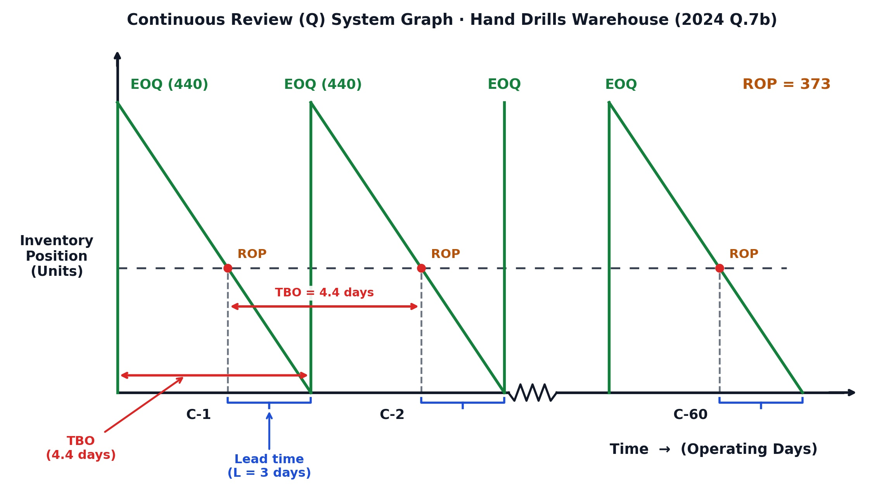
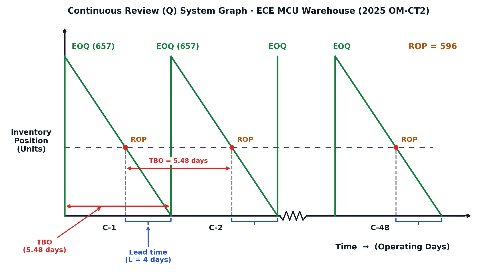

[← Previous: O02.2a: Q-System Method and Weekly Demand Problems](O02.2a_Q_System_Method_and_Weekly_Demand_Problems.md) | [🏠 Index](00_Index.md) | [📐 Master Sheet](99_Master_Formula_and_Statutory_Sheet.md) | [Next: O03.1: Productivity Formulas, SFP, MFP, and Numericals →](O03.1_Productivity_Formulas_SFP_MFP_and_Numericals.md)

---

# O02.2b: Q-System Daily Demand and MCU Problems

> [!info] ⚡ Exam Snapshot
> - **Section & Priority:** Section B (CO3 · Operational Management · MRI Sir) | 🔴 High Priority (Exam Lock) | **Read Time:** ~5 mins
> - **PYQs Covered:** 2024 Final Q.7(b) (06m), 2025 OM-CT2 Q.1(a–f) (20m)
> - **Scoring Rule:** Convert daily demand using 260 operating days, write the 4-line ROP chain, include $H z \sigma_L$ in total cost, state the boxed IP decision rule, and embed the sawtooth graph.

---

## 📌 1. Verbatim Definitions (For 2-Mark Questions)

> **Operating-Day Schedule:** "An industrial calendar where warehouse receipts and deliveries occur only on active working days, typically 5 days per week and 52 weeks per year." (MRI Sir, Class 10 Lecture Notes)
- *Plain meaning:* A working calendar that counts only open operating days and ignores weekends.

> **Inventory Position ($IP$):** "The sum of actual on-hand stock and scheduled receipts minus customer backorders: $IP = OH + SR - BO$." (Inventory Control Lecture Notes)
- *Plain meaning:* Total warehouse stock plus incoming shipments minus unfilled customer orders.

> **Continuous Review ($Q$) System:** "An inventory policy that tracks stock continuously and places a fixed replenishment order of size $Q = EOQ$ whenever inventory position drops to or below the reorder point ($IP \le ROP$)." (Class 10 Board Notes)
- *Plain meaning:* A tracking system that triggers a fixed EOQ order whenever stock drops to ROP.

> **Time Between Orders ($TBO$):** "The average length of time that elapses between two consecutive inventory orders." (Verbatim MRI Sir Board Definition, Class 11)
- *Plain meaning:* The average number of operating days or weeks between two consecutive purchase orders.

---

## ⚡ 2. Core Exam Blocks (Write Directly in Exam)

### Daily Operating-Day Conversion Rules

In industrial warehouses, shipments arrive only on open operating days. Converting daily rates into annual figures follows strict rules:

1. **Operating Calendar Rule:**
   
$$
\text{Operating Days per Year} = 5\text{ days/week} \times 52\text{ weeks/year} = 260\text{ operating days/year}
$$

2. **Annual Demand Conversion ($D$):**
   
$$
D = d \times 260\text{ units/year}
$$

   Never multiply daily demand by 365 calendar days. Deliveries happen only during active warehouse shifts.
3. **Matching Time Units for Lead Time Standard Deviation ($\sigma_L$):**
   
$$
\sigma_L = \sigma_d \sqrt{L}
$$

   Both lead time ($L$) and demand variability ($\sigma_d$) must use operating days. Never combine weekly standard deviation with days of lead time.
4. **Cycle Duration ($TBO$) and Order Frequency ($N$):**
   
$$
TBO = \frac{Q}{D} \times 260\text{ operating days} \quad \Bigg| \quad N = \frac{D}{Q}\text{ orders/year}
$$

---

### MRI Sir's 6-Step Board Model Checklist

Follow this exact six-step sequence to guarantee full marks in Section B:

1. **Step 1: Extract Given Parameters & Annual Demand:**
   State $d$, $L$, $\sigma_d$, $S$, $H$, and cycle service level ($CSL \implies Z$). Calculate $D = d \times 260$.
2. **Step 2: Calculate EOQ & 4-Line ROP Chain:**
   Compute $EOQ = \sqrt{2DS/H}$. List side parameters ($d, l, \sigma_L = \sigma_d\sqrt{L}$), then write:
   
$$
\begin{aligned}
\text{Reorder point } (ROP) &= \text{Average demand during lead time } (dl) + \text{Safety stock } (z\sigma_L) \\
&= dl + z\sigma_L
\end{aligned}
$$

3. **Step 3: Evaluate Inventory Position & Decision Rule:**
   Calculate $IP = OH + SR - BO$. Write the boxed decision rule:
   
$$
\boxed{IP \le ROP} \longrightarrow \text{Place order} \quad \Bigg| \quad \boxed{IP > ROP} \longrightarrow \text{Do not order}
$$

   Conclude with: *"Yes, a new order of [EOQ] units should be placed"* OR *"No, a new order should not be placed."*
4. **Step 4: Compute Total Cost Across Lot Sizes:**
   Use MRI Sir's full annual cost formula including safety stock holding cost:
   
$$
C = \frac{Q}{2}(H) + \frac{D}{Q}(S) + H z \sigma_L
$$

   Evaluate $C$ for each requested lot size and state that cost is minimized at $EOQ$.
5. **Step 5: State Verbatim TBO Definition, TBO, and N:**
   Quote: *"The average length of time that elapses between two consecutive inventory orders."* Compute $TBO$ in days and $N = D / EOQ$.
6. **Step 6: Draw the Sawtooth Graph:**
   Label 8 core elements: vertical axis ($IP$), horizontal axis (time), peak $EOQ$, and dashed $ROP$ line. Also mark drop lines, lead time ($L$), $TBO$ arrow, and cycles $C_1$ to $C_N$ with a break line (`~~~~`).

> [!tip] Memory Hook: The 6-Step Board Chain (D-E-R-I-C-G)
> - **D:** Demand conversion ($D = d \times 260$).
> - **E:** EOQ calculation ($EOQ = \sqrt{2DS/H}$).
> - **R:** ROP calculation ($ROP = dl + z\sigma_L$).
> - **I:** IP decision check ($IP = OH + SR - BO$ vs $ROP$).
> - **C:** Cost comparison ($C = \frac{Q}{2}H + \frac{D}{Q}S + H z \sigma_L$).
> - **G:** Graph with cycles ($C_1$ to $C_N$).

---

### Summary Comparison Table of Daily Demand Problems

This table compares the two 260-operating-day continuous review problems:

| Parameter / Feature | 2024 Final Q.7(b) (Hand Drills) | 2025 OM-CT2 Q.1 (ECE MCUs) |
| :--- | :--- | :--- |
| **Product Item & Application** | $3/8\text{ inch}$ Variable-Speed Hand Drills | ECE Embedded System Microcontrollers |
| **Operating Calendar Basis** | $5\text{ days/wk} \times 52\text{ wks} = 260\text{ days/yr}$ | $5\text{ days/wk} \times 52\text{ wks} = 260\text{ days/yr}$ |
| **Daily Demand ($d$) & Std Dev ($\sigma_d$)** | $d = 100\text{ drills/day}$, $\sigma_d = 30$ | $d = 120\text{ MCUs/day}$, $\sigma_d = 35$ |
| **Annual Demand ($D = 260d$)** | $26,000\text{ drills/year}$ | $31,200\text{ MCUs/year}$ |
| **Ordering ($S$) & Holding ($H$)** | $S = \$35/\text{order}$, $H = \$9.40/\text{unit/yr}$ | $S = \$45/\text{order}$, $H = \$6.50/\text{unit/yr}$ |
| **Lead Time ($L$) & Safety Std Dev ($\sigma_L$)** | $L = 3\text{ days}$, $\sigma_L = 30\sqrt{3} \approx 51.96$ | $L = 4\text{ days}$, $\sigma_L = 35\sqrt{4} = 70$ |
| **Service Level & Factor ($Z$)** | $92\% \implies Z = 1.41$ | $95\% \implies Z = 1.645$ |
| **Optimal Order Quantity ($EOQ$)** | **$440\text{ drills}$** | **$657\text{ MCUs}$** |
| **Safety Stock ($SS$) & Reorder Point ($ROP$)** | $SS = 73\text{ drills}$, $ROP = \mathbf{373\text{ drills}}$ | $SS = 115\text{ MCUs}$, $ROP = \mathbf{596\text{ MCUs}}$ |
| **Current Stock ($OH, SR, BO$) & $IP$** | $OH = 40, SR = 440, BO = 0 \implies \mathbf{480}$ | $OH = 80, SR = 500, BO = 0 \implies \mathbf{580}$ |
| **Boxed Rule Ordering Decision** | $480 > 373$ ($IP > ROP$) $\implies$ **Do NOT order** | $580 \le 596$ ($IP \le ROP$) $\implies$ **Order 657 MCUs** |
| **Cycle Duration ($TBO$) & Orders/Year ($N$)** | $TBO = 4.4\text{ days}$, $N \approx 60\text{ orders/yr}$ | $TBO = 5.48\text{ days}$, $N \approx 48\text{ orders/yr}$ |

---

## 🎯 3. PYQ & Target Answer Key

### 2024 Final Q.7(b) · Hand Drills Warehouse (06 Marks)

**Verbatim Question:**
A regional warehouse purchases hand tools from various suppliers and then distribute then on demand to retailers in the region. The warehouse operates five days per week, 52 weeks per year. Only when it is open can orders be received. The following data are estimated for 3/8 inch hand drills with double insulation and variable speed:
- Average daily demand = 100 drills
- Standard deviation of daily demand = 30 drills
- Lead time = 3 days
- Holding cost = \$9.40/unit/year
- Ordering cost = \$35/order
- Cycle service level = 92%, which corresponds to Z-value 1.41

**Required:**
1. What order quantity, $Q$ and reorder point, $R$, should be used?
2. If on hand inventory is 40 units, there is an open order for 440 drills and there are no back orders, should a new order be placed?
3. Calculate cost for 400 units, 500 units and units equal to EOQ, then comment on the cost implications.

**Complete Board Solution:**

#### Given Parameters (Hand Drills Warehouse)
- Operating schedule: $5\text{ days/week} \times 52\text{ weeks/year} = 260\text{ operating days/year}$
- Daily demand ($d$) = $100\text{ drills/day}$
- Annual demand ($D$) = $100 \times 260 = 26,000\text{ drills/year}$
- Ordering cost ($S$) = $\$35/\text{order}$
- Holding cost ($H$) = $\$9.40/\text{unit/year}$
- Lead time ($L$) = $3\text{ days}$
- Standard deviation of daily demand ($\sigma_d$) = $30\text{ drills}$
- Cycle service level = $92\% \implies Z = 1.41$

#### Part (1): Order Quantity EOQ and Reorder Point ROP

**1. Economic Order Quantity ($EOQ$):**

$$
\begin{aligned}
EOQ &= \sqrt{\frac{2DS}{H}} \\
&= \sqrt{\frac{2 \times 26,000 \times 35}{9.40}} \\
&= \sqrt{\frac{1,820,000}{9.40}} = \sqrt{193,617.02} \approx \mathbf{440\text{ drills}}
\end{aligned}
$$

**2. Reorder Point ($ROP$):**
Side parameters for lead time:
- $d = 100\text{ drills/day}$
- $l = 3\text{ days}$
- $\sigma_L = \sigma_d \sqrt{L} = 30\sqrt{3} \approx 51.96\text{ drills}$

$$
\begin{aligned}
\text{Reorder point } (ROP) &= \text{Average demand during lead time } (dl) + \text{Safety stock } (z\sigma_L) \\
&= dl + z\sigma_L \\
&= 100 \times 3 + 1.41 \times 30\sqrt{3} \\
&= 300 + 73.27 \approx \mathbf{373\text{ drills}}
\end{aligned}
$$

*(Using rounded class value $\sigma_L = 52$ gives $300 + 1.41 \times 52 = 300 + 73.32 = 373.32 \approx 373\text{ drills}$)*.

#### Part (2): Inventory Position IP and Ordering Decision

$$
IP = OH + SR - BO = 40 + 440 - 0 = \mathbf{480\text{ drills}}
$$

- **Decision Rule:** $\boxed{IP \le ROP} \longrightarrow \text{Place order} \quad \Bigg| \quad \boxed{IP > ROP} \longrightarrow \text{Do not order}$
- Here, $480 > 373$ ($IP > ROP$).
- **Direct Conclusion:** **No, a new order should not be placed.**

#### Part (3): Cost Calculations and Implications

Formula: $C = \frac{Q}{2}(H) + \frac{D}{Q}(S) + H z \sigma_L$.
Constant safety stock holding cost:

$$
H z \sigma_L = 9.40 \times 1.41 \times 30\sqrt{3} \approx 9.40 \times 73.27 \approx \mathbf{\$689} \quad (\text{exact: } \$688.74)
$$

1. **For $Q = 400\text{ drills}$:**

$$
C_{400} = \frac{400}{2}(9.40) + \frac{26,000}{400}(35) + 689 = 1,880 + 2,275 + 689 = \mathbf{\$4,844}
$$

2. **For $Q = EOQ = 440\text{ drills}$:**

$$
C_{440} = \frac{440}{2}(9.40) + \frac{26,000}{440}(35) + 689 = 2,068 + 2,068.18 + 689 = \mathbf{\$4,825} \longrightarrow \boxed{EOQ}
$$

3. **For $Q = 500\text{ drills}$:**

$$
C_{500} = \frac{500}{2}(9.40) + \frac{26,000}{500}(35) + 689 = 2,350 + 1,820 + 689 = \mathbf{\$4,859}
$$

- **Cost Implications:** Total annual inventory cost reaches its minimum at $EOQ = 440$ (\$4,825). Under-ordering ($Q = 400$) adds \$19 from extra order placement fees. Over-ordering ($Q = 500$) adds \$34 from excess warehouse holding costs. Both deviations increase overall expenditure.
- **Operational Cycle Parameters:**
  - Definition of TBO: *"The average length of time that elapses between two consecutive inventory orders."*
  - $TBO = \frac{Q}{D} \times 260 = \frac{440}{26,000} \times 260 = \mathbf{4.4\text{ operating days}}$.
  - $N = \frac{D}{Q} = \frac{26,000}{440} \approx 59.09 \approx \mathbf{60\text{ orders/year}}$.

*Figure 1: Continuous Review (Q) System Sawtooth Graph for Hand Drills Warehouse (EOQ = 440, ROP = 373, TBO = 4.4 days, L = 3 days across 60 Cycles).*

---

### 2025 OM-CT2 Q.1(a–f) · ECE Microcontroller (MCU) Warehouse (20 Marks)

**Verbatim Question:**
A regional Electronic and Computer Engineering equipment warehouse purchases electronic components from various suppliers and distributes them on demand to electronics manufacturers, computer assembly firms, and engineering laboratories in the region. The warehouse operates five days per week, 52 weeks per year. Orders can be received only when the warehouse is open.

The following data are estimated for microcontroller units (MCUs) used in embedded-system and computer-control applications:
- Average daily demand = 120 MCUs
- Standard deviation of daily demand = 35 MCUs
- Lead time ($L$) = 4 days
- Holding cost ($H$) = \$6.50/unit/year
- Ordering cost ($S$) = \$45/order
- Cycle service level = 95%
- Assume demand is normally distributed.

**Required:**
- a. What order quantity (EOQ) and reorder point (ROP) should the warehouse use?
- b. If the warehouse currently has 80 MCUs on hand, there is one open order for 500 MCUs, and there are no backorders, should a new order be placed?
- c. Show the cost implication for 400 units, EOQ units, and 700 units.
- d. Calculate the number of orders per year.
- e. Calculate TBO.
- f. Show your solution in a continuous review system.

**Complete Board Solution:**

#### Given Parameters (ECE Microcontrollers)
- Operating schedule: $5\text{ days/week} \times 52\text{ weeks/year} = 260\text{ operating days/year}$
- Daily demand ($d$) = $120\text{ MCUs/day}$
- Annual demand ($D$) = $120 \times 260 = 31,200\text{ MCUs/year}$
- Ordering cost ($S$) = $\$45/\text{order}$
- Holding cost ($H$) = $\$6.50/\text{unit/year}$
- Lead time ($L$) = $4\text{ days}$
- Standard deviation of daily demand ($\sigma_d$) = $35\text{ MCUs}$
- Cycle service level = $95\% \implies Z = 1.645$

#### Part (a): Order Quantity EOQ and Reorder Point ROP

**1. Economic Order Quantity ($EOQ$):**

$$
\begin{aligned}
EOQ &= \sqrt{\frac{2DS}{H}} \\
&= \sqrt{\frac{2 \times 31,200 \times 45}{6.50}} \\
&= \sqrt{\frac{2,808,000}{6.50}} = \sqrt{432,000} \approx 657.27 \approx \mathbf{657\text{ MCUs}}
\end{aligned}
$$

**2. Reorder Point ($ROP$):**
Side parameters for lead time:
- $d = 120\text{ MCUs/day}$
- $l = 4\text{ days}$
- Average lead time demand: $dl = 120 \times 4 = 480\text{ MCUs}$
- Standard deviation of lead time demand: $\sigma_L = \sigma_d \sqrt{L} = 35\sqrt{4} = 35 \times 2 = 70\text{ MCUs}$
- Safety stock: $SS = z \sigma_L = 1.645 \times 70 = 115.15\text{ MCUs}$

$$
\begin{aligned}
\text{Reorder point } (ROP) &= \text{Average demand during lead time } (dl) + \text{Safety stock } (z\sigma_L) \\
&= dl + z\sigma_L \\
&= 480 + 115.15 = 595.15 \approx \mathbf{596\text{ MCUs}}
\end{aligned}
$$

#### Part (b): Inventory Position and Ordering Decision

Current stock parameters: $OH = 80\text{ MCUs}$, $SR = 500\text{ MCUs}$, $BO = 0\text{ MCUs}$.

$$
IP = OH + SR - BO = 80 + 500 - 0 = \mathbf{580\text{ MCUs}}
$$

- **Decision Rule:** $\boxed{IP \le ROP} \longrightarrow \text{Place order} \quad \Bigg| \quad \boxed{IP > ROP} \longrightarrow \text{Do not order}$
- Here, $580 \le 596$ ($IP \le ROP$).
- **Direct Conclusion:** **Yes, a new order of $\boxed{EOQ = 657\text{ MCUs}}$ should be placed immediately.**

#### Part (c): Cost Implication for 400 Units, EOQ Units, and 700 Units

Formula: $C = \frac{Q}{2}(H) + \frac{D}{Q}(S) + H z \sigma_L$.
Constant safety stock holding cost:

$$
H z \sigma_L = 6.50 \times 115.15 = \mathbf{\$748.48}
$$

1. **For $Q = 400\text{ MCUs}$:**
   - Holding cost: $\frac{400}{2} \times 6.50 = \$1,300.00$
   - Ordering cost: $\frac{31,200}{400} \times 45 = \$3,510.00$
   - Total cost: $C_{400} = 1,300.00 + 3,510.00 + 748.48 = \mathbf{\$5,558.48}$
2. **For $Q = EOQ = 657\text{ MCUs}$:**
   - Holding cost: $\frac{657}{2} \times 6.50 = \$2,135.25$
   - Ordering cost: $\frac{31,200}{657} \times 45 = \$2,136.99$
   - Total cost: $C_{657} = 2,135.25 + 2,136.99 + 748.48 = \mathbf{\$5,020.72} \longrightarrow \boxed{EOQ}$
3. **For $Q = 700\text{ MCUs}$:**
   - Holding cost: $\frac{700}{2} \times 6.50 = \$2,275.00$
   - Ordering cost: $\frac{31,200}{700} \times 45 = \$2,005.71$
   - Total cost: $C_{700} = 2,275.00 + 2,005.71 + 748.48 = \mathbf{\$5,029.19}$

**Cost Comparison Summary Table:**

| Order Quantity ($Q$) | Annual Ordering Cost | Annual Holding Cost | Total Cycle Cost | Total Cost with SS | Penalty vs. $EOQ$ |
| :---: | :---: | :---: | :---: | :---: | :---: |
| **$400\text{ MCUs}$** | $\$3,510.00$ | $\$1,300.00$ | $\$4,810.00$ | **$\$5,558.48$** | $+\$537.76$ ($+10.71\%$) |
| **$EOQ = 657\text{ MCUs}$** | $\$2,136.99$ | $\$2,135.25$ | $\$4,272.24$ | **$\$5,020.72$** | **Optimal Baseline** |
| **$700\text{ MCUs}$** | $\$2,005.71$ | $\$2,275.00$ | $\$4,280.71$ | **$\$5,029.19$** | $+\$8.47$ ($+0.17\%$) |

- **Managerial Cost Insights:**
  1. $EOQ = 657$ produces minimum total cost by balancing ordering and holding costs at roughly $\$2,136$ each.
  2. Under-ordering ($Q = 400$) imposes a sharp $\$537.76$ penalty ($+10.71\%$) due to excessive order placements (78 orders/year).
  3. Over-ordering ($Q = 700$) creates a negligible penalty of $\$8.47$ ($+0.17\%$). The warehouse can safely order 700 units to fit standard packaging without financial loss.

#### Part (d): Number of Orders per Year (N)

$$
N = \frac{D}{EOQ} = \frac{31,200}{657} \approx 47.49 \approx \mathbf{48\text{ orders/year}} \quad (\text{Cycles } C_1 \text{ to } C_{48})
$$

#### Part (e): Time Between Orders (TBO)

Definition: *"The average length of time that elapses between two consecutive inventory orders."*

$$
TBO_{\text{days}} = \frac{EOQ}{D} \times 260 = \frac{657}{31,200} \times 260 = \mathbf{5.48\text{ operating days}}
$$

$$
TBO_{\text{weeks}} = \frac{EOQ}{D} \times 52 = \frac{657}{31,200} \times 52 \approx \mathbf{1.10\text{ weeks}}
$$

#### Part (f): Continuous Review Sawtooth Graph

*Figure 2: Continuous Review (Q) System Sawtooth Graph for ECE MCU Warehouse across 48 Annual Cycles (EOQ = 657, ROP = 596, TBO = 5.48 days, L = 4 days).*

---

> [!warning] ⚠️ Examiner Traps
> - **The 365-Day Trap:** Never multiply daily demand by 365 calendar days. Standard industrial warehouses operate 260 days ($5\text{ days} \times 52\text{ weeks}$).
> - **Unit Mismatch in $\sigma_L$:** Ensure lead time and daily demand use identical units. Use $\sigma_L = \sigma_d \sqrt{L\text{ (days)}}$. Never combine weekly $\sigma$ with days of lead time.
> - **Omission of Safety Stock Cost:** MRI Sir requires full annual cost $C = \frac{Q}{2}H + \frac{D}{Q}S + H z \sigma_L$. Omitting $H z \sigma_L$ loses marks in cost comparisons.
> - **Missing Boxed Rule:** Always write $\boxed{IP \le ROP} \longrightarrow \text{Place order}$ before stating your final decision.

---

[← Previous: O02.2a: Q-System Method and Weekly Demand Problems](O02.2a_Q_System_Method_and_Weekly_Demand_Problems.md) | [🏠 Index](00_Index.md) | [📐 Master Sheet](99_Master_Formula_and_Statutory_Sheet.md) | [Next: O03.1: Productivity Formulas, SFP, MFP, and Numericals →](O03.1_Productivity_Formulas_SFP_MFP_and_Numericals.md)
