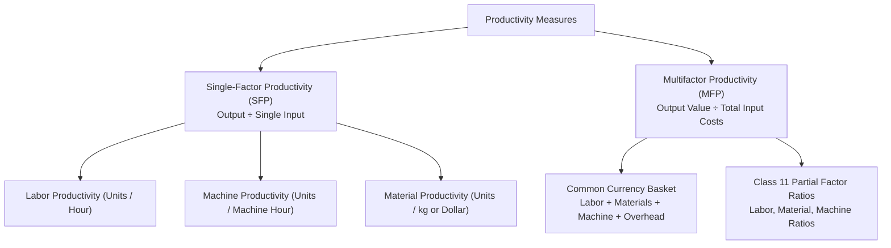

[← Previous: O02.2b: Q-System Daily Demand and MCU Problems](O02.2b_Q_System_Daily_Demand_and_MCU_Problems.md) | [🏠 Index](00_Index.md) | [📐 Master Sheet](99_Master_Formula_and_Statutory_Sheet.md) | [Next: O03.2: Productivity Decline, Human Factors, and Industry 4.0 →](O03.2_Productivity_Decline_Human_Factors_and_Industry_4_0.md)

---

# O03.1: Productivity Formulas, SFP, MFP, and Numericals

> [!info] ⚡ Exam Snapshot
> - **Section & Priority:** Section B (CO3 · Operational Management · MRI Sir) | 🔴 Prime Final Lock (Class 11) | **Read Time:** ~5 mins
> - **PYQs Covered:** Class 11 Core Board Topic, 7 Solved Lecture Scenarios + 10-Mark Model Problem
> - **Scoring Rule:** State formulas with units, convert all inputs to common currency for MFP, maintain sign in $\% \Delta P$, answer the 3 diagnostic questions when productivity falls, and state partial factor ratios.

---

## 📌 1. Verbatim Definitions (For 2-Mark Questions)

> **Productivity:** "Productivity is a measure of how efficiently inputs (such as labor, materials, and capital) are used to produce outputs (goods or services). In its simplest form, productivity is expressed as the ratio of output to input." (MRI Sir Lecture Notes, Slide 2)
- *Plain meaning:* A ratio showing how much useful output you get from the resources you spend.

> **Single-Factor Productivity (SFP):** "A productivity measure that evaluates output relative to a single input resource, such as labor hours, machine hours, or capital." (Class 11 Lecture Notes)
- *Plain meaning:* A measure that compares output against only one input resource at a time.

> **Multifactor Productivity (MFP):** "A productivity measure that evaluates output relative to a combination of resources, such as labor, materials, energy, and capital, expressed in a common monetary currency." (Class 11 Lecture Notes)
- *Plain meaning:* A measure that compares output value against all combined input costs in money.

> **Partial Factor Ratios:** "Monetary or unit ratios that compare total output value directly against individual cost items in a multifactor setting." (MRI Sir, Raidah Class 11 Board Notes)
- *Plain meaning:* Ratios comparing total output value against each specific input cost like labor or materials.

---

## ⚡ 2. Core Exam Blocks (Write Directly in Exam)

### Fundamental Formulas & Operational Principles

1. **Fundamental Ratio:**
   
$$
\text{Productivity} = \frac{\text{Output}}{\text{Input}}
$$

   - **Numerator (Output):** Physical count (units, shirts, phones) OR total sales value ($\text{Quantity} \times \text{Selling Price}$).
   - **Denominator (Input):** Physical resources (hours, kg) OR total operating expenses in dollars.
2. **Three Operational Paths to Increase Productivity:**
   - *Path 1:* Grow output with input held constant (better line balance, worker skill).
   - *Path 2:* Maintain output while cutting input (scrap reduction, energy efficiency).
   - *Path 3 (Ideal):* Grow output while cutting input simultaneously (automation, modern tools).
3. **Why Productivity is a Relative Metric:** An isolated number (e.g. 4.0 phones/hour) has no standalone meaning. It requires comparison against:
   - Historical records (last month or prior shift).
   - Planned operating standards (engineering quotas).
   - Competitor benchmarks (industry average).

---

### Single-Factor vs. Multifactor Productivity

#### Single-Factor Formulas
- Labor Productivity:
  
$$
P_{\text{labor}} = \frac{\text{Total Output (Units)}}{\text{Total Labor Hours}} \quad \Bigg| \quad \text{Unit Labor Requirement} = \frac{\text{Labor Hours}}{\text{Output Units}}
$$

- Machine Productivity:
  
$$
P_{\text{machine}} = \frac{\text{Total Output (Units)}}{\text{Machine Operating Hours}}
$$

#### The Single-Factor Automation Trap
Looking only at labor productivity can hide total costs. When a plant invests \$500,000 in an automated robot:
- Labor hours drop by 80%, so labor productivity jumps five-fold (+500%).
- But machine depreciation, power, and maintenance costs surge.
- Overall unit production cost can actually increase.
- Management must calculate Multifactor Productivity to evaluate real net gains.

#### Multifactor Productivity (MFP) in Common Currency
Because hours, kilograms, and kilowatt-hours cannot be added directly, convert all inputs into a common monetary currency:

$$
\text{MFP} = \frac{\text{Total Output Value}}{\text{Labor Cost} + \text{Material Cost} + \text{Machine Cost} + \text{Overhead Cost}}
$$

- $\text{MFP} > 1.0$: Plant is profitable (revenue exceeds operating expenses).
- $\text{MFP} = 1.0$: Plant breaks even on production costs.
- $\text{MFP} < 1.0$: Plant is operating at an operational loss.

#### Class 11 Three Partial Factor Ratios
Taught by MRI Sir on the board to isolate financial returns per cost item:
1. **Labour Factor Ratio:**
   
$$
\text{Labour Ratio} = \frac{\text{Total Output Value}}{\text{Total Labor Cost}} = \frac{\text{Units} \times \text{Price}}{\text{Labor Hours} \times \text{Hourly Wage}}
$$

2. **Material Factor Ratio:**
   
$$
\text{Material Ratio (Physical)} = \frac{\text{Output Units}}{\text{Material Cost}} \quad \Bigg| \quad \text{Material Ratio (Monetary)} = \frac{\text{Total Output Value}}{\text{Material Cost}}
$$

3. **Machine Factor Ratio:**
   
$$
\text{Machine Ratio (Physical)} = \frac{\text{Output Units}}{\text{Machine Overhead Cost}} \quad \Bigg| \quad \text{Machine Ratio (Monetary)} = \frac{\text{Total Output Value}}{\text{Machine Overhead Cost}}
$$

---

### Period-over-Period Growth and Diagnostic Framework

1. **Growth Formula:**
   
$$
\% \Delta P = \frac{P_{\text{new}} - P_{\text{old}}}{P_{\text{old}}} \times 100\%
$$

   Always keep the mathematical sign ($+\% \Delta P$ shows efficiency gains; $-\% \Delta P$ shows productivity loss).
2. **MRI Sir's 3 Diagnostic Questions (When $\% \Delta P < 0$):**
   - *Question 1 (Why decreased?):* Assembly bottlenecks, worker fatigue, machine breakdowns, or defective raw materials.
   - *Question 2 (Operational solution?):* Rebalance stations, introduce ergonomics, schedule preventative maintenance, inspect incoming parts.
   - *Question 3 (Management action?):* Enforce standard operating procedures (SOPs), retrain operators, adjust quality incentives.

---

### Side-by-Side Comparison: SFP vs. MFP

| Feature | Single-Factor Productivity (SFP) | Multifactor Productivity (MFP) |
| :--- | :--- | :--- |
| **Resource Scope** | Evaluates exactly one input resource (labor or machine). | Evaluates multiple inputs together in a combined denominator. |
| **Measurement Unit** | Physical units per input unit (e.g. shirts/hour, desks/hour). | Dimensionless monetary ratio or physical units per dollar spent. |
| **Managerial View** | Narrow. Can show false gains when capital replaces labor. | Comprehensive. Captures total cost trade-offs across all inputs. |
| **Data Collection** | Fast and easy to record directly on the factory floor. | Requires detailed wage records, invoices, and accounting overhead. |
| **Primary Use** | Daily line tracking, shift comparisons, and worker scheduling. | Strategic budgeting, automation reviews, and plant investments. |

> [!tip] Memory Hook: Output Triangle & L-M-M-O
> - **Output Triangle:** $\text{Output} = \text{Productivity} \times \text{Input}$. Put Output at the top; cover any variable to get its formula.
> - **L-M-M-O Basket:** Denominator for MFP is **L**abor + **M**aterials + **M**achines + **O**verhead.

---

## 🎯 3. PYQ & Target Answer Key

### Model Q1 & Q2 · Theory Blueprints (2 to 3 Marks)

#### Definition of Productivity & Relative Nature (02 Marks)
- **Answer Blueprint:** Define as $\text{Productivity} = \text{Output} / \text{Input}$ (efficient resource conversion). State components (physical vs monetary output; resource basket denominator). Explain relative nature: an isolated number lacks meaning without comparison against historical periods, engineering targets, or competitor benchmarks.

#### SFP vs. MFP Distinction (03 Marks)
- **Answer Blueprint:** Write formulas for SFP and common currency MFP. Explain the automation trap (why labor gains can mislead). Draw the 5-row comparison table from Section 2.

---

### Model Q3 · Multi-Sector Labor Productivity (04 Marks)

Calculate single-factor labor productivity for four operational settings:

1. **Furniture Desk Plant:**
   
$$
P_{\text{labor}} = \frac{500\text{ desks}}{1,200\text{ hours}} = \mathbf{0.4167\text{ desks/hour}} \quad \Bigg( \text{Unit labor requirement} = \frac{1,200}{500} = \mathbf{2.40\text{ hours/desk}} \Bigg)
$$

2. **Garment T-Shirt Plant:**
   
$$
P_{\text{labor}} = \frac{1,800\text{ shirts}}{600\text{ hours}} = \mathbf{3.00\text{ shirts/hour}} \quad \Bigg( \text{Unit labor requirement} = \frac{600}{1,800} = \mathbf{0.333\text{ hours/shirt}} \Bigg)
$$

3. **NGO Youth Training:** 40 workshops, 15 trainees/workshop ($40 \times 15 = 600\text{ trainees}$), 800 trainer hours.
   - Workshop rate: $P_{\text{workshop}} = \frac{40\text{ workshops}}{800\text{ hours}} = \mathbf{0.050\text{ workshops/hour}}$ ($20\text{ hours/workshop}$).
   - Participant rate: $P_{\text{participant}} = \frac{600\text{ trainees}}{800\text{ hours}} = \mathbf{0.750\text{ trainees/hour}}$.
4. **NGO Micro-Credit Loans:** 300 loans, 900 officer hours.
   
$$
P_{\text{loan}} = \frac{300\text{ loans}}{900\text{ hours}} = \mathbf{0.3333\text{ loans/hour}} \quad \Bigg( \text{Unit requirement} = \frac{900}{300} = \mathbf{3.00\text{ hours/loan}} \Bigg)
$$

---

### Model Q4 · Period-over-Period Evaluation: Apple Plant (04 Marks)

**Scenario:** Month 1: 220,000 iPhones with 50,000 labor hours. Month 2: 200,000 iPhones with 50,000 labor hours.

1. **Monthly Productivity Indices:**
   - Month 1: $P_1 = \frac{220,000}{50,000} = \mathbf{4.40\text{ iPhones/hour}}$.
   - Month 2: $P_2 = \frac{200,000}{50,000} = \mathbf{4.00\text{ iPhones/hour}}$.
2. **Percentage Change:**
   
$$
\% \Delta P = \frac{P_2 - P_1}{P_1} \times 100\% = \frac{4.00 - 4.40}{4.40} \times 100\% = \frac{-0.40}{4.40} \times 100\% = \mathbf{-9.09\%}
$$

3. **Managerial Interpretation:**
   - *Finding:* Labor productivity dropped by $9.09\%$. The plant produced 20,000 fewer phones for the exact same labor hours.
   - *Root Causes:* Assembly line balance issues, worker fatigue, part shortages, or machine downtime.
   - *Corrective Action:* Rebalance stations, inspect supply deliveries, and enforce standard assembly SOPs.

---

### Model Q5 · Common Currency MFP Suite (04 Marks)

1. **Furniture Desk Plant:** Output: $500 \times \$100 = \$50,000$.
   - Costs: Labor ($1,200 \times \$15 = \$18,000$) + Wood (\$9,000) + Machine ($500 \times \$10 = \$5,000$) = $\$32,000$.
   
$$
\text{MFP} = \frac{\$50,000}{\$32,000} = \mathbf{1.5625} \quad \Bigg( \text{With \$2,000 other overhead: } \frac{\$50,000}{\$34,000} = \mathbf{1.4706} \Bigg)
$$

2. **Garment T-Shirt Plant:** Output: $1,800 \times \$10 = \$18,000$.
   - Costs: Labor ($600 \times \$14 = \$8,400$) + Fabric (\$2,500) + Machine ($300 \times \$8 = \$2,400$) = $\$13,300$.
   
$$
\text{MFP} = \frac{\$18,000}{\$13,300} \approx \mathbf{1.3534} \quad \Bigg( \text{With \$700 overhead: } \frac{\$18,000}{\$14,000} \approx \mathbf{1.2857} \Bigg)
$$

3. **Professional University:** Output: $25\text{ courses} \times 20\text{ students} \times \$500 = \$250,000$.
   - Costs: Faculty ($1,000 \times \$30 = \$30,000$) + Materials (\$4,000) + IT (\$2,000) = $\$36,000$.
   
$$
\text{MFP} = \frac{\$250,000}{\$36,000} \approx \mathbf{6.944}
$$

   Generates $\$6.944$ of tuition revenue for every $\$1.00$ of operating cost.
4. **Commercial Bakery:** Physical output: 2,400 loaves.
   - Costs: Labor ($300 \times \$12 = \$3,600$) + Flour (\$600) + Power (\$200) = $\$4,400$.
   
$$
\text{MFP (Physical)} = \frac{2,400\text{ loaves}}{\$4,400} \approx \mathbf{0.5455\text{ loaves/\$}} \quad \Bigg( \text{Unit cost} = \frac{\$4,400}{2,400} = \mathbf{\$1.833/\text{loaf}} \Bigg)
$$

---

### Model Q6 · Apple Plant MFP and 3 Partial Factor Ratios (04 Marks)

**Scenario:** 200,000 iPhones @ \$700 wholesale (\$140M output value). Labor: 50,000h @ \$25 (\$1.25M), Components: \$25M, Machine overhead: \$5M.

1. **Total Input Cost & Overall MFP:**
   - $\text{Total Input Cost} = \$1.25\text{M} + \$25.00\text{M} + \$5.00\text{M} = \$31.25\text{M}$.
   
$$
\text{MFP} = \frac{\$140,000,000}{\$31,250,000} = \mathbf{4.48} \quad \Bigg( \text{With Class 11 \$6M variant: } \frac{\$140\text{M}}{\$32.25\text{M}} \approx \mathbf{4.34} \Bigg)
$$

2. **Class 11 Three Partial Factor Ratios:**
   - **Labour Factor Ratio:**
     
$$
\text{Labour Ratio} = \frac{\text{Output Value}}{\text{Labor Cost}} = \frac{\$140,000,000}{\$1,250,000} = \mathbf{112.0}
$$

   - **Material Factor Ratio:**
     
$$
\text{Monetary} = \frac{\$140,000,000}{\$25,000,000} = \mathbf{5.60} \quad \Bigg| \quad \text{Physical} = \frac{200,000}{\$25,000,000} = \mathbf{0.008\text{ phones/\$}}
$$

   - **Machine Factor Ratio:**
     
$$
\text{Monetary} = \frac{\$140,000,000}{\$5,000,000} = \mathbf{28.00} \quad \Bigg| \quad \text{Physical} = \frac{200,000}{\$5,000,000} = \mathbf{0.040\text{ phones/\$}}
$$

---

### Model Q7 · Comprehensive 10-Mark Model Problem: Packaging Company

**Scenario:** Cartons sell at \$5. Month 1: 32,000 cartons, 8,000h @ \$5 (\$40k), \$40k materials, \$10k machines. Month 2: 25,600 cartons, 8,000h @ \$5 (\$40k), \$45k materials, \$10k machines.

#### Step 1: Month 1 & Month 2 Calculations
1. **Month 1:**
   - Output Value: $32,000 \times \$5 = \$160,000$; Total Cost: $\$40\text{k} + \$40\text{k} + \$10\text{k} = \$90,000$.
   - Labor Productivity: $P_{\text{labor}, 1} = \frac{32,000}{8,000} = \mathbf{4.00\text{ cartons/hour}}$.
   - Multifactor Productivity: $\text{MFP}_1 = \frac{\$160,000}{\$90,000} \approx \mathbf{1.778}$.
2. **Month 2:**
   - Output Value: $25,600 \times \$5 = \$128,000$; Total Cost: $\$40\text{k} + \$45\text{k} + \$10\text{k} = \$95,000$.
   - Labor Productivity: $P_{\text{labor}, 2} = \frac{25,600}{8,000} = \mathbf{3.20\text{ cartons/hour}}$.
   - Multifactor Productivity: $\text{MFP}_2 = \frac{\$128,000}{\$95,000} \approx \mathbf{1.347}$.

#### Step 2: Percentage Changes
- Labor Productivity Change:
  
$$
\% \Delta P_{\text{labor}} = \frac{3.20 - 4.00}{4.00} \times 100\% = \mathbf{-20.00\%}
$$

- Multifactor Productivity Change:
  
$$
\% \Delta \text{MFP} = \frac{1.347 - 1.778}{1.778} \times 100\% = \mathbf{-24.24\%}
$$

#### Step 3: Comparative Summary Table & Diagnosis

| Metric / Parameter | Month 1 (Base) | Month 2 (Current) | Absolute Change | Percentage Change |
| :--- | :---: | :---: | :---: | :---: |
| **Output Quantity** | $32,000\text{ cartons}$ | $25,600\text{ cartons}$ | $-6,400\text{ cartons}$ | $-20.00\%$ |
| **Output Sales Value** | $\$160,000$ | $\$128,000$ | $-\$32,000$ | $-20.00\%$ |
| **Labor Hours** | $8,000\text{ hours}$ | $8,000\text{ hours}$ | $0\text{ hours}$ | $0.00\%$ |
| **Total Input Cost** | $\$90,000$ | $\$95,000$ | $+\$5,000$ | $+5.56\%$ |
| **Labor Productivity** | $4.00\text{ cartons/hr}$ | $3.20\text{ cartons/hr}$ | $-0.80\text{ cartons/hr}$ | $\mathbf{-20.00\%}$ |
| **Multifactor Productivity** | $1.778$ | $1.347$ | $-0.431$ | $\mathbf{-24.24\%}$ |

- **Managerial Diagnosis:**
  1. *Labor Drop ($-20.00\%$):* Identical labor hours (8,000) yielded 6,400 fewer cartons, revealing assembly line bottlenecks and worker fatigue.
  2. *Multifactor Drop ($-24.24\%$):* MFP dropped even further because material expenses rose from \$40k to \$45k despite producing less output. This confirms high scrap rates and defective raw cardboard.
  3. *Action Plan:* Inspect cardboard supplier quality, rebalance folding workstations, and enforce standardized line procedures.

---

> [!warning] ⚠️ Examiner Traps
> - **The Common Currency Requirement:** Never sum hours, kilograms, and kilowatt-hours directly in MFP. Convert all input resources to dollars first.
> - **Retaining the Minus Sign:** When productivity drops, always write $-\% \Delta P$ explicitly. Stating a positive number when efficiency drops loses marks.
> - **Handling Excluded Overhead:** Read exam prompts carefully. If overhead is excluded, calculate on specified inputs; if unspecified, state both figures to secure full credit.
> - **Three Diagnostic Questions:** Always state MRI Sir's three questions (Why decreased? Operational solution? Management action?) whenever an exam scenario shows negative growth.

---

[← Previous: O02.2b: Q-System Daily Demand and MCU Problems](O02.2b_Q_System_Daily_Demand_and_MCU_Problems.md) | [🏠 Index](00_Index.md) | [📐 Master Sheet](99_Master_Formula_and_Statutory_Sheet.md) | [Next: O03.2: Productivity Decline, Human Factors, and Industry 4.0 →](O03.2_Productivity_Decline_Human_Factors_and_Industry_4_0.md)
