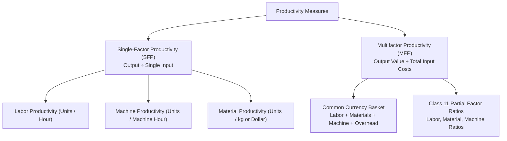

[← Previous: O02.2b: Q-System Daily Demand and MCU Problems](O02.2b_Q_System_Daily_Demand_and_MCU_Problems.md) | [🏠 Index](00_Index.md) | [📐 Master Sheet](99_Master_Formula_and_Statutory_Sheet.md) | [Next: O03.2: Productivity Decline, Human Factors, and Industry 4.0 →](O03.2_Productivity_Decline_Human_Factors_and_Industry_4_0.md)

---

# O03.1: Productivity Formulas, SFP, MFP, and Numericals

> [!info] ⚡ Exam Snapshot
> - **Section & Priority:** Section B (CO3 · Operational Management · MRI Sir) · 🔴 Prime Final Lock (Class 11) · **Read Time:** ~6 mins
> - **PYQs Covered:** Class 11 Core Board Topic, 7 Solved Lecture Scenarios + 10-Mark Model Problem
> - **Scoring Rule:** State formulas with clear units. Convert all inputs into money for MFP. Keep the minus sign in $\% \Delta P$. Answer the 3 diagnostic questions when productivity falls. State partial factor ratios.

---

## 📌 1. Verbatim Definitions (For 2-Mark Questions)

> **Productivity:** "Productivity is a measure of how efficiently inputs (such as labor, materials, and capital) are used to produce outputs (goods or services). In its simplest form, productivity is expressed as the ratio of output to input." *(MRI Sir Lecture Notes, Slide 2)*

*Plain meaning:* Productivity shows how well a company turns inputs (like labor and materials) into finished goods or services. It is simply output divided by input.

> **Single-Factor Productivity (SFP):** "A productivity measure that evaluates output relative to a single input resource, such as labor hours, machine hours, or capital." *(Class 11 Lecture Notes)*

*Plain meaning:* This measures output against just one resource at a time. The most common example is output per worker hour.

> **Multifactor Productivity (MFP):** "A productivity measure that evaluates output relative to a combination of resources, such as labor, materials, energy, and capital, expressed in a common monetary currency." *(Class 11 Lecture Notes)*

*Plain meaning:* This measures output against all production costs combined. You turn all inputs (labor, materials, overhead) into money so you can add them together.

> **Partial Factor Ratios:** "Monetary or unit ratios that compare total output value directly against individual cost items in a multifactor setting." *(MRI Sir, Raidah Class 11 Board Notes)*

*Plain meaning:* These ratios show how much sales value you get for every dollar spent on one specific cost. Common examples include labor, raw materials, or machine overhead.

---

## ⚡ 2. Core Exam Blocks (Write Directly in Exam)

### Fundamental Formulas & Operational Principles

#### 1. Fundamental Productivity Ratio

$$
\text{Productivity} = \frac{\text{Output}}{\text{Input}}
$$

- **Top (Output):** Count finished goods (shirts, phones) or total sales value ($\text{Quantity} \times \text{Selling Price}$).
- **Bottom (Input):** Count resources used (labor hours, kilograms) or total operating expenses in money.

#### 2. Output Monetary Value Formulation

$$
\text{Output Value} = \text{Quantity} \times \text{Selling Price}
$$

#### 3. Three Operational Paths to Increase Productivity

- *Path 1 (Increase Output, Keep Inputs Fixed):* Make more goods using the same labor and machine hours. Better line balancing helps achieve this.
- *Path 2 (Keep Output Fixed, Cut Inputs):* Make the exact same target quota, but cut scrap, wasted materials, and power use.
- *Path 3 (The Ideal Path):* Increase output and reduce inputs at the same time using modern automation.

#### 4. Why Productivity is a Relative Metric

A single productivity number (like 4.0 phones per hour) tells you very little on its own. You must compare it against three benchmarks to see if it is good or bad:

- Past performance: Compare with last month or yesterday's shift.
- Planned targets: Compare with engineering quotas and management goals.
- Competitor benchmarks: Compare with rival factories in your industry.

---

### Single-Factor vs. Multifactor Productivity

#### Single-Factor Formulas

Single-Factor Productivity evaluates output against one resource at a time:

**Labor Productivity:**

$$
P_{\text{labor}} = \frac{\text{Total Output (Units)}}{\text{Total Labor Hours}}
$$

**Unit Labor Requirement (Inverse Ratio):**

$$
\text{Unit Labor Requirement} = \frac{\text{Total Labor Hours}}{\text{Total Output (Units)}} = \frac{1}{P_{\text{labor}}}
$$

**Machine Productivity:**

$$
P_{\text{machine}} = \frac{\text{Total Output (Units)}}{\text{Machine Operating Hours}}
$$

#### The Single-Factor Automation Trap

Looking only at labor productivity can easily fool a manager:

- Suppose a factory spends \$500,000 on robot assembly arms.
- Worker hours drop by 80%, so labor productivity jumps 500%.
- But machine maintenance, power bills, and machine wear surge.
- In the end, total production cost per unit may actually go up!
- That is why managers must check Multifactor Productivity to see the true cost picture.

#### Multifactor Productivity (MFP) in Common Currency

You cannot add worker hours, kilograms of steel, and kilowatt-hours together directly. Convert every input into a shared currency (like dollars or taka) first:

$$
\text{MFP} = \frac{\text{Total Output Value}}{\text{Labor Cost} + \text{Material Cost} + \text{Machine Cost} + \text{Overhead Cost}}
$$

What the MFP number tells you about factory profit:

- $\text{MFP} > 1.0$: Profitable. Total sales revenue exceeds total operating costs.
- $\text{MFP} = 1.0$: Break-even. Sales revenue exactly equals operating costs.
- $\text{MFP} < 1.0$: Operating loss. Spending exceeds sales revenue.

#### Class 11 Three Partial Factor Ratios

MRI Sir showed these three ratios on the board to track returns on each specific cost:

**1. Labour Factor Ratio:**

$$
\text{Labour Ratio} = \frac{\text{Total Output Value}}{\text{Total Labor Cost}} = \frac{\text{Units} \times \text{Price}}{\text{Labor Hours} \times \text{Hourly Wage}}
$$

**2. Material Factor Ratio:**

$$
\text{Material Ratio (Monetary)} = \frac{\text{Total Output Value}}{\text{Total Material Cost}}
$$

$$
\text{Material Ratio (Physical)} = \frac{\text{Total Output Units}}{\text{Total Material Cost}}
$$

**3. Machine Factor Ratio:**

$$
\text{Machine Ratio (Monetary)} = \frac{\text{Total Output Value}}{\text{Total Machine Overhead Cost}}
$$

$$
\text{Machine Ratio (Physical)} = \frac{\text{Total Output Units}}{\text{Total Machine Overhead Cost}}
$$

---

### Period-over-Period Growth and Diagnostic Framework

#### Percentage Change Formula

$$
\% \Delta P = \frac{P_{\text{new}} - P_{\text{old}}}{P_{\text{old}}} \times 100\%
$$

Always keep the plus or minus sign. A plus sign ($+\% \Delta P$) means productivity rose. A minus sign ($-\% \Delta P$) means productivity dropped.

#### MRI Sir's 3 Diagnostic Questions (Mandatory when $\% \Delta P < 0$)

Whenever productivity drops, MRI Sir requires you to answer these three diagnostic questions:

- *Question 1: Why did productivity fall?*
  - Look for bottleneck stations, tired workers, machine breakdowns, or bad raw materials.
- *Question 2: What is the practical shop-floor fix?*
  - Balance the assembly line, add ergonomic chairs, schedule machine maintenance, and inspect incoming parts.
- *Question 3: What management action is needed?*
  - Enforce standard work rules, retrain line workers, and offer bonuses for defect-free work.

---

### Side-by-Side Comparison: SFP vs. MFP

| Feature | Single-Factor Productivity (SFP) | Multifactor Productivity (MFP) |
| :--- | :--- | :--- |
| **Resource Scope** | Tracks only one input resource (like labor hours or machine hours). | Combines all major inputs together into a single total cost. |
| **Measurement Unit** | Physical units per input unit (e.g. shirts/hour, desks/hour). | Pure ratio (dollars of output per dollar of input) or units per dollar. |
| **Managerial View** | Narrow. It can hide big machine costs when robots replace workers. | Broad and complete. It captures cost trade-offs across all resources. |
| **Data Collection** | Fast and easy to record directly on the shop floor. | Needs detailed wage slips, material invoices, and utility bills. |
| **Primary Use** | Daily line tracking, shift comparisons, and worker scheduling. | Big-picture budgets, automation choices, and factory investment reviews. |

> [!tip] Memory Hook: Output Triangle & L-M-M-O Basket
> - **Output Triangle:** $\text{Output} = \text{Productivity} \times \text{Input}$. Put Output at the top. Cover any item to see its formula.
> - **L-M-M-O Basket:** The four standard cost items in the MFP bottom line are **L**abor + **M**aterials + **M**achines + **O**verhead.

---

## 🎯 3. PYQ & Target Answer Key

### Target Q1 · Definition of Productivity and Relative Nature (02 Marks)

**Verbatim Question:**

Define productivity in operations management. Why is productivity considered a relative measure rather than an absolute indicator?

**Model Answer:**

Productivity measures how well a company turns inputs into finished outputs. In operations management, it is written as output divided by input:

$$
\text{Productivity} = \frac{\text{Output}}{\text{Input}}
$$

- **Output:** The amount of finished goods made or services provided. It is written in physical units or total sales revenue.
- **Input:** The resources used up during production, such as labor hours, machine hours, raw materials, or money spent.

Productivity is a relative measure because an isolated number has little meaning on its own. For example, making 4.0 phones per hour does not tell you if the line did well or poorly. You must compare that number against three yardsticks:

1. Past records: Compare with earlier shifts or prior months.
2. Planned goals: Compare with engineering quotas and management targets.
3. Industry benchmarks: Compare with rival factories making similar products.

---

### Target Q2 · Single-Factor vs. Multifactor Productivity Comparison (03 Marks)

**Verbatim Question:**

Distinguish between Single-Factor Productivity (SFP) and Multifactor Productivity (MFP). Provide mathematical formulas and a structured comparison table.

**Model Answer:**

Operations managers group productivity by how many resources are measured at once:

1. **Single-Factor Productivity (SFP):** Compares output against one specific input resource:

$$
\text{SFP} = \frac{\text{Total Output}}{\text{Single Resource Input}} \quad \implies \quad P_{\text{labor}} = \frac{\text{Total Output (Units)}}{\text{Total Labor Hours}}
$$

2. **Multifactor Productivity (MFP):** Compares output against multiple inputs converted into a single currency:

$$
\text{MFP} = \frac{\text{Total Output Value}}{\text{Labor Cost} + \text{Material Cost} + \text{Machine Cost} + \text{Overhead Cost}}
$$

**Structured Comparison Table:**

| Feature | Single-Factor Productivity (SFP) | Multifactor Productivity (MFP) |
| :--- | :--- | :--- |
| **Input Scope** | Exactly one input resource (labor or machine). | Multiple inputs combined in a shared denominator. |
| **Measurement Unit** | Physical units per input unit (e.g. shirts/hour). | Dimensionless monetary ratio or units per dollar. |
| **Operational View** | Narrow. Misleads when machines replace labor. | Broad. Captures all production costs in money. |
| **Data Collection** | Simple and fast to collect on the shop floor. | Requires detailed cost sheets and accounting records. |
| **Decision Role** | Daily line tracking and shift scheduling. | Long-term capital planning and automation choices. |

---

### Target Q3 · Single-Factor Labor Productivity Across Four Operational Sectors (04 Marks)

**Verbatim Question:**

Calculate the single-factor labor productivity for each of the following four operational scenarios:

- (a) An office furniture factory produces 500 desks using 1,200 labor hours.
- (b) A garment plant produces 1,800 T-shirts using 600 labor hours.
- (c) A training organization conducts 40 workshops using 800 trainer hours with an average of 15 participants per workshop.
- (d) A micro-credit agency disburses 300 loans using 900 loan officer hours.

**Complete Board Solution:**

#### Part (a): Furniture Desk Factory

- Output = $500\text{ desks}$
- Labor input = $1,200\text{ hours}$

$$
P_{\text{labor}} = \frac{500\text{ desks}}{1,200\text{ hours}} = \mathbf{0.4167\text{ desks/hour}}
$$

In reverse, find the labor hours needed per desk:

$$
\text{Unit Labor Requirement} = \frac{1,200\text{ hours}}{500\text{ desks}} = \mathbf{2.40\text{ hours/desk}}
$$

#### Part (b): Garment T-Shirt Plant

- Output = $1,800\text{ T-shirts}$
- Labor input = $600\text{ hours}$

$$
P_{\text{labor}} = \frac{1,800\text{ T-shirts}}{600\text{ hours}} = \mathbf{3.00\text{ shirts/hour}}
$$

In reverse, find the labor time needed for one shirt:

$$
\text{Unit Labor Requirement} = \frac{600\text{ hours}}{1,800\text{ shirts}} = \mathbf{0.333\text{ hours/shirt}} \quad (20\text{ minutes/shirt})
$$

#### Part (c): NGO Youth Vocational Training

- Workshops = $40$
- Participants per workshop = $15$
- Total participants = $40 \times 15 = 600\text{ trainees}$
- Trainer input = $800\text{ hours}$

1. Workshop completion rate:

$$
P_{\text{workshop}} = \frac{40\text{ workshops}}{800\text{ hours}} = \mathbf{0.050\text{ workshops/trainer hour}} \quad (20\text{ hours/workshop})
$$

2. Trainee participant rate:

$$
P_{\text{participant}} = \frac{600\text{ trainees}}{800\text{ hours}} = \mathbf{0.750\text{ trainees/trainer hour}}
$$

#### Part (d): NGO Micro-Credit Program

- Output = $300\text{ loans}$
- Labor input = $900\text{ officer hours}$

$$
P_{\text{loan}} = \frac{300\text{ loans}}{900\text{ hours}} = \mathbf{0.3333\text{ loans/officer hour}}
$$

In reverse, find the processing time per loan:

$$
\text{Time per Loan} = \frac{900\text{ hours}}{300\text{ loans}} = \mathbf{3.00\text{ officer hours/loan}}
$$

---

### Target Q4 · Period-over-Period Labor Productivity Evaluation: Apple Plant (04 Marks)

**Verbatim Question:**

Apple's smartphone assembly plant in China produced 200,000 iPhones in Month 2 using 50,000 labor hours. In Month 1, the same plant produced 220,000 iPhones using 50,000 labor hours.

- (i) Compute the labor productivity for both Month 1 and Month 2.
- (ii) Calculate the period-over-period percentage change in labor productivity.
- (iii) Interpret the operational meaning of this result for the plant manager.

**Complete Board Solution:**

#### Step 1: Compute Monthly Labor Indices

For Month 1 (Base Period):

$$
P_1 = \frac{\text{Output}_1}{\text{Labor Input}_1} = \frac{220,000\text{ iPhones}}{50,000\text{ hours}} = \mathbf{4.40\text{ iPhones/hour}}
$$

For Month 2 (Current Period):

$$
P_2 = \frac{\text{Output}_2}{\text{Labor Input}_2} = \frac{200,000\text{ iPhones}}{50,000\text{ hours}} = \mathbf{4.00\text{ iPhones/hour}}
$$

#### Step 2: Compute Period-over-Period Percentage Change

Apply the standard percentage change formula:

$$
\% \Delta P = \frac{P_{\text{new}} - P_{\text{old}}}{P_{\text{old}}} \times 100\% = \frac{P_2 - P_1}{P_1} \times 100\%
$$

Substitute the calculated values:

$$
\% \Delta P = \frac{4.00 - 4.40}{4.40} \times 100\% = \frac{-0.40}{4.40} \times 100\% = \mathbf{-9.09\%}
$$

#### Step 3: Managerial Interpretation

1. **Core Finding:** Labor productivity dropped by $9.09\%$. The plant produced 20,000 fewer phones while using the exact same 50,000 labor hours.
2. **Root Causes:** Workstation bottlenecks, worker fatigue, late parts from suppliers, or machine breakdowns.
3. **Corrective Action Plan:** Balance the assembly line stations, inspect incoming component quality, and enforce standard operating procedures.

---

### Target Q5 · Multifactor Productivity Suite in Common Currency (04 Marks)

**Verbatim Question:**

Calculate the Multifactor Productivity (MFP) for each of the following manufacturing and service operations:

- (a) A furniture factory produces 500 desks selling at \$100 each. Inputs include 1,200 labor hours at \$15/hr, \$9,000 wood materials, and 500 machine hours at \$10/hr.
- (b) A garment unit produces 1,800 T-shirts selling at \$10 each. Inputs include 600 labor hours at \$14/hr, \$2,500 fabric, and 300 machine hours at \$8/hr.
- (c) A university delivers 25 certificate courses to 20 students per course at \$500 tuition per student. Inputs include 1,000 faculty hours at \$30/hr, \$4,000 materials, and \$2,000 IT infrastructure.
- (d) A commercial bakery produces 2,400 loaves of bread in a week. Inputs include 300 labor hours at \$12/hr, \$600 ingredients, and \$200 oven electricity.

**Complete Board Solution:**

#### Part (a): Furniture Desk Plant MFP

Calculate total output sales value:

$$
\text{Total Output Value} = 500\text{ desks} \times \$100 = \$50,000
$$

Sum the specified input costs:

- Labor cost: $1,200\text{ hours} \times \$15/\text{hour} = \$18,000$
- Material cost: $\$9,000$
- Machine cost: $500\text{ hours} \times \$10/\text{hour} = \$5,000$

$$
\text{Total Specified Input Cost} = \$18,000 + \$9,000 + \$5,000 = \$32,000
$$

Compute MFP:

$$
\text{MFP} = \frac{\$50,000}{\$32,000} = \mathbf{1.5625}
$$

*(If management includes other overhead of \$2,000, total input cost becomes \$34,000, yielding $\text{MFP} = \frac{\$50,000}{\$34,000} \approx \mathbf{1.4706}$).*

#### Part (b): Garment T-Shirt Plant MFP

Calculate total output sales value:

$$
\text{Total Output Value} = 1,800\text{ T-shirts} \times \$10 = \$18,000
$$

Sum the specified input costs:

- Labor cost: $600\text{ hours} \times \$14/\text{hour} = \$8,400$
- Material cost: $\$2,500$
- Machine cost: $300\text{ hours} \times \$8/\text{hour} = \$2,400$

$$
\text{Total Input Cost} = \$8,400 + \$2,500 + \$2,400 = \$13,300
$$

Compute MFP:

$$
\text{MFP} = \frac{\$18,000}{\$13,300} \approx \mathbf{1.3534}
$$

*(If other overhead of \$700 is included per management instruction, total input cost becomes \$14,000, yielding $\text{MFP} = \frac{\$18,000}{\$14,000} \approx \mathbf{1.2857}$).*

#### Part (c): Professional University MFP

Calculate total enrolled students and tuition revenue:

- Total students: $25\text{ courses} \times 20\text{ students} = 500\text{ students}$
- Total tuition revenue: $500 \times \$500 = \$250,000$

Sum the input costs:

- Faculty payroll: $1,000\text{ hours} \times \$30/\text{hour} = \$30,000$
- Course materials: $\$4,000$
- IT infrastructure: $\$2,000$

$$
\text{Total Input Cost} = \$30,000 + \$4,000 + \$2,000 = \$36,000
$$

Compute MFP:

$$
\text{MFP} = \frac{\$250,000}{\$36,000} \approx \mathbf{6.944}
$$

The program earns $\$6.944$ in tuition revenue for every $\$1.00$ spent.

#### Part (d): Commercial Bakery MFP

Physical output: $2,400\text{ loaves of bread}$.

Sum the specified input costs:

- Labor cost: $300\text{ hours} \times \$12/\text{hour} = \$3,600$
- Flour and ingredients: $\$600$
- Oven electricity: $\$200$

$$
\text{Total Specified Input Cost} = \$3,600 + \$600 + \$200 = \$4,400
$$

Compute physical MFP:

$$
\text{MFP (Physical)} = \frac{2,400\text{ loaves}}{\$4,400} \approx \mathbf{0.5455\text{ loaves/\$}}
$$

In reverse, find the production cost per loaf:

$$
\text{Unit Cost} = \frac{\$4,400}{2,400\text{ loaves}} = \mathbf{\$1.833/\text{loaf}}
$$

*(If bread sells at \$2.50 per loaf, total output value is $\$6,000$, yielding monetary $\text{MFP} = \frac{\$6,000}{\$4,400} \approx \mathbf{1.3636}$; with \$400 additional overhead, $\text{MFP} = \frac{\$6,000}{\$4,800} = \mathbf{1.25}$).*

---

### Target Q6 · Apple Plant Multifactor Productivity and Three Partial Factor Ratios (04 Marks)

**Verbatim Question:**

Apple's smartphone assembly plant produced 200,000 iPhones last month. Each phone sells for a wholesale price of \$700. The plant incurred the following production inputs:

- Labor: 50,000 hours at \$25 per hour
- Components and raw materials: \$25,000,000
- Machine depreciation and electricity overhead: \$5,000,000

**Required:**

- (i) Compute the total input cost and overall Multifactor Productivity (MFP).
- (ii) Calculate the three partial factor ratios taught by MRI Sir in Class 11 (Labour Factor Ratio, Material Factor Ratio, and Machine Factor Ratio).

**Complete Board Solution:**

#### Step 1: Total Input Cost and Overall MFP

Calculate total wholesale output value:

$$
\text{Total Output Value} = 200,000\text{ iPhones} \times \$700 = \$140,000,000
$$

Sum the input cost categories:

- Labor cost: $50,000\text{ hours} \times \$25/\text{hour} = \$1,250,000$
- Material cost: $\$25,000,000$
- Machine overhead: $\$5,000,000$

$$
\text{Total Input Cost} = \$1,250,000 + \$25,000,000 + \$5,000,000 = \$31,250,000
$$

Compute overall MFP:

$$
\text{MFP} = \frac{\$140,000,000}{\$31,250,000} = \mathbf{4.48}
$$

The plant produces $\$4.48$ of wholesale smartphone output for every $\$1.00$ of total operating expense.

*(Class 11 Variant: With \$6,000,000 machine overhead, total cost is \$32,250,000, yielding $\text{MFP} = \frac{\$140\text{M}}{\$32.25\text{M}} \approx \mathbf{4.34}$).*

#### Step 2: The Three Class 11 Partial Factor Ratios

**1. Labour Factor Ratio:**

$$
\text{Labour Ratio} = \frac{\text{Total Output Value}}{\text{Total Labor Cost}} = \frac{\$140,000,000}{\$1,250,000} = \mathbf{112.0}
$$

Every \$1.00 paid to assembly workers generates \$112.00 of wholesale smartphone output.

**2. Material Factor Ratio:**

- Monetary basis:

$$
\text{Material Ratio (Monetary)} = \frac{\$140,000,000}{\$25,000,000} = \mathbf{5.60}
$$

- Physical basis:

$$
\text{Material Ratio (Physical)} = \frac{200,000\text{ iPhones}}{\$25,000,000} = \mathbf{0.008\text{ iPhones/\$}}
$$

**3. Machine Factor Ratio:**

- Monetary basis (with \$5M overhead):

$$
\text{Machine Ratio (Monetary)} = \frac{\$140,000,000}{\$5,000,000} = \mathbf{28.00}
$$

- Physical basis (with \$5M overhead):

$$
\text{Machine Ratio (Physical)} = \frac{200,000\text{ iPhones}}{\$5,000,000} = \mathbf{0.040\text{ iPhones/\$}}
$$

*(With Raidah's \$6M machine overhead variant: Monetary Ratio is $\frac{\$140\text{M}}{\$6\text{M}} \approx \mathbf{23.33}$, and Physical Ratio is $\frac{200,000}{\$6\text{M}} \approx \mathbf{0.0333\text{ iPhones/\$}}$).*

---

### Target Q7 · Full 10-Mark Model Problem: Packaging Company

**Verbatim Question:**

A regional packaging company produces corrugated shipping cartons selling at \$5 per carton. The production records for Month 1 and Month 2 show:

- **Month 1:** Produced 32,000 cartons using 8,000 labor hours at \$5/hr, \$40,000 raw cardboard materials, and \$10,000 machine overhead.
- **Month 2:** Produced 25,600 cartons using 8,000 labor hours at \$5/hr, \$45,000 raw cardboard materials, and \$10,000 machine overhead.

**Required:**

- (a) Define Single-Factor Productivity and Multifactor Productivity with mathematical formulas. *(02 Marks)*
- (b) Calculate for both Month 1 and Month 2:
  - (i) Labor Productivity (cartons per labor hour),
  - (ii) Total Multifactor Productivity (MFP), and
  - (iii) The percentage change in both productivity measures. *(04 Marks)*
- (c) Construct a comparative summary table and provide a concise managerial diagnosis explaining why productivity declined. *(04 Marks)*

**Complete Board Solution:**

#### Part (a): Definitions and Formulas

1. **Single-Factor Productivity (SFP):** Measures output against a single input resource:

$$
P_{\text{labor}} = \frac{\text{Total Output (Units)}}{\text{Total Labor Hours}}
$$

2. **Multifactor Productivity (MFP):** Measures output against all combined operating costs converted into a common currency:

$$
\text{MFP} = \frac{\text{Total Output Value}}{\text{Labor Cost} + \text{Material Cost} + \text{Machine Cost} + \text{Overhead Cost}}
$$

#### Part (b): Step-by-Step Numerical Solution

**1. Month 1 Base Calculations:**

- Output quantity: $Q_1 = 32,000\text{ cartons}$
- Output sales value: $32,000 \times \$5 = \$160,000$
- Labor cost: $8,000\text{ hours} \times \$5/\text{hour} = \$40,000$
- Material cost: $\$40,000$
- Machine overhead: $\$10,000$
- Total input cost: $\$40,000 + \$40,000 + \$10,000 = \$90,000$

$$
P_{\text{labor}, 1} = \frac{32,000\text{ cartons}}{8,000\text{ hours}} = \mathbf{4.00\text{ cartons/hour}}
$$

$$
\text{MFP}_1 = \frac{\$160,000}{\$90,000} \approx \mathbf{1.778}
$$

**2. Month 2 Current Calculations:**

- Output quantity: $Q_2 = 25,600\text{ cartons}$
- Output sales value: $25,600 \times \$5 = \$128,000$
- Labor cost: $8,000\text{ hours} \times \$5/\text{hour} = \$40,000$
- Material cost: $\$45,000$ (higher because of raw cardboard scrap)
- Machine overhead: $\$10,000$
- Total input cost: $\$40,000 + \$45,000 + \$10,000 = \$95,000$

$$
P_{\text{labor}, 2} = \frac{25,600\text{ cartons}}{8,000\text{ hours}} = \mathbf{3.20\text{ cartons/hour}}
$$

$$
\text{MFP}_2 = \frac{\$128,000}{\$95,000} \approx \mathbf{1.347}
$$

**3. Percentage Changes:**

**Percentage change in labor productivity:**

$$
\% \Delta P_{\text{labor}} = \frac{3.20 - 4.00}{4.00} \times 100\% = \frac{-0.80}{4.00} \times 100\% = \mathbf{-20.00\%}
$$

**Percentage change in multifactor productivity:**

$$
\% \Delta \text{MFP} = \frac{1.347 - 1.778}{1.778} \times 100\% = \frac{-0.431}{1.778} \times 100\% = \mathbf{-24.24\%}
$$

#### Part (c): Comparative Summary Table and Managerial Diagnosis

**Comparative Summary Table:**

| Metric / Parameter | Month 1 (Base) | Month 2 (Current) | Absolute Change | Percentage Change |
| :--- | :---: | :---: | :---: | :---: |
| **Output Quantity** | $32,000\text{ cartons}$ | $25,600\text{ cartons}$ | $-6,400\text{ cartons}$ | $-20.00\%$ |
| **Output Sales Value** | $\$160,000$ | $\$128,000$ | $-\$32,000$ | $-20.00\%$ |
| **Labor Hours** | $8,000\text{ hours}$ | $8,000\text{ hours}$ | $0\text{ hours}$ | $0.00\%$ |
| **Total Input Cost** | $\$90,000$ | $\$95,000$ | $+\$5,000$ | $+5.56\%$ |
| **Labor Productivity** | $4.00\text{ cartons/hr}$ | $3.20\text{ cartons/hr}$ | $-0.80\text{ cartons/hr}$ | $\mathbf{-20.00\%}$ |
| **Multifactor Productivity** | $1.778$ | $1.347$ | $-0.431$ | $\mathbf{-24.24\%}$ |

**Managerial Diagnosis:**

1. **Labor Productivity Drop ($-20.00\%$):** Workers used the exact same 8,000 hours but made 6,400 fewer cartons. This points to line bottlenecks, tired workers, or slow assembly stations.
2. **Multifactor Productivity Drop ($-24.24\%$):** MFP fell even more sharply than labor productivity. Cardboard spending climbed from \$40,000 to \$45,000 even though the factory made fewer boxes. This proves that high cardboard scrap and poor material quality hurt operations.
3. **Corrective Action Plan:** Check the cardboard supplier for defective raw materials. Rebalance folding line workstations. Retrain operators using clear standard procedures.

---

> [!warning] ⚠️ Examiner Traps
> - **The Common Currency Rule:** Never add hours, kilograms, and kilowatt-hours directly in MFP. Convert all input resources into money first.
> - **Keeping the Minus Sign:** When productivity drops, always write $-\% \Delta P$ clearly. Writing a positive number when productivity falls loses marks.
> - **Handling Overhead in Questions:** Read the exam question carefully. If overhead is excluded, calculate on given costs. If unsure, state both values.
> - **Three Diagnostic Questions:** Always write MRI Sir's three diagnostic questions whenever an exam problem shows a productivity decline.

---

[← Previous: O02.2b: Q-System Daily Demand and MCU Problems](O02.2b_Q_System_Daily_Demand_and_MCU_Problems.md) | [🏠 Index](00_Index.md) | [📐 Master Sheet](99_Master_Formula_and_Statutory_Sheet.md) | [Next: O03.2: Productivity Decline, Human Factors, and Industry 4.0 →](O03.2_Productivity_Decline_Human_Factors_and_Industry_4_0.md)
