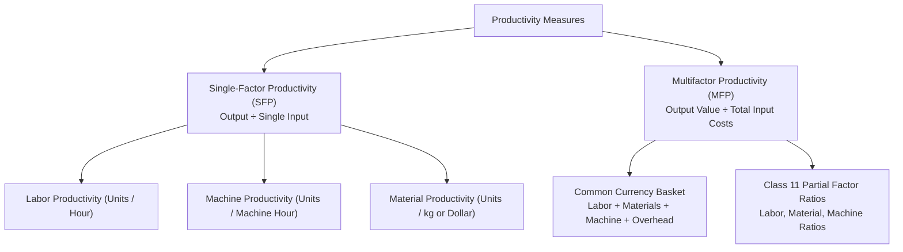

[← Previous: O02.2b: Q-System Daily Demand and MCU Problems](O02.2b_Q_System_Daily_Demand_and_MCU_Problems.md) | [🏠 Index](00_Index.md) | [📐 Master Sheet](99_Master_Formula_and_Statutory_Sheet.md) | [Next: O03.2: Productivity Decline, Human Factors, and Industry 4.0 →](O03.2_Productivity_Decline_Human_Factors_and_Industry_4_0.md)

---

# O03.1: Productivity Formulas, SFP, MFP, and Numericals

> [!info] ⚡ Exam Snapshot
> - **Section & Priority:** Section B (CO3 · Operational Management · MRI Sir) · 🔴 Prime Final Lock (Class 11) · **Read Time:** ~6 mins
> - **PYQs Covered:** Class 11 Core Board Topic, 7 Solved Lecture Scenarios + 10-Mark Model Problem
> - **Scoring Rule:** State formulas with explicit units, convert all inputs to common currency for MFP, maintain sign in $\% \Delta P$, answer the 3 diagnostic questions when productivity falls, and state partial factor ratios.

---

## 📌 1. Verbatim Definitions (For 2-Mark Questions)

> **Productivity:** "Productivity is a measure of how efficiently inputs (such as labor, materials, and capital) are used to produce outputs (goods or services). In its simplest form, productivity is expressed as the ratio of output to input." *(MRI Sir Lecture Notes, Slide 2)*

*Plain meaning:* A fundamental operational metric that measures how effectively an organization converts economic resources into finished goods or services.

> **Single-Factor Productivity (SFP):** "A productivity measure that evaluates output relative to a single input resource, such as labor hours, machine hours, or capital." *(Class 11 Lecture Notes)*

*Plain meaning:* An operational measure that assesses production output against one specific input resource at a time, most commonly worker labor hours.

> **Multifactor Productivity (MFP):** "A productivity measure that evaluates output relative to a combination of resources, such as labor, materials, energy, and capital, expressed in a common monetary currency." *(Class 11 Lecture Notes)*

*Plain meaning:* A comprehensive efficiency measure that compares the total monetary value of goods produced against the sum of all input expenses converted into a shared currency.

> **Partial Factor Ratios:** "Monetary or unit ratios that compare total output value directly against individual cost items in a multifactor setting." *(MRI Sir, Raidah Class 11 Board Notes)*

*Plain meaning:* Diagnostic ratios that evaluate how much sales revenue or physical output is generated per dollar spent on a single cost category like labor, raw materials, or machine overhead.

---

## ⚡ 2. Core Exam Blocks (Write Directly in Exam)

### Fundamental Formulas & Operational Principles

#### 1. Fundamental Productivity Ratio

$$
\text{Productivity} = \frac{\text{Output}}{\text{Input}}
$$

- **Numerator (Output):** Measured in physical counts (units, shirts, smartphones) or total sales value ($\text{Quantity} \times \text{Selling Price}$).
- **Denominator (Input):** Measured in physical resources (hours, kilograms) or total operating expenses in monetary units.

#### 2. Output Monetary Value Formulation

$$
\text{Output Value} = \text{Quantity} \times \text{Selling Price}
$$

#### 3. Three Operational Paths to Increase Productivity

- *Path 1 (Grow Output with Constant Input):* Increase total output while holding labor and machine hours steady through better line balancing.
- *Path 2 (Cut Input with Constant Output):* Produce the required quota while reducing waste, scrap, and energy consumption.
- *Path 3 (Ideal Path):* Grow output while reducing input resources simultaneously through modern automation.

#### 4. Why Productivity is a Relative Metric

An isolated numerical value (such as 4.0 phones per hour) has no operational meaning by itself. Meaningful evaluation requires comparison against three standards:

- Historical records (performance during the previous month or prior shift).
- Planned operating standards (engineering quotas and budgeted targets).
- Competitor benchmarks (industry standards across competing manufacturers).

---

### Single-Factor vs. Multifactor Productivity

#### Single-Factor Formulas

Single-Factor Productivity evaluates output relative to one resource at a time:

**Labor Productivity:**

$$
P_{\text{labor}} = \frac{\text{Total Output (Units)}}{\text{Total Labor Hours}}
$$

**Unit Labor Requirement (Inverse Ratio):**

$$
\text{Unit Labor Requirement} = \frac{\text{Total Labor Hours}}{\text{Total Output (Units)}} = \frac{1}{P_{\text{labor}}}
$$

**Machine Productivity:**

$$
P_{\text{machine}} = \frac{\text{Total Output (Units)}}{\text{Machine Operating Hours}}
$$

#### The Single-Factor Automation Trap

Relying exclusively on labor productivity can mislead operations managers:

- If a plant invests \$500,000 in an automated robotic workstation, labor hours may plunge by 80%.
- This reduction causes labor productivity to surge five-fold (+500%).
- However, machine depreciation, electrical power, and maintenance fees rise sharply.
- As a consequence, overall unit manufacturing cost can actually increase.
- Management must calculate Multifactor Productivity to evaluate the true financial impact.

#### Multifactor Productivity (MFP) in Common Currency

Because worker hours, kilograms of raw materials, and kilowatt-hours cannot be added together directly, convert all inputs into a common currency:

$$
\text{MFP} = \frac{\text{Total Output Value}}{\text{Labor Cost} + \text{Material Cost} + \text{Machine Cost} + \text{Overhead Cost}}
$$

Evaluating operational solvency from the resulting ratio:

- $\text{MFP} > 1.0$: The facility is profitable because sales revenue exceeds operating expenditure.
- $\text{MFP} = 1.0$: The facility breaks even on direct operating expenses.
- $\text{MFP} < 1.0$: Operating expenses exceed sales revenue, resulting in an operational loss.

#### Class 11 Three Partial Factor Ratios

Demonstrated by MRI Sir on the lecture board to isolate returns on individual cost categories:

**1. Labour Factor Ratio:**

$$
\text{Labour Ratio} = \frac{\text{Total Output Value}}{\text{Total Labor Cost}} = \frac{\text{Units} \times \text{Price}}{\text{Labor Hours} \times \text{Hourly Wage}}
$$

**2. Material Factor Ratio:**

$$
\text{Material Ratio (Monetary)} = \frac{\text{Total Output Value}}{\text{Total Material Cost}}
$$

$$
\text{Material Ratio (Physical)} = \frac{\text{Total Output Units}}{\text{Total Material Cost}}
$$

**3. Machine Factor Ratio:**

$$
\text{Machine Ratio (Monetary)} = \frac{\text{Total Output Value}}{\text{Total Machine Overhead Cost}}
$$

$$
\text{Machine Ratio (Physical)} = \frac{\text{Total Output Units}}{\text{Total Machine Overhead Cost}}
$$

---

### Period-over-Period Growth and Diagnostic Framework

#### Percentage Change Formula

$$
\% \Delta P = \frac{P_{\text{new}} - P_{\text{old}}}{P_{\text{old}}} \times 100\%
$$

Always preserve the mathematical sign. A positive sign ($+\% \Delta P$) indicates efficiency gains, while a negative sign ($-\% \Delta P$) confirms productivity decline.

#### MRI Sir's 3 Diagnostic Questions (Mandatory when $\% \Delta P < 0$)

- *Question 1 (Why has productivity decreased?):* Assembly bottlenecks, worker fatigue, machine breakdowns, or defective raw materials.
- *Question 2 (What is the operational solution?):* Rebalance workstations, introduce ergonomic supports, schedule preventative maintenance, and inspect incoming supplies.
- *Question 3 (What actions must management take?):* Enforce standard operating procedures (SOPs), retrain operators, and revise quality incentive structures.

---

### Side-by-Side Comparison: SFP vs. MFP

| Feature | Single-Factor Productivity (SFP) | Multifactor Productivity (MFP) |
| :--- | :--- | :--- |
| **Resource Scope** | Evaluates exactly one input resource (labor or machine). | Evaluates multiple inputs together in a combined denominator. |
| **Measurement Unit** | Physical units per input unit (such as shirts/hour, desks/hour). | Dimensionless monetary ratio or physical units per dollar spent. |
| **Managerial View** | Narrow. Can show false gains when capital replaces labor. | Comprehensive. Captures total cost trade-offs across all inputs. |
| **Data Collection** | Fast and easy to record directly on the factory floor. | Requires detailed wage records, supplier invoices, and overhead accounting. |
| **Primary Use** | Daily line tracking, shift comparisons, and worker scheduling. | Strategic budgeting, automation reviews, and plant investments. |

> [!tip] Memory Hook: Output Triangle & L-M-M-O Basket
> - **Output Triangle:** $\text{Output} = \text{Productivity} \times \text{Input}$. Place Output at the top; cover any variable to get its formula.
> - **L-M-M-O Basket:** The four standard cost items in the MFP denominator are **L**abor + **M**aterials + **M**achines + **O**verhead.

---

## 🎯 3. PYQ & Target Answer Key

### Target Q1 · Definition of Productivity and Relative Nature (02 Marks)

**Verbatim Question:**

Define productivity in operations management. Why is productivity considered a relative measure rather than an absolute indicator?

**Model Answer:**

Productivity measures how efficiently an organization converts economic inputs into valuable outputs. In operations management, it is formulated as the ratio of output produced to input consumed:

$$
\text{Productivity} = \frac{\text{Output}}{\text{Input}}
$$

- **Output:** The quantity of finished goods produced or services delivered, expressed in physical units or total sales revenue.
- **Input:** The resources consumed during the conversion process, such as labor hours, machine hours, materials, or total operating expenses.

Productivity is considered a relative measure because a standalone numerical figure offers little managerial meaning without context. For example, producing 4.0 phones per hour does not reveal whether a line is performing well until compared against:

1. Past operational records (prior shifts or historical months).
2. Budgeted engineering quotas (planned management targets).
3. Industry benchmarks (performance of competing manufacturers).

---

### Target Q2 · Single-Factor vs. Multifactor Productivity Comparison (03 Marks)

**Verbatim Question:**

Distinguish between Single-Factor Productivity (SFP) and Multifactor Productivity (MFP). Provide mathematical formulas and a structured comparison table.

**Model Answer:**

Operations managers categorize productivity by the scope of resources evaluated:

1. **Single-Factor Productivity (SFP):** Evaluates output relative to one specific input resource:

$$
\text{SFP} = \frac{\text{Total Output}}{\text{Single Resource Input}} \quad \implies \quad P_{\text{labor}} = \frac{\text{Total Output (Units)}}{\text{Total Labor Hours}}
$$

2. **Multifactor Productivity (MFP):** Evaluates output relative to multiple combined inputs converted into a common monetary currency:

$$
\text{MFP} = \frac{\text{Total Output Value}}{\text{Labor Cost} + \text{Material Cost} + \text{Machine Cost} + \text{Overhead Cost}}
$$

**Structured Comparison Table:**

| Feature | Single-Factor Productivity (SFP) | Multifactor Productivity (MFP) |
| :--- | :--- | :--- |
| **Input Scope** | Exactly one input resource (labor or machine). | Multiple inputs combined in a shared denominator. |
| **Measurement Unit** | Physical units per input unit (e.g. shirts/hour). | Dimensionless monetary ratio or units per dollar. |
| **Operational View** | Narrow. Misleads when capital replaces labor. | Comprehensive. Captures all operational expenditures. |
| **Data Collection** | Simple and fast to collect on the shop floor. | Requires detailed cost sheets and accounting overhead. |
| **Decision Role** | Daily line tracking and shift scheduling. | Strategic capital planning and automation decisions. |

---

### Target Q3 · Single-Factor Labor Productivity Across Four Operational Sectors (04 Marks)

**Verbatim Question:**

Calculate the single-factor labor productivity for each of the following four operational scenarios:

- (a) An office furniture factory produces 500 desks using 1,200 labor hours.
- (b) A garment plant produces 1,800 T-shirts using 600 labor hours.
- (c) A training organization conducts 40 workshops using 800 trainer hours with an average of 15 participants per workshop.
- (d) A micro-credit agency disburses 300 loans using 900 loan officer hours.

**Complete Board Solution:**

#### Part (a): Furniture Desk Factory

- Output = $500\text{ desks}$
- Labor input = $1,200\text{ hours}$

$$
P_{\text{labor}} = \frac{500\text{ desks}}{1,200\text{ hours}} = \mathbf{0.4167\text{ desks/hour}}
$$

Equivalently, the unit labor requirement is:

$$
\text{Unit Labor Requirement} = \frac{1,200\text{ hours}}{500\text{ desks}} = \mathbf{2.40\text{ hours/desk}}
$$

#### Part (b): Garment T-Shirt Plant

- Output = $1,800\text{ T-shirts}$
- Labor input = $600\text{ hours}$

$$
P_{\text{labor}} = \frac{1,800\text{ T-shirts}}{600\text{ hours}} = \mathbf{3.00\text{ shirts/hour}}
$$

Equivalently, each shirt requires:

$$
\text{Unit Labor Requirement} = \frac{600\text{ hours}}{1,800\text{ shirts}} = \mathbf{0.333\text{ hours/shirt}} \quad (20\text{ minutes/shirt})
$$

#### Part (c): NGO Youth Vocational Training

- Workshops = $40$
- Participants per workshop = $15$
- Total participants = $40 \times 15 = 600\text{ trainees}$
- Trainer input = $800\text{ hours}$

1. Workshop completion rate:

$$
P_{\text{workshop}} = \frac{40\text{ workshops}}{800\text{ hours}} = \mathbf{0.050\text{ workshops/trainer hour}} \quad (20\text{ hours/workshop})
$$

2. Trainee participant rate:

$$
P_{\text{participant}} = \frac{600\text{ trainees}}{800\text{ hours}} = \mathbf{0.750\text{ trainees/trainer hour}}
$$

#### Part (d): NGO Micro-Credit Program

- Output = $300\text{ loans}$
- Labor input = $900\text{ officer hours}$

$$
P_{\text{loan}} = \frac{300\text{ loans}}{900\text{ hours}} = \mathbf{0.3333\text{ loans/officer hour}}
$$

Equivalently, loan processing duration is:

$$
\text{Time per Loan} = \frac{900\text{ hours}}{300\text{ loans}} = \mathbf{3.00\text{ officer hours/loan}}
$$

---

### Target Q4 · Period-over-Period Labor Productivity Evaluation: Apple Plant (04 Marks)

**Verbatim Question:**

Apple's smartphone assembly plant in China produced 200,000 iPhones in Month 2 using 50,000 labor hours. In Month 1, the same plant produced 220,000 iPhones using 50,000 labor hours.

- (i) Compute the labor productivity for both Month 1 and Month 2.
- (ii) Calculate the period-over-period percentage change in labor productivity.
- (iii) Interpret the operational meaning of this result for the plant manager.

**Complete Board Solution:**

#### Step 1: Compute Monthly Labor Indices

For Month 1 (Base Period):

$$
P_1 = \frac{\text{Output}_1}{\text{Labor Input}_1} = \frac{220,000\text{ iPhones}}{50,000\text{ hours}} = \mathbf{4.40\text{ iPhones/hour}}
$$

For Month 2 (Current Period):

$$
P_2 = \frac{\text{Output}_2}{\text{Labor Input}_2} = \frac{200,000\text{ iPhones}}{50,000\text{ hours}} = \mathbf{4.00\text{ iPhones/hour}}
$$

#### Step 2: Compute Period-over-Period Percentage Change

Apply the standard percentage change formula:

$$
\% \Delta P = \frac{P_{\text{new}} - P_{\text{old}}}{P_{\text{old}}} \times 100\% = \frac{P_2 - P_1}{P_1} \times 100\%
$$

Substitute the calculated values:

$$
\% \Delta P = \frac{4.00 - 4.40}{4.40} \times 100\% = \frac{-0.40}{4.40} \times 100\% = \mathbf{-9.09\%}
$$

#### Step 3: Managerial Interpretation

1. **Core Finding:** Labor productivity dropped by $9.09\%$. The plant produced 20,000 fewer phones for the exact same labor investment (50,000 worker hours).
2. **Root Causes:** Assembly line imbalance, worker fatigue, component delivery delays, or machine downtime.
3. **Corrective Action Plan:** Rebalance assembly stations, inspect supplier component shipments, and enforce standardized assembly procedures.

---

### Target Q5 · Multifactor Productivity Suite in Common Currency (04 Marks)

**Verbatim Question:**

Calculate the Multifactor Productivity (MFP) for each of the following manufacturing and service operations:

- (a) A furniture factory produces 500 desks selling at \$100 each. Inputs include 1,200 labor hours at \$15/hr, \$9,000 wood materials, and 500 machine hours at \$10/hr.
- (b) A garment unit produces 1,800 T-shirts selling at \$10 each. Inputs include 600 labor hours at \$14/hr, \$2,500 fabric, and 300 machine hours at \$8/hr.
- (c) A university delivers 25 certificate courses to 20 students per course at \$500 tuition per student. Inputs include 1,000 faculty hours at \$30/hr, \$4,000 materials, and \$2,000 IT infrastructure.
- (d) A commercial bakery produces 2,400 loaves of bread in a week. Inputs include 300 labor hours at \$12/hr, \$600 ingredients, and \$200 oven electricity.

**Complete Board Solution:**

#### Part (a): Furniture Desk Plant MFP

Calculate total output sales value:

$$
\text{Total Output Value} = 500\text{ desks} \times \$100 = \$50,000
$$

Sum the specified input costs:

- Labor cost: $1,200\text{ hours} \times \$15/\text{hour} = \$18,000$
- Material cost: $\$9,000$
- Machine cost: $500\text{ hours} \times \$10/\text{hour} = \$5,000$

$$
\text{Total Specified Input Cost} = \$18,000 + \$9,000 + \$5,000 = \$32,000
$$

Compute MFP:

$$
\text{MFP} = \frac{\$50,000}{\$32,000} = \mathbf{1.5625}
$$

*(If management includes other overhead of \$2,000, total input cost becomes \$34,000, yielding $\text{MFP} = \frac{\$50,000}{\$34,000} \approx \mathbf{1.4706}$).*

#### Part (b): Garment T-Shirt Plant MFP

Calculate total output sales value:

$$
\text{Total Output Value} = 1,800\text{ T-shirts} \times \$10 = \$18,000
$$

Sum the specified input costs:

- Labor cost: $600\text{ hours} \times \$14/\text{hour} = \$8,400$
- Material cost: $\$2,500$
- Machine cost: $300\text{ hours} \times \$8/\text{hour} = \$2,400$

$$
\text{Total Input Cost} = \$8,400 + \$2,500 + \$2,400 = \$13,300
$$

Compute MFP:

$$
\text{MFP} = \frac{\$18,000}{\$13,300} \approx \mathbf{1.3534}
$$

*(If other overhead of \$700 is included per management instruction, total input cost becomes \$14,000, yielding $\text{MFP} = \frac{\$18,000}{\$14,000} \approx \mathbf{1.2857}$).*

#### Part (c): Professional University MFP

Calculate total enrolled students and tuition revenue:

- Total students: $25\text{ courses} \times 20\text{ students} = 500\text{ students}$
- Total tuition revenue: $500 \times \$500 = \$250,000$

Sum the input costs:

- Faculty payroll: $1,000\text{ hours} \times \$30/\text{hour} = \$30,000$
- Course materials: $\$4,000$
- IT infrastructure: $\$2,000$

$$
\text{Total Input Cost} = \$30,000 + \$4,000 + \$2,000 = \$36,000
$$

Compute MFP:

$$
\text{MFP} = \frac{\$250,000}{\$36,000} \approx \mathbf{6.944}
$$

The program generates $\$6.944$ in tuition revenue for every $\$1.00$ expended.

#### Part (d): Commercial Bakery MFP

Physical output: $2,400\text{ loaves of bread}$.

Sum the specified input costs:

- Labor cost: $300\text{ hours} \times \$12/\text{hour} = \$3,600$
- Flour and ingredients: $\$600$
- Oven electricity: $\$200$

$$
\text{Total Specified Input Cost} = \$3,600 + \$600 + \$200 = \$4,400
$$

Compute physical MFP:

$$
\text{MFP (Physical)} = \frac{2,400\text{ loaves}}{\$4,400} \approx \mathbf{0.5455\text{ loaves/\$}}
$$

Equivalently, the unit production cost is:

$$
\text{Unit Cost} = \frac{\$4,400}{2,400\text{ loaves}} = \mathbf{\$1.833/\text{loaf}}
$$

*(If bread sells at \$2.50 per loaf, total output value is $\$6,000$, yielding monetary $\text{MFP} = \frac{\$6,000}{\$4,400} \approx \mathbf{1.3636}$; with \$400 additional overhead, $\text{MFP} = \frac{\$6,000}{\$4,800} = \mathbf{1.25}$).*

---

### Target Q6 · Apple Plant Multifactor Productivity and Three Partial Factor Ratios (04 Marks)

**Verbatim Question:**

Apple's smartphone assembly plant produced 200,000 iPhones last month. Each phone sells for a wholesale price of \$700. The plant incurred the following production inputs:

- Labor: 50,000 hours at \$25 per hour
- Components and raw materials: \$25,000,000
- Machine depreciation and electricity overhead: \$5,000,000

**Required:**

- (i) Compute the total input cost and overall Multifactor Productivity (MFP).
- (ii) Calculate the three partial factor ratios taught by MRI Sir in Class 11 (Labour Factor Ratio, Material Factor Ratio, and Machine Factor Ratio).

**Complete Board Solution:**

#### Step 1: Total Input Cost and Overall MFP

Calculate total wholesale output value:

$$
\text{Total Output Value} = 200,000\text{ iPhones} \times \$700 = \$140,000,000
$$

Sum the input cost categories:

- Labor cost: $50,000\text{ hours} \times \$25/\text{hour} = \$1,250,000$
- Material cost: $\$25,000,000$
- Machine overhead: $\$5,000,000$

$$
\text{Total Input Cost} = \$1,250,000 + \$25,000,000 + \$5,000,000 = \$31,250,000
$$

Compute overall MFP:

$$
\text{MFP} = \frac{\$140,000,000}{\$31,250,000} = \mathbf{4.48}
$$

The plant produces $\$4.48$ of wholesale output for every $\$1.00$ of total operating expense.

*(Class 11 Variant: With \$6,000,000 machine overhead, total cost is \$32,250,000, yielding $\text{MFP} = \frac{\$140\text{M}}{\$32.25\text{M}} \approx \mathbf{4.34}$).*

#### Step 2: The Three Class 11 Partial Factor Ratios

**1. Labour Factor Ratio:**

$$
\text{Labour Ratio} = \frac{\text{Total Output Value}}{\text{Total Labor Cost}} = \frac{\$140,000,000}{\$1,250,000} = \mathbf{112.0}
$$

Every \$1.00 paid to assembly workers generates \$112.00 of wholesale smartphone output.

**2. Material Factor Ratio:**

- Monetary basis:

$$
\text{Material Ratio (Monetary)} = \frac{\$140,000,000}{\$25,000,000} = \mathbf{5.60}
$$

- Physical basis:

$$
\text{Material Ratio (Physical)} = \frac{200,000\text{ iPhones}}{\$25,000,000} = \mathbf{0.008\text{ iPhones/\$}}
$$

**3. Machine Factor Ratio:**

- Monetary basis (with \$5M overhead):

$$
\text{Machine Ratio (Monetary)} = \frac{\$140,000,000}{\$5,000,000} = \mathbf{28.00}
$$

- Physical basis (with \$5M overhead):

$$
\text{Machine Ratio (Physical)} = \frac{200,000\text{ iPhones}}{\$5,000,000} = \mathbf{0.040\text{ iPhones/\$}}
$$

*(With Raidah's \$6M machine overhead variant: Monetary Ratio is $\frac{\$140\text{M}}{\$6\text{M}} \approx \mathbf{23.33}$, and Physical Ratio is $\frac{200,000}{\$6\text{M}} \approx \mathbf{0.0333\text{ iPhones/\$}}$).*

---

### Target Q7 · Comprehensive 10-Mark Model Problem: Packaging Company

**Verbatim Question:**

A regional packaging company produces corrugated shipping cartons selling at \$5 per carton. The production records for Month 1 and Month 2 show:

- **Month 1:** Produced 32,000 cartons using 8,000 labor hours at \$5/hr, \$40,000 raw cardboard materials, and \$10,000 machine overhead.
- **Month 2:** Produced 25,600 cartons using 8,000 labor hours at \$5/hr, \$45,000 raw cardboard materials, and \$10,000 machine overhead.

**Required:**

- (a) Define Single-Factor Productivity and Multifactor Productivity with mathematical formulas. *(02 Marks)*
- (b) Calculate for both Month 1 and Month 2:
  - (i) Labor Productivity (cartons per labor hour),
  - (ii) Total Multifactor Productivity (MFP), and
  - (iii) The percentage change in both productivity measures. *(04 Marks)*
- (c) Construct a comparative summary table and provide a concise managerial diagnosis explaining why productivity declined. *(04 Marks)*

**Complete Board Solution:**

#### Part (a): Definitions and Formulas

1. **Single-Factor Productivity (SFP):** Measures output relative to a single input resource:

$$
P_{\text{labor}} = \frac{\text{Total Output (Units)}}{\text{Total Labor Hours}}
$$

2. **Multifactor Productivity (MFP):** Measures output relative to all combined operating costs converted into a common currency:

$$
\text{MFP} = \frac{\text{Total Output Value}}{\text{Labor Cost} + \text{Material Cost} + \text{Machine Cost} + \text{Overhead Cost}}
$$

#### Part (b): Step-by-Step Numerical Solution

**1. Month 1 Base Calculations:**

- Output quantity: $Q_1 = 32,000\text{ cartons}$
- Output sales value: $32,000 \times \$5 = \$160,000$
- Labor cost: $8,000\text{ hours} \times \$5/\text{hour} = \$40,000$
- Material cost: $\$40,000$
- Machine overhead: $\$10,000$
- Total input cost: $\$40,000 + \$40,000 + \$10,000 = \$90,000$

$$
P_{\text{labor}, 1} = \frac{32,000\text{ cartons}}{8,000\text{ hours}} = \mathbf{4.00\text{ cartons/hour}}
$$

$$
\text{MFP}_1 = \frac{\$160,000}{\$90,000} \approx \mathbf{1.778}
$$

**2. Month 2 Current Calculations:**

- Output quantity: $Q_2 = 25,600\text{ cartons}$
- Output sales value: $25,600 \times \$5 = \$128,000$
- Labor cost: $8,000\text{ hours} \times \$5/\text{hour} = \$40,000$
- Material cost: $\$45,000$ (increased due to high raw cardboard scrap)
- Machine overhead: $\$10,000$
- Total input cost: $\$40,000 + \$45,000 + \$10,000 = \$95,000$

$$
P_{\text{labor}, 2} = \frac{25,600\text{ cartons}}{8,000\text{ hours}} = \mathbf{3.20\text{ cartons/hour}}
$$

$$
\text{MFP}_2 = \frac{\$128,000}{\$95,000} \approx \mathbf{1.347}
$$

**3. Percentage Changes:**

**Percentage change in labor productivity:**

$$
\% \Delta P_{\text{labor}} = \frac{3.20 - 4.00}{4.00} \times 100\% = \frac{-0.80}{4.00} \times 100\% = \mathbf{-20.00\%}
$$

**Percentage change in multifactor productivity:**

$$
\% \Delta \text{MFP} = \frac{1.347 - 1.778}{1.778} \times 100\% = \frac{-0.431}{1.778} \times 100\% = \mathbf{-24.24\%}
$$

#### Part (c): Comparative Summary Table and Managerial Diagnosis

**Comparative Summary Table:**

| Metric / Parameter | Month 1 (Base) | Month 2 (Current) | Absolute Change | Percentage Change |
| :--- | :---: | :---: | :---: | :---: |
| **Output Quantity** | $32,000\text{ cartons}$ | $25,600\text{ cartons}$ | $-6,400\text{ cartons}$ | $-20.00\%$ |
| **Output Sales Value** | $\$160,000$ | $\$128,000$ | $-\$32,000$ | $-20.00\%$ |
| **Labor Hours** | $8,000\text{ hours}$ | $8,000\text{ hours}$ | $0\text{ hours}$ | $0.00\%$ |
| **Total Input Cost** | $\$90,000$ | $\$95,000$ | $+\$5,000$ | $+5.56\%$ |
| **Labor Productivity** | $4.00\text{ cartons/hr}$ | $3.20\text{ cartons/hr}$ | $-0.80\text{ cartons/hr}$ | $\mathbf{-20.00\%}$ |
| **Multifactor Productivity** | $1.778$ | $1.347$ | $-0.431$ | $\mathbf{-24.24\%}$ |

**Managerial Diagnosis:**

1. **Labor Productivity Drop ($-20.00\%$):** The workforce consumed the identical 8,000 labor hours but completed 6,400 fewer cartons. This indicates manual line bottlenecks, operator fatigue, or excessive rework.
2. **Multifactor Productivity Drop ($-24.24\%$):** MFP declined even more severely than labor productivity. Raw cardboard expenditures increased from \$40,000 to \$45,000 despite producing less finished product. This confirms severe material scrap and substandard cardboard quality.
3. **Corrective Action Plan:** Audit cardboard supplier quality, rebalance folding workstations, and enforce standardized operating procedures on the assembly line.

---

> [!warning] ⚠️ Examiner Traps
> - **The Common Currency Requirement:** Never sum hours, kilograms, and kilowatt-hours directly in MFP. Convert all input resources to monetary currency first.
> - **Retaining the Minus Sign:** When productivity drops, always write $-\% \Delta P$ explicitly. Stating a positive number when efficiency drops loses marks.
> - **Handling Excluded Overhead:** Read exam prompts carefully. If overhead is excluded, calculate on specified inputs; if unspecified, state both figures to secure full credit.
> - **Three Diagnostic Questions:** Always state MRI Sir's three questions (Why decreased? Operational solution? Management action?) whenever an exam scenario shows negative growth.

---

[← Previous: O02.2b: Q-System Daily Demand and MCU Problems](O02.2b_Q_System_Daily_Demand_and_MCU_Problems.md) | [🏠 Index](00_Index.md) | [📐 Master Sheet](99_Master_Formula_and_Statutory_Sheet.md) | [Next: O03.2: Productivity Decline, Human Factors, and Industry 4.0 →](O03.2_Productivity_Decline_Human_Factors_and_Industry_4_0.md)
