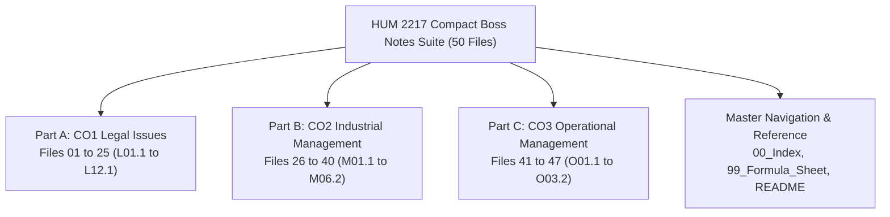

[🏠 Open 1-Day Survival Index (00_Index.md)](00_Index.md) | [📐 30-Min Master Sheet](99_Master_Formula_and_Statutory_Sheet.md) | [🚀 Start Studying: L01.1 →](L01.1_Definitions_of_Law_and_Society.md)

---

# HUM 2217: Compact Boss Notes (1-Day Exam Rescue)

Welcome to the **Compact Boss Notes Suite** for **HUM 2217: Legal Issues, Industrial & Operational Management**. This suite is built for RUET ECE 2-2 students.

We built these notes for students who have only 24 hours left before the exam. At this stage, reading long textbooks or huge lecture slides takes too much time. These notes cut out the fluff. They give you plain, direct explanations while keeping 100% of the scoring rules, section numbers, and exam formulas.

---

## 1. Why These Compact Notes Exist

Most study guides repeat the same ideas over and over. They use long, confusing sentences that give you a headache. These compact notes fix that:

- **75% Less Reading:** We explain every fact, law section, and management theory only once.
- **Super Fast Reads:** Each subtopic takes only 3 to 5 minutes to read and understand.
- **100% Exam Coverage:** Covers every question from the last four final exams (2020 to 2024) and all 2025 Class Tests.
- **High-Yield Exam Locks:** Focuses on Shoaib Sir's voice-note suggestions and Dr. Md. Rabiul Islam Sir's Class 11 board problems.
- **Short, Everyday Words:** Sentences are short (under 20 words) and easy to read on the first try.

---

## 2. Standard 4-Part Note Layout

Every note in this folder uses the same 4-part structure. This helps you review fast and remember key points:

1. **⚡ Exam Snapshot:**
   - Shows the exam priority, reading time, past marks, and key takeaways.
   - Tells you what the examiner wants to see on your paper.

2. **📌 1. Verbatim Definitions (For 2-Mark Questions):**
   - Gives the exact legal quote from the Contract Act 1872 or BLC 2006, or the official textbook definition.
   - Includes a *Plain meaning* explanation right below the quote in simple everyday words.

3. **⚡ 2. Core Exam Blocks (Write Directly in the Exam):**
   - Puts comparisons into clean, quick-read tables.
   - Breaks legal rules, timelines, and management functions into simple numbered points.
   - Includes memory tricks, worker count ladders, and clear diagrams.

4. **🎯 3. Past Question Answer Plans:**
   - Theory answers give you an easy-to-follow plan: definition, key points, and conclusion.
   - Legal case studies use Shoaib Sir's 4-step structure: 1. Facts, 2. Law & Section, 3. Analysis, and 4. Conclusion.
   - Inventory math questions use Dr. Md. Rabiul Islam Sir's 6-step board layout with full calculations.

---

## 3. High-Yield Exam Locks Quick-Jump

Jump directly to the highest-scoring topics on the final examination:

- 📦 **[Continuous Review ($Q$) System: O02.2a](O02.2a_Q_System_Method_and_Weekly_Demand_Problems.md) & [O02.2b](O02.2b_Q_System_Daily_Demand_and_MCU_Problems.md):** Guaranteed 10-mark board math problem. Covers weekly and daily demand conversions, inventory position checks, and complete sawtooth graphs.
- ⚙️ **[Productivity Formulas & Math: O03.1](O03.1_Productivity_Formulas_SFP_MFP_and_Numericals.md):** High-yield math problem. Covers Single-Factor and Multifactor Productivity, percentage changes, and fixes for falling output.
- ⚖️ **[Doctrine of Frustration (`Sec 56`): L04.2](L04.2_Doctrine_of_Frustration_and_Case_Studies.md):** Shoaib Sir's confirmed 10-mark case study. Uses the 4-step case format to distinguish real impossibility from simple commercial hardship.
- 👶 **[Maternity Benefits (`Sec 45–50`): L06.1](L06.1_Maternity_Benefits_Sec_45_to_50.md):** High-probability law question. Covers 16 weeks of paid leave, qualification rules, notice procedures, and daily wage calculations.
- 🧯 **[Workplace Fire Safety (`Sec 62`): L07.1](L07.1_Fire_Safety_Precautions_Sec_62.md):** Fire safety rules for escape stairs, outward doors, red Bangla signs, and mock fire drills.
- 🏢 **[Welfare Facilities Ladder (`Sec 89–94`): L08.1](L08.1_Welfare_Measures_Sec_89_to_99.md):** Worker thresholds for first-aid boxes, clinics, canteens, lunch rooms, and children's crèches.
- 🤝 **[Dispute Settlement Ladder (`Sec 210`): L11.2](L11.2_Industrial_Disputes_and_Settlement_Ladder_Sec_210.md):** 3-stage dispute resolution through direct two-sided talks, conciliation, and optional arbitration.
- 📐 **[Master Formula & Statutory Sheet (File 99)](99_Master_Formula_and_Statutory_Sheet.md):** Rapid 30-minute memory sheet. Contains all verified law sections, inventory formulas, and memory acronyms.

---

## 4. Suite Architecture & Navigation Map

### Complete 47-Note Subtopic Directory

| Part | Topic | Compact Boss Note Files |
| :--- | :--- | :--- |
| **CO1 Legal Issues** | **L01 · Introduction to Law** | [`L01.1`](L01.1_Definitions_of_Law_and_Society.md) · [`L01.2`](L01.2_Industrial_Law_vs_Labour_Law.md) · [`L01.3`](L01.3_Why_ECE_Students_Must_Learn_Law.md) |
| **CO1 Legal Issues** | **L02 · Contract Basics** | [`L02.1`](L02.1_Contract_Agreement_Void_and_Voidable.md) · [`L02.2`](L02.2_Essential_Elements_of_Valid_Contract.md) · [`L02.3`](L02.3_Offer_and_Acceptance_Rules.md) · [`L02.4`](L02.4_Applied_ECE_Tenders_and_RD_Contract_Risks.md) |
| **CO1 Legal Issues** | **L03 · Consideration** | [`L03.1`](L03.1_Consideration_Definition_Types_and_Rules.md) · [`L03.2`](L03.2_Exceptions_to_No_Consideration_No_Contract.md) |
| **CO1 Legal Issues** | **L04 · Discharge & Frustration** | [`L04.1`](L04.1_Modes_of_Discharge_of_Contract.md) · [`L04.2`](L04.2_Doctrine_of_Frustration_and_Case_Studies.md) |
| **CO1 Legal Issues** | **L05 · BLC Definitions & Hours** | [`L05.1`](L05.1_BLC_Core_Definitions_and_Age_Classes.md) · [`L05.2`](L05.2_Adolescent_Working_Hours_Sec_41.md) · [`L05.3`](L05.3_Applied_Factory_Compliance_and_Adult_Hours.md) |
| **CO1 Legal Issues** | **L06 · Maternity Benefits** | [`L06.1`](L06.1_Maternity_Benefits_Sec_45_to_50.md) |
| **CO1 Legal Issues** | **L07 · Workplace & Fire Safety** | [`L07.1`](L07.1_Fire_Safety_Precautions_Sec_62.md) · [`L07.2`](L07.2_Machinery_Safety_and_Workplace_Duties.md) |
| **CO1 Legal Issues** | **L08 · Welfare Measures** | [`L08.1`](L08.1_Welfare_Measures_Sec_89_to_99.md) |
| **CO1 Legal Issues** | **L09 · Employment Termination** | [`L09.1`](L09.1_Termination_of_Employment_Sec_20_to_27.md) |
| **CO1 Legal Issues** | **L10 · Trade Unions** | [`L10.1`](L10.1_Trade_Union_Basics_Objectives_and_Functions.md) · [`L10.2`](L10.2_Trade_Union_Registration_and_Cancellation.md) · [`L10.3`](L10.3_Trade_Union_Legal_Status_Rights_and_Applied_Role.md) |
| **CO1 Legal Issues** | **L11 · CBA & Disputes** | [`L11.1`](L11.1_Collective_Bargaining_and_CBA_Sec_202.md) · [`L11.2`](L11.2_Industrial_Disputes_and_Settlement_Ladder_Sec_210.md) |
| **CO1 Legal Issues** | **L12 · Unfair Labour Practices** | [`L12.1`](L12.1_Unfair_Labour_Practices_Sec_195_and_196.md) |
| **CO2 Industrial Management** | **M01 · Management Foundations** | [`M01.1`](M01.1_Management_Definitions_Resources_and_Nature.md) · [`M01.2`](M01.2_Efficiency_vs_Effectiveness_and_Decision_Matrix.md) · [`M01.3`](M01.3_Management_Functions_POLC_and_Leadership.md) |
| **CO2 Industrial Management** | **M02 · Levels, Areas & Skills** | [`M02.1`](M02.1_Management_Levels_and_Functional_Areas.md) · [`M02.2`](M02.2_Managerial_Skills_Evaluation_and_Development.md) |
| **CO2 Industrial Management** | **M03 · Fayol & Taylor** | [`M03.1`](M03.1_Fayols_14_Principles_and_Scalar_Chain.md) · [`M03.2`](M03.2_Taylors_Scientific_Management.md) |
| **CO2 Industrial Management** | **M04 · Planning, Organizing & Control** | [`M04.1`](M04.1_Planning_and_Rational_Decision_Making.md) · [`M04.2`](M04.2_Organizing_Departmentalization_Delegation_and_Span.md) · [`M04.3`](M04.3_Controlling_Process_and_Steps.md) |
| **CO2 Industrial Management** | **M05 · Motivation Theories** | [`M05.1`](M05.1_Motivation_Basics_and_Financial_vs_NonFinancial.md) · [`M05.2`](M05.2_Maslow_Hierarchy_and_Herzberg_Two_Factor_Theory.md) · [`M05.3`](M05.3_Vroom_Expectancy_McGregor_XY_and_ERG_Theories.md) |
| **CO2 Industrial Management** | **M06 · HRM & Appraisal** | [`M06.1`](M06.1_HRM_Recruitment_Selection_and_Training.md) · [`M06.2`](M06.2_Performance_Appraisal_Methods_and_Rating_Errors.md) |
| **CO3 Operational Management** | **O01 · Inventory & ABC Analysis** | [`O01.1`](O01.1_Inventory_Control_and_Holding_Costs.md) · [`O01.2`](O01.2_Types_of_Inventory_and_ABC_Analysis.md) |
| **CO3 Operational Management** | **O02 · EOQ & Q-System Board Math** | [`O02.1`](O02.1_EOQ_Model_ROP_Safety_Stock_and_Cost_Curves.md) · [`O02.2a`](O02.2a_Q_System_Method_and_Weekly_Demand_Problems.md) · [`O02.2b`](O02.2b_Q_System_Daily_Demand_and_MCU_Problems.md) |
| **CO3 Operational Management** | **O03 · Productivity & Industry 4.0** | [`O03.1`](O03.1_Productivity_Formulas_SFP_MFP_and_Numericals.md) · [`O03.2`](O03.2_Productivity_Decline_Human_Factors_and_Industry_4_0.md) |

---

## 5. How to Study in Under 10 Hours

1. Open [`00_Index.md`](00_Index.md) and review the 1-Day Hour-by-Hour Exam Rescue Plan.
2. Complete **Block 1** right away to secure about 25 marks. This covers Continuous Review ($Q$) System calculations and the Doctrine of Frustration case study.
3. Work through **Block 2** to secure about 20 marks. This covers Shoaib Sir's key legal sections and BLC workplace rules.
4. Study **Block 3** to lock in about 15 marks. Learn Dr. Md. Rabiul Islam Sir's management theories, classical principles, and appraisal errors.
5. Use **Block 4** for a quick 60-minute skim of extra notes. Then memorize [`99_Master_Formula_and_Statutory_Sheet.md`](99_Master_Formula_and_Statutory_Sheet.md) 30 minutes before entering the exam hall.

---

[🏠 Open 1-Day Survival Index (00_Index.md)](00_Index.md) | [📐 30-Min Master Sheet](99_Master_Formula_and_Statutory_Sheet.md) | [🚀 Start Studying: L01.1 →](L01.1_Definitions_of_Law_and_Society.md)
